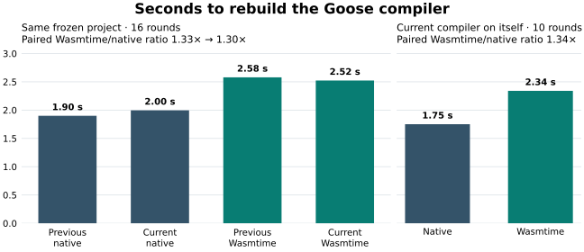
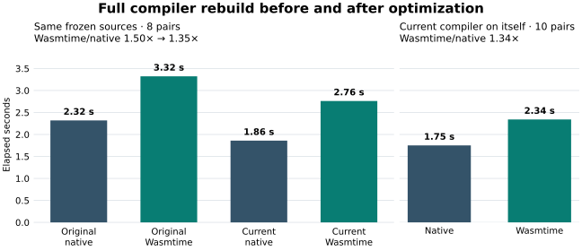
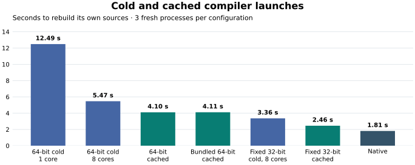

# Array shrink checks in the Goose compiler

## Rebuilding the compiler

On its own sources, compiler `673458e` took **2.34 s in cached Wasmtime and 1.75 s native**. The median within-round ratio was **1.34× native time** across 10 alternating pairs. Wasmtime ran a precompiled fixed-memory module. The timer includes process launch, instantiation, checking the project and writing its portable Wasm module. [Own-source runs](current.json)

| Frozen project at `b6c2f10` | Metric | Previous compiler | Current compiler | Paired change |
| --- | --- | ---: | ---: | ---: |
| Cached Wasmtime | Elapsed seconds | 2.58 | 2.52 | -1.03% |
| Cached Wasmtime | CPU seconds | 2.56 | 2.51 | -1.01% |
| Cached Wasmtime | Billion instructions | 19.61 | 19.47 | -0.70% |
| Native Goose | Elapsed seconds | 1.90 | 2.00 | +1.02% |
| Native Goose | CPU seconds | 1.89 | 1.97 | +0.99% |
| Native Goose | Billion instructions | 15.80 | 15.76 | -0.24% |

The table gives each compiler's median and the median of the 16 within-round changes. The Wasmtime/native ratio on these same sources moved from 1.33× to 1.30×. The resampled 95% interval for Wasmtime elapsed time was -2.45% to +4.88%. All timed compilers wrote the same 8,792,713-byte module. [Frozen rounds](frozen.json) · [Median ratios and intervals](rebuild-summary.json) · [Eight rounds during qualification](load-control.json) · [Twelve rounds during other benchmark work](interleaved-frozen.json) · [Concurrent own-source control](interleaved-current.json)

A separate Wasmtime-only repeat alternated the same two compilers for 24 pairs. Elapsed time changed by +1.54% with a 95% interval of -1.06% to +8.91%. Instructions changed by -0.70%. Other work on the shared host increased scheduling pressure during this repeat. [24 Wasmtime pairs](wasm-confirm.json) · [Host load](load.json.gz)

Across five optimization batches on the original project at `9682303`, cached Wasmtime took 15.63% less time and retired 19.45% fewer instructions. Its paired ratio went from 1.50× to 1.35× native. [Eight pairs on the original sources](campaign.json)

## What changed

When an array shrinks, the compiler checks live references and values that contain them. Many have the same type and point to the same storage. Previously the checker searched a list of up to 64 earlier answers for each holder. The new lookup divides those answers among 32 buckets and compares all three parts of the key in the selected bucket. After the cache fills, the checker continues checking new references individually.

The frozen compiler made 912,435 eligible holder visits and only three needed a later-use check. Removing the scan let three unsafe programs through. Checking later use first made a full rebuild almost ten times slower. A reference-only shortcut changed the allocation of internal storage identities, which can affect how precisely the compiler checks very large projects. The release preserves their allocation order. [Experiment results and rejected approaches](../compiler-followup/README.md#array-shrink-checks)

## Cold and cached self-compilation

A fresh eight-thread Wasmtime process took **3.36 s cold** to prepare and run the fixed 32-bit compiler. With prepared code on one core, it took **2.46 s**. Native took **1.81 s**. All three one-run-per-process configurations rebuilt the same project. [Three runs per configuration, including edited-source controls](launch.json)

## Remaining gap

In the cached own-source rebuild, the Wasm entry point accounted for 99.6% of the process time. The median time outside it was 10 ms. Wasmtime retired 23.5% more host instructions per build than native. [Process and entry-point timings](current.json)

On the current compiler, four phase measurements per engine put the additional work in Wasmtime at **3.68 billion instructions**. Lifetime checking accounted for **1.49 billion** and Wasm emission **0.85 billion**. [Phase counts and binary hashes](phase-counters.json)

Two follow-up experiments changed how the checker walks the bitmap of live holders. With six paired full builds per engine, the simpler traversal retired 0.16% fewer Wasmtime instructions and took 0.49% longer. Sharing the search for a nonempty word retired 0.29% fewer instructions and took 0.14% longer. Both preserved every output byte. The two traversal functions together occupied 0.65% of the sampled Wasmtime rebuild, so further work there has little room to close the native gap. [Profiles, trials, patches and oracle](word-trials.json.gz)

The Wasm local allocator and operand decoder accounted for 249 of 3,379 Wasmtime samples (7.37%) and 171 of 2,474 native samples (6.91%). The current allocator decodes instructions after the emitter writes them. [Exact-code sampling and compiler identities](word-trials.json.gz)

## Recording the instructions the allocator needs

The local allocator needs to know when a function reads or writes a local variable and where control flow can branch. On 1,539 archived function bodies, it decoded 13.54 million Wasm instructions to find 7.11 million relevant events. Feeding those events directly to the current allocator produced the same remapped locals and output bytes in all 48 timed runs. [Frozen workloads and capture procedure](../../2026-11-17/wasm-slot-prefix/README.md#reproduction) · [Source patch, samples and control outputs](allocator-replay.json.gz)

| Six paired rounds on the captured bodies | Native | Cached Wasmtime |
| --- | ---: | ---: |
| Allocator elapsed time with events prepared in advance | −30.6% | −37.9% |
| Simulated emission plus allocation, including event writes | −9.1% | −25.2% |
| Whole replay process, retired instructions with event writes | −8.0% | −16.0% |

The simulation copies the same encoded byte runs in both cases and charges the candidate for recording each event. It used 64.0 MB of event payload across the full capture, peaking at 1.06 MB for one function. Integration still needs to account for offsets that change when the emitter rewrites parameter accesses and inserts a function prelude. The next whole-compiler experiment can compare those offsets and each function's output bytes against the existing decoder, then time the full compiler with recording enabled. [Replay measurements and implementation](allocator-replay.json.gz)

## Reader benchmarks

Across eleven small programs, the median CPU ratios aggregated by workload were 0.984× for Wasm emission and 0.975× for C emission. Round-resampled 95% intervals were -4.16% to +0.80% and -4.80% to -0.42% respectively. The chart shows elapsed time. All 22 program and target combinations emitted identical bytes across releases. [Catalog and intervals](catalog-summary.json) · [31 sampled builds per cell](compiler-comparison.json.gz)

Across ten examples, all 100 timed build artifacts matched their counterparts from the previous release. The 30 Langbench builds also matched, including the upstream Goose and C controls. Differences between sessions running those binaries reflect measurement conditions. [Examples](examples.json.gz) · [Wasmtime process and preparation times](host.json.gz) · [Langbench builds](langbench-build.json) · [Resident execution](langbench-hot.json.gz)

The portable compiler build used the same source directory in three series. Each reproduced the same generated C, native program and Wasm module. The README uses the final series, which measured 33.10 s through C and Clang and 2.76 s for direct Wasm. Native build time varied with concurrent work and I/O pressure. [Self-host chart data](selfhost.json) · [Earlier samples](reader-controls.json.gz) · [Host load samples](load.json.gz)

## Correctness and reproduction

Bootstrap reproduced the compiler, and the previous and current versions agreed on all 10,061 contract observations. Each also produced identical lifetime traces, diagnostics and exit status for 4,394 distinct sources at normal limits and again with early class creation. The frozen compiler matched through final validation at both limits. Under an artificial pressure threshold of 256, both versions restricted class precision 78,769 times and produced the same diagnostic. In a separate test, 72 distinct live views caused 75 hash collisions and eight uncached checks. The checker caught an invalidated view beyond the cache limit. The safe program emitted identical Wasm and printed 2556. [Qualification](verification.json) · [Fingerprint and capacity controls](lifetime-checks.json.gz) · [Ordinary sources](lifetime-ordinary.json.gz) · [Forced-class sources](lifetime-forced.json.gz)

Build `b6c2f10` and `673458e` with the pinned eight-unit Clang 23 native build and the release-specific fixed-memory profiles. Use the paired harness on a frozen compiler source archive, with both compilers emitting portable memory64. The archived records identify every measured compiler, host, command and output. [Procedure](../../2026-11-19/fixed-record-copies/README.md#verification-and-reproduction) · [Previous profile](../../2026-11-19/compiler-opportunities/training.profile) · [Current profile](training.profile) · [Self-host tool and source hashes](selfhost.json)
