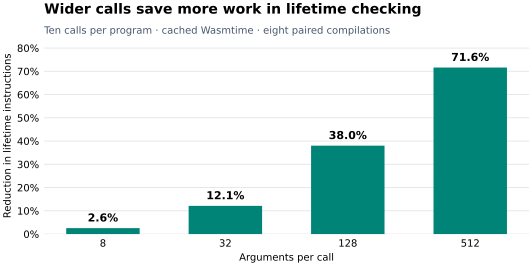
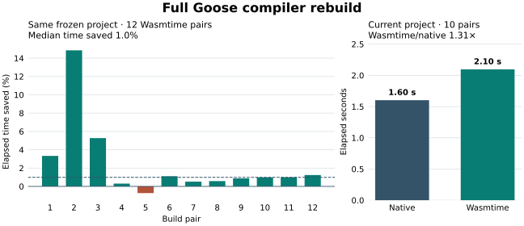

# Lifetime checking for wide calls

For a program that calls a 512-parameter function ten times, the lifetime checker now uses **25.73 million instructions**, down from **90.63 million** in Wasmtime. Most calls in the compiler itself are much narrower. Across the full frozen compiler build, Wasmtime used **1.77% fewer instructions**. [Wide-call counters](wide-summary.json) · [Full rebuild pairs](frozen.json)

| Arguments per call | Previous instructions | Current instructions | Reduction |
| ---: | ---: | ---: | ---: |
| 8 | 624,556 | 608,629 | 2.6% |
| 32 | 2,050,728 | 1,802,124 | 12.1% |
| 128 | 10,618,496 | 6,582,308 | 38.0% |
| 512 | 90,627,402 | 25,729,508 | 71.6% |

For each width we generated one program that prints the sum of the first and last arguments ten times. We ran eight pairs on CPU 3, randomizing the compiler order within each pair. Both fixed-memory Wasm compilers emitted the same bytes as the pinned native reference in all 64 compilations. We executed each reference module and checked its ten output lines. The counters measure the lifetime phase of compilation. [Raw counters and identities](wide.json.gz) · [Workload and runner](measure-wide.py)

## What changed

The checker used to restart at the first argument every time it appended to a list. To bind the arguments to a function's parameters, it searched again from the first item for each position. Each growing list now keeps its first and last items, and parameter binding advances one link per parameter. Nested calls can allocate their own items between the outer call's arguments.

Two changes help ordinary calls. The checker reads a variable's root and reference-bearing type once when evaluating its name. When a reference has one possible storage location, the checker can directly read what that location holds. When class-based checking can add more locations, it still includes those in the result.

In isolated screens on the frozen compiler, the list change saved 0.11% of whole-build Wasmtime instructions. The variable and single-location changes together saved 1.66%. Skipping temporary lists for built-ins and single-value returns saved 0.02%. Passing more checker records by reference saved 0.55% and required changing 21 helper signatures. We kept the smaller changes with the measured gains above. [Prototype patches, profiles and comparisons](experiments.json.gz)

## Rebuilding the compiler

On its own source, `ef702b1` rebuilt in **2.10 s in cached Wasmtime** and **1.60 s native**. The median within-pair ratio was **1.31×** over ten rounds. Both produced the same 7,379,195-byte portable compiler. [Own-source pairs](current.json) · [Earlier eight pairs](current-interleaved.json)

| Frozen compiler project | Lifetime instructions | Whole-build instructions | Whole-build elapsed time (95% paired interval) |
| --- | ---: | ---: | ---: |
| Cached Wasmtime | 9.03 B → 8.72 B | -1.77% | -0.65% (-1.62% to -0.02%) |
| Native Goose | 7.57 B → 7.32 B | -1.75% | -1.50% (-3.59% to +0.11%) |

Each comparison rebuilt the same `9a6040a` project. The table gives median lifetime-phase counts over three samples per engine and compiler, and whole-process changes over twelve rounds on CPU 7 with the execution order reversed on alternate rounds. Both compilers produced the same 7,378,033-byte module in every timed run. An independent twelve-pair Wasmtime repeat measured **-0.99%** in elapsed time, with 11 faster pairs. The experiments ran on a shared Ryzen 7 3800X. [Phase probe results](frozen-phases.json.gz) · [Paired statistics](rebuild-summary.json) · [Wasmtime repeat](wasmtime-repeat.json) · [Host load](reader-controls.json.gz)

On the original `9682303` project, the median paired Wasmtime/native ratio went from 1.51× at the start of the campaign to 1.31× here. [Cumulative comparison](campaign.svg) · [Six rounds](campaign.json)

## Cold and cached self-compilation

The bundled compiler took **3.00 s cold** with eight compilation threads and **2.23 s cached** on one core. Native took **1.67 s**. These are medians from three fresh processes per configuration and include startup. The separate portable memory64 series starts its execution timer after engine preparation. [All 33 launches](launch.json) · [Launch chart](launch.svg) · [Portable compiler](selfhost.json)

Across eleven small programs, native compiler CPU time changed by -3.11% for direct Wasm emission and -3.24% for C emission. The reader benchmarks also ran ten examples and Mandelbrot. All 100 example builds and all 30 Mandelbrot builds reproduced their previous hashes. The example process measurements include launch and exit. The resident Mandelbrot series measures seven executions per engine after warm-up. [Compiler catalog](catalog-summary.json) · [Example builds](examples.json.gz) · [Process runs](host.json.gz) · [Mandelbrot](langbench-hot.json.gz)

A second catalog control used fresh copies of both native executables. Over 30 paired rounds per program on each of two CPUs, checking used 0.73% fewer instructions, direct Wasm emission used 0.38% fewer and C emission used 0.29% fewer. The first 31-round timing series overlapped qualification. We repeated it after qualification, kept both runs, and used the second for the reader chart. [Fresh-copy instruction counts](small-program-summary.json) · [Counter samples](small-program-counters.json.gz) · [Timing controls](reader-controls.json.gz)

## Further experiments

Folding identical branches in the compiler's Wasm removed 44,350 static calls to the runtime error handler. The compiler module shrank 6.3%. [Compiler size, cached execution and cold preparation](compiler-size.md)

A separate prototype indexed the globals a function reads. On the frozen compiler it saved 1.33% of Wasmtime instructions in isolation. On a generated program with 512 globals and 512 initializer calls, a version layered on the new checker saved 27.7% when each call read all the globals and 45.3% when it read two. Every workload initialized the index once. Forcing an index reset before every initializer raised instructions by 5.5% over the released checker on the dense case. Keeping each function's static read information across resets is the next experiment. [Prototype, synthetic workload and reset control](capture-index.json.gz)

## Verification and reproduction

The two compiler sources produced identical lifetime fingerprints on 4,364 inputs at each of two thresholds. A fingerprint records the checker's state, including ordered tuple contents, effects, exits and exported reference provenance. The ordinary run matched 13,679 records. Lowering the threshold for switching to class-based analysis from 4,096 to 16 matched a further 14,114, including 217 retries. A three-level tuple exercised recursive merging, cycle handling and remapping. The retrained release matched all 61 focused byte-output and diagnostic checks, including 41 executions. [Verification summary](lifetime-checks.json) · [Corpus, controls and probes](lifetime-corpus.json.gz)

Bootstrap reproduced the same C on successive generations. Default conformance passed 10,697/10,801 rows and memory64 passed 4,771/4,779, with only known gaps. All 10,061 compiler output comparisons matched. The release fixed-memory compiler reproduced itself byte for byte. [Qualification and binary identities](verification.json) · [Region layout profile](training.profile)

Build the stages with `bench/selfhost_comparison.py` using the revisions and emitter pinned in the reports. Run `measure-wide.py --help` for the six inputs to the wide-call benchmark. It uses the [Linux phase counter](../../2026-11-19/lifetime-evaluator-frames/tools/phases.py). Run `python plot-wide.py` to redraw the wide-call chart and `python bench/selfbuild_charts.py bench/results/2026-11-20/lifetime-argument-lists` from the project root for the compiler rebuild charts.
