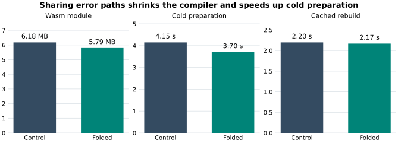

# Where the compiler's bytes go

**Sharing the ends of branches reduced the bundled Goose compiler from 6,184,697 to 5,793,875 bytes (6.32%).** The change removed 44,350 duplicate error-handler calls from the module. The compiler produced the same 7,378,033-byte Wasm output when it rebuilt the frozen project. [Sizes, executed probes and raw measurements](size-trials.json.gz)

The chart compares a Binaryen read/write control with the same module after branch folding. Cold preparation and cached rebuilds are separate single-core benchmarks.

## What ts-rust measured

The public `pingdotgg/ts-rust` Linux release shrank **11.1%**, from 47,838,008 to 42,546,304 bytes. Most of the saving came from stripping symbol tables. The linker also merged identical machine code, saving 271,776 bytes on its own. The PR credits Claude Opus 5.5. [ts-rust PR 110](https://github.com/pingdotgg/ts-rust/pull/110)

A separate change replaced five musl byte comparison, search and copy routines in the static x86-64 executable. The project reported wall-time reductions of **3.72% on VS Code, 4.33% on Sentry and 5.66% on TypeORM** for an extra 1,536 bytes. That PR credits GPT-6.1 Sol for implementation and Claude Opus 5.5 for checking. We could verify these two changes in the public repository. A Neon-specific revision was unavailable for this comparison. [ts-rust PR 111](https://github.com/pingdotgg/ts-rust/pull/111)

## What transfers to Goose

Stripping our native compiler saved 65,024 bytes (1.07%). The stripped executable reproduced the same frozen compiler. The fixed Wasm module already contains zero custom sections, and 94.8% of it is function code. It also already uses Wasm bulk-memory operations. An earlier compiler experiment replacing bulk copies and fills with loops tripled Wasmtime rebuild time. [Native and Wasm artifact inspection](size-trials.json.gz) · [Bulk-memory comparison](../../2026-11-18/compiler-frame-cost/README.md)

| Fixed Wasm compiler | Bytes | Change from Goose release | Post-processing time |
| --- | ---: | ---: | ---: |
| Goose release | 6,184,697 | — | — |
| Binaryen read and write only | 6,175,964 | -0.14% | 0.84 s |
| Merge identical functions | 6,161,319 | -0.38% | 1.04 s |
| Merge identical and similar functions | 6,139,728 | -0.73% | 1.21 s |
| Outline repeated instructions | 6,153,840 | -0.50% | 4.12 s |
| Merge common branch endings | 5,793,875 | -6.32% | 6.84 s |

Each post-processed row used Binaryen 133 on one core with the same input and settings. Processing times are single observations. The read/write control accounts for byte-encoding changes made even with no optimization pass. Whole-function merging saved another 14,645 bytes beyond that control. Common branch endings accounted for another 382,089 bytes. Every module produced the same frozen compiler. [Commands, hashes and controls](size-trials.json.gz)

The compiler emits the source line, error message and a call to `goose.abort` when generating a failing check. Across the compiler module, branch folding reduced the number of static `goose.abort` calls from 60,232 to 15,882. Those are instruction sites in the file. Successful builds skip the error paths. The paired change in cached rebuild time against the read/write control was **+0.38% (-6.64% to +2.58%)**, with a **-0.07%** instruction change over eight alternating rounds. All 61 focused diagnostic and output comparisons also matched, including 41 executions. [Static call counts, function sizes and cached comparisons](size-trials.json.gz) · [Binaryen's branch folding pass](https://github.com/WebAssembly/binaryen/blob/version_133/src/passes/CodeFolding.cpp)

Cold Wasmtime preparation on one core changed from **4.15 s to 3.70 s**, or **-10.89% (-11.72% to -10.67%)** over seven randomized pairs. This times engine compilation and instantiation for `--version` with the cache disabled. It excludes running the compiler on a source project. The intervals above resample complete paired rounds. [Cold process measurements](size-trials.json.gz)

The next emitter experiment is to share a failure block across checks in a function when they have the same message and effective source line. A useful first test is `cc_builtin`, whose Wasm body shrank by 13,702 bytes under general branch folding. Measure module size, cold preparation and cached rebuild time separately. The 6.84-second post-processing pass remains an experiment.
