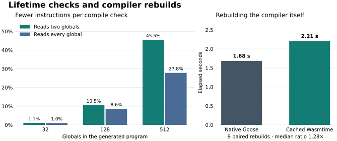

# Reusing lifetime checks for globals

On a frozen compiler project, the balanced Wasm compiler at `74af91f` rebuilt **2.0% faster** than `ef702b1` in cached Wasmtime. The new compiler took less time in nine of eleven pairs (95% paired bootstrap interval for time saved, **0.5–5.6%**). On its own sources, the new compiler took **2.21 s in Wasmtime** and **1.68 s native**, a **1.28×** median within-pair ratio. [Frozen pairs](frozen.json) · [Own-source pairs](current.json) · [Statistics](rebuild-summary.json)



## Where the savings come from

A function called by several global initializers used to make the lifetime checker walk the same list of globals each time. Now the checker remembers which storage cells the function or its callees can read. It reads their current contents on every validation and rebuilds the list when a new eligible global appears. It also remembers when a function and all its callees read no captured variables. Other callers can then skip that part of the call graph. [Checker implementation](../../../../selfhost/checker_lifetimes.goose)

In generated programs with 512 globals, full compile checks went from **157.1 million to 85.7 million instructions** when the function read two globals. When it read all 512, the count fell from **321.8 million to 232.3 million**. These are whole-process hardware instructions for a fresh compiler process with a primed Wasmtime cache, including parsing and type checking. The program had one initializer call per global. Each reported count is the median of seven checks per compiler. Both compilers emitted identical modules and the programs printed their expected results. [Measurements, module hashes and invalidation control](capture-checks.json.gz) · [Program generator and driver](measure-captures.py)

| Globals in scope | Fewer instructions reading two | Fewer instructions reading all |
| ---: | ---: | ---: |
| 32 | 1.12% | 1.01% |
| 128 | 10.53% | 8.59% |
| 512 | 45.47% | 27.82% |

Forcing every global initializer to discard the saved list still saved 33.65% for the 512-global sparse case and 7.08% for the dense case, relative to the previous compiler in the same run. The forced change exists only in the measurement binary. A separate program with 64 functions sharing a 64-call chain used 4.38% fewer instructions to check. [Controls and samples](capture-checks.json.gz)

## Rebuilding the compiler

| Frozen project, 11 paired rounds | Previous median | Current median | Change in paired wall time | Change in paired instructions |
| --- | ---: | ---: | ---: | ---: |
| Wasmtime, balanced | 2.21 s | 2.16 s | −2.02% | −1.97% |
| Native | 1.68 s | 1.65 s | −1.34% | −2.84% |

The within-pair Wasmtime/native time ratio went from 1.32× to 1.31×. The native elapsed-time interval included zero improvement (−2.34% to +2.03% time saved). Both engines benefited from doing less work. This batch establishes a Wasmtime rebuild improvement and leaves the relative gap about the same. [Frozen rebuilds](frozen.json) · [Own-source comparison](current.json) · [Before-and-after chart](rebuild.svg)

The frozen input was `9a6040a`. All 44 outputs had SHA-256 `86cc98b268138c073ca529febfde21689dcb130658edf6f31f4ef7e3256342a3` (7,378,033 bytes). The separate nine-pair own-source series emitted the same 7,383,307-byte module in all 18 runs. The processes ran on CPU 7 of a shared Ryzen 7 3800X with the order reversed on alternate rounds. Wasmtime 50.0.1 used its default Cranelift speed settings and a primed machine-code cache. Times include reading sources, checking, generating the module and writing the output. The primary series ran after qualification. Earlier series overlapped qualification and had much wider elapsed-time variation. [Counters and output hashes](frozen.json) · [Earlier direct and balanced comparisons and CPU pressure](interleaved.json.gz) · [Rebuild driver](../../2026-11-18/compiler-frame-cost/measure.py)

| Compiler phase on frozen input | Previous Wasmtime | Current Wasmtime | Previous native | Current native |
| --- | ---: | ---: | ---: | ---: |
| Parsing | 0.70 B | 0.70 B | 0.47 B | 0.47 B |
| Type checking outside lifetime analysis | 2.36 B | 2.36 B | 1.74 B | 1.74 B |
| Lifetime analysis | 8.59 B | 8.25 B | 7.32 B | 6.91 B |
| Optimization | 1.33 B | 1.33 B | 0.97 B | 0.97 B |
| Wasm emission | 4.07 B | 4.07 B | 3.75 B | 3.75 B |

These are median compiler-thread hardware instruction counts over four rounds with phase instrumentation. Type checking excludes the nested lifetime phase. The remaining lifetime gap is about **1.33 billion instructions**, around twice the next largest phase gap (0.62 billion in other type checking). [Phase counters and driver](phases.json.gz)

## Where to look next

Seven paired CPU profiles of the direct bundled compiler checking the same frozen input put the largest lifetime-function sample difference in expression evaluation. A narrower target is replaying the lifetime effects of a function when another function calls it.

| Time attributed to the function itself per check | Direct Wasmtime | Native |
| --- | ---: | ---: |
| Expression evaluation (`life_eval`) | 112 ms | 72 ms |
| Replaying effects (`life_replay`) | 39 ms | 16 ms |
| Value conversion (`life_coerce`) | 24 ms | 6 ms |

The profiler sampled the active instruction every 2 ms of CPU time. The estimates above are averages across runs and exclude time attributed to callees. Native inlining can charge work to a different function. The profiled module has the release's exact direct Wasm bytes followed by a function-name section. Adding names before Binaryen optimization changed its output, so this table applies to the direct compiler. The next experiment is to count how many replayed effects change a caller's state and measure the cost of the unchanged ones. [Function samples, binaries and drivers](function-samples.json.gz)

## Wasmtime and Binaryen experiments

On the previous balanced compiler, more aggressive Wasmtime inlining reduced process instructions from 17.07 billion to 16.52 billion, and grew the machine-code cache from 8.28 MB to 13.03 MB. In three screening rounds it took 2.46 s against the default's 2.36 s. Wasmtime's single-pass register allocator used 29.38 billion instructions. A separate Binaryen inlining screen topped out at 16.80 billion instructions and likewise showed no elapsed-time gain. The release keeps the existing engine and packaging defaults. [Flags, prototype patches, module hashes and timings](screens.json.gz) · [Previous packaging experiments](../compact-releases/README.md)

## Compatibility and reproduction

Bootstrap reproduced the generated C byte for byte. The new Wasm compiler reproduced its bundled module, and both the new compiler and the pinned emitter produced the same portable module. Default conformance passed 10,697 of 10,801 rows, memory64 passed 4,771 of 4,779, and both matched their known gaps. Qualification also passed all 101 unit tests, 54 native checks and 10,061 compiler output comparisons. [Qualification](verification.json.gz) · [Release identities and sizes](modules.json) · [Training profile](training.profile)

At the default concrete-frame limit of 4,096, the previous and current compilers matched on all 4,364 inputs, including diagnostics and 13,679 lifetime-state fingerprints. At a forced early limit of 16, all 4,364 matched again, including 14,114 fingerprints and 217 retries. Instrumented self-checks also matched at both limits. Nineteen focused positive and negative programs matched under bundled memory32 at `-O0` and portable memory64 at `-O2`. [Verification records](verification.json.gz) · [Structural fingerprint method](../../2026-11-19/lifetime-store-delivery/README.md#reproducing-the-checks)

To reproduce the global tests on Linux, supply the two bundled Wasm compilers identified in the report, the Wasmtime host and the frozen standard library. CPU 6 was used for the three global widths. Use `--shape shared-callees --width 16 32 64` for the separate call-graph series. The driver checks the emitted bytes and executes each generated program before comparing hardware counters.

```sh
python3 measure-captures.py "$PREVIOUS_WASM" "$CURRENT_WASM" "$GOOSE_WASMTIME" "$STDLIB" "$WORK" \
  --cpu 6 --rounds 7 --shape sparse dense --width 32 128 512
```

## Reader benchmarks

The README charts use 31 native compiler builds per program, five cold builds per example and seven resident executions per Mandelbrot engine and input. All 100 example builds and all 30 Mandelbrot builds reproduced the preceding compiler's artifact hashes. The example process chart includes launch and exit. The resident Mandelbrot chart times the computation after engine preparation and warm-up. The repeated reader runs followed qualification and self-host timing. [Compiler catalog](compiler-comparison.json.gz) · [Example builds](examples.json.gz) · [Example process times](host.json.gz) · [Mandelbrot builds](langbench-build.json) · [Resident execution](langbench-hot.json.gz) · [First runs under higher load](reader-controls.json.gz)

Building the portable compiler from the same frozen source location reproduced the same native executable, C and Wasm in all three rounds. Direct Wasm took 2.52 s and native through Clang took 28.25 s (medians). An earlier separate build directory reproduced the Wasm and used identical source files, but produced a different C artifact and native binary. Its samples are retained as a separate run. The cold-launch chart uses the bundled and portable modules emitted by the current compiler, with three fresh processes per configuration. [Matched build and execution samples](selfhost.json) · [Earlier directory and timing control](selfhost-interleaved.json.gz) · [Cold and cached processes](launch.json)
