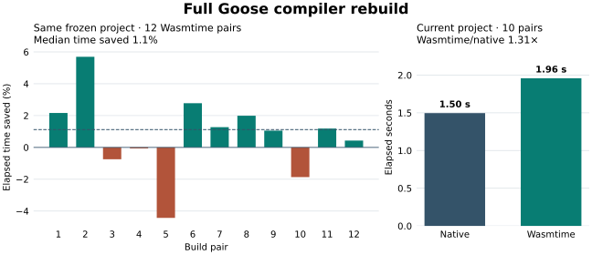
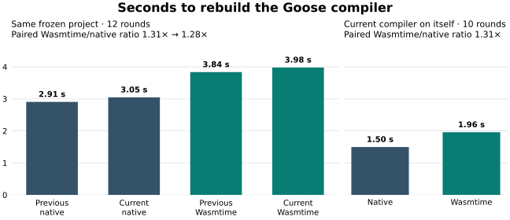
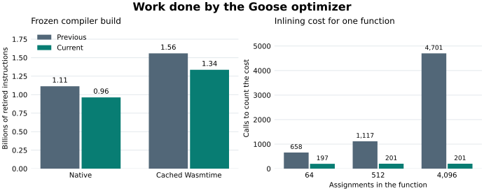
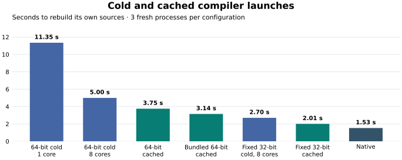

# Smaller optimizer traversals

## Rebuilding the compiler

Compiler `092d3d3` rebuilt its own source tree in **1.96 s in cached Wasmtime and 1.50 s native**, a median paired ratio of **1.31×** over 10 rounds. On identical `c9fb226` sources, the optimizer used **14.22% fewer host instructions in Wasmtime**. The entire Wasmtime process used **1.24% fewer instructions**. [Current-source pairs](current.json) · [Identical-source pairs](frozen.json)

| Frozen project at `c9fb226` | Metric | Previous compiler | Current compiler | Paired change |
| --- | --- | ---: | ---: | ---: |
| Cached Wasmtime | Seconds elapsed | 3.84 | 3.98 | +0.78% |
| Cached Wasmtime | Billion retired instructions | 17.87 | 17.65 | -1.24% |
| Native Goose | Seconds elapsed | 2.91 | 3.05 | +3.48% |
| Native Goose | Billion retired instructions | 14.73 | 14.57 | -1.02% |

The Wasmtime/native ratio on the same project went from 1.31× to 1.28× in 12 four-way rounds. The paired elapsed change for Wasmtime was +0.78% (95% resampled interval -7.45% to +5.29%). An independent 12-pair Wasmtime repeat measured -1.12% elapsed (95% interval -2.08% to +0.41%), with 8 faster pairs. Each build emitted the same 7,361,442-byte memory64 module. The table shows individual compiler medians and within-round changes, which can differ under changing machine load. [Independent repeat](wasmtime-repeat.json) · [Paired statistics](rebuild-summary.json)

Across seven optimization batches on the original `9682303` project, the Wasmtime/native elapsed ratio moved from 1.46× to 1.25×. Wasmtime used 23.23% fewer instructions. Own-source figures in the README come from the ten pairs after the launch suite. The earlier eight pairs ran alongside other benchmarks. [Original frozen project](campaign.json) · [Cumulative chart](campaign.svg) · [Earlier current-source pairs](current-interleaved.json)

## What changed

The optimizer used to copy a 160-byte syntax node before visiting its children and again after returning. It now keeps the child indexes and operator it needs, then looks up the current node after recursion. Looking it up again matters because inlining can grow the node table or turn a call into a block. Read-only traversals borrow nodes directly. When counting the cost of inlining a function, the optimizer stops as soon as the cost exceeds the budget. A body exactly at the limit still qualifies.

| Optimizer function | Static 16-byte load/store pairs in Wasm, before → after | Wasm instructions in its body, before → after |
| --- | ---: | ---: |
| `opt_node` | 128 → 0 | 3,971 → 3,250 |
| `opt_collect` | 17 → 0 | 748 → 693 |
| `opt_inline_cost` | 10 → 0 | 327 → 319 |
| `opt_separate_tree` | 10 → 0 | 606 → 566 |
| `opt_fold_binary` | 30 → 0 | 1,999 → 1,849 |

Wasmtime compiled `opt_node` to 2,259 x64 instructions before and 2,087 after the change. Clang compiled it to 1,361 and 1,345 respectively. The counts above describe code in the binary. Hardware counters on whole compilations measured Wasmtime optimizer execution at 1.558 → 1.336 billion instructions and native optimizer execution at 1.114 → 0.963 billion. [Disassembly, module identities and review](generated-code.json.gz) · [Same-source phase counts](frozen-phases.json.gz)

| Five-pair screens against the same baseline | Whole Wasmtime instructions | Paired elapsed time |
| --- | ---: | ---: |
| Keep scalar traversal fields across recursion | -0.17% | +0.20% |
| Also borrow child records | -0.17% | +0.74% |
| Borrow the entry once and skip absent children | -0.65% | -1.39% |
| Also borrow nodes in read-only traversals | -0.76% | -0.69% |
| Stop inlining cost once over budget | -1.18% | -1.05% |
| Also borrow the remaining fact and symbol records (released) | -1.24% | -1.48% |
| Add a literal-specific early return | -1.31% | +0.35% |

In a generated function with 64 assignments, both compilers decided to inline. The new cost calculation made 197 calls, down from 658. Both rejected functions with 512 and 4,096 assignments. The previous calculation made 1,117 and 4,701 calls respectively. The new calculation stopped after 201 calls in both cases. Each pair emitted identical Wasm and printed `9`. [Scaling counts and hashes](cost-scaling.json) · [Reproduction driver](cost-driver.json.gz)

The screening builds used one emitter, one fixed32 memory profile and the same source tree to compile. The row with a special case for literals saved another 0.07 percentage points of whole-build instructions and had a longer median elapsed time in this screen. We kept the general traversal. Retraining changed 349 bytes of static data. The complete Wasm code section matched the selected screening module byte for byte. [All rounds and source patches](optimization-trials.json.gz) · [Production verification](generated-code.json.gz)

Both engines benefit from skipping optimizer work. On identical sources the optimizer's excess in Wasmtime fell from 444 million to 373 million instructions per rebuild. On its own project, lifetime checking accounted for 1.47 billion of the 3.06 billion extra instructions in Wasmtime across the five compiler phases. [Current phase counts](phase-counters.json)

## Cold and cached self-compilation

Three fresh processes per configuration rebuilt the whole project. The fixed32 compiler took **2.70 s cold** with eight engine compilation threads, **2.01 s cached** on one core and **1.53 s native**. The 33-row series also includes edited-source builds. Absolute times vary with activity on this shared machine. [Launch results and output hashes](launch.json)

## Reader benchmarks

Across eleven programs, the change in compiler CPU time was +3.56% (95% interval +0.74% to +6.05%) for direct Wasm and +2.42% (95% interval +0.04% to +4.95%) for C emission. All 22 program/target combinations emitted identical bytes between releases. All 100 timed example builds and all 30 Langbench builds reproduced the preceding release's artifacts. The example runtime charts include process startup. The seven-sample resident Mandelbrot comparison times guest execution after warmup. [Compiler catalog](compiler-comparison.json.gz) · [Catalog intervals](catalog-summary.json) · [Examples](examples.json.gz) · [Process times](host.json.gz) · [Langbench builds](langbench-build.json) · [Resident Langbench](langbench-hot.json.gz)

A second control used hardware counters enabled when each compiler process started, one output path, and randomized pair order. Across 792 fresh processes on CPU 5, direct Wasm emission retired 0.75% fewer instructions but used 2.38% more CPU time. C emission retired 0.68% fewer instructions and used 1.76% more CPU time. Check-only compilation, which stops before optimization, retired essentially the same number of instructions (−0.01%) and used 1.97% more CPU time. A repeat with a different random order put CPU time at +3.07% for Wasm, +1.85% for C and +2.58% for check-only. It also measured fewer instructions for both emission targets. The small-program slowdown appeared in both runs, including work outside the optimizer. Its cause remains unresolved. [Per-program instructions, cycles, CPU time and driver](catalog-counters.json.gz)

The portable compiler comparison measures an independently built general memory64 module. Its Wasmtime and V8 execution measurements start after instantiation. The fixed32 chart above measures a whole process. The three portable builds used the same pinned emitter and Clang 23, and the machine was shared during the measurements. [Portable compiler benchmark](selfhost.json) · [Host conditions and control runs](reader-controls.json.gz)

## Verification and reproduction

The previous and current compilers made the same 7,894 folds, 11,482 propagations and 7,214 inlining decisions on the frozen compiler. They both grew the syntax tree from 380,876 to 605,966 nodes. C, memory32 and memory64 outputs were byte-identical for each target. Instrumented compilers also agreed in all 99 focused cases. Under the same host, both uninstrumented releases produced identical raw diagnostics and exit status in 15 rejection cases. The Rust Wasmtime host appends one extra newline to stderr for both compiler versions. The new regression covers a function at the 200-node budget and another that exceeds it by one. A zero-cost nested function occurs at the boundary. Changing the budget comparison from `<=` to `<` made the test fail. [Fixtures, counters, emissions and diagnostics](optimizer-equivalence.json.gz)

GPT-6.2 Sol high independently reviewed traversal order and reference lifetimes, verified the release disassembly, and checked that the benchmark compared the same inputs and outputs. The review added the inclusive-budget regression and clarified when a recursive walk can safely borrow a syntax node.

Bootstrap reached a fixed point and all 10,061 output comparisons matched. Default conformance passed 10,697 of 10,801 rows and memory64 passed 4,771 of 4,779, with only the tracked gaps. All 54 native checks and 98 unit tests passed. [Qualification and release identities](verification.json)

Build `c9fb226` and `092d3d3` with the same pinned native emitter and eight-unit Clang build. Train each release's fixed32 profile on squares, sorting and tour. Verify that the fixed32 compiler reproduces itself and emits the independent portable memory64 module. Run the alternating harness on one frozen source archive and on the new source. The raw reports identify every compiler, engine, flag, source archive and output hash. [Build procedure](../../2026-11-19/fixed-record-copies/README.md#verification-and-reproduction) · [Previous profile](../wasm-local-events/training.profile) · [Current profile](training.profile) · [Previous compiler study](../wasm-local-events/README.md)
