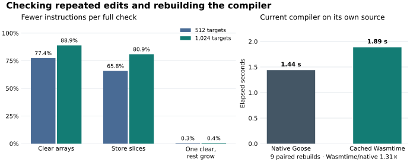

# Checking ordered lifetime effects

Clearing 1,024 distinct arrays used to cost 1.12 billion instructions for a full compiler check. Looking up earlier clears by their contents brought that down to **125 million**, an **88.9% reduction**. Checking 1,024 slice stores used **80.9% fewer** instructions. A program dominated by array growth saved **0.4%**. [Programs and samples](effect-checks.json.gz)

## Why the checker was slow

The lifetime checker records what each function does to storage. For example, clearing an array can invalidate a slice that a caller still holds. When a function is called again, the checker needs to know whether it has already recorded the same effect and whether an intervening operation makes its order matter.

Previously the checker walked backward through every effect until it found an equal one or encountered a conflicting operation. The first clear of each of 1,024 different arrays had no earlier match. Each search scanned a longer history. The checker now looks up the newest equal effect in the current validation of that function. For a clear, comparing its position with the last operation that could invalidate the match is enough. For a store, the checker inspects intervening operations that invalidate stored references, and vice versa. When the checker groups calling contexts, those inspections still record which references may point to the same storage. [Implementation](../../../../selfhost/checker_lifetimes.goose)

On the frozen compiler project, both compilers made **160,029 ordered lookups**. The previous compiler inspected **1,820,808** history entries. The new compiler inspected **183,373** hash-bucket entries and visited no intervening store or invalidation links on this particular input. The two counts describe the respective search loops. They exclude hash construction and other checker work. [Instrumented runs and source differences](effect-traces.json.gz)

| Globals edited twice | Clear each array | Store one slice per holder | Clear one array, grow the rest |
| ---: | ---: | ---: | ---: |
| 32 | 3.4% fewer | 3.0% fewer | 0.05% fewer |
| 128 | 30.5% fewer | 23.8% fewer | 0.17% fewer |
| 512 | 77.4% fewer | 65.8% fewer | 0.34% fewer |
| 1,024 | 88.9% fewer | 80.9% fewer | 0.40% fewer |

Each cell compares median whole-process hardware instructions over seven shuffled pairs of checks on CPU 6. The previous and current direct bundled compilers ran under Wasmtime 50.0.1 with primed machine-code caches. Each pair of compilers also emitted identical Wasm, and all 12 programs printed the same output as the pinned upstream Goose implementation. [Measurements](effect-checks.json.gz) · [Generator and driver](measure-effects.py) · [Upstream execution and release verification](verification.json.gz)

## Rebuilding the compiler

| Frozen source, 11 paired rounds | Previous median | Current median | Paired time change (95% interval) | Paired instruction change |
| --- | ---: | ---: | ---: | ---: |
| Cached Wasmtime, balanced | 1.923 s | 1.911 s | −0.87% (−1.13% to −0.71%) | −1.44% |
| Native | 1.471 s | 1.456 s | −0.84% (−1.41% to −0.29%) | −0.82% |

On the frozen project the median within-pair Wasmtime/native time ratio rounded to **1.31× for both versions**. On the current compiler’s own sources, nine pairs gave **1.89 s in cached Wasmtime** and **1.44 s native**, for a **1.31×** median paired ratio. The interval for that ratio was 1.307–1.315×. [Frozen runs](frozen.json) · [Own-source runs](current.json) · [Paired statistics](rebuilds.json)

Fresh processes alternated order on CPU 7 of a shared Ryzen 7 3800X after qualification and the first reader runs finished. Wasmtime 50.0.1 used its primed Cranelift machine-code cache. Elapsed times include process launch, reading source, compilation and writing output. All 44 frozen rebuilds produced the same 7,378,033-byte module (SHA-256 `86cc98b268138c073ca529febfde21689dcb130658edf6f31f4ef7e3256342a3`), and all 18 own-source runs reproduced the 7,382,769-byte current compiler. Each interval is a percentile bootstrap of the paired median with 5,000 resamples. [Inputs, cache identities and hardware counters](frozen.json) · [Host load during measurements](primary-load.json)

The separate phase probe ran the frozen project four times per compiler and backend. Lifetime checking fell from **8.25 to 8.01 billion instructions** in Wasmtime and **6.91 to 6.80 billion** in native code. Parsing, optimization and Wasm emission stayed within 0.01 billion of their preceding counts. Lifetime analysis still accounted for the largest instruction-count difference between backends, at 1.21 billion, followed by the rest of type checking at 0.62 billion. Counts alone do not predict elapsed time. [Phase counters](phases.json.gz)

## What else was tried

A prototype grouped successive array-growth effects for reuse. On the frozen rebuild it could skip only 3,296 of 141,330 validation growth events. The extra bookkeeping increased full-build instructions by 0.05%. Another prototype linked only earlier stores and invalidations. On the 512-clear program it still used 317 million instructions, close to the original 322 million. Indexing equal clears brought the count down to 73 million. [Prototype measurements and patches](experiments.json.gz) · [Event traces](effect-traces.json.gz)

Inlining equality and hash operations on top of the selected change saved another 0.31% of instructions in the direct-module screen and added 35,724 bytes to the compiler. The release keeps the smaller implementation. One possible next experiment is to identify which growth replays repeatedly resolve the same storage in different function calls. Reusing those results requires proving they stay valid when callers change references. Only two of 2,451 concrete validation store targets changed their immediately observed contents on the frozen workload, but the checker also records effects for callers. [Measurements](experiments.json.gz) · [Replay counters](effect-traces.json.gz)

## Compatibility and reproduction

The C bootstrap reached a fixed point, and the native and self-hosted compilers reproduced the same bundled module. All 10,061 baseline/candidate output comparisons matched. The size-optimized compiler also rebuilt the frozen 7,378,033-byte module byte for byte. The default contract suite passed 10,697 of 10,801 rows and memory64 passed 4,771 of 4,779, with exactly the recorded gaps. All 101 unit tests and 54 native runtime checks passed. [Release and qualification evidence](verification.json.gz) · [Training profile](training.profile)

Comparing checker state across 4,364 inputs at each of two settings also found no differences. Forcing the checker to group contexts after 16 frames exercised 253 inputs that used grouped analysis and 217 retries. All 38 focused runtime rows matched the preceding compiler, including diagnostics on rejected sources and emitted Wasm and output on accepted ones. [Differential checks](verification.json.gz)

To repeat the generated workloads, run the driver from this checkout with the old and new bundled compiler modules, the release Wasmtime runner, the frozen standard library and an empty scratch directory. The full-rebuild driver accepts that same frozen source stage and a named list of compiler artifacts. The raw pair reports record compiler, engine, cache and output hashes. [Generated programs](measure-effects.py) · [Rebuild driver](../../2026-11-18/compiler-frame-cost/measure.py) · [Chart source](plot.py)
