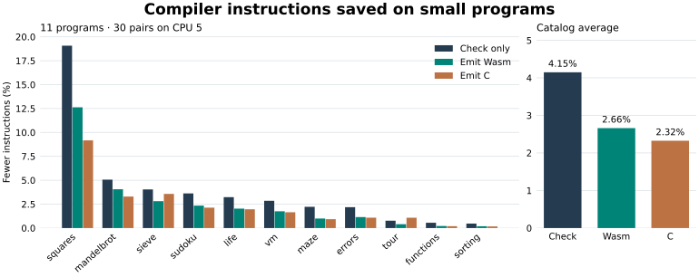
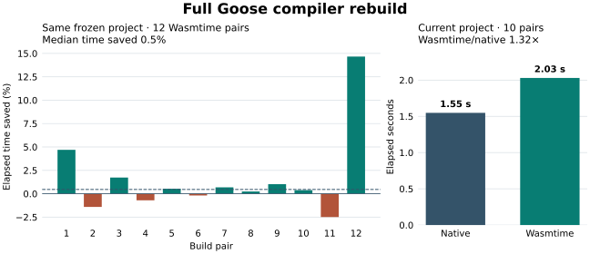

# Small-program compilation and compiler rebuilds

## Small program builds

Checking the eleven catalog programs used **4.15% fewer CPU instructions**. Direct Wasm emission used **2.66% fewer** and C emission used **2.32% fewer**. Squares benefited most. Checking it took 0.85 million instructions before and 0.69 million after. The savings meant less on sorting and functions, where work after parsing accounts for more of the build. [Per-program measurements](small-summary.json)

| Native compiler operation | Instructions, CPU 5 | Instructions, CPU 6 | Process CPU time, CPU 5 (95% interval) | Process CPU time, CPU 6 (95% interval) |
| --- | ---: | ---: | ---: | ---: |
| Check only | -4.15% | -4.15% | -0.71% (-2.36% to +0.91%) | -1.49% (-3.39% to +0.89%) |
| Emit Wasm | -2.66% | -2.66% | +0.38% (-2.36% to +1.41%) | +2.55% (-2.62% to +4.71%) |
| Emit C | -2.32% | -2.32% | +0.98% (-1.52% to +3.06%) | -2.39% (-3.96% to +1.69%) |

Each column compares `9a6040a` with `092d3d3` on the same 11 inputs. Each CPU ran 30 randomized rounds from a fresh matched pair of executable copies. Every C and Wasm file matched its reference hash. We took the median per program, gave each of the eleven programs equal weight using a geometric mean, and resampled paired rounds for the intervals. Every fresh-copy CPU-time interval includes zero. [Raw counters, input hashes and drivers](small-counters.json.gz)

The regular reader benchmark ran 31 fresh builds per program on CPU 2. Its CPU-time change was -1.28% for Wasm emission and -2.61% for C emission. Those runs use the original executable files. Build times on this scale depend on how the OS maps them into memory. [Reader catalog](compiler-comparison.json.gz) · [Timing intervals](catalog-summary.json)

## Why the previous checks looked slower

With the earlier `c9fb226` and `092d3d3` executables, 24 interleaved rounds reproduced a **2.01% check-only CPU increase**. A second pair of executable files with identical bytes reduced the difference to **−0.02%** (95% interval −0.45% to +0.39%). Sampling on a separate core found about ten extra minor faults per check in the newer original file’s executable mapping. A minor fault is the kernel connecting an already resident page to the new process. Four more pairs of identical copies and an address-randomization control reproduced the file dependence. The specific cause within Linux’s mapping or cache behavior remains open. [File identities, fault samples, relocation and copy controls](previous-regression.json.gz)

## What changed

The lexer groups the 46 keywords by length. Identifiers whose lengths match no keyword return immediately. Each remaining comparison uses the existing byte-slice equality helper. The checker starts its name and effect tables with 64 buckets. When a table grows, it clears the occupied range once, adds empty buckets, and reinserts entries in their original order. In a compiler built with the checker change alone, checking an empty program during Wasm emission fell from 188,854 to 32,588 instructions outside lifetime analysis. [Experiments and phase counters](experiments.json.gz)

Writing tokens only once saved another 0.08% of full Wasmtime rebuild instructions in isolation, but it expanded changes to error handling throughout the lexer. Moving the body-skip cursor into local variables had essentially no effect on full rebuild instructions. Allocating lifetime tables later saved around 21,450 instructions on the empty build and added a branch to effect lookup. Rewriting path normalization produced matching output on 35,843 path spellings and a 0.07% Wasmtime instruction saving on squares emission. The release keeps the keyword and checker changes. [Prototype patches and measurements](experiments.json.gz)

## Rebuilding the compiler

On its own source the compiler took **2.03 s in cached Wasmtime** and **1.55 s native**. The median within-pair ratio was **1.32×** over ten rounds. Both implementations produced the same 7,378,033-byte module. [Own-source pairs](current.json)

On frozen `092d3d3` sources, the new compiler changed whole-process Wasmtime instructions by **-0.21%**. The elapsed change was -0.17% (95% interval -2.48% to +3.02%). The independent 12-pair Wasmtime repeat measured -0.46% (95% paired-round interval -1.38% to +0.44%), with 8 faster pairs. Shared host load increased during the first series. Both comparisons retain every round. Each comparison emitted the same 7,361,938-byte memory64 module. [Four-way pairs](frozen.json) · [Wasmtime repeat](wasmtime-repeat.json) · [Paired statistics](rebuild-summary.json)

| Frozen compiler parsing | Previous host instructions | Current host instructions | Change |
| --- | ---: | ---: | ---: |
| Native | 526.48 M | 468.52 M | -11.01% |
| Wasmtime | 744.17 M | 707.07 M | -4.99% |

The parse totals are median host instructions for the compiler’s parse phase over three samples per engine and version. Lifetime checking still uses roughly 9.0 billion instructions in Wasmtime on this build. [Phase measurements and probe](frozen-phases.json.gz)

On the original `9682303` project, the median paired Wasmtime/native time ratio went from 1.55× to 1.28×. [Original frozen project](campaign.json) · [Cumulative chart](campaign.svg) · [Earlier eight own-source pairs](current-interleaved.json)

## Cold and cached self-compilation

The bundled 32-bit compiler took 2.79 s cold with eight compilation threads, 2.45 s from a compiled-module cache on one core, and 1.54 s as a native executable. Each figure is the median of three fresh process launches. The cached measure includes process and runtime startup. Its median from this separate launch suite rose versus the previous study. The paired frozen builds above isolate the compiler change on identical inputs. [All 33 launches](launch.json) · [Launch chart](launch.svg)

The separate portable memory64 benchmark times the guest after engine preparation. The example process series includes launch and exit. All 100 example build artifacts and 30 Mandelbrot build artifacts matched their previous hashes. Mandelbrot’s seven resident samples time execution after warm-up. [Portable compiler](selfhost.json) · [Example builds](examples.json.gz) · [Example processes](host.json.gz) · [Mandelbrot](langbench-hot.json.gz) · [Benchmark controls](reader-controls.json.gz)

## Verification and reproduction

Bootstrap produced identical C in successive generations. Default conformance passed 10,697/10,801 rows and memory64 passed 4,771/4,779 with only known gaps. All 10,061 output comparisons matched. Release training used squares, sorting and tour. The fixed 32-bit Wasm compiler reproduced its own bytes and emitted the same portable memory64 compiler as the pinned native emitter. [Qualification and artifact hashes](verification.json) · [Training profile](training.profile)

The released native compiler matched the previous compiler’s raw token output, diagnostics and exit status on 4,572 inputs, including a generated set of 27,619 keyword spellings and mutations. An independent GPT-6.2 Sol high review checked native and Wasmtime keyword streams and ran a 310-array program across two table-growth thresholds. All 64 focused checker comparisons matched, including diagnostics on invalid programs. [Corpus results](token-streams.json.gz) · [Growth, shadowing and lexer controls](boundary-checks.json.gz)

Check out the commits named above and build them with the same pinned emitter and Clang 23.1.5 according to the [self-host comparison harness](../../../../bench/selfhost_comparison.py). The counter archive contains the exec-time Linux probe, commands, seeds, source hashes and byte-output checks. Rebuild the small-program chart with `python plot-small.py` from this directory and the rebuild charts with `python bench/selfbuild_charts.py bench/results/2026-11-20/small-build-frontend` from the repository root.
