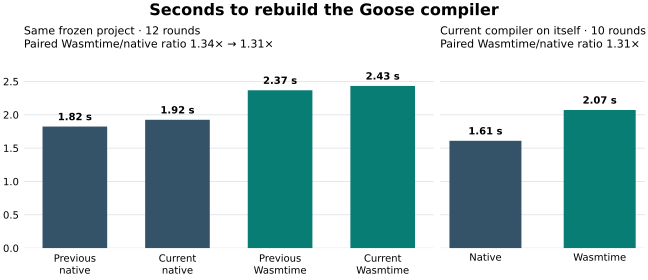
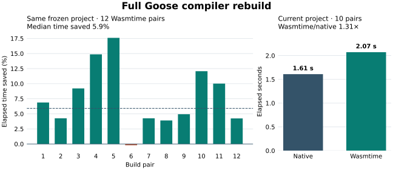
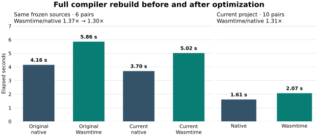
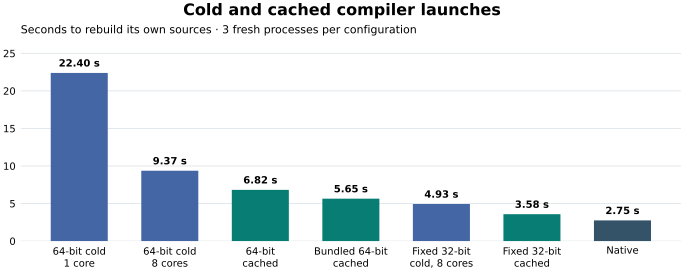

# Recording local accesses during Wasm emission

## Rebuilding the compiler

Compiler `c9fb226` rebuilt itself in **2.07 s in cached Wasmtime and 1.61 s native**, a median paired ratio of **1.31×** across 10 alternating rounds. On the previous release's source tree, both compilers wrote the same 8,793,142-byte module. [Current project](current.json) · [Frozen project](frozen.json)

| Frozen project at `673458e` | Metric | Previous | Current | Paired change |
| --- | --- | ---: | ---: | ---: |
| Cached Wasmtime | Seconds elapsed | 2.37 | 2.43 | -3.62% |
| Cached Wasmtime | Billion instructions | 19.47 | 18.80 | -3.41% |
| Native Goose | Seconds elapsed | 1.82 | 1.92 | -2.36% |
| Native Goose | Billion instructions | 15.76 | 15.59 | -1.09% |

The table shows each compiler’s median and the median change within rounds. Those two summaries can differ when host load changes between builds. Across 12 frozen-source rounds the Wasmtime/native ratio moved from **1.34× to 1.31×**. The paired change in Wasmtime elapsed time was -3.62% (95% interval -5.89% to +2.61%). Each entry includes starting a fresh process, loading the precompiled module, checking the source and writing the result. On current sources 99.56% of Wasmtime wall time was inside the guest entry point. The current and frozen panels use different source trees. Own-source medians come from the repeat after the reader and launch suites finished. [Paired medians and resampled intervals](rebuild-summary.json) · [Eight own-source pairs during other benchmark work](current-interleaved.json)

Sharing the local-access helpers also changed how much code the compiler must generate when it builds itself. The portable output shrank from 8,793,142 to 7,361,442 bytes. The same new Wasmtime compiler executed 18.80 billion instructions on the previous source tree and 17.87 billion on its own. This source-size effect is additional to the savings on identical inputs. [Module identities](verification.json) · [Instruction counts](rebuild-summary.json)

In a separate 12-pair Wasmtime repeat after the reader benchmarks, elapsed time changed by -5.91% (95% resampled interval -11.04% to -4.25%). The candidate finished first in 11 pairs and retired 3.41% fewer instructions. [Independent repeat](wasmtime-repeat.json)

The cumulative comparison on the original `9682303` source tree spans six optimization batches. The Wasmtime/native ratio moved from 1.37× to 1.30×. Wasmtime elapsed time changed by -15.85% (95% interval -24.24% to -9.14%) across 6 paired rounds. [Original project](campaign.json)

## What changed

After writing a function, the compiler used to read its Wasm bytes back to find which local variables were live at the same time. The emitter now records local accesses and control instructions as it writes them. If it replaces a parameter access with a shorter instruction, it moves the recorded offsets alongside the retained bytes. The allocator visits the function prelude first, then the body, and reuses the first available slot of the right type.

The frozen build emitted 4,097,811 instructions across 1,593 functions before local reuse. Removing 39,835 parameter-access sequences changed offsets in 1,480 of those functions. A shadow compiler independently decoded each original and edited body, then compared local declarations and final bytes against the previous allocator. All 2,056,105 finalized events and all 1,593 rewritten functions agreed. [Counts and diagnostic source](experiment-sources.json.gz) · [Per-function checks and replay](allocator-verification.json.gz)

On these identical sources, Wasm emission in Wasmtime fell from **5.52 to 4.86 billion host instructions** (-11.98%). The earlier allocator-only simulation measured 25.2% less elapsed time including event writes. A whole rebuild also parses, checks and optimizes the project. [Same-source phase counts](frozen-phases.json.gz) · [Earlier allocator simulation](../holder-lookups/README.md#recording-the-instructions-the-allocator-needs)

| Prototype on the same frozen sources | Paired rounds | Change in whole-rebuild Wasmtime instructions |
| --- | ---: | ---: |
| Record byte offsets and decode the recorded operands | 6 | -1.22% |
| Adjust offsets a retained span at a time | 6 | -1.69% |
| Keep decoding with a simpler cursor | 6 | -2.10% |
| Record offset, opcode and operand in packed integers | 6 | -2.79% |
| Group slots by type, with the original decoder | 5 | -0.92% |
| Packed events with bounds checks and grouped slots | 6 | -3.47% |
| Ordinary fields, with inline local helpers | 8 | -3.47% |
| Ordinary fields, with shared local helpers | 8 | -3.41% |

Each row compares a candidate to the previous release using the same emitter and fixed-memory profile. The final row retains full-width offsets and operands. Sharing the local helpers cut its module from 8,056,272 to 6,172,072 bytes in this screen. A diagnostic build of the packed prototype measured 5.629 billion backend instructions with both recording and decoding enabled, and 4.971 billion using the events. An initial comparison that mixed two emitter binaries reported a 19.4% regression. The matched repeat measured a 2.79% reduction. [Raw rounds and compilers](experiment-rounds.json.gz) · [Prototypes and baseline-relative patches](experiment-sources.json.gz) · [All screened alternatives](experiment-summary.json) · [Within-binary controls](ablation.json.gz)

In three alternating peak-memory measurements per case, the frozen rebuild used 627,736 KiB before and 625,116 KiB after. For a single 2,500-statement function the medians were 320,764 and 320,760 KiB. Each pair emitted identical bytes, and both stress-test modules printed `-9959`. [Inputs, per-process peak RSS and driver](memory.json.gz)

## Where the gap remains

| Current compiler on its own source | Native, billion instructions | Wasmtime, billion instructions | Difference |
| --- | ---: | ---: | ---: |
| Parsing | 0.53 | 0.74 | +0.22 |
| Other type checking | 1.75 | 2.39 | +0.64 |
| Lifetime checking | 7.59 | 9.07 | +1.47 |
| Optimization | 1.11 | 1.56 | +0.44 |
| Wasm emission | 3.74 | 4.09 | +0.35 |

Lifetime checking accounted for 1.47 billion of the 3.12 billion additional instructions in the five measured phases. It verifies how long references remain safe to use. Native and Wasmtime ran the same source checks. The table excludes process startup and counts lifetime checking separately from the rest of type checking. [Four phase measurements per engine](phase-counters.json)

Instruction sampling of the release binaries put functions named `life_*` at 50.4% in both engines. One smaller target has a specific copying cost. The optimizer takes two snapshots of a 160-byte syntax node while processing an expression. Its traversal function, `opt_node`, accounted for 2.54% of Wasmtime instruction samples and 2.13% native. Of 476 additional Wasmtime samples in that function, 136 mapped to vector loads or stores. A next experiment could retain only the child indexes needed across recursion and read the updated node after visiting those children. The next release measured this change on frozen compiler sources. [Optimizer traversal results](../optimizer-node-traversal/README.md#what-changed) · [Exact-binary profiles and experiment criteria](next-profile.json.gz)

## Cold and cached self-compilation

The fixed 32-bit compiler took **4.93 s cold** with eight engine-compilation threads, **3.58 s cached** on one core and **2.75 s native**. Three fresh processes per configuration rebuilt the current project on a shared host. Absolute launch times depend on other activity. The release's fixed 32-bit module shrank from 7,329,733 to 6,172,072 bytes. [All 33 launches, including edited builds](launch.json)

## Reader benchmarks

On the eleven-program catalog the change in compiler CPU time was -1.45% (95% interval -3.12% to -0.03%) for direct Wasm and +0.84% (95% interval -0.09% to +2.87%) for C emission. Every workload produced the same output bytes for a given target. The charts show elapsed time. [31 sampled builds per cell](compiler-comparison.json.gz) · [Per-workload CPU ratios and intervals](catalog-summary.json)

All 100 example builds and 30 Langbench builds reproduced the previous release's artifacts. The ten example runtime results include process startup. The seven-sample resident Mandelbrot results time only execution after warmup. The catalog and portable compiler series were repeated under different host loads. The portable chart uses the series with lower measured CPU pressure (6.2% versus 31.4%). [Both series and host conditions](reader-controls.json.gz)

The portable compiler comparison uses general memory64 and measures guest execution after instantiation. The self-rebuild comparison above uses a bundled fixed-memory32 compiler in a fresh process. [Examples](examples.json.gz) · [Wasmtime process and preparation times](host.json.gz) · [Langbench builds](langbench-build.json) · [Resident execution](langbench-hot.json.gz) · [Portable compiler builds and execution](selfhost.json)

## Verification and reproduction

Bootstrap reached a fixed point. All 10,061 contract observations agreed with the previous executable. The default suite passed 10,697 of 10,801 rows and memory64 passed 4,771 of 4,779, with only the previously tracked gaps. All 54 native checks and 97 unit tests passed. The independent allocator check passed 149 compiled cases, including 384 runtime observations, four additional late diagnostic checks and five raw allocator workloads covering wide operands, branch tables and 60,000 tiny functions. The dedicated parameter-edit regression runs in memory32 and memory64. [Qualification and release identities](verification.json) · [Shadow and replay checks](allocator-verification.json.gz)

Build commits `673458e` and `c9fb226` through the same pinned Goose emitter and eight-unit Clang 23 build. Train each fixed32 release profile on squares, sorting and tour. Check that the compiled compiler reproduces its own fixed32 bytes and the independently emitted portable module. Run the alternating paired harness against a single frozen source archive. The raw records identify sources, executables, engine, flags, CPU and output hashes. [Build and timing procedure](../../2026-11-19/fixed-record-copies/README.md#verification-and-reproduction) · [Previous profile](../holder-lookups/training.profile) · [Current profile](training.profile) · [Release build driver](verification.json)
