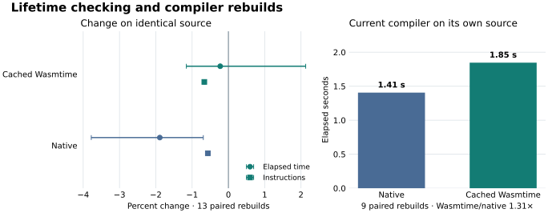

# Less work per lifetime check

The new lifetime checker used **0.66% fewer instructions** in cached Wasmtime on a frozen rebuild. The elapsed-time interval includes no change. Native builds took 1.89% less time on the same input. On its own source the compiler took **1.85 s in Wasmtime** and **1.41 s native**, a **1.31×** median paired ratio. [Full timings and hashes](paired.json.gz)

## Two changes to the checker

A function can read storage while an assignment is building its replacement. The lifetime checker looks for that conflict when the program can construct a replacement. The frozen compiler project invoked that check **1,105,032** times and skipped its body every time. Moving the existing guard to the callers avoids those calls and passes a read-only borrow along the path that still checks. In an independent screen that saved **0.28%** of the entire build's retired instructions. [Source and counter trace](experiments.json.gz)

The checker converted **1,065,766** expression values to an expected type. In **967,025** cases (90.7%), the type already matched. A matching type can still need to discard references, but there is no conversion between slice, reference and owned storage to consider. The checker now takes that shorter path and uses the source and destination type kinds once on conversions that do change type. This saved **0.40%** of whole-build instructions on its own. Together the changes saved **0.68%** with the previous release's memory-layout profile held fixed. All four trial batches produced the same frozen Wasm output. [Source differences and samples](experiments.json.gz)

| Direct Wasm prototype | Change in retired instructions |
| --- | ---: |
| Guard at construction-read callers | −0.28% |
| Type conversion by source and destination kind | −0.40% |
| Both, selected | −0.68% |
| Both plus a guard on held operands | −0.71% |
| Expression dispatcher using one match | −0.24% |
| Pass overlap fields individually | +0.08% |
| Convert value records in place | +0.10% |

The additional held-operand guard added 17,487 bytes to the measured module for another 0.03 percentage points of instruction savings. The table uses the medians of each trial and its baseline in the same screen. Other activity on the host affected screen wall times. The release comparison below used separate paired runs after qualification. [All variants, including rejected builds](experiments.json.gz)

## Rebuilding the compiler

| Frozen source, 13 paired rounds | Previous median | Current median | Paired elapsed change (95% interval) | Paired instruction change |
| --- | ---: | ---: | ---: | ---: |
| Cached Wasmtime, balanced | 1.930 s | 1.971 s | −0.23% (−1.16% to +2.13%) | −0.66% |
| Native | 1.515 s | 1.500 s | −1.89% (−3.78% to −0.69%) | −0.57% |

The frozen Wasmtime/native ratio was **1.29× before** and **1.31× after**. Per round the change in that ratio had a median of +1.37% and a 95% interval from +0.20% to +2.51%. In the separate own-source run, loading the cached module and instantiating it took a median **2.7 ms**. [Raw pairs and CPU pressure](paired.json.gz) · [Paired statistics](rebuilds.json)

The 52 frozen builds ran on CPU 7 of a Ryzen 7 3800X, with the order reversed each round. Both compilers built project `9a6040a` to portable memory64 at `-O2` and reproduced the same 7,378,033 bytes. Wasmtime 50.0.1 used a primed machine-code cache. The separate nine own-source pairs reproduced the 7,381,718-byte current portable compiler. Both sets of timings include process launch, source reading and output. The 95% intervals use 5,000 bootstrap samples of matched rounds. [Engine and compiler fingerprints](paired.json.gz)

A separate four-round probe attributed **8.01 → 7.90 billion instructions** to lifetime analysis in Wasmtime and **6.80 → 6.72 billion** in native code. The remaining lifetime gap is about **1.18 billion instructions**. [Phase counters](phases.json.gz)

## The full construction-read control

A frozen program uses 128 whole assignments and produces 32,768 reads at runtime. The compiler entered the full construction-read check 1,669 times. Both builds emitted identical Wasm and printed `32768`. A second program reads the array while replacing it and both builds produced the same two diagnostics. The safe program used **0.13% fewer** hardware instructions over seven check pairs. [Programs, outcomes and timings](replacement-control.json.gz)

## Qualification

The C bootstrap reached a fixed point. Native and Wasm rebuilt the same bundled compiler, and the pinned emitter agreed with the compiler on the portable module. All 10,061 output comparisons, 101 unit tests and 54 native checks passed. The default and memory64 contract suites matched their known gaps. The checker traces matched for all 4,364 inputs at each of two frame limits. The forced 16-frame run exercised 217 class-analysis retries. All 38 focused runtime and diagnostic comparisons matched. [Qualification and artifact hashes](verification.json.gz)

The [paired build driver](../../2026-11-18/compiler-frame-cost/measure.py) takes a frozen project, a scratch directory and named native binaries or Wasm modules. The paired archive records the workload, output, binaries, module cache and host hashes. The [training profile](training.profile) reproduces the release layout and the [chart script](plot.py) renders the published comparison.
