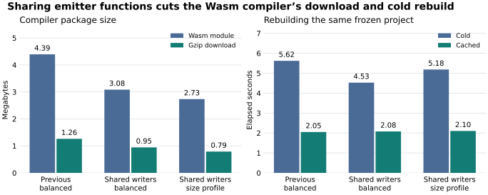

# Sharing the compiler's write helpers

Sharing emitter helpers cut the balanced compiler from **4.39 MB to 3.08 MB** (29.8% smaller). Cold Wasmtime rebuilds took **19.8% less time** across five matched rounds. The size profile is **2.73 MB**. [Profiles and raw timings](profiles.json) · [All observations](cold-release.json.gz)

## Which code got smaller

The C and Wasm emitters use the same few operations to write text, encode integers and emit address and slice instructions. Inlining those operations copied their code, including buffer-growth checks, into many functions in the self-built compiler. The selected change keeps those shared operations as calls. It preserves the compiler’s C, Wasm, memory32 and memory64 output options.

The direct Wasm census attributes 2.06 MB of function bodies to `codegen.goose` and 1.68 MB to `codegen_c.goose`. With function names preserved through Binaryen, the two files still account for 2.51 MB of function bodies, about 62% of code. The census reproduces the shipped direct module exactly after stripping the name section. Names can change Binaryen’s ordering and the named balanced image has a different executable hash, so its grouping estimates where to look within the packaged release. The ordinary stripped balanced build reproduced the published executable hash. The shipped balanced module already removes the dispatch table and element segment. [Census and hashes](census.json.gz)

| Prototype | Direct module | Balanced module |
| --- | ---: | ---: |
| Previous compiler | 6.187 MB | 4.394 MB |
| Share C text writers | 5.269 MB | 3.794 MB |
| Share Wasm address and slice writers | 5.423 MB | 3.922 MB |
| Share variable-length integer writers | 5.664 MB | 4.055 MB |
| Share all three families and the byte writer, selected | 4.123 MB | 3.085 MB |
| Also share opcode wrappers | 3.983 MB | 3.000 MB |
| Also share general string comparisons instead | 4.002 MB | 3.004 MB |

All compiler variants in the rebuild screen emitted the same frozen Wasm. Outlining the extra opcode wrappers saved another 85 KB and increased full-build instructions by 0.48 percentage points relative to the selected change. The string-comparison version saved 81 KB and increased instructions by 0.37 points. Buffering multi-byte writes in a local array increased instructions by 0.97% relative to the selected version and slightly increased its package size. An isolated region-bound prototype reproduced its own compiler, cut 48 KB from the opcode-wrapped version and used 0.29% fewer instructions on a frozen check. That last prototype changes the Wasm emitted for programs, so its check-only screen is a separate observation. [All screens, patches and controls](screens.json.gz)

## Full builds on a frozen project

| Release | Raw Wasm | Gzip | Cold rebuild | Cached rebuild |
| --- | ---: | ---: | ---: | ---: |
| Previous balanced | 4.39 MB | 1.26 MB | 5.62 s | 2.05 s |
| Shared writers, balanced | 3.08 MB | 0.95 MB | 4.53 s | 2.08 s |
| Shared writers, size | 2.73 MB | 0.79 MB | 5.18 s | 2.10 s |

Five rounds shuffled the three modules within each round on CPU 7. Cold runs included compiling and instantiating the module. Median time for those preparation steps fell from **3.57 s to 2.45 s** with the balanced build. Cached runs reused prepared machine code. All 30 runs wrote the same 7,378,033-byte portable Wasm on frozen source `9a6040a`. The percentage in the heading uses matched rounds. [Module and output hashes](cold-release.json.gz)

| Cached, 11 paired rounds | Previous median | Current median | Paired elapsed change (95% interval) | Paired instruction change |
| --- | ---: | ---: | ---: | ---: |
| Wasmtime, balanced | 2.028 s | 2.049 s | +0.32% (−1.65% to +0.76%) | +0.49% |
| Native | 1.592 s | 1.629 s | +0.83% (−0.05% to +5.21%) | +0.78% |

On identical input, the cached Wasmtime elapsed-time interval includes no change. On the current compiler's own source, the balanced release took **1.90 s in Wasmtime** and **1.45 s native**, a **1.31×** median paired ratio over nine rounds. Both series used CPU 7 on a Ryzen 7 3800X, primed Wasmtime 50.0.1 caches and alternating order. [Pairs and hashes](paired.json.gz) · [Statistics](rebuilds.json)

The self-build workload is also smaller. The same pinned native emitter saw **608,167 → 479,529 AST nodes** after optimization and emitted **7.38 → 4.79 MB** of portable memory64 on the two source revisions. This is a different-source observation. Every benchmark that compares release performance directly holds the workload fixed. [Source shape and artifact hashes](source-shape.json)

## Lifetime scheduling

A trace of the baseline counted changes during argument binding and each frame’s evaluation. It marked frames that changed and followed calls backward to their callers, conservatively using edges from both the current and previous round. The instrumented build emitted the same frozen Wasm. [Trace, instrumentation and reduction](frame-trace.json.gz)

| Discovery pass | Frame evaluations | Evaluations outside the reverse call closure |
| ---: | ---: | ---: |
| 1 | 2,917 | 0 |
| 2 | 2,918 | 2,355 |
| 3 | 2,917 | 2,577 |
| 4 | 2,917 | 2,749 |

These are retrospective counts, with nested effects charged to their enclosing evaluation. The trace gives a reason to prototype scheduling and leaves the correctness question open. A frame can read and propagate a changed binding or store through shared storage even when its calls are stable. The next scheduler experiment needs to record those reads and the ordered effects needed by callers, then check the prediction against the existing full pass. The shipped change is limited to the emitters. [Previous caller and binding experiments](../../2026-11-19/lifetime-callers/README.md)

## Qualification

The C bootstrap reached a fixed point. Native and Wasm rebuilt the bundled compiler byte for byte, and the pinned emitter produced the same portable module. All **10,061** output comparisons and all **38** focused runtime and diagnostic comparisons matched. The default suite (10,697/10,801), split native suite (5,926/6,022) and memory64 suite (4,771/4,779) matched their recorded gaps. All 101 unit tests and 54 native runtime checks passed. [Qualification and fingerprints](verification.json.gz) · [Layout training profile](training.profile)

The [frozen comparison driver](../../2026-11-18/compiler-frame-cost/measure.py) measures native and Wasm compiler artifacts on the same staged source. The [cold and cached driver](../../2026-11-20/compact-releases/measure.py) compares the packaged modules. The [plot script](plot.py) renders the published figure.
