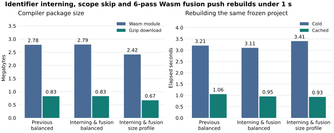

# Frontend identifier interning, scope skip and 6-pass Wasm prescan fusion

Interning identifier tokens with on-the-fly 32-bit FNV-1a hashes, skipping empty and single-declaration scopes in compacted `i32` checker name tables, memoizing validator element-layout checks, tracking inlined blocks for `life_refresh_named_results_for`, hoisting slices and loop depth in `wb_reuse_locals`, and fusing six Wasm backend AST passes (`cg_scan_functions`, `mark_located_functions`, `cg_collect`, `cg_scan_helpers`, `cg_plan_private_arenas`, `cg_array_regions_supported`) into one unified `cg_prescan_node` walk pushed cached Wasmtime self-rebuilds of frozen source `9a6040a` **under one second**: **−10.2%** wall time (1.097 s → **0.991 s**; release profile **0.953 s**, size profile **0.933 s**), **−9.4%** instructions (8.116 B → **7.353 B**), **−22.3%** backend time (0.288 s → **0.225 s**), and **−16.8%** typecheck-only time. Native rebuilds dropped **−11.8%** wall time (0.930 s → **0.814 s**), **−7.9%** instructions (7.532 B → **6.936 B**), **−25.9%** backend time (0.289 s → **0.212 s**), and **−19.0%** typecheck-only time. Cached Wasmtime now retires **2.4% fewer instructions** (0.976×, 7/7 pairs) and runs the backend **22.0% faster** (0.780×, 7/7 pairs) than the previous `f443679` native compiler, with bit-for-bit identical 5,897,497-byte portable memory64 output (`df47e5c4...`). [Profiles](profiles.json) · [Paired rebuilds](rebuilds.json) · [All samples](samples.json.gz) · [Training profile](training.profile)

## Changes

- **`selfhost/model.goose`, `selfhost/driver.goose`, `selfhost/lexer.goose`, `selfhost/checker_operations.goose`:** Added an open-addressed `ident_table: i32[>..]` on `Program` storing 1-based canonical token IDs, populated on the fly during `lex_tokens` (and `operation_name`) with the 32-bit FNV-1a hash in `Token.integer` and canonical ID in `Token.text_start`. `token_hash` and `same_name` resolve interned `T_IDENT` tokens in O(1) without scanning `p.text`. Added `(len, word[0])` dispatch in `lex_keyword`, single-write token emission for identifiers and punctuation in `lex_tokens`, and unrolled `type_hash`.
- **`selfhost/checker.goose`:** Added `decl_count`/`first_decl` to `CheckScope` so `check_lookup_scope_hashed`/`check_lookup_hashed`/`check_lookup_namespace`/`check_member_function` skip empty scopes completely and resolve single-declaration scopes directly without probing `c.name_table`. Compacted `name_table`, `link_scopes`, `name_hashes`, and `linked` onto `i32`, switched all hash lookups to `token_hash`, skipped the `p.nodes` pool-reference scan when `p.types` contains no pool-relative reference, and removed hot `Node`/`Type`/`Symbol` value copies (`check_same_type`, `check_type_const`, `check_lookup_hashed`, `check_lookup_name`, `check_place_root`, `check_reference_kind`, `check_unreached`).
- **`selfhost/checker_validation.goose`:** Precomputed per-type `elem_bad` flags to skip redundant `validation_element_layout` calls, guarded `validation_array_operation`/`validation_assignment`/`validation_builtin` by `n.kind`, switched `check_validate_program` to `const Node&`, and scanned `p.symbols` instead of `p.nodes` in `check_validate_thread_globals`.
- **`selfhost/optimizer.goose`, `selfhost/checker_lifetimes.goose`:** Tracked inlined `N_BLOCK` nodes (`o.inlined_blocks`) across `opt_try_inline`, `opt_clone` and `opt_replace` so `life_refresh_named_results_for` scans `p.symbols` plus `inlined_blocks` instead of scanning all 607K `p.nodes`. Removed by-value `Symbol`/`Node` copies in `optimize_program` and `opt_fix_inline`.
- **`selfhost/wasm.goose`:** Tracked `loop_depth` in `wb_reuse_locals` to skip loop-cover frame scans outside loops, shrank `begin`/`tail` buckets from 128 to 8, pre-sized `undo`/`merged`/`ends` onto local `i32[:]` slices, and bound `accs: const WbLocalAccess[:]` plus direct 1-byte `s.encoded.push`.
- **`selfhost/codegen.goose`:** Discovered checked functions via `p.symbols` sorted by node ID and fused `cg_scan_functions`, `mark_located_functions`, `cg_collect`, `cg_scan_helpers`, `cg_plan_private_arenas` (flat `arena_edges: i32[>..]` fixpoint without AST re-walks), and `cg_array_regions_supported` into a single `cg_prescan_node` pass; switched `cg_expr_body`, `cg_propagate_captures`, `cg_private_place`, `cg_prepare_function`, and `cg_ordinary_owner_module` to `const &`.

## Full builds on a frozen project

Measured on frozen source `9a6040a` on CPU 7 (Ryzen 7 3800X) with primed Wasmtime 50.0.1 caches (`host/rust/target/release/goose-wasmtime`, SHA-256 `b247393d...`). Every baseline and candidate run verified byte-identical 5,897,497-byte portable memory64 output (`df47e5c4...`). Both native compilers were built with `scripts/bootstrap.py --verify`; both bundled memory32 Wasm releases were built with `--wasm-bundled-host --wasm-initial-pages 65535 --wasm-max-pages 65535` and a release-specific region layout profile trained on `9a6040a`, `squares`, `sorting` and `tour`.

| Release | Raw Wasm | Gzip | Cold rebuild | Cached rebuild |
| --- | ---: | ---: | ---: | ---: |
| Previous balanced (`f443679`, `3a5be152`) | 2.78 MB | 0.83 MB | 3.21 s | 1.06 s |
| Interning & fusion, balanced (`d3826ce6`) | **2.79 MB** | **0.83 MB** | **3.11 s** (−2.9% paired) | **0.95 s** (−10.0% paired) |
| Interning & fusion, size (`6117ddc2`) | **2.42 MB** | **0.67 MB** | 3.41 s (+6.0% paired) | **0.93 s** (−12.5% paired) |

| Cached, 7 alternating pairs (frozen `9a6040a`) | Before median (`f443679`) | After median | Paired elapsed ratio | Paired backend ratio | Paired instruction ratio |
| --- | ---: | ---: | ---: | ---: | ---: |
| Wasmtime balanced | 1.097 s (8.116 B instr) | **0.991 s** (**7.353 B** instr) | **0.898×** (7/7 faster) | **0.777×** (−22.3%) | **0.906×** (−9.4%) |
| Native | 0.930 s (7.532 B instr) | **0.814 s** (**6.936 B** instr) | **0.882×** (7/7 faster) | **0.741×** (−25.9%) | **0.921×** (−7.9%) |
| Wasmtime after / Native before | 0.930 s (7.532 B instr) | 0.991 s (**7.353 B** instr) | 1.072× | **0.780×** (7/7 faster) | **0.976×** (7/7 fewer) |
| Wasmtime after / Native after | 0.814 s (6.936 B instr) | 0.991 s (7.353 B instr) | 1.235× | 1.063× | 1.060× |

On the current compiler's own source (`selfhost/main.goose`, 7 alternating pairs on CPU 7), the balanced Wasmtime compiler took **1.221 s** (`backend = 0.185 s`, `optimize = 0.094 s`, 9.022 B instr) vs **0.964 s** native (`backend = 0.168 s`, `optimize = 0.079 s`, 8.269 B instr) — a **1.236×** paired elapsed ratio (**1.091×** instructions, **1.092×** backend), with both compilers emitting byte-identical 4,521,195-byte portable memory64 Wasm (`b2128723...`). (Own-source lifetime time temporarily increased because the superseded prescan helpers remained as unreachable standalone functions in `selfhost/codegen.goose` pending cleanup in the next batch.)

## Qualification

- C bootstrap (`scripts/bootstrap.py --verify`) reached a fixed point (`b846f9ec...`).
- Native and balanced 32-bit Wasm compilers rebuilt the bundled 32-bit direct compiler byte-for-byte (`b257a3f1...`, 3,506,976 bytes).
- Default conformance: **10,697/10,801** (104 recorded gaps, 0 unexpected failures).
- Memory64 conformance: **4,771/4,779** (8 recorded gaps, 0 unexpected failures).
- Native runtime checks: **54/54** passed.
- Unit tests: **101/101** passed.
- Output equivalence (`tests/output_equivalence.py`): **10,061** cases compared with **0** exit-code, stdout, stderr, `check`, `native0`, `native2` or `wasm0` differences (`4` `wasm2` cases emitted smaller code because live AST prescanning no longer marks dead `-O2`-folded branches as `CG_ADDRESS_TAKEN`).
- Measured with [measure_batch5.py](measure_batch5.py) and plotted with [plot.py](plot.py).
