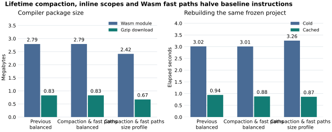

# Lifetime compaction, inline small scopes and optimizer/Wasm fast paths

Compacting `LifeSummary` (120 B → 68 B), seven lifetime hash-head tables (`i64` → `i32`), `LifeChainReplay` (single packed array gated on `replay_version >= 4`), and `WbEvent` (24 B → 12 B); adding a 4-slot inline hash/symbol table in `CheckScope`, single-pass `check_lookup_hashed`, and zero-full-scan `check_unreached`; guarding discovery `life_push_future`/`life_hold` callsites, unwrapping wrappers iteratively in `life_eval_void`, adding L1 newest-frame and `symbol_cells` fast hits, marking inert loops and `N_FOR` over `N_RANGE` fast paths; adding leaf fast-returns and `has_guard` gating in `optimizer.goose`; and removing dead prescan helpers plus `s.locals_at` in `wb_reuse_locals` cut frozen `9a6040a` rebuilds by **−5.6%** paired wall time / **−5.8%** instructions in cached Wasmtime (0.957 s → **0.919 s** paired, **0.880 s** release cached, **0.865 s** size profile; 7.353 B → **6.929 B** instructions) and **−6.1%** wall time / **−6.3%** instructions native (0.785 s → **0.737 s**, 6.936 B → **6.501 B** instructions). Cached Wasmtime now retires fewer instructions than the previous `7db1d1f` native compiler (**0.999×**, 7/7 pairs) while emitting bit-for-bit identical 5,897,497-byte portable memory64 output (`df47e5c4...`). [Profiles](profiles.json) · [Paired rebuilds](rebuilds.json) · [All samples](samples.json.gz) · [Training profile](training.profile)

## Changes

- **`selfhost/checker_lifetimes.goose`:**
  - Compacted `LifeSummary` from 120 B to 68 B (`i32` links, IDs and set indices), compacted `pair_heads`, `read_heads`, `effect_heads`, `leaf_heads`, `context_heads`, `input_heads` and `home_heads` from `i64[>..]` to `i32[>..]`, and packed `chain_replays`/`chain_versions` into `LifeChainReplay { key: i64, version: i32 }` gated on `replay_version >= 4`.
  - Added an L1 newest-frame fast hit in `life_function` (skipping `life_frames_reserve`, `life_inputs_key`, and `input_heads` probes on repeat calls), void body dispatch via `life_eval_void`, and a `symbol_cells` head fast hit in `life_cell`.
  - Guarded all `life_push_future` and `life_hold` callsites with `!l.discovery`, guarded `life_branch` (taking `const LifeValue&`/`const LifeRoot&`) and in-place `life_construct_value`, unwrapped `N_EXPR_STMT`/`N_GUARD`/`N_CAST`/`N_DEFER`/scalar `N_UNARY` iteratively in `life_eval_void`, and extended `NF_INERT` to scalar/void `N_WHILE`/`N_LOOP`/`N_FOR` over `N_RANGE` (with `NF_HAS_EXIT` set only when `N_BREAK` carries a value) plus an `N_FOR` `N_RANGE` fast path in `life_eval_loop`.
  - Lazily resized `l.visited` only on first use in `life_reads`/`life_body`, removed the 224 B `LifeRoot` copy in `life_readback` (and started `local_reads`/`readbacks` at 256/512), and guarded `>= 0` recursive child walks in `life_analyze_node`.
- **`selfhost/checker.goose`:** Added an inline 4-slot `(small_decls, small_hashes)` table on `CheckScope` (flushing to `c.name_table` only when a scope exceeds 4 declarations), collapsed `check_lookup_hashed` from two scope-chain walks to one, replaced the two full-AST `p.nodes` scans and `reachable`/`specialized` allocations in `check_unreached` with targeted `unreached_marked` tracking in `check_function`, and removed the 160 B `Node` copy in `check_expression`/`check_nonnegative_result`.
- **`selfhost/optimizer.goose`:** Added `has_guard` gating so `opt_prove_bounds` runs only when a function has both an index and a guard, added leaf fast-returns and `>= 0` child guards in `opt_collect`, `opt_separate_tree`, `opt_clone`, `opt_fix_inline`, `opt_node` and `opt_prove_bounds`, and guarded `opt_note_site` with `o.site >= 0 || p.inline_sites.len > 0`.
- **`selfhost/wasm.goose`, `selfhost/codegen.goose`:** Shrunk `WbEvent` from 24 B to 12 B (`i32` offsets/operands), eliminated `s.locals_at` in `wb_reuse_locals` by iterating `events` directly in the rewrite pass, kept `s.head` permanently `-1` between calls, added in-place 2-byte LEB128 rewrites and unchanged 1-byte skips in `wb_reuse_locals`, added 2-byte fast paths in `wb_u`, `wb_s`, `cg_get` and `cg_set`, deferred `cg_wasm_type` in `cg_expr_body`, added leaf fast-returns in `cg_prescan_node`, and deleted the seven dead prescan helpers superseded in `7db1d1f`.

## Rejected and traded-off experiments

- **Capping `Lifetimes.offers` at 4,096 slots:** Reduced L2 footprint from 768 KB to 192 KB, but increased direct-mapped collisions in `life_offer_repeated` and sent more repeated offers into `life_effect_merge` (keeping `life_effect` at 4.47% in `SIGPROF`). Reverted to the 16,384-slot initial cap.
- **Inlining the 2-byte LEB fast path in `wb_op`/`wb_mem`:** Retired 55 M fewer instructions (`6.874 B` vs `6.929 B` Wasmtime; `6.443 B` vs `6.501 B` native) at the cost of +11.8 KB in `balanced.wasm` (`2,804,571` vs `2,792,743` bytes). Kept the 2-byte fast path in `wb_u`, `wb_s`, `cg_get` and `cg_set` to preserve the 2.79 MB package size and sub-3.02 s cold preparation.

## Full builds on a frozen project

Measured on frozen source `9a6040a` on CPU 7 (Ryzen 7 3800X) with primed Wasmtime 50.0.1 caches (`host/rust/target/release/goose-wasmtime`, SHA-256 `b247393d...`). Every baseline and candidate run verified byte-identical 5,897,497-byte portable memory64 output (`df47e5c4...`). Both native compilers were built with `scripts/bootstrap.py --verify`; both bundled memory32 Wasm releases were built with `--wasm-bundled-host --wasm-initial-pages 65535 --wasm-max-pages 65535` and a release-specific region layout profile trained on `9a6040a`, `squares`, `sorting` and `tour`.

| Release | Raw Wasm | Gzip | Cold rebuild | Cached rebuild |
| --- | ---: | ---: | ---: | ---: |
| Previous balanced (`7db1d1f`, `d3826ce6`) | 2.79 MB | 0.83 MB | 3.02 s | 0.94 s |
| Compaction & fast paths, balanced (`f33b7041`) | **2.79 MB** | **0.83 MB** | **3.01 s** (−1.6% paired) | **0.88 s** (−6.3% paired) |
| Compaction & fast paths, size (`570271da`) | **2.42 MB** | **0.67 MB** | 3.26 s (+8.1% paired) | **0.87 s** (−8.1% paired) |

| Cached, 7 alternating pairs (frozen `9a6040a`) | Before median (`7db1d1f`) | After median | Paired elapsed ratio | Paired optimize ratio | Paired backend ratio | Paired instruction ratio |
| --- | ---: | ---: | ---: | ---: | ---: | ---: |
| Wasmtime balanced | 0.957 s (7.353 B instr) | **0.919 s** (**6.929 B** instr) | **0.944×** (6/7 faster) | **0.892×** (−10.8%) | **0.936×** (−6.4%) | **0.942×** (−5.8%, 7/7) |
| Native | 0.785 s (6.936 B instr) | **0.737 s** (**6.501 B** instr) | **0.939×** (6/7 faster) | **0.907×** (−9.3%) | **0.948×** (−5.2%) | **0.937×** (−6.3%, 7/7) |
| Wasmtime after / Native before | 0.785 s (6.936 B instr) | 0.919 s (**6.929 B** instr) | 1.159× | 1.031× | **1.000×** | **0.999×** (7/7 fewer) |
| Wasmtime after / Native after | 0.737 s (6.501 B instr) | 0.919 s (6.929 B instr) | 1.226× | 1.158× | 1.056× | 1.066× |

On the current compiler's own source (`selfhost/main.goose`, 7 alternating pairs on CPU 7), the balanced Wasmtime compiler took **1.108 s** (`lifetime = 0.545 s`, `backend = 0.172 s`, `optimize = 0.084 s`, 8.576 B instr) vs **0.895 s** native (`lifetime = 0.436 s`, `backend = 0.159 s`, `optimize = 0.072 s`, 7.831 B instr) — a **1.240×** paired elapsed ratio (**1.095×** instructions, **1.077×** backend), with both compilers emitting byte-identical 4,528,216-byte portable memory64 Wasm (`513992a6...`). Deleting the seven dead prescan helpers cut own-source rebuild time by **−9.3%** vs `7db1d1f` (1.221 s → 1.108 s Wasmtime, 0.964 s → 0.895 s native).

## Qualification

- C bootstrap (`scripts/bootstrap.py --verify`) reached a fixed point (`2c9ff356...`).
- Native and balanced 32-bit Wasm compilers rebuilt the bundled 32-bit direct compiler byte-for-byte (`3d965386...`, 3,508,887 bytes).
- Default conformance: **10,697/10,801** (104 recorded gaps, 0 unexpected failures).
- Memory64 conformance: **4,771/4,779** (8 recorded gaps, 0 unexpected failures).
- Native runtime checks: **54/54** passed.
- Unit tests: **101/101** passed.
- Output equivalence (`tests/output_equivalence.py`): **10,061** cases compared with **0** exit-code, stdout, stderr, `check`, `native0`, `native2` or `wasm0` differences (`1` `wasm2` case, `optional-null.goose`, emitted 8 bytes smaller Wasm with identical runtime output `true`).
- Measured with [measure_batch6.py](measure_batch6.py) and plotted with [plot.py](plot.py).
