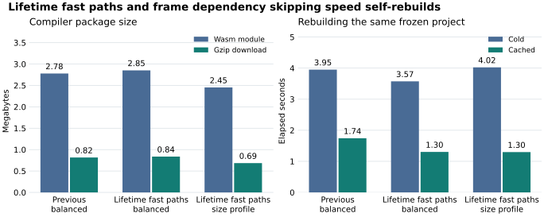

# Lifetime fast paths and frame dependency skipping

Precomputing per-type, per-symbol and per-node lifetime flags, eliding inert scalar operations and cells, tracking clean concrete frames across discovery passes, indexing live reference holders with a bitmap and caching shrink/walk/global-capture checks cut lifetime checking time roughly in half on frozen source `9a6040a`: **−50.1%** in cached Wasmtime (0.901 s → **0.449 s**) and **−52.9%** native (0.795 s → **0.379 s**). Full rebuilds fell **26.1%** in cached Wasmtime (1.775 s → **1.314 s**, −28.8% instructions) and **27.3%** native (1.511 s → **1.107 s**, −30.6% instructions). The new balanced Wasmtime compiler rebuilt the frozen project **13.5% faster** (0.865× paired elapsed time, 0.759× instructions, 7/7 pairs) than the previous `766898a` native compiler. [Profiles](profiles.json) · [Paired rebuilds](rebuilds.json) · [All samples](samples.json.gz) · [Training profile](training.profile)

## Changes in `selfhost/checker_lifetimes.goose`

- **Precomputed lifetime flags (`life_prepare_nodes`, `life_analyze_node`):** classifies types (`TF_L_*`), non-address-taken scalar locals/parameters (`SF_SCALAR_LOCAL`), scopes containing live cells (`scope_has_cell`), pure-place/shrink-free/inert expressions (`NF_PURE_PLACE`, `NF_MAY_SHRINK`, `NF_INERT`) and acyclic inert helper functions (`NF_FN_INERT`).
- **Void-returning evaluator (`life_eval_void`):** evaluates statements, conditions and discarded operands without constructing or copying 72-byte `LifeValue` records, and forwards a block's `receiving` destination only to true `F_TAIL` expressions.
- **Discovery frame dependency skipping (`life_frame_is_clean`, `dep_roots`, `dep_callees`):** records roots read and callees invoked by clean non-recursive concrete frames and skips re-evaluating unchanged frames in later discovery passes while replaying their summaries.
- **Live holder bitmap & shrink/walk/capture epochs (`live_holder_bits`, `live_holder_words`, `shrink_clean`, `walk_memo_roots`, `global_live_epoch`):** scans only live holder cells on array shrinks and loop entries, memoizes negative shrink checks by `holder_grow_epoch`, expands `held_walks` memoization up to 32 roots with epoch validation, avoids allocating global-capture snapshots when unchanged (`life_global_captures_match`), and skips redundant `life_grow` hold scans when `build_holds == 0`.

## Full builds on a frozen project

Measured on frozen source `9a6040a` on CPU 7 (Ryzen 7 3800X) with primed Wasmtime 50.0.1 caches (`host/rust/target/release/goose-wasmtime`, SHA-256 `b247393d...`). Every run verified deterministic 6,594,988-byte portable memory64 output (SHA-256 `3e3d7d8a...`). Both native compilers were built with `scripts/bootstrap.py --verify`; both bundled memory32 Wasm releases were built with `--wasm-bundled-host --wasm-initial-pages 65535 --wasm-max-pages 65535` and a release-specific region layout profile trained on `squares`, `sorting` and `tour`.

| Release | Raw Wasm | Gzip | Cold rebuild | Cached rebuild |
| --- | ---: | ---: | ---: | ---: |
| Previous balanced (`766898a`, `ced8e84e`) | 2.78 MB | 0.82 MB | 3.95 s | 1.74 s |
| Lifetime fast paths, balanced (`ec34ff9b`) | 2.85 MB | 0.84 MB | **3.57 s** (−9.1% paired) | **1.30 s** (−25.4% paired) |
| Lifetime fast paths, size (`046c08aa`) | 2.45 MB | 0.69 MB | 4.02 s (+2.9% paired) | **1.30 s** (−26.7% paired) |

| Cached, 7 alternating pairs (frozen `9a6040a`) | Before median (`766898a`) | After median | Paired elapsed ratio | Paired lifetime ratio | Paired instruction ratio |
| --- | ---: | ---: | ---: | ---: | ---: |
| Wasmtime balanced | 1.775 s (13.765 B instr) | **1.314 s** (9.799 B instr) | **0.739×** (7/7 faster) | **0.499×** (−50.1%) | **0.712×** (−28.8%) |
| Native | 1.511 s (12.913 B instr) | **1.107 s** (8.959 B instr) | **0.727×** (7/7 faster) | **0.471×** (−52.9%) | **0.694×** (−30.6%) |
| Wasmtime after / Native before | 1.511 s (12.913 B instr) | **1.314 s** (9.799 B instr) | **0.865×** (7/7 faster) | **0.560×** (−44.0%) | **0.759×** (−24.1%) |
| Wasmtime after / Native after | 1.107 s (8.959 B instr) | 1.314 s (9.799 B instr) | 1.174× | 1.172× | 1.094× |

On the current compiler's own source (`selfhost/main.goose`, 7 alternating pairs on CPU 7), the balanced Wasmtime compiler took **1.243 s** (`life = 0.464 s`, 9.002 B instr) vs **1.013 s** native (`life = 0.385 s`, 8.022 B instr) — a **1.23×** paired elapsed ratio (**1.12×** instructions), with both compilers emitting identical 4,518,926-byte portable memory64 Wasm (`4f93609e...`).

## Qualification

- C bootstrap (`scripts/bootstrap.py --verify`) reached a fixed point (`579671fb...`).
- Native and balanced 32-bit Wasm compilers rebuilt the bundled 32-bit direct compiler byte-for-byte (`1b22b4b4...`, 3,743,151 bytes).
- Default conformance: **10,697/10,801** (104 recorded gaps, 0 unexpected failures).
- Memory64 conformance: **4,771/4,779** (8 recorded gaps, 0 unexpected failures).
- Native runtime checks: **54/54** passed.
- Unit tests: **101/101** passed (2 skipped).
- Output equivalence (`tests/output_equivalence.py`): **10,060/10,061** matched identically. The single difference is `upstream:test/errors_tc/byteview_cycle_holder.goose`, where both compilers reject the invalid program (exit 1) and the candidate reports the actual escaping store at line 5:47 (`out.bytes = h.bytes`, matching upstream's test annotation) instead of baseline's line 8:23 (which stemmed from `life_eval_block` forwarding a `void` caller's destination into a non-tail `;` statement).
- Proof & diagnostic sweep across **4,519** corpus, fixture and selfhost sources (`LIFE_CONCRETE_FRAMES = 4096`): **4,518/4,519** matched exported provenance hashes and diagnostics identically, with only the same `byteview_cycle_holder.goose` diagnostic improvement. At forced `LIFE_CONCRETE_FRAMES = 16`, all 4,519 exit codes and diagnostics matched (modulo `byteview_cycle_holder.goose`), with 4 small fixtures remaining concrete slightly longer because inert helper functions no longer allocate frames.
- Measured with [measure_batch2.py](measure_batch2.py) and plotted with [plot.py](plot.py).
