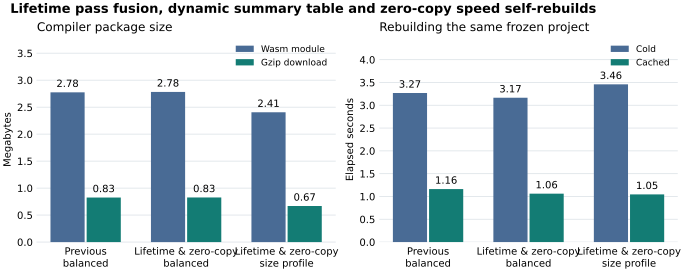

# Lifetime pass fusion, dynamic summary table and zero-copy

Fusing the four `life_prepare_nodes` node scans into one pass with single-visit topological DFS, eliminating redundant and scalar `life_refresh_named_results` work, shrinking `LifeFrame.summary_heads` to a dynamically doubled 16 KB `i32` table and `LifeOffer` to 48 bytes, avoiding dead `life_load`/`life_relative_storage` and `TY_VOID`/`TY_REF` temporary creation in `life_call`, compacting attempt tables onto `i32` slices, and removing hot by-value arena copies cut lifetime analysis time on frozen source `9a6040a` by **−22.2%** in cached Wasmtime (0.430 s → **0.329 s**) and **−28.1%** native (0.359 s → **0.258 s**), while cutting optimizer time by **−11.7%** in Wasmtime and **−13.9%** native. Full rebuilds fell **−9.3%** in cached Wasmtime (1.169 s → **1.065 s**, **−7.7%** instructions: 8.794 B → **8.116 B**) and **−11.8%** native (0.993 s → **0.868 s**, **−7.5%** instructions: 8.140 B → **7.531 B**). Cached Wasmtime now executes **fewer total instructions** (0.997×, 7/7 pairs) and **faster lifetime analysis** (0.923×, 7/7 pairs) than the previous `b30cd88` native compiler, with bit-for-bit identical portable memory64 output (`5,897,497` bytes, `df47e5c4...`). [Profiles](profiles.json) · [Paired rebuilds](rebuilds.json) · [All samples](samples.json.gz) · [Training profile](training.profile)

## Changes

- **`selfhost/checker_lifetimes.goose` (pass fusion & DFS):** Merged all four `0..node_count` scans in `life_prepare_nodes` (including `life_has_replacement`) into a single pass, and replaced the 4-round `clear_work` loop with single-visit topological post-order DFS (`fn_state: u8[>..]`).
- **`selfhost/checker_lifetimes.goose` (named results):** Removed the redundant `life_refresh_named_results(p)` call inside `life_check_attempt` (already run by `optimize_program` before codegen), filtered `life_named_results_into` with `life_type_may_need_named_result(p, ty)` so void/scalar/plain-ref/fixed-POD results skip body walks, hoisted all eight scratch arrays in `life_refresh_named_results`, and switched node/symbol reads to `const &`.
- **`selfhost/checker_lifetimes.goose` (effect summaries & replay):** Shrunk `summary_heads` to a dynamically doubled power-of-two `i32` table (starting at 4,096 entries / 16 KB with mask indexing instead of 64-bit modulo), compacted `LifeOffer` from 96 to 48 bytes (`i32` fields), passed `const LifeEffect&`/`const LifeValue&` to effect and storage helpers, added 1-alt local root fast exits in `life_effect`/`life_add_contents`/`life_bind`/`life_effect_far`, cached `life_nearest_recursive` hits inline, unrolled `[...]` hash loops via `inline fn life_hash_step`, and skipped 184-byte `LifeEffect` copies on skipped/unmapped `life_replay` entries.
- **`selfhost/checker_lifetimes.goose` (calls, evaluation & compact tables):** Moved dead `receiver`/`life_load`/`life_relative_storage` computation inside builtin-0 checks in `life_call`, skipped `life_temporary` allocation on `TY_VOID` and plain `TY_REF` call results (increasing `dep_dest == destination` clean skips), used 1-byte `type_flags` helpers (`life_tf_is_ref`, `life_tf_holds`, `life_tf_rel`), added fast exits in `life_load`/`life_eval_void`/`life_eval_access`/`life_eval_return`/`life_arguments_equal`/`life_function`, compacted `symbol_cells`/`node_roots`/`function_frames`/`visited` onto `i32`, scanned `p.symbols` instead of `p.nodes` for standalone roots, and replaced value-copying `for x in arena` loops with indexed `const &` loops.

## Full builds on a frozen project

Measured on frozen source `9a6040a` on CPU 7 (Ryzen 7 3800X) with primed Wasmtime 50.0.1 caches (`host/rust/target/release/goose-wasmtime`, SHA-256 `b247393d...`). Every baseline and candidate run verified byte-identical 5,897,497-byte portable memory64 output (`df47e5c4...`). Both native compilers were built with `scripts/bootstrap.py --verify`; both bundled memory32 Wasm releases were built with `--wasm-bundled-host --wasm-initial-pages 65535 --wasm-max-pages 65535` and a release-specific region layout profile trained on `9a6040a`, `squares`, `sorting` and `tour`.

| Release | Raw Wasm | Gzip | Cold rebuild | Cached rebuild |
| --- | ---: | ---: | ---: | ---: |
| Previous balanced (`b30cd88`, `84c50611`) | 2.78 MB | 0.83 MB | 3.27 s | 1.16 s |
| Lifetime & zero-copy, balanced (`3a5be152`) | **2.78 MB** | **0.83 MB** | **3.17 s** (−2.5% paired) | **1.06 s** (−9.6% paired) |
| Lifetime & zero-copy, size (`13095108`) | **2.41 MB** | **0.67 MB** | 3.46 s (+5.8% paired) | **1.05 s** (−10.5% paired) |

| Cached, 7 alternating pairs (frozen `9a6040a`) | Before median (`b30cd88`) | After median | Paired elapsed ratio | Paired lifetime ratio | Paired instruction ratio |
| --- | ---: | ---: | ---: | ---: | ---: |
| Wasmtime balanced | 1.169 s (8.794 B instr) | **1.065 s** (**8.116 B** instr) | **0.907×** (7/7 faster) | **0.778×** (−22.2%) | **0.923×** (−7.7%) |
| Native | 0.993 s (8.140 B instr) | **0.868 s** (**7.531 B** instr) | **0.882×** (7/7 faster) | **0.719×** (−28.1%) | **0.925×** (−7.5%) |
| Wasmtime after / Native before | 0.993 s (8.140 B instr) | 1.065 s (**8.116 B** instr) | 1.089× | **0.923×** (7/7 faster) | **0.997×** (7/7 fewer) |
| Wasmtime after / Native after | 0.868 s (7.531 B instr) | 1.065 s (8.116 B instr) | 1.237× | 1.279× | 1.078× |

On the current compiler's own source (`selfhost/main.goose`, 7 alternating pairs on CPU 7), the balanced Wasmtime compiler took **1.120 s** (`lifetime = 0.414 s`, `optimize = 0.094 s`, `backend = 0.234 s`, 8.434 B instr) vs **0.918 s** native (`lifetime = 0.332 s`, `optimize = 0.080 s`, `backend = 0.228 s`, 7.647 B instr) — a **1.219×** paired elapsed ratio (**1.103×** instructions, **1.030×** backend), with both compilers emitting byte-identical 4,498,480-byte portable memory64 Wasm (`d169953c...`).

## Qualification

- C bootstrap (`scripts/bootstrap.py --verify`) reached a fixed point (`64b4ad71...`).
- Native and balanced 32-bit Wasm compilers rebuilt the bundled 32-bit direct compiler byte-for-byte (`68296fba...`, 3,495,779 bytes).
- Default conformance: **10,697/10,801** (104 recorded gaps, 0 unexpected failures).
- Memory64 conformance: **4,771/4,779** (8 recorded gaps, 0 unexpected failures).
- Native runtime checks: **54/54** passed.
- Unit tests: **101/101** passed.
- Output equivalence (`tests/output_equivalence.py`): **10,061** cases compared with **0** exit-code, stdout, stderr, `check`, `wasm0`, `wasm2` or `native0` differences (`96` `native2` cases removed dead `g_ref` temporaries on scalar/plain-struct inlined blocks because `life_refresh_named_results` no longer attaches unused `N_BINDING` nodes to types without result locations).
- Measured with [measure_batch4.py](measure_batch4.py) and plotted with [plot.py](plot.py).
