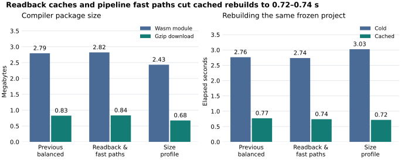

# Inexact readback/far-effect caches and pipeline fast paths

Adding a depth-clocked `inexact_reads` cache in `life_readback`, a 1024-slot `far_cache` in `life_effect_far`, zero-`LifeItem` builtin dispatch, scalar-load skipping in `life_eval_access`, discovery-only error guards and declaration fast paths in `life_bind`/`life_store`/`life_call`/`life_eval_loop`, unit-load-factor hash tables and inline `small_hashes` scans plus O(1) `check_record` field ordering in `checker.goose`, leaf fast-skips in `optimizer.goose`, per-type region classification caching in `cg_prescan_node` and fast integer/bool lowering in `codegen.goose`, and a single-pass / 1-byte ULEB fast path in `wb_reuse_locals` cut frozen `9a6040a` rebuilds by **−4.4%** paired wall time / **−8.3%** instructions in cached Wasmtime (0.772 s → **0.738 s** paired, **0.740 s** release cached, **0.718 s** size profile; 6.252 B → **5.731 B** instructions, −521 M) and **−4.3%** wall time / **−6.2%** instructions native (0.641 s → **0.614 s**, 6.022 B → **5.646 B** instructions). Cached Wasmtime now retires **4.8% fewer instructions** than the previous `4f98cee` native compiler (**0.952×**, 7/7 pairs), runs its Wasm backend faster than the previous native backend (**0.992×**, 7/7 pairs), and sits within **1.5%** of the new native compiler's instruction count (**1.015×**) while emitting bit-for-bit identical 5,897,497-byte portable memory64 output (`df47e5c4...`). On the compiler's own source (`selfhost/main.goose`), cached Wasmtime dropped below one second at **0.958 s** (**−7.0%** paired vs 1.030 s, **−10.0%** instructions: 8.401 B → **7.565 B**, −836 M). [Profiles](profiles.json) · [Paired rebuilds](rebuilds.json) · [All samples](samples.json.gz) · [Training profile](training.profile)

## Changes

- **`selfhost/checker_lifetimes.goose`:**
  - Added per-depth mutation clocks (`cell_clock` + 64-entry `depth_clock`, updated in `life_set_live` and `life_set_refs`, skipping unchanged `life_set_refs`) and a depth-clocked `inexact_reads` direct-mapped cache in `life_readback` for single-alt inexact local reads (`!alt.exact && !global && root.class_frame < 0 && root.depth < 64 && l.class_frames == 0 && l.island == 0`, preserving `l.dep_tainted = true` on discovery hits); skipped the `remembered` loop for single-local reads and passed `const LifeCellKey&` in `life_candidates`.
  - Added a 1024-slot `far_cache` in `life_effect_far` for multi-alt place sets (`pcount > 1`), hoisted `l.frame <= 0`, and tracked `min_chain`; added single-root fast paths in `life_read_offer` and `life_replay`.
  - Upgraded `life_summary_bucket` to 64-bit multiplicative xorshift mixing, lowered `summary_heads` (initial 8192) and `effect_heads` (initial 2048) hash load factor from 2.0 to 1.0, and reordered `life_effect_merge` comparisons to check `node`/`owner`/`kind` first.
  - Added a zero-`LifeItem` stack-argument fast path for builtins (`builtin >= 0`) in `life_call`; added a scalar fast path in `life_eval_access` (`storage < 0 || (l.type_flags[storage] & (TF_L_REF | TF_L_HOLDS)) == 0`) skipping `life_load`; added immutable-declaration and mutable-declaration fast paths in `life_bind`; hoisted `life_stored_roots` and added early no-op return in `life_store`; guarded validation-only `life_error` checks in `life_bind`, `life_store`, `life_call`, and `life_eval_loop` with `!l.discovery`; split `life_interior`, `life_copy`, `life_receive`, and `life_fold` into inline fast paths + `*_slow`; added an owner/global head check inside `life_cell` to skip `life_frame_for`; cached `cur_flags` in `life_analyze_node` and removed redundant `l.nodes_prepared` bounds guards in hot evaluators.
- **`selfhost/checker.goose`:**
  - Lowered hash load factor from 2.0 to 1.0 in `check_link_table` and `check_index_effect`; inlined the `cnt <= 4` `small_hashes` filter directly in `check_lookup_hashed` so `check_lookup_scope_hashed` is only invoked on hash hits or scopes with > 4 declarations.
  - Replaced `check_record`'s five 160 B `Node` copies with scalar loads and replaced its $O(k^2 F)$ triple-nested field-order inversion check with O(1) monotonic `prev_ordinal` tracking, walking `used`/`supplied_bindings` directly through `c.integer_work`.
  - Split `check_retarget_exits` into an inline fast filter (skipping all non-`N_BLOCK`/`N_WHILE`/`N_FOR`/`N_LOOP` subtrees) + `check_retarget_exits_walk` with leaf skips; added `index == 0` fast path in `check_list_at`; added `left == right && left <= TYPE_F64` fast path and removed `Type` copies in `check_join_type`; removed `Node` copies in `check_resolve_type` and `check_branch_readonly`; made `check_const_type`, `check_plain_value_type`, `check_contains_refs` (`ty < 12`), `check_size_class` (`ty < 13`), and `check_effect_bucket` inline with primitive/flag fast paths.
- **`selfhost/optimizer.goose` & `selfhost/model.goose`:**
  - Added contiguous leaf-kind skips (`N_INTEGER..N_NULL` or `N_INTEGER..N_STRING`, plus childless `N_NAME` in `opt_clone`/`opt_inline_cost`) before recursive calls in `opt_inline_cost`, `opt_separate_tree`, `opt_inline_dependencies`, `opt_clone`, `opt_fix_inline`, `opt_subtree_safe_for_bound`, and `opt_prove_bounds`, and guarded `opt_note_site` in `opt_clone` with `(o.site >= 0 || p.inline_sites.len > 0 && node >= p.inline_sites[0].first) && library_token(p, n.token)`.
  - Made `library_node` and `library_token` inline and added an O(1) `node < p.inline_sites[0].first` short-circuit in `location_token`.
- **`selfhost/codegen.goose` & `selfhost/wasm.goose`:**
  - Added per-type 1-byte `type_reg` classification caching (`cg_prescan_type_reg`) in `CgPrescan`, guarded `CG_ADDRESS_TAKEN` checks in `cg_prescan_node`, hoisted fast `N_INTEGER` (`type_id <= TYPE_F64`) and `N_BOOL` lowering right after `N_NAME` in `cg_expr_body`, and guarded both `m.captures` loops in `cg_prepare_function` with `if m.captures.len > 0`.
  - In `wb_reuse_locals`, tracked `max_first` to bound the bucket scan, tracked `changed` to skip Pass 2 completely when local indices are unchanged, and added a 1-byte in-place ULEB fast path for `total < 128`.

## Rejected and traded-off experiments

- **Alternative Binaryen `wasm-opt` flags on `direct.wasm`:** Tested `-O2`, `-Os`, and `-O3` (all with `--skip-pass remove-unused-brs --code-folding --reorder-functions`) against the `balanced` (`-O1`) profile on the Batch 7 module (frozen `9a6040a`, CPU 7): `-O2` regressed both size (`2.82 MB` vs `2.79 MB`) and cold time (`3.20 s` vs `2.77 s`) with unchanged cached time (`0.792 s`); `-Os` (`2.51 MB`, `0.785 s` cached) and `-O3` (`2.49 MB`, `0.765 s` cached) traded ~10× longer compaction (`53–59 s` vs `5.5 s`) for modest cached gains. Kept `scripts/goose_wasm.py` `balanced` and `size` profiles unchanged.
- **Inlining `life_cell` and `life_coerce`:** Adding `inline fn` wrappers around `life_cell` and `life_coerce` (which passes and returns a 36 B `LifeValue` by value) grew `balanced.wasm` by `+14.2 KB` (`2,812,614 → 2,826,845 B`) across ~15 callsites with no cycle-time win. Reverted `inline` on both while keeping their fast paths inside the non-inline functions.
- **`.resize()` on `c.effect_key_heads` in `check_index_effect`:** Rejected by the lifetime checker because `.resize()` models potential shrink on a borrowed array; retained `while c.effect_key_heads.len < count { c.effect_key_heads.push(-1); }`.
- **Qualification defects caught and fixed before release:** `check_contains_refs` initially checked `ty < 13`, misclassifying `TYPE_STRING` (`12`, `u8[:]`) as ref-free (`queue_view.goose` and 7 `byteview_*`/`growshrink_*` diagnostic tests); narrowed to `ty < 12`. `opt_clone` and `opt_subtree_safe_for_bound` initially skipped all `N_NAME` nodes, dropping generic type arguments in `N_NAME.first` (`codegen_threads -O2` on `qpoll<Packet>`) and skipping `F_REFERENCE_CONTEXT` checks; narrowed to `N_INTEGER..N_NULL` (plus childless `N_NAME` in `opt_clone` and `opt_inline_cost`).

## Full builds on a frozen project

Measured on frozen source `9a6040a` on CPU 7 (Ryzen 7 3800X) with primed Wasmtime 50.0.1 caches (`host/rust/target/release/goose-wasmtime`, SHA-256 `b247393d...`). Every baseline and candidate run verified byte-identical 5,897,497-byte portable memory64 output (`df47e5c4...`). Both native compilers were built with `scripts/bootstrap.py --verify`; both bundled memory32 Wasm releases were built with `--wasm-bundled-host --wasm-initial-pages 65535 --wasm-max-pages 65535` and a release-specific region layout profile trained on `9a6040a`, `squares`, `sorting` and `tour`.

| Release | Raw Wasm | Gzip | Cold rebuild | Cached rebuild |
| --- | ---: | ---: | ---: | ---: |
| Previous balanced (`4f98cee`, `b328761c`) | 2.79 MB | 0.83 MB | 2.76 s | 0.77 s |
| Readback cache & fast paths, balanced (`b871f3a6`) | **2.82 MB** | **0.84 MB** | **2.74 s** (−0.7% paired) | **0.74 s** (−5.0% paired) |
| Readback cache & fast paths, size (`a809052c`) | **2.43 MB** | **0.68 MB** | **3.03 s** (+9.3% paired) | **0.72 s** (−7.0% paired) |

| Cached, 7 alternating pairs (frozen `9a6040a`) | Before median (`4f98cee`) | After median | Paired elapsed ratio | Paired lifetime ratio | Paired backend ratio | Paired instruction ratio |
| --- | ---: | ---: | ---: | ---: | ---: | ---: |
| Wasmtime balanced | 0.772 s (6.252 B instr) | **0.738 s** (**5.731 B** instr) | **0.956×** (−4.4%, 6/7) | **0.939×** (−6.1%, 6/7) | **0.939×** (−6.1%, 7/7) | **0.917×** (−8.3%, 7/7) |
| Native | 0.641 s (6.022 B instr) | **0.614 s** (**5.646 B** instr) | **0.957×** (−4.3%, 7/7) | **0.950×** (−5.0%, 7/7) | **0.973×** (−2.7%, 7/7) | **0.938×** (−6.2%, 7/7) |
| Wasmtime after / Native before | 0.641 s (6.022 B instr) | 0.738 s (**5.731 B** instr) | 1.150× | 1.222× | **0.992×** (−0.8%, 7/7) | **0.952×** (−4.8%, 7/7) |
| Wasmtime after / Native after | 0.614 s (5.646 B instr) | 0.738 s (5.731 B instr) | 1.202× | 1.290× | **1.020×** | **1.015×** |

Phase breakdown on frozen `9a6040a` (paired medians, Wasmtime balanced before → after): parse `58.3 ms → 59.4 ms` (+1.8% paired), typecheck excl. lifetime `164.7 ms → 163.3 ms` (−0.5%), lifetime `275.9 ms → 258.9 ms` (−6.1%), optimize `72.7 ms → 66.6 ms` (−7.9%, 7/7), backend `188.1 ms → 176.9 ms` (−6.1%, 7/7). Native typecheck excl. lifetime improved `127.0 ms → 118.3 ms` (−6.8%, 7/7).

## Own-source self-compilation

| Cached, 7 alternating pairs (`selfhost/main.goose`) | Before median (`4f98cee`) | After median | Paired elapsed ratio | Paired lifetime ratio | Paired backend ratio | Paired instruction ratio |
| --- | ---: | ---: | ---: | ---: | ---: | ---: |
| Wasmtime balanced | 1.030 s (8.401 B instr) | **0.958 s** (**7.565 B** instr) | **0.930×** (−7.0%, 7/7) | **0.913×** (−8.7%, 7/7) | **0.923×** (−7.7%, 7/7) | **0.900×** (−10.0%, 7/7) |
| Native | 0.839 s (7.785 B instr) | **0.785 s** (**7.154 B** instr) | **0.938×** (−6.2%, 7/7) | **0.915×** (−8.5%, 7/7) | **0.970×** (−3.0%, 7/7) | **0.919×** (−8.1%, 7/7) |
| Wasmtime after / Native before | 0.839 s (7.785 B instr) | 0.958 s (**7.565 B** instr) | 1.141× | 1.166× | 1.008× | **0.972×** (−2.8%, 7/7) |
| Wasmtime after / Native after | 0.785 s (7.154 B instr) | 0.958 s (7.565 B instr) | 1.218× | 1.273× | **1.039×** | **1.057×** |

Phase breakdown on own source `selfhost/main.goose` (Wasmtime balanced before → after): parse `62.8 ms → 63.8 ms`, typecheck excl. lifetime `181.4 ms → 172.2 ms` (−5.2%, 7/7), lifetime `542.9 ms → 495.7 ms` (−8.7%, 7/7), optimize `67.3 ms → 63.4 ms` (−5.8%, 6/7), backend `163.7 ms → 151.4 ms` (−7.7%, 7/7). All four compilers emitted byte-identical 4,673,282-byte portable memory64 Wasm (`2dc2b967...`).

## Qualification

- C bootstrap (`scripts/bootstrap.py --verify`) reached a fixed point (`019d043d...`).
- Native and balanced 32-bit Wasm compilers rebuilt the bundled 32-bit direct compiler byte-for-byte (`9c40cc8a...`, 3,568,003 bytes).
- Default conformance: **10,697/10,801** (104 recorded gaps, 0 unexpected failures).
- Memory64 conformance: **4,771/4,779** (8 recorded gaps, 0 unexpected failures).
- Native runtime checks: **54/54** passed.
- Unit tests: **101/101** passed.
- Output equivalence (`tests/output_equivalence.py`): **10,061** cases compared with **0** differences across exit codes, stdout, stderr, `check`, `native0`, `native2`, `wasm0`, and `wasm2`.
- Measured with [measure_batch8.py](measure_batch8.py) and plotted with [plot.py](plot.py).

## Reader benchmarks

All five reader suites were refreshed on a clean `fb15dbf` tree against the qualified `fb15dbf` compiler (`592d71ac...`) using Node `24.12.0` (V8 `13.6.233.17-node.37`), Wasmtime `50.0.1`, GCC `16.2.1` and Clang `23.1.5`:

- **Cold and cached launches:** Three fresh-process rounds on CPU 3 (8-core cold preparation on CPUs 0–7) using frozen `fb15dbf` sources and the release layout profile. The fixed 32-bit bundled compiler took **1.36 s cold** (8 cores) and **1.02 s cached** (1 core; edited source **1.00 s**) vs **0.83 s native** (edited source **0.82 s**); 64-bit cold took 6.24 s (1 core) / 2.57 s (8 cores), 64-bit cached 1.87 s and bundled 64-bit cached 1.45 s. [All launches](launch.json) · [Chart](launch.svg)
- **Eleven-program compiler catalog:** All 44 cells (31 samples per cell on CPU 2) qualified between `f7ae491` and `fb15dbf`. Geometric-mean compiler CPU time dropped by **−12.5%** (95% CI −13.3% to −11.9%) for direct Wasm and **−8.2%** (95% CI −8.5% to −7.1%) for C emission, with all 11 workloads faster on both targets (up to −22.6% Wasm on `sorting` and −21.8% on `functions`). [Compiler catalog](compiler-comparison.json.gz) · [Intervals](catalog-summary.json) · [Chart receipt](compiler-chart.json)
- **Portable self-hosting:** Three builds and three execution rounds on frozen `fb15dbf` sources (CPU 4; Clang 23 builds on CPUs 1, 3, 5, 7) using the bootstrapped `fb15dbf` emitter. Building took **0.90 s** for portable Wasm and **20.05 s** through C and Clang with byte-identical outputs across all three rounds. Checking took **0.61 s** native, **1.42 s** Wasmtime and **1.82 s** V8; emitting `compiler.wasm` took **0.86 s** native, **1.89 s** Wasmtime and **2.30 s** V8 (byte-identical across all three engines). [Portable build and execution](selfhost.json) · [Chart receipt](selfhost-chart.json)
- **Ten example programs:** All 100 cold builds (5 samples per cell on CPU 3; **59.9–69.9 ms** direct Wasm, **0.285–2.036 s** through C) and 360 native-host process runs (CPU 7) passed output checks: `sorting` took **111 ms** in minimal precompiled Wasmtime (**128 ms** full precompiled) vs **121 ms** native C, and `sudoku` took **6.9 ms** minimal precompiled (**7.2 ms** full precompiled) vs **6.4 ms** native C. [Example builds](examples.json.gz) · [Process timings](host.json.gz)
- **Langbench Mandelbrot:** All 30 builds (5 rounds on CPU 1; direct Wasm **4.1 ms**, Goose native **317.1 ms**, GCC C **57.1 ms**, Clang C **66.6 ms**, upstream Goose **197.3 ms**) and 7 resident samples per engine passed official checksum verification. Official resident medians: **2.48 s** native, **2.68 s** Wasmtime, **2.67 s** V8, **2.48 s** GCC C, **2.66 s** Clang C and **2.49 s** upstream native Goose. [Mandelbrot builds](langbench-build.json) · [Build chart receipt](langbench-chart.json) · [Resident runs](langbench-hot.json.gz) · [Resident chart receipt](langbench-hot-chart.json) · [CPU pressure](reader-pressure.json)
