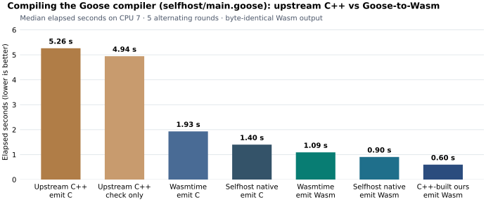

# Upstream C++ Goose compatibility and head-to-head self-compilation

Resolving all 33 strictness divergences between our self-hosted checker and upstream C++ Goose (`763e6ad9994e`) enables upstream C++ Goose (`build/native/goose`) to check, optimize (`-O2`), emit C (`13.77 MB`), and natively build our entire 23-file compiler (`selfhost/main.goose`). The resulting C++-built compiler emits bit-for-bit identical portable memory64 Wasm on both frozen `9a6040a` (`5,897,497` bytes, `df47e5c4...`) and current `selfhost/main.goose` (`4,673,668` bytes, `a4898578...`). In a 5-round interleaved comparison on CPU 7 compiling `selfhost/main.goose`, our **cached Wasmtime balanced compiler emitting Wasm** ran in **1.09 s** (7.57 B instructions) — **4.87× faster** than upstream C++ Goose emitting C (**5.26 s**, 41.04 B instructions; **0.205×** paired wall time, 5/5 pairs) and **4.56× faster** than upstream C++ Goose takes to run `check` alone (**4.94 s**, 39.34 B instructions). Even emitting C, cached Wasmtime (**1.93 s**) beat upstream C++ Goose by **2.73×** (**0.367×**, 5/5 pairs), while our self-hosted native compiler emitted Wasm in **0.90 s** (**5.86× faster**) and C in **1.40 s** (**3.81× faster**). [Results](results.json) · [All samples](samples.json.gz)

## Changes

- **`selfhost/checker_lifetimes.goose`:**
  - Changed `Lifetimes.{parents,depths,functions}` (and `check_lifetimes`/`life_check_attempt` parameters) from `const i64[:]` slices to `const i64[>..]&` array references and changed `LifeFailure` from `{ node: i64, message: const u8[:] }` to `{ node: i64, kind: i64 }` with a `life_failure_message(kind)` lookup helper. Removing raw `i64[:]` and `u8[:]` element slices from `struct Lifetimes` clears all 26 upstream §5.1 conservative shrink-aliasing errors (`CanHoldViewInto(Lifetimes, ...)`).
  - Replaced `(found > ...) as i64` and `(found >= 0) as i64` in `life_effect_indexed` with explicit `if` returns (upstream rejects `bool as i64`).
  - Hoisted RHS calls before assignments into `l.frames[...]` in `life_add_contents`, `life_class_call`, and `life_function`.
- **`selfhost/checker.goose`:**
  - Hoisted RHS calls before assignments into `p.nodes[...]` / `p.symbols[...]` / `c.*` across 13 sites (`check_substitute`, `check_clone`, `check_ensure_generics`, `check_resolve_type`, `check_expect`, `check_condition_value`, `check_record`, `check_render_hooks`, `check_prepare_function`, `check_block`, `check_loop`, `check_break`, `check_return`, `check_program_types`) to satisfy upstream §5.1 LHS/RHS shrink ordering.
- **`selfhost/codegen.goose`:**
  - Hoisted `cg_make_signature` results before assigning `m.functions[i].{signature,closure_signature}`.
  - Changed `cg_signature` parameters to `const u8[:]` and moved `m.signature_scratch.clear()` to the end of `cg_signature` (after `args` and `results` are last read).
- **`selfhost/codegen_c.goose`:**
  - Changed `indices` in `generate_c`, `cc_emit_function`, and `CcBody` to `const i32[>..]&` (`i32[>..]`) so upstream does not alias `indices` with `CcBody`'s mutable `i64[>..]&` scratch arrays.
- **`selfhost/wasm.goose`:**
  - Replaced `s.frames.clear()`/`push`/`pop` inside `wb_reuse_locals` with an integer stack cursor `frame_len` over `s.frames`, eliminating `.pop()` while slices borrowed from `s` are live.

## Head-to-head self-compilation (`selfhost/main.goose`, CPU 7)

Measured over 5 alternating rounds on CPU 7 (Ryzen 7 3800X; Wasmtime 50.0.1 host SHA-256 `b247393d...`; upstream C++ Goose `763e6ad9994e`, SHA-256 `b27ab168...`). All three Wasm-emitting compilers (`wasmtime-balanced`, `selfhost-native`, and `cppbuilt-native`) emitted byte-identical `4,673,668`-byte portable memory64 Wasm (`a4898578...`); both C-emitting selfhost compilers emitted byte-identical `36,761,790`-byte C (`b4cd1571...`).

| Compiler & mode (`selfhost/main.goose`) | Median wall | Median instructions | Paired ratio vs upstream C++ emit C | Speedup vs upstream C++ emit C |
| --- | ---: | ---: | ---: | ---: |
| Upstream C++ `goose` emit C (`-O2 -o main.c`) | 5.263 s | 41.036 B | 1.000× | 1.00× |
| Upstream C++ `goose check` | 4.945 s | 39.341 B | — | — |
| Our cached Wasmtime (`balanced.wasm`) → C | **1.931 s** | 14.623 B | **0.367×** (5/5) | **2.73×** (2.81× fewer instr) |
| Our self-hosted native (`goose`) → C | **1.401 s** | 12.174 B | **0.263×** (5/5) | **3.81×** (3.37× fewer instr) |
| Our cached Wasmtime (`balanced.wasm`) → Wasm | **1.091 s** | 7.570 B | **0.205×** (5/5) | **4.87×** (5.42× fewer instr) |
| Our self-hosted native (`goose`) → Wasm | **0.905 s** | 7.144 B | **0.171×** (5/5) | **5.86×** (5.74× fewer instr) |
| Our compiler built by upstream C++ + GCC (`-O3` + BCE) → Wasm | **0.598 s** | 3.100 B | **0.114×** (5/5) | **8.80×** (13.24× fewer instr) |

Note: the 5-round frozen `9a6040a` regression check ran in the same session under slightly higher ambient CPU frequency scaling than the earlier quiet Batch 8 run (absolute medians `0.860 s → 0.841 s` Wasmtime, `0.709 s → 0.707 s` native), showing **−2.5%** paired Wasmtime elapsed change (`0.975×`, 5/5 rounds; `5.721 B → 5.720 B` instructions) and **−0.4%** native instructions (`5.634 B → 5.614 B`, 5/5 rounds), with byte-identical `5,897,497`-byte output (`df47e5c4...`).

## Qualification

- Upstream C++ Goose (`build/native/goose check` and `build --cc gcc`) checked, optimized, and built `selfhost/main.goose` cleanly; the built binary emitted byte-identical Wasm on both frozen `9a6040a` (`df47e5c4...`) and current `selfhost/main.goose` (`a4898578...`).
- C bootstrap (`scripts/bootstrap.py --verify`) reached a fixed point (`3894d6e6...`).
- Native and balanced 32-bit Wasm compilers rebuilt `direct.wasm` byte-for-byte (`0b9e174a...`, 3,568,656 bytes).
- Default conformance: **10,697/10,801** (104 recorded gaps, 0 unexpected failures).
- 3-unit native conformance: **5,926/6,022** (96 recorded gaps, 0 unexpected failures).
- Memory64 conformance: **4,771/4,779** (8 recorded gaps, 0 unexpected failures).
- Native runtime checks: **54/54** passed.
- Unit tests: **101/101** passed.
- Output equivalence (`tests/output_equivalence.py`): **10,061** cases compared with **0** differences against `fb15dbf`.
- Measured with [measure_upstream_compat.py](measure_upstream_compat.py) and plotted with [plot.py](plot.py).
