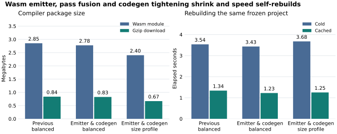

# Wasm emitter, pass fusion, bounds proof and codegen tightening

Reusing scratch buffers across emitted Wasm functions, compacting `wb_reuse_locals` onto `i32` slices with epoch-stamped arrays, pruning unused closure thunks and function table entries, fusing `mark_located_functions`/`cg_collect`/`cg_region_body_supported`/`cg_may_region` while removing by-value 160-byte `Node` copies, memoizing inliner dependency checks, and adding intra-procedural bounds proof plus tightened region reserve / `.len` / power-of-two index lowering cut Wasm backend time on frozen source `9a6040a` by **−20.5%** in cached Wasmtime (0.382 s → **0.298 s**) and **−17.6%** native (0.353 s → **0.289 s**). Full rebuilds fell **−8.5%** in cached Wasmtime (1.359 s → **1.250 s**, **−10.3%** instructions: 9.799 B → **8.794 B**) and **−6.3%** native (1.124 s → **1.062 s**, **−9.1%** instructions: 8.959 B → **8.140 B**). Cached Wasmtime now executes **fewer total instructions** than the previous `f7ae491` native compiler (0.982×, 7/7 pairs) and emits **10.6% smaller** portable memory64 Wasm (`6,594,988` → `5,897,497` bytes). [Profiles](profiles.json) · [Paired rebuilds](rebuilds.json) · [All samples](samples.json.gz) · [Training profile](training.profile)

## Changes

- **`selfhost/wasm.goose`:** Inlined `wb_byte` and added 1-byte LEB fast paths directly in `wb_u`, `wb_s`, `wb_op`, `wb_mem`, `wb_i32` and `wb_i64`. Replaced per-function `wb_reuse_locals` allocations with reusable `WbReuseScratch` buffers (`i32` index slices, local slice bindings, epoch-stamped `arm`/`stamp` tables and no-shrink `undo`/`merged`/`ends` cursors).
- **`selfhost/model.goose`:** Added `F_VALUE_USED` to `mark_located_functions`, switched node scans in `mark_located_functions` and `mark_unwinding_functions` to `const Node&`, and removed `[n.first, n.left, n.right, n.third]` temporary array allocations.
- **`selfhost/codegen.goose`:** Added reusable `CgEmitScratch`, hashed `cg_signature` with open-addressed `signature_slots`, pruned unused closure thunks and function-table entries using `F_VALUE_USED`, wrote Wasm sections directly into `out`, combined `cg_region_reserve_at`/`cg_region_publish_at` bounds checks and elided `cg_ensure_memory` on fixed-memory modules, added `cg_scale_index` power-of-two shifts and direct ordinary-owner `.len` / `F_BOUNDS_PROVEN` `N_INDEX` lowering, switched `region_memo` to `u8` populated bottom-up during `cg_region_body_supported`, skipped redundant `item.elements` scans, inlined `cg_diverges`/`cg_memo_get`/`cg_owner`/`cg_aggregate`, and eliminated hot by-value `Node` copies.
- **`selfhost/optimizer.goose`:** Removed redundant `opt_callees` pre-walk, memoized `opt_inline_dependencies_cached` per callee/strictness mode, avoided early-exit 432-byte copies in `opt_try_inline`, and added `-O2` intra-procedural bounds proof (`opt_prove_bounds`) for `for i in lo..arr.len`, `if i >= 0 && i < arr.len`, and short-circuit `&&` guards.

## Full builds on a frozen project

Measured on frozen source `9a6040a` on CPU 7 (Ryzen 7 3800X) with primed Wasmtime 50.0.1 caches (`host/rust/target/release/goose-wasmtime`, SHA-256 `b247393d...`). Every baseline run verified deterministic 6,594,988-byte portable memory64 output (`3e3d7d8a...`); every candidate run verified deterministic 5,897,497-byte output (`df47e5c4...`, −10.6%). Both native compilers were built with `scripts/bootstrap.py --verify`; both bundled memory32 Wasm releases were built with `--wasm-bundled-host --wasm-initial-pages 65535 --wasm-max-pages 65535` and a release-specific region layout profile trained on `9a6040a`, `squares`, `sorting` and `tour`.

| Release | Raw Wasm | Gzip | Cold rebuild | Cached rebuild |
| --- | ---: | ---: | ---: | ---: |
| Previous balanced (`f7ae491`, `ec34ff9b`) | 2.85 MB | 0.84 MB | 3.54 s | 1.34 s |
| Emitter & codegen, balanced (`84c50611`) | **2.78 MB** | **0.83 MB** | **3.43 s** (−3.6% paired) | **1.23 s** (−7.5% paired) |
| Emitter & codegen, size (`398b40fc`) | **2.40 MB** | **0.67 MB** | 3.68 s (+4.5% paired) | **1.25 s** (−7.8% paired) |

| Cached, 7 alternating pairs (frozen `9a6040a`) | Before median (`f7ae491`) | After median | Paired elapsed ratio | Paired backend ratio | Paired instruction ratio |
| --- | ---: | ---: | ---: | ---: | ---: |
| Wasmtime balanced | 1.359 s (9.799 B instr) | **1.250 s** (**8.794 B** instr) | **0.915×** (7/7 faster) | **0.795×** (−20.5%) | **0.897×** (−10.3%) |
| Native | 1.124 s (8.959 B instr) | **1.062 s** (**8.140 B** instr) | **0.937×** (7/7 faster) | **0.824×** (−17.6%) | **0.909×** (−9.1%) |
| Wasmtime after / Native before | 1.124 s (8.959 B instr) | 1.250 s (**8.794 B** instr) | 1.111× | **0.848×** (7/7 faster) | **0.982×** (7/7 fewer) |
| Wasmtime after / Native after | 1.062 s (8.140 B instr) | 1.250 s (8.794 B instr) | 1.178× | 1.035× | 1.080× |

On the current compiler's own source (`selfhost/main.goose`, 7 alternating pairs on CPU 7), the balanced Wasmtime compiler took **1.264 s** (`backend = 0.245 s`, 8.866 B instr) vs **1.049 s** native (`backend = 0.235 s`, 8.003 B instr) — a **1.204×** paired elapsed ratio (**1.108×** instructions, **1.050×** backend), with both compilers emitting byte-identical 4,464,385-byte portable memory64 Wasm (`bfec8cb7...`).

On emitted `examples/sorting.goose` (7 cached Wasmtime pairs on CPU 7, identical stdout), module size fell from `85,174` to **`81,292` bytes** (−4.6%) and retired instructions fell deterministically across 7/7 pairs (`2,012.5 M → 2,011.5 M`, 0.9995×), while elapsed time exhibited bimodal Zen 2 code-alignment jitter between `106 ms` and `135 ms` (median `110.8 ms` before vs `134.7 ms` after; min `109.0 ms` before vs `106.0 ms` after).

## Qualification

- C bootstrap (`scripts/bootstrap.py --verify`) reached a fixed point (`d34ad587...`).
- Native and balanced 32-bit Wasm compilers rebuilt the bundled 32-bit direct compiler byte-for-byte (`0180205e...`, 3,482,709 bytes vs 3,743,151 bytes previously, −7.0%).
- Default conformance: **10,697/10,801** (104 recorded gaps, 0 unexpected failures).
- Memory64 conformance: **4,771/4,779** (8 recorded gaps, 0 unexpected failures).
- Native runtime checks: **54/54** passed.
- Unit tests: **101/101** passed.
- Output equivalence (`tests/output_equivalence.py`): **10,061** cases compared with **0** exit-code, stdout, stderr or `check`-mode differences (`1,390` `wasm2` and `47` `native2` expected codegen/BCE output improvements, plus `10` `native0` nested-closure constant-folding improvements after removing `opt_callees`).
- Measured with [measure_batch3.py](measure_batch3.py) and plotted with [plot.py](plot.py).
