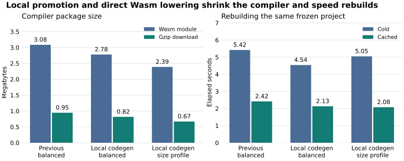

# Local promotion and direct Wasm codegen

Promoting non-address-taken references, slices, function values and scalar locals to Wasm locals, eliding unused activation frames, constructing fixed aggregates directly in their destinations, folding constant field/member store offsets, fusing inverted comparisons and pruning unused loop bookkeeping cut cached Wasmtime self-build instructions by **16.5%** (16.46 B → **13.75 B**, fewer instructions than the previous Clang `-O2` native compiler's 13.76 B) and shrank the balanced compiler from **3.08 MB to 2.78 MB** (−9.9%; size profile **2.39 MB**, −12.6%). On `examples/sorting.goose`, emitted Wasm instructions fell **42.7%** and guest runtime fell **31.4%** (182.7 ms → **125.4 ms**). [Profiles](profiles.json) · [Paired rebuilds and runtime](rebuilds.json) · [All samples](samples.json.gz)

## Changes in `selfhost/codegen.goose`

- **Local promotion (`cg_local_slot_type`, `cg_prepare_function`, tighter `CG_ADDRESS_TAKEN`):** keeps non-address-taken `TY_REF`, `TY_SLICE`, `TY_FN`, `N_BINDING`, `N_VARIABLE` and narrow integer bindings in Wasm locals instead of stack-frame slots.
- **Leaf-frame elision (`f.frame_used`):** skips frame-pointer save/restore and stack reservation when a function never touches frame memory.
- **Direct aggregate construction (`f.direct_return`, `cg_emit_into_dest`, `cg_record_full_init`):** constructs fresh fixed aggregates directly in the destination slot (guarded by `!in_place` in `cg_record_fields`) and skips zero-clearing structs when all non-padding fields are explicitly initialized.
- **Store offset folding & fused branches (`fold_base`, `member_offset`, `cg_branch_cond`, `cg_invert_comparison`):** folds constant field offsets into memory store immediates in bundled `-O2` mode and lowers negated integer comparisons / short-circuit `&&`/`||` conditions directly to branches.
- **Loop lowering (`cg_for`, `cg_may_region`):** hoists stable slice/array base pointers across loops, skips unused loop ordinals and skips region mark/restore when a block or loop cannot acquire regions.

## Full builds on a frozen project

Measured on frozen source `9a6040a` on CPU 7 (Ryzen 7 3800X, shared host) with primed Wasmtime 50.0.1 caches (`host/rust/target/release/goose-wasmtime`, SHA-256 `b247393d...`). Every run verified deterministic portable memory64 output (baseline 7,378,033 B, SHA-256 `86cc98b2...`; candidate 6,594,988 B, −10.6%, SHA-256 `3e3d7d8a...`).

| Release | Raw Wasm | Gzip | Cold rebuild | Cached rebuild |
| --- | ---: | ---: | ---: | ---: |
| Previous balanced (`f4dadfc1`) | 3.08 MB | 0.95 MB | 5.42 s | 2.42 s |
| Local codegen, balanced (`ced8e84e`) | 2.78 MB | 0.82 MB | 4.54 s (−12.0% paired) | 2.13 s (−14.8% paired) |
| Local codegen, size (`1567dcf7`) | 2.39 MB | 0.67 MB | 5.05 s (−3.3% paired) | 2.08 s (−15.8% paired) |

| Cached, 7 alternating pairs (frozen `9a6040a`) | Before median | After median | Paired elapsed ratio | Paired instruction ratio | Paired cycle ratio |
| --- | ---: | ---: | ---: | ---: | ---: |
| Wasmtime balanced | 2.477 s (16.464 B instr) | 2.174 s (13.753 B instr) | **0.892×** (7/7 faster) | **0.835×** (−16.5%) | **0.879×** (−12.1%) |
| Native | 1.913 s (13.763 B instr) | 1.860 s (12.901 B instr) | 0.993× (5/7 faster) | **0.937×** (−6.3%) | 0.967× (−3.3%) |
| Wasmtime after / Native before | 1.913 s (13.763 B instr) | 2.174 s (13.753 B instr) | 1.164× | **0.999×** (−0.07%) | 1.161× |

On the current compiler's own source (`selfhost/main.goose`, 7 alternating pairs on CPU 7, shared host), the balanced Wasmtime compiler took **1.94 s** (12.593 B instr) vs **1.66 s** native (11.635 B instr) — a **1.18×** paired elapsed ratio (**1.08×** instructions), down from **1.31×** before this change, with both compilers emitting identical 4,396,348-byte portable Wasm (`eae89536...`).

## Emitted Wasm runtime

Seven alternating pairs on `examples/sorting.goose` (CPU 7, cached Wasmtime 50.0.1, identical stdout):

| Metric | Baseline | Candidate | Change |
| --- | ---: | ---: | ---: |
| Direct `-O2` Wasm size | 101,513 B | 85,174 B | −16.1% |
| Guest runtime | 182.7 ms | 125.4 ms | **−31.4%** |
| Instructions retired | 3,514.8 M | 2,012.5 M | **−42.7%** |
| Cycles | 636.5 M | 442.1 M | **−30.5%** |

## Qualification

- C bootstrap (`scripts/bootstrap.py --verify`) reached a fixed point (`300f606c...`).
- Native and Wasm compilers rebuilt the bundled 32-bit direct compiler byte-for-byte (`f7f8cdd9...`).
- Default conformance: **10,697/10,801** (104 recorded gaps, 0 unexpected failures).
- Memory64 conformance: **4,771/4,779** (8 recorded gaps, 0 unexpected failures).
- Native runtime checks: **54/54** passed.
- Unit tests: **101/101** passed.
- Output equivalence (`tests/output_equivalence.py`): **10,061** comparisons; 0 differences in `check`, `native0`, `native2`, `wasm0`, and 0 exit/stdout/stderr differences across all 1,376 expected `wasm2` bytecode improvements.
- Measured with [measure_batch1.py](measure_batch1.py) and plotted with [plot.py](plot.py).
