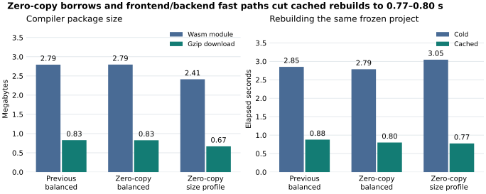

# Zero-copy borrows, lifetime struct compaction and frontend/backend fast paths

Eliminating ~215 whole-struct `Node`/`Type`/`Symbol`/`Token`/`LifeRoot`/`LifeValue` value copies across `checker_validation.goose`, `checker.goose`, `checker_lifetimes.goose`, `optimizer.goose` and `codegen.goose`; compacting nine hot lifetime structs (`LifeValue`, `LifeSet`, `LifeItem`, `LifeHold`, `LifeLeaf`, `LifeExit`, `LifeEffect`, `LifeCell`, `LifeCellKey`) from `i64` to `i32` IDs; adding single-root fast paths and packed 64-bit hashes in `life_effect`/`life_offer_slot`/`life_leaf_hash` plus inline fast paths in `life_equal`/`life_join`/`life_append`; fixing an exponential double-recursion bug on `N_IF`/`&&`/`||` in `opt_node` with leaf fast-returns across `optimizer.goose`; replacing `cg_binding_result_type`'s AST/type growth with negative-ID encoding plus adding `cg_convert`/`cg_expr_body`/`cg_prescan_node` fast paths and 2-byte ULEB fast paths in `wasm.goose`; and adding lookup-table scanning, decimal integer fast-pathing, and a zero-collision 128-slot FNV-1a keyword filter in `lexer.goose` cut frozen `9a6040a` rebuilds by **−8.4%** paired wall time / **−9.8%** instructions in cached Wasmtime (0.860 s → **0.791 s** paired, **0.800 s** release cached, **0.774 s** size profile; 6.929 B → **6.252 B** instructions, −677 M) and **−6.8%** wall time / **−7.4%** instructions native (0.692 s → **0.644 s**, 6.501 B → **6.022 B** instructions). Cached Wasmtime now retires **3.8% fewer instructions** than the previous `2b0405d` native compiler (**0.962×**, 7/7 pairs) and comes within **3.8%** of the new native compiler's instruction count (**1.038×**) while emitting bit-for-bit identical 5,897,497-byte portable memory64 output (`df47e5c4...`). [Profiles](profiles.json) · [Paired rebuilds](rebuilds.json) · [All samples](samples.json.gz) · [Training profile](training.profile)

## Changes

- **`selfhost/checker.goose` & `selfhost/checker_validation.goose`:**
  - Replaced ~120 whole-struct `Node` (160 B), `Type`, `Symbol`, and `Token` copies with `const &` borrows or scalar field loads across `checker_validation.goose` (~35 sites) and `checker.goose` (~85 hot sites including `check_conversion`, `check_unify`, `check_call`, `check_declare`, `check_expression`, `check_variable`, `check_assignment`, `check_function`, `check_statement`, `check_literal_argument`, and `check_resolve_component`).
  - Changed `check_choose_call`, `check_context_float_choice`, and `check_try_dispatch` to pass `callee_node: i64` instead of copying a 160 B `Node` by value on every call; detected `has_generic` in `check_call` to skip generic binding/substitution loops on non-generic calls; added O(1) same-type fast paths in `check_conversion`, `check_unify`, and `check_numeric_value_type`; indexed `validation_index_owners` and replaced `while push` loops in `check_type_property`/`check_type_property_scan` with `.resize`.
- **`selfhost/checker_lifetimes.goose`:**
  - Compacted nine hot structs to `i32` IDs (preserving field order): `LifeValue` (72 B → 36 B), `LifeSet` (88 B → 48 B), `LifeItem` (80 B → 40 B), `LifeHold` (96 B → 48 B), `LifeLeaf` (96 B → 48 B), `LifeExit` (104 B → 52 B), `LifeEffect` (153 B → 81 B), `LifeCell` (104 B → 56 B, fitting inside one 64 B cache line), and `LifeCellKey` (40 B → 20 B), with `LIFE_PARAMETER_BOUND = -2` so `bound_depth: i32` caches parameter bounds cleanly without `-O0` overflow.
  - Eliminated all ten 224 B `LifeRoot` copies (`const LifeRoot&`) and converted hot helpers to `const LifeValue&` and safe `const LifeAlt&`.
  - Optimized `life_effect` (the #1 SIGPROF hotspot at 5.05%): fast-returned `0` for `pset.count == 1 && root == 0`, inlined the single-root reach check (eliminating ~90% of `life_effect_far` calls), and guarded `life_summary_reserve`/`life_index_reserve`.
  - Packed `i32` field pairs into `u64` words in `life_offer_slot` (5 FNV steps vs 10) and `life_leaf_hash` (6 steps vs 11); split `life_equal` and `life_join` into inline fast paths + `*_slow`; made `life_append` inline; bypassed `life_item`+`life_coerce` in `life_function` when parameter items are already coerced; guarded `life_frames_reserve`, `life_leave_scope`, `N_IF` branches, `out.contents`, and `life_analyze_node` children; dispatched void loops directly to `life_eval_loop`; removed the redundant `l.omit_construct_reads = false` in `life_class_new`; and replaced `while push(0)` resize loops on mark arrays with `.resize`.
- **`selfhost/optimizer.goose`:**
  - Fixed an exponential double-recursion bug in `opt_node` where `N_IF` and `N_BINARY` (`&&`/`||`) recursed on `left` and then fell through to recurse on `left` a second time; added leaf-kind skips and early post-recursion returns in `opt_node`, `opt_collect`, `opt_tail_rewrite`, `opt_callees`, and `opt_has_defer`, and removed `Node`/`Symbol` copies in hot optimizer helpers.
- **`selfhost/codegen.goose`, `selfhost/wasm.goose`, `selfhost/model.goose`:**
  - Replaced `cg_binding_result_type`'s AST/type mutations with negative-ID encoding (`-2 - first`), making all of `codegen.goose` non-growing for `p.nodes`/`p.types`/`p.symbols`, and converted all 97 `p.(nodes|types|symbols)[...]` copies to `const &` (plus `const CgDestination&`).
  - Split `cg_convert` into an inline same-type fast path + `cg_convert_slow`; guarded `cg_prescan_node` type-property checks with `tid >= 13`; guarded `token_is("len")`/`token_is("cap")` in `cg_expr_body` with `n.symbol < 0`; simplified `cg_get`/`cg_set` to single unsigned range checks; added 2-byte ULEB fast paths in `wb_op`, `wb_mem`, `wb_u`, and `wb_reuse_locals`; and bound `Node&` in `append_child`.
- **`selfhost/lexer.goose`:**
  - Added `LEX_IDENT: u8[256]` identifier-character table, `LEX_SINGLE: u8[128]` inline single-character punctuation dispatch, a zero-collision 128-slot multiplicative FNV-1a keyword filter `LEX_KW_HASH: u32[128]` (`((h as u64 * 3005) as! u32) >> 25`, skipping `lex_keyword` on ~95% of identifiers), and a fast-path decimal integer scanner (< 18 digits) avoiding per-digit 64-bit unsigned division.

## Rejected and traded-off experiments

- **2-byte SLEB fast paths in `wb_i32` / `wb_i64`:** Added ~8 KB to `balanced.wasm` (`2,802,981` vs `2,794,951` bytes) across 205 callsites for negligible runtime savings because most emitted immediates fit 1-byte SLEB (`−64..63`) or exceed 14 bits. Reverted `wb_i32`/`wb_i64` while retaining the 2-byte ULEB fast paths in `wb_op`, `wb_mem`, and `wb_u`.
- **Skipping throwaway `N_TYPE_ARG` allocation in `check_return_value`:** Avoided allocating a single-return `N_TYPE_ARG` node in `p.nodes`, but shifted downstream specialized function node IDs (`g_fn<id>` in C, nonlocal-return handler tags in Wasm, and one error path), producing 359/10,061 output-equivalence diffs for negligible (< 0.2 ms) savings. Reverted to preserve 0/10,061 output equivalence across all backends.
- **`.resize()` on `checker.goose` lookup tables (`variable_lookup`, `root_nodes`, `root_symbols`) and `const LifeAlt&` across class-query/build-shrink paths:** Goose's lifetime checker models `.resize()` as a potential shrink (`life_shrink_array`) and tracks aliasing across same-typed `LifeAlt[>..]` arrays (`l.alts`, `l.scratch`, `l.build_alts`). Kept `while push` on those three checker tables and by-value `LifeAlt` (28 B) across calls reaching `life_build_add`/`life_class_query*`.

## Full builds on a frozen project

Measured on frozen source `9a6040a` on CPU 7 (Ryzen 7 3800X) with primed Wasmtime 50.0.1 caches (`host/rust/target/release/goose-wasmtime`, SHA-256 `b247393d...`). Every baseline and candidate run verified byte-identical 5,897,497-byte portable memory64 output (`df47e5c4...`). Both native compilers were built with `scripts/bootstrap.py --verify`; both bundled memory32 Wasm releases were built with `--wasm-bundled-host --wasm-initial-pages 65535 --wasm-max-pages 65535` and a release-specific region layout profile trained on `9a6040a`, `squares`, `sorting` and `tour`.

| Release | Raw Wasm | Gzip | Cold rebuild | Cached rebuild |
| --- | ---: | ---: | ---: | ---: |
| Previous balanced (`2b0405d`, `f33b7041`) | 2.79 MB | 0.83 MB | 2.85 s | 0.88 s |
| Borrows & fast paths, balanced (`b328761c`) | **2.79 MB** | **0.83 MB** | **2.79 s** (−2.2% paired) | **0.80 s** (−8.8% paired) |
| Borrows & fast paths, size (`7f6c22d2`) | **2.41 MB** | **0.67 MB** | 3.05 s (+6.9% paired) | **0.77 s** (−12.2% paired) |

| Cached, 7 alternating pairs (frozen `9a6040a`) | Before median (`2b0405d`) | After median | Paired elapsed ratio | Paired typecheck ratio | Paired optimize ratio | Paired instruction ratio |
| --- | ---: | ---: | ---: | ---: | ---: | ---: |
| Wasmtime balanced | 0.860 s (6.929 B instr) | **0.791 s** (**6.252 B** instr) | **0.916×** (−8.4%, 7/7) | **0.828×** (−17.2%, 7/7) | **0.876×** (−12.4%, 7/7) | **0.902×** (−9.8%, 7/7) |
| Native | 0.692 s (6.501 B instr) | **0.644 s** (**6.022 B** instr) | **0.932×** (−6.8%, 7/7) | **0.909×** (−9.1%, 7/7) | **0.891×** (−10.9%, 7/7) | **0.926×** (−7.4%, 7/7) |
| Wasmtime after / Native before | 0.692 s (6.501 B instr) | 0.791 s (**6.252 B** instr) | 1.142× | 1.184× | 1.117× | **0.962×** (−3.8%, 7/7) |
| Wasmtime after / Native after | 0.644 s (6.022 B instr) | 0.791 s (6.252 B instr) | 1.230× | 1.302× | 1.281× | **1.038×** |

Phase breakdown on frozen `9a6040a` (paired medians, Wasmtime balanced before → after): parse `62.8 ms → 58.9 ms` (−6.4% paired), typecheck excl. lifetime `199.3 ms → 165.1 ms` (−17.2%), lifetime `288.4 ms → 273.6 ms` (−5.3%), optimize `95.5 ms → 83.2 ms` (−12.4%), backend `198.1 ms → 192.3 ms` (−2.6%).

On the current compiler's own source (`selfhost/main.goose`, 7 alternating pairs on CPU 7), the balanced Wasmtime compiler took **1.048 s** (`parse = 0.063 s`, `typecheck excl. lifetime = 0.181 s`, `lifetime = 0.548 s`, `optimize = 0.074 s`, `backend = 0.168 s`, 8.348 B instr) vs **0.833 s** native (`parse = 0.053 s`, `typecheck excl. lifetime = 0.142 s`, `lifetime = 0.424 s`, `optimize = 0.059 s`, `backend = 0.148 s`, 7.737 B instr) — a **1.258×** paired elapsed ratio (**1.079×** instructions, **1.136×** backend), with both compilers emitting byte-identical 4,619,713-byte portable memory64 Wasm (`18175148...`).

## Qualification

- C bootstrap (`scripts/bootstrap.py --verify`) reached a fixed point (`ff42086b...`).
- Native and balanced 32-bit Wasm compilers rebuilt the bundled 32-bit direct compiler byte-for-byte (`a87b3558...`, 3,528,131 bytes).
- Default conformance: **10,697/10,801** (104 recorded gaps, 0 unexpected failures).
- Memory64 conformance: **4,771/4,779** (8 recorded gaps, 0 unexpected failures).
- Native runtime checks: **54/54** passed.
- Unit tests: **101/101** passed.
- Output equivalence (`tests/output_equivalence.py`): **10,061** cases compared with **0** differences across exit codes, stdout, stderr, `check`, `native0`, `native2`, `wasm0`, and `wasm2`.
- Measured with [measure_batch7.py](measure_batch7.py) and plotted with [plot.py](plot.py).
