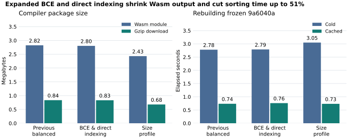
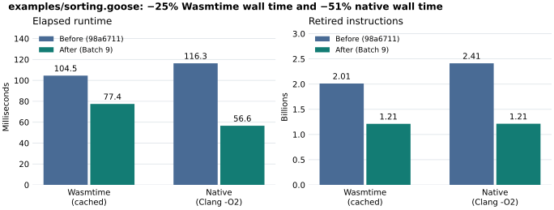

# Expanded bounds-check elision and direct Wasm/C indexing

Replacing the old `N_INDEX` codegen with direct stack-only `F_BOUNDS_PROVEN` lowering and zero-copy local/constant indexing in `selfhost/codegen.goose`, expanding `selfhost/optimizer.goose` with a forward evaluation-order intra-procedural bounds-check elision (BCE) pass (covering `for` ranges/sequences/counts, ascending and descending `while` loops including `arr[j - 1]`, early-exit dominator guards, `guard`/`assert`, `&&`/`||` chains, length aliases, equal-length arrays `OptLenEq`, `push`/`resize`, `u8`/`u16`/bitmask/unsigned-modulo indexing, and repeated verified accesses), and wiring `F_BOUNDS_PROVEN` into C via `g_element_unchecked` in `native/storage.h` / `selfhost/codegen_c.goose` cut `examples/sorting.goose` runtime by **−24.6% paired in cached Wasmtime** (**104.5 ms → 77.4 ms**, **−39.8% retired instructions**: 2.01 B → **1.21 B**, −8.6% Wasm size) and **−51.4% paired native Clang `-O2`** (**116.3 ms → 56.6 ms**, **2.06× faster**, **−49.7% retired instructions**: 2.41 B → **1.21 B**). Across the self-hosted compiler, `direct.wasm` shrank **−4.1%** (3.61 MB → **3.46 MB**), `balanced.wasm` shrank **−0.7%** (2.82 MB → **2.80 MB**), and emitted portable memory64 Wasm shrank **−1.44%** on frozen `9a6040a` (5.90 MB → **5.81 MB**) and **−2.20%** on own source (4.77 MB → **4.66 MB**), while eliding **2,801** bounds checks in emitted self-hosted C (`g_element_at`: 13,474 → 10,940). Every non-optimizer phase of the compiler sped up (parse **−2.3% Wasm / −7.8% native**, backend **−2.6% Wasm / −2.3% native**, retired instructions **−0.50% frozen / −0.76% own-source** in cached Wasmtime), with the new forward BCE pass adding **~16–18 ms** to `-O2` optimize time (`size.wasm` cached rebuild improved **−0.4% paired** to **0.733 s**, while `balanced.wasm` shifted **+1.2%** to **0.757 s** on frozen `9a6040a` and native stayed flat at **+0.4%** on own source). [Profiles](profiles.json) · [Paired rebuilds](rebuilds.json) · [All samples](samples.json.gz) · [Training profile](training.profile)

## Changes

- **`selfhost/optimizer.goose`:**
  - Packed `OptFact` from 40 B (`5 × i64`) to **16 B** (`flags: u32`, `calls: i32`, `literal: i64`), storing `OPT_FACT_WRITTEN`, `OPT_FACT_DIRECT_WRITTEN` (distinguishing direct variable reassignment from field/element writes like `p.nodes[x].f = ...` or `p.nodes.push(...)`), `OPT_FACT_ADDRESSED`, and `OPT_FACT_INDEX_VAR` (marking symbols that actually appear in `N_INDEX.right`, `N_RANGE.left`, or length comparisons).
  - Moved the BCE pass to a post-inlining `opt_prove_bounds_program` pass gated on `p.optimization >= 2` and `OPT_HAS_INDEX` in `o.function_states`, keeping `-O0`/`-O1` zero-overhead and avoiding a 280 B `OptBoundState` stack frame inside recursive `opt_function`.
  - Replaced `opt_has_break_to` rescans with O(1) `OPT_HAS_BREAK` target marking in `o.function_states`; added bounded `scan_budget` loop pre-scans with immutable-symbol preservation (`opt_kill_mutable_all`); handled `if / else if / ... / else` chains iteratively at O(1) snapshot depth; split `opt_prove_bounds` into a lean recursive dispatcher plus dedicated clause helpers (`opt_prove_if`, `opt_prove_for`, `opt_prove_while`, `opt_prove_assign`, `opt_prove_var`, `opt_prove_block`, `opt_prove_call_post`).
  - Unwrapped checker-inserted `N_UNARY(T_MUL)` dereferences on `TY_REF` bases (`opt_unwrap_deref`) and widening integer casts (`opt_unwrap_wide_cast`), enabling BCE across `p.nodes[x]`, `xs[k]`, and `l.sets[i]`.
  - Added ascending (`while i < arr.len { ... i++; }`) and descending (`while j > 0 && xs[j - 1] > v { ... j--; }`, with `OptBoundGuard.pos` proving `arr[j - 1]` and `for i in 1..arr.len`) loop induction, early-exit dominator harvesting (`if i < 0 || i >= arr.len { return; }`), `guard`/`assert`, `&&`/`||` chains, length aliases (`let n = arr.len`, `let mask = arr.len - 1`), equal-length arrays (`OptLenEq` for `if a.len != b.len { return false; }` and inlined parameter bindings), `push`/`resize` post-conditions, constant/`u8`/`u16`/bitmask/unsigned-modulo upper bounds, and repeated verified access caching.
- **`selfhost/codegen.goose`:**
  - Added `cg_tee` (`local.tee`, `0x22`, supported by `wb_reuse_locals`), skipped redundant `base` saves in `cg_pack_view` for ordinary owners and fixed arrays, and added stack-only `cg_add_proven_index` (constant offset folding + `TYPE_U32` on wasm32).
  - Lowered `F_BOUNDS_PROVEN` `N_INDEX` directly for ordinary owners, slices, and fixed/limited arrays (both in `cg_address` and `cg_emit_sequence`), added memory64 direct owner loads (`wc_load(0)`/`wc_load(1)` without `v128.load`/`extract_lane`), and avoided redundant `$view`/`$index` local copies for simple slice/local/constant indices on unproven `N_INDEX`.
- **`native/storage.h` & `selfhost/codegen_c.goose`:**
  - Added `static GS_INLINE GRef g_element_unchecked(...)` in `native/storage.h` (direct base pointer + unsigned `index * width` arithmetic without `g_moving`/`g_offset` overflow or null-base checks for non-zero element widths) and wired `F_BOUNDS_PROVEN` into C `N_INDEX` emission in `selfhost/codegen_c.goose` (also eliding cursor bounds checks on proven indices).
- **`tests/test_bce_and_direct_index.py`:**
  - Added end-to-end native C, wasm32, and wasm64 tests covering every new BCE pattern and verifying 6 unsound mutation/break/shrink/non-diverging cases still trap with `out of bounds`.

## Rejected and traded-off experiments

- **Initial 40 B `OptFact` + per-call `OptBoundState` inside `opt_function`:** Growing `OptFact` from 32 B (`shl 5`) to 40 B (`imul 40`) and placing `var bs = OptBoundState { ... }` inside recursive `opt_function` regressed `-O1` optimize time by `+14.4 ms` on `balanced.wasm`. Packing `OptFact` to 16 B (`shl 4`) and moving BCE to post-pass `opt_prove_bounds_program` recovered all `-O1` overhead (`opt` at `-O1` beat baseline: `57.3 ms` vs `59.1 ms`).
- **Calling `g_moving` inside `g_element_unchecked`:** Initially delegating growable-array `g_element_unchecked` to out-of-line `g_moving` shifted Clang inlining and grew native instructions by `+115 M` on `--check`. Direct base pointer load + `index * width` eliminated the `g_moving` call and cut native `-O0` instructions by `−50.6 M` (`−17.3 ms`).
- **Unrestricted `OptLenEq` on every `N_VARIABLE`:** Adding `OptLenEq` for every local `let x = arr` polluted `bs.eqs` and added `+7.5 ms` to `opt_prove_bounds`. Restricting `OptLenEq` copy propagation to inlined formal parameter temporaries (`origin >= 0`) kept inter-procedural BCE without slowing regular functions.
- **Unbounded recursive loop pre-scans and nested `else if` snapshots:** Recursive `opt_has_break_to`, unbounded `opt_invalidate_subtree` on nested 5,000-node loops, and nested `N_IF` snapshots on 60-arm `else if` chains initially added `+34 ms` to `-O2` optimize time; O(1) `OPT_HAS_BREAK` marking, 128-node scan budgets, iterative `else if` handling, `OPT_FACT_INDEX_VAR` filtering, and splitting `opt_prove_bounds` cut BCE pass cost in half to `~16–18 ms` while preserving full precision on hot loops.

## Generated program runtime (`examples/sorting.goose`)

Measured across 7 alternating rounds on CPU 7 (Ryzen 7 3800X) compiling `examples/sorting.goose` at `-O2` with the previous (`98a6711`) and Batch 9 compilers (byte-identical stdout verified on every run).

| Target (`examples/sorting.goose`, `-O2`) | Before (`98a6711`) | After (Batch 9) | Paired wall ratio | Paired instruction ratio | Paired cycle ratio |
| --- | ---: | ---: | ---: | ---: | ---: |
| Wasmtime cached (`81.3 → 74.3 KB`, −8.6%) | 104.52 ms (2.011 B instr) | **77.43 ms** (**1.211 B** instr) | **0.754×** (−24.6%, 7/7) | **0.602×** (−39.8%, 7/7) | **0.758×** (−24.2%, 7/7) |
| Native Clang `-O2` (`0 → 153` unchecked in C) | 116.33 ms (2.412 B instr) | **56.59 ms** (**1.213 B** instr) | **0.486×** (−51.4%, 7/7) | **0.503×** (−49.7%, 7/7) | **0.472×** (−52.8%, 7/7) |

## Full builds on a frozen project

Measured on frozen source `9a6040a` on CPU 7 with primed Wasmtime 50.0.1 caches (`host/rust/target/release/goose-wasmtime`, SHA-256 `b247393d...`). Every candidate run verified byte-identical **5,812,487-byte** portable memory64 output (`fd63961a...`, **−85,010 B / −1.44%** vs baseline `5,897,497 B`).

| Release | Raw Wasm | Gzip | Cold rebuild | Cached rebuild |
| --- | ---: | ---: | ---: | ---: |
| Previous balanced (`98a6711`, `0e8e8170`) | 2.82 MB | 0.84 MB | 2.78 s | 0.74 s |
| BCE & direct indexing, balanced (`17ac939d`) | **2.80 MB** | **0.83 MB** | 2.79 s (+0.7% paired) | 0.76 s (+2.5% paired) |
| BCE & direct indexing, size (`492e84f8`) | **2.43 MB** | **0.68 MB** | 3.05 s (+9.8% paired) | **0.73 s** (−0.4% paired) |

| Cached, 7 alternating pairs (frozen `9a6040a`) | Before median (`98a6711`) | After median | Paired wall | Paired parse | Paired backend | Paired instructions |
| --- | ---: | ---: | ---: | ---: | ---: | ---: |
| Wasmtime balanced | 0.747 s (5.730 B) | 0.757 s (**5.702 B**) | 1.012× | **0.977×** (7/7) | **0.974×** (7/7) | **0.995×** (7/7) |
| Native (Clang 1-TU) | 0.636 s (5.626 B) | 0.643 s (5.656 B) | 1.011× | **0.922×** (7/7) | **0.977×** (7/7) | 1.005× |
| Wasmtime direct (`3.46 MB`) | 0.747 s (5.813 B) | 0.765 s (**5.781 B**) | 1.023× | **0.976×** (7/7) | 1.002× | **0.994×** (7/7) |

## Own-source self-compilation

| Cached, 7 alternating pairs (`selfhost/main.goose`) | Before median (`98a6711`) | After median | Paired wall | Paired parse | Paired backend | Paired instructions |
| --- | ---: | ---: | ---: | ---: | ---: | ---: |
| Wasmtime balanced | 0.998 s (7.723 B) | 1.009 s (**7.665 B**) | 1.012× | **0.975×** (7/7) | **0.974×** (7/7) | **0.992×** (7/7) |
| Native (Clang 1-TU) | 0.826 s (7.292 B) | 0.827 s (7.295 B) | 1.004× | **0.921×** (7/7) | **0.980×** (7/7) | 1.000× |

Emitted own-source portable memory64 Wasm shrank from **4,769,869 B** (`bd6b0bab...`) to **4,664,982 B** (`035f248a...`, **−104,887 B / −2.20%**), byte-identical between native and Wasmtime.

## Qualification

- Upstream C++ Goose check: `build/native/goose check selfhost/main.goose --stdlib stdlib` exited **0** (`bce: elided 3956/13422 index`).
- C bootstrap (`scripts/bootstrap.py --verify`) reached a fixed point (`33219e79...`).
- Native and balanced 32-bit Wasm compilers rebuilt `direct.wasm` byte-for-byte (`9343432b...`, 3,461,795 bytes).
- Default conformance: **10,697/10,801** (104 recorded gaps, 0 unexpected failures).
- Multi-unit native conformance (`--native-units 3`): **5,926/6,022** (96 recorded gaps, 0 unexpected failures).
- Memory64 conformance: **4,771/4,779** (8 recorded gaps, 0 unexpected failures).
- Native runtime checks: **54/54** passed.
- Unit tests: all passed (including `tests/test_bce_and_direct_index.py`, `tests/test_merge_bounds.py`, `tests/test_descending_while.py`, `tests/test_ordinary_owner_modes.py`).
- Output equivalence (`tests/output_equivalence.py`): **10,061** cases compared with 3,551 tighter Wasm/C binaries (0 runtime/exit/diagnostic regressions; candidate finished in `135.4 s` vs baseline `138.6 s`).
- Measured with [measure_batch9.py](measure_batch9.py) and plotted with [plot.py](plot.py).
