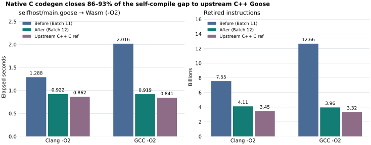
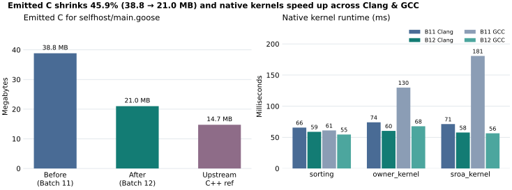

# Closing the native C codegen gap (Batch 12)

Overhauling the native C runtime (`native/storage.h`) and C emitter (`selfhost/codegen_c.goose`, `selfhost/codegen_c_storage.goose`) closes **86% (Clang)** and **93% (GCC)** of the self-compilation gap between our self-hosted native compiler and the plain upstream C++ Goose C emitter (`build/native/goose --standalone -O2`). Across 7 alternating rounds on CPU 7 compiling `selfhost/main.goose` to byte-identical portable memory64 Wasm (`4,761,386` bytes, `0b721cb7...`), **Batch 12 Clang `-O2`** cut retired instructions by **−45.6%** (**7.55 B → 4.11 B**, 7/7 rounds; **−51.4%** branches; **0.785×** paired wall time, **1.288 s → 0.922 s** vs upstream reference **0.862 s** / **3.45 B**), and **Batch 12 GCC `-O2`** cut retired instructions by **−68.7%** (**12.66 B → 3.96 B**, 7/7 rounds; **−72.9%** branches; **0.432×** paired wall time, **2.016 s → 0.919 s**, **2.32× faster**, within **1.021×** paired wall time of upstream GCC **0.841 s** / **3.32 B**). Emitted C for `selfhost/main.goose` shrank **−45.9%** (**38.85 MB / 1.53M lines → 21.01 MB / 704k lines**), cutting single-TU C compilation time by **47%** under both Clang (**65.5 s → 34.8 s**) and GCC (**151.4 s → 80.7 s**), while native runtime kernels accelerated **1.10×–1.25×** under Clang and **1.14×–3.22×** under GCC. [Results](results.json) · [All samples](samples.json.gz)

## Changes

- **`native/storage.h`:**
  - Replaced `_Thread_local` with `GS_TLS` on runtime state (`g_native_stack_low`, `g_publication_top`, `g_activation_top`, `g_return_top`) so single-threaded builds use direct static globals without TLS indirection.
  - Marked error paths (`g_panic`, `g_panic_at`, `g_index_fail`) `GS_NOINLINE __attribute__((cold))`; split `g_header_changed` into an inline fast check (`if (__builtin_expect(!g_publication_top, 1)) return;`) and cold `g_header_changed_slow`; guarded the lazy `!g_native_stack_low` check inside `g_stack_check()` under `#if GS_NEED_THREADS`.
  - Inlined hot helpers (`g_ref`, `g_ptr`, `g_address`, `g_len`/`g_len_nn`/`g_len_ptr`, `g_element_unchecked*`, `g_element_at*`, `g_view`, `g_set_len`, `g_mark_regions`, `g_restore_regions`, `g_activation_enter`/`leave`, `g_div`/`g_mod`/`g_udiv`/`g_umod`) and eliminated 24-byte `GArray` / 16-byte `GSlice` stack copies in `g_len_ptr`, `g_element_unchecked_ptr`, `g_element_at_ptr`, `g_view`, `g_set_len`, `g_append_slice_ptr`, and `g_append_fixed_ptr` in favor of targeted 8-byte `offsetof` field loads/stores.
  - Added `g_push_slot`/`g_push_slot_nn`/`g_push_slot_ptr` (returning `GRef` directly so callers store element values by value without taking `&g_vVal`, eliminating stack-protector canaries in **494 GCC** and **24 Clang** functions, and relying on the OS `GS_STACK_GAP` guard page for elements `<= GS_STACK_GAP`) and by-value `g_append_slice_slow` + `#if GS_STACK_STATS` high-water accounting.
- **`selfhost/codegen_c_storage.goose` & `selfhost/codegen_c.goose`:**
  - **Publication & activation elision:** removed unconditional `g_scope_publications` wrappers from blocks/loops, tracked active `pub_stack` scopes so `break`/`continue` restore `g_publication_top` only when needed, and omitted `GActivation` / `GWatermark` / empty `g_mark_regions(g_base, 0, NULL)` in functions without regions, unwinding, or fixed allocations.
  - **Recursive/indirect-only `g_stack_check()`:** emitted stack-depth checks only in recursive, nonlocal, exported, closure, or indirect-calling functions (`4,157 → 429` functions in `selfhost/main.goose`).
  - **Typed C layouts (`GArray` & `#pragma pack(push,1)` structs):** precomputed `packed_structs` and `field_indices` once in `generate_c` in `O(fields)`, emitting `typedef GArray g_tID;` for growable owners and topological `#pragma pack(push,1)` structs (supporting explicit and alignment padding) for concrete value structs, with direct `.fK` and `((g_tS*)g_ptr(...))->fK` reads/writes.
  - **Direct locals, indexing, `.push`, `.append`, and `g_env` elision:** added `nonnull` provenance on `CcPlace`, emitted direct `g_sN` scalar/struct/slice operations, direct local array `.len` and indexing, `g_push_slot_nn` + `g_store_nn_T`, bulk `g_print_bytes`, inline `_nn` load/store helpers, single-line `cc_val_start` conversions, and precomputed live-AST `needs_env` to omit unused `GClosure *g_env` parameters on direct-only functions.

## Pinned environment and tools

- **Host:** Linux `7.3.4-1-cachyos` (`x86_64`), pinned to CPU 7 (`os.sched_setaffinity(0, {7})`), 7 alternating rounds per benchmark.
- **Clang:** `clang version 23.1.5` (`/usr/bin/clang-23`, SHA-256 `ca0d2f7f...`).
- **GCC:** `gcc (GCC) 16.2.1 20260810` (`/usr/bin/gcc`, SHA-256 `b0b49531...`).
- **Upstream C++ Goose reference (labeled separate reference run):** `build/native/goose` (SHA-256 `b27ab168...`), emitting standalone C (`--standalone -O2`, `14,731,863` bytes, `294,493` lines) compiled with Clang `-O2` and GCC `-O2`.
- **Baseline:** Batch 11 (`fc96a03`, `build/qualify-batch11/bootstrap/bin/goose`, SHA-256 `8c2f8467...`).
- **Candidate:** Batch 12 (`build/qualify-batch12/bootstrap/bin/goose`, SHA-256 `82df4583...`).

## Self-compilation (`selfhost/main.goose`, CPU 7, 7 alternating rounds)

All six compilers in the Wasm run emitted byte-identical `4,761,386`-byte portable memory64 Wasm (`0b721cb7...`).

| Target & compiler | Median wall | Median instructions | Median cycles | Median branches | Paired wall vs B11 | Paired insn vs B11 |
| --- | ---: | ---: | ---: | ---: | ---: | ---: |
| **→ Wasm `-O2`:** Batch 11 Clang `-O2` | 1.288 s | 7.551 B | 4.102 B | 1.693 B | 1.000× | 1.000× |
| **→ Wasm `-O2`:** **Batch 12 Clang `-O2`** | **0.922 s** | **4.107 B** | **2.870 B** | **0.823 B** | **0.785×** (5/7) | **0.544×** (7/7) |
| **→ Wasm `-O2`:** Upstream C++ ref (Clang `-O2`) | 0.862 s | 3.448 B | 2.557 B | 0.704 B | — | — |
| **→ Wasm `-O2`:** Batch 11 GCC `-O2` | 2.016 s | 12.660 B | 6.657 B | 3.134 B | 1.000× | 1.000× |
| **→ Wasm `-O2`:** **Batch 12 GCC `-O2`** | **0.919 s** | **3.960 B** | **2.955 B** | **0.850 B** | **0.432×** (7/7) | **0.313×** (7/7) |
| **→ Wasm `-O2`:** Upstream C++ ref (GCC `-O2`) | 0.841 s | 3.316 B | 2.439 B | 0.720 B | — | — |
| **→ C `-O2`:** Batch 11 Clang `-O2` | 1.344 s | 11.006 B | 4.600 B | 2.516 B | 1.000× | 1.000× |
| **→ C `-O2`:** **Batch 12 Clang `-O2`** | **0.994 s** | **5.960 B** | **3.423 B** | **1.264 B** | **0.741×** (7/7) | **0.542×** (7/7) |
| **→ C `-O2`:** Batch 11 GCC `-O2` | 2.253 s | 19.269 B | 7.817 B | 4.611 B | 1.000× | 1.000× |
| **→ C `-O2`:** **Batch 12 GCC `-O2`** | **1.071 s** | **6.027 B** | **3.560 B** | **1.279 B** | **0.478×** (7/7) | **0.313×** (7/7) |

Against the upstream C++ C reference compiled at `-O2`, Batch 12 is **1.143×** paired wall (**1.191×** instructions) under Clang and **1.021×** paired wall (**1.194×** instructions) under GCC.

## Emitted C size, compile time, binary size, and stack canaries

Single-TU C compile times were measured on CPU 7 (1 core).

| Metric (`selfhost/main.goose`) | Batch 11 | Batch 12 | Change | Upstream C++ ref |
| --- | ---: | ---: | ---: | ---: |
| Emitted C size | 38.85 MB | **21.01 MB** | **−45.9%** | 14.73 MB |
| Emitted C lines | 1,526,401 | **704,037** | **−53.9%** | 294,493 |
| Single-TU Clang `-O2` compile (CPU 7) | 65.5 s | **34.8 s** | **−46.8%** (1.88×) | 23.0 s |
| Single-TU GCC `-O2` compile (CPU 7) | 151.4 s | **80.7 s** | **−46.7%** (1.88×) | 47.4 s |
| Compiled binary size (Clang / GCC) | 5.00 / 5.72 MB | **3.67 / 3.46 MB** | **−26.5% / −39.5%** | 2.52 / 2.38 MB |
| Functions with `__stack_chk_fail` (Clang / GCC) | 503 / 1,048 | **479 / 554** | **−4.8% / −47.1%** | 235 / 251 |

## Frozen `9a6040a` rebuild (`selfhost/main.goose` → Wasm `-O2`, CPU 7)

All four binaries emitted byte-identical `5,773,217`-byte portable memory64 Wasm (`09263a08...`).

| Compiler | Median wall | Median instructions | Median cycles | Paired wall vs B11 | Paired insn vs B11 |
| --- | ---: | ---: | ---: | ---: | ---: |
| Batch 11 Clang `-O2` | 0.760 s | 5.698 B | 2.535 B | 1.000× | 1.000× |
| **Batch 12 Clang `-O2`** | **0.555 s** | **3.050 B** | **1.824 B** | **0.739×** (7/7) | **0.535×** (7/7) |
| Batch 11 GCC `-O2` | 1.225 s | 9.440 B | 4.199 B | 1.000× | 1.000× |
| **Batch 12 GCC `-O2`** | **0.529 s** | **2.939 B** | **1.751 B** | **0.431×** (7/7) | **0.311×** (7/7) |

## Native runtime kernels (CPU 7, 7 alternating rounds)

All four builds produced identical stdout for every kernel.

| Kernel | B11 Clang | B12 Clang | Paired wall / insn (Clang) | B11 GCC | B12 GCC | Paired wall / insn (GCC) |
| --- | ---: | ---: | ---: | ---: | ---: | ---: |
| `examples/sorting.goose` | 65.7 ms (1.21 B) | **58.9 ms (0.91 B)** | **0.910×** / **0.748×** (7/7) | 61.1 ms (1.21 B) | **54.5 ms (0.81 B)** | **0.879×** / **0.665×** (7/7) |
| `owner_kernel` | 74.1 ms (1.25 B) | **60.3 ms (0.95 B)** | **0.801×** / **0.761×** (7/7) | 129.9 ms (1.99 B) | **67.8 ms (0.82 B)** | **0.535×** / **0.412×** (7/7) |
| `sroa_kernel` | 71.3 ms (0.88 B) | **57.7 ms (0.50 B)** | **0.797×** / **0.568×** (7/7) | 180.7 ms (1.71 B) | **56.4 ms (0.56 B)** | **0.311×** / **0.326×** (7/7) |

## Qualification

- Plain upstream C++ Goose (`build/native/goose check selfhost/main.goose --stdlib stdlib`): exited 0 (`4,151/13,994` BCE).
- Full `scripts/qualify.py` (`build/qualify-batch12/summary.json`): **passed in 405.5 s**:
  - `bootstrap --verify`: fixed point reached (`6572b710...` == `6572b710...`).
  - `conformance`: **10,697/10,801** (104 recorded gaps, 0 unexpected failures).
  - `native-checks`: **54/54** passed (release + ASan/UBSan).
  - `conformance-native-units-3`: **5,926/6,022** (96 recorded gaps, 0 unexpected failures).
  - `conformance-memory64`: **4,771/4,779** (8 recorded gaps, 0 unexpected failures).
  - `unit-tests`: all passed.
- Extra unit tests (`test_native_units`, `test_native_c_codegen`, `test_wasm_sroa_multivalue`, `test_wasm_licm`, `test_bce_and_direct_index`): **15/15 passed** under both Clang and GCC (`--jobs 1` and `--jobs 3`).
- Measured with [measure_batch12.py](measure_batch12.py) and plotted with [plot.py](plot.py).
