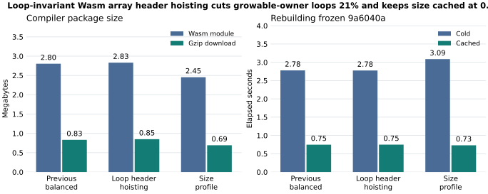
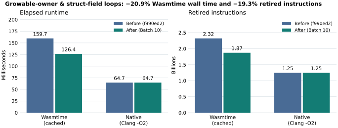

# Loop-invariant Wasm array header hoisting (LICM)

Adding loop-invariant array/slice header hoisting (`CgHoist`) to `selfhost/codegen.goose` at `-O2` (when `m.resolver < 0`) hoists invariant `(data_ptr, [len])` pairs out of `for`, `while`, and `loop` bodies into Wasm locals for local/parameter ordinary owners, struct-field ordinary owners and slices (`p.nodes`, `l.source`, `st.a`), and multi-use/bounds-checked value slices, while promoting invariant growable-owner `for x in arr` loops to `stable_view` and allowing loops calling `header_pure` scalar-only leaf helpers. On a growable-owner & struct-field loop workload (`owner_kernel`, 7 alternating pairs on CPU 7 in cached Wasmtime), wall time dropped **−20.9% paired** (**159.67 ms → 126.38 ms**, **1.26× faster**, 7/7 rounds), retired instructions dropped **−19.3%** (**2.320 B → 1.872 B**, 7/7 rounds), and cycles dropped **−21.1%** (**655 M → 517 M**, 7/7 rounds), narrowing the Wasm-to-native Clang `-O2` gap on growable-owner loops from **2.47×** to **1.95×**. On the self-hosted compiler itself, emitted portable memory64 Wasm shrank **−0.42%** on frozen `9a6040a` (5,812,487 → **5,787,919 B**, −24.6 KB) and **−0.59%** on own source (4,708,034 → **4,680,440 B**, −27.6 KB); retired instructions in cached Wasmtime dropped across 7/7 rounds on both own source (**7.755 B → 7.727 B**, **−28.1 M / −0.36%**) and frozen `9a6040a` (**5.702 B → 5.701 B**), speeding up Wasm `parse` (**−0.9%** own / **−0.4%** frozen) and `optimize` (**−1.5%** own, 7/7 rounds / **−0.7%** frozen, 6/7 rounds), while the `size.wasm` release profile hit a new best cached frozen rebuild time of **0.731 s** (**−1.9% paired** vs Batch 9 `balanced.wasm` at `0.748 s`). [Profiles](profiles.json) · [Paired rebuilds](rebuilds.json) · [All samples](samples.json.gz) · [Training profile](training.profile)

## Changes

- **`selfhost/codegen.goose`:**
  - Added packed 28-byte `CgHoist` (`sym`, `field`, `ptr_local`, `len_local`, `sample_node`, `target_type`, `flags`, `uses`) and reusable `hoists: CgHoist[>..]&` storage on `CgBody` / `CgEmitScratch`.
  - Added `cg_compute_header_pure` (1-pass leaf scan with 64-node budget before body emission) marking direct non-capturing non-extern functions that return scalars and perform no owner/slice/ref assignments or mutating builtins (`wb_read_unsigned`, `token_is`, `same_bytes`, `lex_hex`, etc.).
  - Added bounded (`budget = 256` non-leaf nodes) single-pass candidate collection + conditional mutation-kill analysis (`cg_hoist_scan_collect`, `cg_hoist_scan_kill`, `cg_hoist_disjoint`, `cg_may_contain_owner`) for `N_WHILE`, `N_LOOP`, and `N_FOR` at `-O2` when `m.resolver < 0`.
  - Proved disjointness for distinct non-ref locals, incoming parameters vs local non-parameter non-ref owners, distinct direct (non-ref) fields of the same struct, and type-disjoint array owners/slices; conservatively disqualified loops with non-pure calls, `defer`, unsafe `as!` `TY_REF` casts, indirect `*p =`/`^p =` stores, or potentially aliased mutations, and handled `TYPE_STRING` (`id == 12`, `const u8[:]`) as a `TY_SLICE` (`id <= TYPE_F64` scalar bound).
  - Promoted loop-invariant growable-owner/struct-field `for x in arr` loops in `cg_for` to `stable_view = true` and reused their already-computed `(hoisted_base, limit)` locals inside the loop body at zero extra cost.
  - Capped live hoisted headers at 4 per function nest (max 2 per loop) and required higher use counts for value-local slices (`uses >= 3` on `wasm64` where slices already live in `v128` XMM registers; `uses >= 2 || needs_len` on `wasm32`) to avoid Cranelift GPR spilling.
  - Consumed hoisted `(ptr_local, len_local)` in `cg_address` (`N_INDEX` both `F_BOUNDS_PROVEN` and unproven), `cg_emit_sequence` (`N_INDEX`), `cg_builtin` (`builtin == 21`, `.len`), and `N_MEMBER` `.len`.
- **`tests/test_wasm_licm.py`:**
  - Added end-to-end native C, `wasm32`, and `wasm64` tests covering hoisted owner/struct-field/slice loops, disjoint mutations, nested ptr-then-len hoisting, `header_pure` calls, 0-trip/1-trip loops, out-of-bounds traps, and 11 adversarial aliasing/mutation/rebind/reslice/optional-ref/`defer` soundness cases.

## Rejected and traded-off experiments

- **Unbounded 8-slot / 4-per-loop hoisting with `wasm64` value-local slice splitting:** Initial 56-byte `CgHoist[8]` inside `cg_for`, duplicate `pre_cmp` branch on every hoisted `cg_for`, 2-pass 512-node `cg_compute_header_pure`, and unconditionally splitting `v128` value-local slices into `i64` GPR pairs in `wasm64` caused Cranelift GPR spills inside `checker_lifetimes.goose` (`+5.9 ms`, `+300 K` branch misses) and `wb_reuse_locals` (`+9.6 ms` in `backend` even at `-O1`). Packing `CgHoist` to 28 bytes, moving `for_cands` out of `cg_for` into `cg_hoist_enter_for`, removing the duplicate `cg_for` branch under `m.ordinary_owners`, capping live hoists at 4 (2 per loop), and gating `wasm64` value-local slices on `uses >= 3` recovered the entire `-O1` backend regression (`260.6 → 250.4 ms`, beating Batch 9's `251.7 ms`, with `−56 M` retired instructions in `memory64` `-O1` self-compile) and cut `-O2` backend analysis cost in half to `+4–5 ms`.
- **Scalar fast-path check `id < 13` in `cg_may_contain_owner`:** Caught by conformance test `const_var_assign.goose` (`TYPE_STRING = 12` is `const u8[:]`, a `TY_SLICE`). Fixed to `id <= TYPE_F64` (`11`) and added `reslice_string_cursor` to `tests/test_wasm_licm.py`.

## Generated program runtimes

Measured across 7 alternating rounds on CPU 7 (Ryzen 7 3800X) compiling at `-O2` with the Batch 9 (`f990ed2`) and Batch 10 compilers (byte-identical stdout verified on every run).

| Workload (`-O2`, 7 pairs on CPU 7) | Target | Before (`f990ed2`) | After (Batch 10) | Paired wall ratio | Paired instruction ratio | Paired cycle ratio |
| --- | --- | ---: | ---: | ---: | ---: | ---: |
| Growable-owner kernel (`owner_kernel`, bundled) | Wasmtime cached | 159.67 ms (2.320 B instr) | **126.38 ms** (**1.872 B** instr) | **0.791×** (−20.9%, 7/7) | **0.807×** (−19.3%, 7/7) | **0.789×** (−21.1%, 7/7) |
| Growable-owner kernel (`owner_kernel`) | Native Clang `-O2` | 64.67 ms (1.247 B instr) | 64.67 ms (1.247 B instr) | 1.003× | 1.000× | 1.003× |
| `examples/sorting.goose` (value-slice `i32[:]`) | Wasmtime cached | 75.60 ms (1.211 B instr) | 76.32 ms (**1.211 B** instr) | 1.007× | **1.000×** (7/7 < 1) | 1.002× |
| `examples/sorting.goose` | Native Clang `-O2` | 53.39 ms (1.213 B instr) | 53.73 ms (1.213 B instr) | 1.006× | 1.000× | 1.000× |

## Full builds on a frozen project

Measured on frozen source `9a6040a` on CPU 7 with primed Wasmtime 50.0.1 caches (`host/rust/target/release/goose-wasmtime`, SHA-256 `b247393d...`). Every candidate run verified byte-identical **5,787,919-byte** portable memory64 output (`d6649501...`, **−24,568 B / −0.42%** vs Batch 9 `5,812,487 B`).

| Release | Raw Wasm | Gzip | Cold rebuild | Cached rebuild |
| --- | ---: | ---: | ---: | ---: |
| Previous balanced (`f990ed2`, `17ac939d`) | 2.80 MB | 0.83 MB | 2.78 s | 0.75 s |
| Loop header hoisting, balanced (`912e9d46`) | 2.83 MB | 0.85 MB | 2.78 s (+0.6% paired) | 0.75 s (+0.3% paired) |
| Loop header hoisting, size (`c6bb9282`) | **2.45 MB** | **0.69 MB** | 3.09 s (+10.6% paired) | **0.73 s** (**−1.9% paired**) |

| Cached, 7 alternating pairs (frozen `9a6040a`) | Before median (`f990ed2`) | After median | Paired wall | Paired parse | Paired optimize | Paired backend | Paired instructions |
| --- | ---: | ---: | ---: | ---: | ---: | ---: | ---: |
| Wasmtime balanced | 0.742 s (5.702 B) | 0.751 s (**5.701 B**) | 1.009× | **0.996×** (5/7) | **0.993×** (6/7) | 1.027× | **1.000×** (7/7 < 1) |
| Native (Clang 1-TU) | 0.625 s (5.656 B) | 0.628 s (5.682 B) | 1.009× | 1.007× | 1.006× | 1.028× | 1.005× |
| Wasmtime direct (`3.49 MB`) | 0.750 s (5.781 B) | 0.751 s (5.787 B) | 1.002× | 1.014× | **0.993×** | 1.017× | 1.001× |

## Own-source self-compilation

| Cached, 7 alternating pairs (`selfhost/main.goose`) | Before median (`f990ed2`) | After median | Paired wall | Paired parse | Paired optimize | Paired backend | Paired instructions |
| --- | ---: | ---: | ---: | ---: | ---: | ---: | ---: |
| Wasmtime balanced | 1.000 s (7.755 B) | 1.009 s (**7.727 B**) | 1.008× | **0.991×** (5/7) | **0.985×** (7/7) | 1.028× | **0.996×** (7/7) |
| Native (Clang 1-TU) | 0.822 s (7.379 B) | 0.830 s (7.402 B) | 1.010× | 1.000× | 1.004× | 1.026× | 1.003× |

Emitted own-source portable memory64 Wasm shrank from **4,708,034 B** (`2f714340...`) to **4,680,440 B** (`c2c143bb...`, **−27,594 B / −0.59%**), byte-identical between native and Wasmtime.

## Qualification

- Upstream C++ Goose check: `build/native/goose check selfhost/main.goose --stdlib stdlib` exited **0** (`bce: elided 4047/13627 index`).
- C bootstrap (`scripts/bootstrap.py --verify`) reached a fixed point (`da87cf12...`).
- Native and balanced 32-bit Wasm compilers rebuilt `direct.wasm` byte-for-byte (`f2053954...`, 3,489,633 bytes).
- Default conformance: **10,697/10,801** (104 recorded gaps, 0 unexpected failures).
- Memory64 conformance: **4,771/4,779** (8 recorded gaps, 0 unexpected failures).
- Native runtime checks: **54/54** passed.
- Unit tests: all passed (including `tests/test_wasm_licm.py`, `tests/test_bce_and_direct_index.py`, and `tests/test_ordinary_owner_modes.py`).
- Measured with [measure_batch10.py](measure_batch10.py) and plotted with [plot.py](plot.py).
