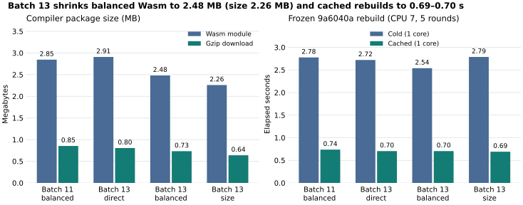
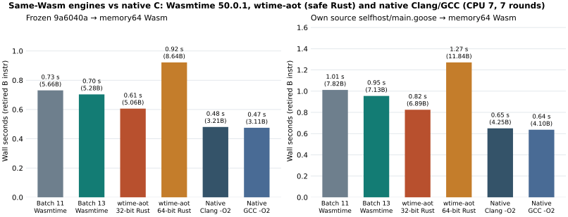
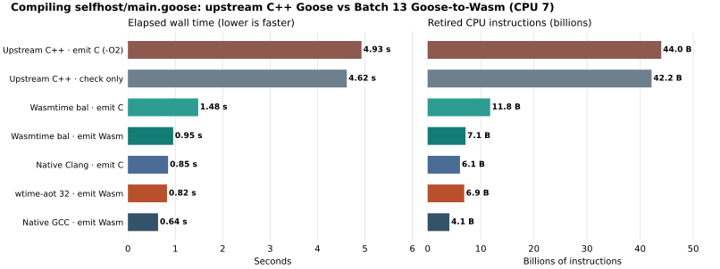
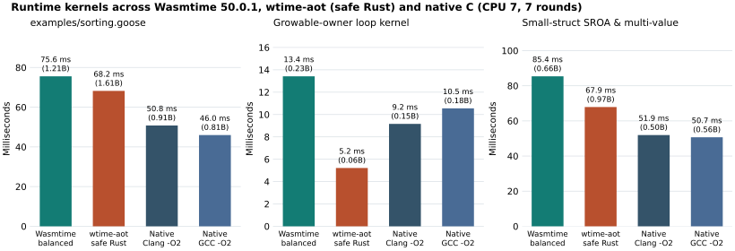

# Wasm bytecode compaction, dead region/scratch mark elimination, cold abort outlining & `wtime-aot` evaluation (Batch 13)

Adding stack-based `local.set L; local.get L` → `local.tee L` / single-use elimination and unread-write `drop` folding inside `wb_reuse_locals` (`selfhost/wasm.goose`), tightening `cg_may_region` and adding `cg_may_print` + `f.acquisitions` restore guards + `no_regions` dead-mark stripping (`selfhost/codegen.goose`), and outlining cold per-message `(i32) -> ()` abort helpers shrank the direct 32-bit bundled compiler from **3.50 MB → 2.91 MB** (**−16.9%**), the balanced release from **2.85 MB → 2.48 MB** (**−13.0%**, gzip **0.73 MB**), the size profile from **2.46 MB → 2.26 MB** (**−8.2%**, gzip **0.64 MB**), and the portable memory64 compiler from **4.76 MB → 4.04 MB** (**−15.1%**), while shrinking Wasmtime `.cwasm` x86-64 machine code by **−11.0%** (**5.58 MB → 4.97 MB**). On CPU 7 across 7 alternating rounds, cached Wasmtime 50.0.1 sped up on **7/7 rounds** for both frozen `9a6040a` (**0.731 s → 0.703 s** balanced, **0.961×**, **−6.7%** instructions; `size` **0.692 s**, **0.947×**; cold balanced **2.78 s → 2.54 s**, **−8.6%**) and own source `selfhost/main.goose` (**1.011 s → 0.955 s** balanced, **0.942×**, **−8.8%** instructions: 7.82 B → **7.13 B**; `size` **0.930 s**, **0.920×**). Running the exact same Batch 13 32-bit Wasm module ahead-of-time through read-only sibling [`../wtime`](https://github.com/mewhhaha/wtime) `wtime-aot` (`6ed7ed3c...`, `#![forbid(unsafe_code)]` safe Rust, `rustc 1.97.1`, `--target-cpu native`) reached **0.606 s** on frozen `9a6040a` (**0.861×** of cached Wasmtime balanced, **7/7 rounds**, **IPC 2.158**), **0.825 s** on own source (**0.864×** of Wasmtime, **7/7 rounds**, **5.97× faster** than upstream C++ Goose emitting C), and **5.22 ms** on `owner_kernel` (**2.57× faster** than Wasmtime and **1.76×–2.02× faster** than native Clang/GCC via LLVM auto-vectorization). [Profiles](profiles.json) · [Rebuilds](rebuilds.json) · [Full results](results.json) · [All samples](samples.json.gz) · [Training profile](training.profile)

## Changes

- **`selfhost/wasm.goose` (`wb_reuse_locals`):**
  - Lowered early-exit guard from `locals.len < 2` to `locals.len == 0` so single-local functions participate in folding and dead-local removal.
  - Added a stack-based exact-offset peephole pass (`wb_local_len`) over recorded `WbEvent`s: folds adjacent and nested `local.set L; local.get L` pairs (including Batch 11 multi-value return chains `set r1; set r0; get r0; get r1`) to 0 bytes when `reads[L] == 1` or `local.tee L` (`0x22`) when `reads[L] > 1`; turns unread `local.set` into `drop` (`0x1a`) and omits unread `local.tee`.
  - Added recorded `0x23` (`global.get`) and `0x24` (`global.set 3`) dead-mark elimination: when `no_regions` is true (`f.acquisitions == 0`), removes dead `local.get mark; global.set 3` pairs, which drops `reads[mark]` to 0 and lets pass 2b remove the preceding `global.get 3; local.set mark` (and any unread `global.get 0; local.set scratch`) completely.
  - Preserved the zero-copy in-place 1-byte/2-byte ULEB fast paths when `!any_folded`.
- **`selfhost/codegen.goose`:**
  - **Dead region-mark elimination (`global 3`):** Fixed `cg_may_region` so reading existing arrays/references (`N_NAME`, `N_MEMBER`, `N_INDEX`, `N_SLICE`, `N_UNARY`, `N_BINARY`, and `N_CALL` passing `TY_REF` parameters or calling array methods on non-region elements) no longer falsely triggers region marks; guarded all non-loop `cg_restore_regions` sites with `if f.acquisitions != acq`; passed `f.acquisitions == 0` to `wb_reuse_locals` to strip remaining loop/early-block `global 3` marks in zero-acquisition functions. Cut `global.get 3 / global.set 3` in `direct.wasm` by **−97.4% / −95.5%** (**59,833 / 43,659 → 1,579 / 1,943**).
  - **Dead scratch-mark elimination (`global 0`):** Added memoized `cg_may_print` (packed into bits 2..3 of `m.region_memo`) so `cg_loop`, `cg_for`, and inlined `F_EARLY` blocks only save/restore `global 0` when they contain a `print(...)` call (the only site that sets `f.scratch = true`). Cut `global.get 0 / global.set 0` in `direct.wasm` by **−92.9% / −85.6%** (**9,728 / 9,554 → 688 / 1,376**).
  - **Cold abort helper outlining:** Outlined per-message `(i32) -> ()` abort helpers (`m.abort_helpers` at the end of the function index space, enabled for user and `_start` bodies; runtime helpers `owner_view`/`raw_append`/`update_length`/`host_reserve` stay inline to avoid single-use helper overhead). Replaced **21,449** inline `wa_const ptr; i32.const len; i32.const line; call goose.abort` host-import call sites with compact `i32.const line; call $abort_k; unreachable`, shrinking `.cwasm` x86-64 machine code by another **−433 KB** and lifting Wasmtime IPC.
  - **Bundled publication-stripping compatibility:** Updated `cg_without_publications` to recognize peephole-folded `local.tee` (`0x22`), single-use dropped `header` operands, and `drop`/folded `global.get 11` marks so `cg_strip_publications` remains active under `--wasm-bundled-host`.

## Incremental experiment log

Staged measurements against Batch 12 (`28dec22`) on `selfhost/main.goose` before final qualification:

| Stage | `direct.wasm` | `balanced.wasm` | `compiler64.wasm` | `direct.cwasm` | `g3` (`get/set`) | `g0` (`get/set`) | Own-source Wasmtime instr |
| --- | ---: | ---: | ---: | ---: | ---: | ---: | ---: |
| Batch 12 baseline | 3,558,857 B | 2,894,140 B | 4,766,575 B | 6,337,000 B | 59,833 / 43,659 | 9,728 / 9,554 | 8.050 B (`bal` 7.901 B) |
| Exp 1: `wb_reuse_locals` peephole + pub-strip fix | 3,431,005 B | 2,874,099 B | 4,593,527 B | 6,332,872 B | 59,833 / 43,659 | 9,728 / 9,554 | 8.039 B (`bal` 7.894 B) |
| Exp 1B: + `cg_may_region` & `f.acquisitions` guards | 3,071,898 B | 2,603,472 B | 4,236,438 B | 5,976,288 B | 4,509 / 6,810 | 5,306 / 9,579 | 7.435 B (`bal` 7.312 B) |
| Exp 1C: + `cg_may_print` & `no_regions` stripping | 2,991,241 B | 2,548,541 B | 4,156,317 B | 5,828,840 B | 1,579 / 1,943 | 688 / 1,376 | 7.266 B (`bal` 7.127 B) |
| **Exp 2 (kept): + cold abort helper outlining** | **2,908,849 B** | **2,480,899 B** | **4,043,778 B** | **5,395,720 B** | **1,579 / 1,943** | **688 / 1,376** | **7.274 B (`bal` 7.130 B)** |

All three stages improved bytecode size, machine code size, cold compile time, and cached compiler rebuild speed and were retained.

**Observed microarchitectural trade-off (`sroa_kernel` in Wasmtime):** On `sroa_kernel`, removing dead `global.get 3` inside `event_bench`'s `evs.push(...)` loop cut retired Wasmtime instructions by **−6.3%** (**0.768 B → 0.720 B**, `balanced` **0.660 B**), but Cranelift 50.0.1 spilled/reloaded the array header slot inside the shortened loop body (`0x38(%rsp)` reloaded into `%rsi` instead of staying in `%rax`), lowering Wasmtime IPC from **2.83 → 2.02** (`66.35 ms → 86.87 ms`, `balanced` `85.38 ms`). The same Batch 13 Wasm module compiled through `wtime-aot` ran in **67.88 ms** (**0.783×** of Wasmtime, IPC **3.462**).

## Release profiles (frozen `9a6040a`, CPU 7, 5 rounds)

| Release | Raw Wasm | Gzip | `.cwasm` (x86-64) | Cold rebuild (1 core) | Cached rebuild (1 core) |
| --- | ---: | ---: | ---: | ---: | ---: |
| Batch 11 balanced (`fc96a03`) | 2.85 MB | 0.85 MB | 5.58 MB | 2.78 s (prep 2.05 s) | 0.737 s |
| Batch 13 direct (uncompacted) | **2.91 MB** | **0.80 MB** | **5.40 MB** | **2.72 s** (prep 2.02 s) | **0.704 s** |
| Batch 13 balanced (`-O1`) | **2.48 MB** | **0.73 MB** | **4.97 MB** | **2.54 s** (prep 1.84 s) | **0.705 s** |
| Batch 13 size (`-Oz`) | **2.26 MB** | **0.64 MB** | **5.11 MB** | **2.79 s** (prep 2.09 s) | **0.691 s** |

## Same-Wasm engines (`Wasmtime 50.0.1`, `wtime-aot`) vs native C (CPU 7, 7 alternating rounds)

Pinned sibling `../wtime` at `6ed7ed3ce50bc15f431546a0ad9ac2aec41f3039` (kept strictly read-only; `wtime-aot` built into `build/wtime-aot-target` with `rustc 1.99.0`, generated crates built into `build/wtime-aot-cache` with `rustc 1.97.1`, `--target-cpu native`, `--jobs 8`). Cold AOT build times on 8 cores: `compiler32-direct` **35.3 s** (5.85 MB binary), `compiler32-bal` **32.6 s** (5.87 MB), `compiler64` **64.3 s** (10.93 MB), kernels **3.4–5.7 s**. All seven Batch 13 engines emitted byte-identical memory64 Wasm on both frozen `9a6040a` (**5,000,455 B**) and own source `selfhost/main.goose` (**4,043,778 B**).

### Frozen `9a6040a` → memory64 Wasm (`-O2`)

| Engine | Median wall | Retired instr | Cycles | IPC | Lifetime | Backend | Paired wall vs Wasmtime bal |
| --- | ---: | ---: | ---: | ---: | ---: | ---: | ---: |
| Batch 11 Wasmtime balanced | 0.731 s | 5.662 B | 2.868 B | 1.974 | 254.9 ms | 176.3 ms | 1.041× (0/7) |
| Batch 13 Wasmtime direct | **0.704 s** | **5.386 B** | 2.759 B | 1.952 | 232.9 ms | 190.9 ms | 1.000× |
| Batch 13 Wasmtime balanced | **0.703 s** | **5.283 B** | 2.755 B | 1.917 | 231.8 ms | 190.4 ms | 1.000× (**0.961×** vs B11, 7/7) |
| Batch 13 Wasmtime size | **0.692 s** | 5.658 B | 2.710 B | 2.088 | 228.3 ms | 187.7 ms | **0.985×** (**0.947×** vs B11, 7/7) |
| **`wtime-aot` 32-bit safe Rust (`direct`)** | **0.606 s** | **5.064 B** | **2.347 B** | **2.158** | **207.7 ms** | **158.5 ms** | **0.861×** (7/7) |
| `wtime-aot` 32-bit safe Rust (`balanced`) | 0.608 s | 5.068 B | 2.357 B | 2.151 | 208.5 ms | 158.1 ms | 0.865× |
| `wtime-aot` 64-bit safe Rust (`compiler64`) | 0.922 s | 8.637 B | 3.660 B | 2.360 | 318.1 ms | 257.1 ms | 1.310× (0/7) |
| Batch 13 Native Clang `-O2` | **0.481 s** | **3.214 B** | **1.833 B** | 1.753 | 156.1 ms | 134.3 ms | **0.685×** (7/7) |
| Batch 13 Native GCC `-O2` | **0.475 s** | **3.105 B** | **1.810 B** | 1.716 | 153.4 ms | 132.0 ms | **0.677×** (7/7) |

### Own source `selfhost/main.goose` → memory64 Wasm (`-O2`, 4,043,778 B)

| Engine | Median wall | Retired instr | Cycles | IPC | Lifetime | Backend | Paired wall vs Wasmtime bal |
| --- | ---: | ---: | ---: | ---: | ---: | ---: | ---: |
| Batch 11 Wasmtime balanced | 1.011 s | 7.818 B | 4.034 B | 1.938 | 508.0 ms | 163.3 ms | 1.062× (0/7) |
| Batch 13 Wasmtime direct | **0.955 s** | **7.274 B** | 3.801 B | 1.914 | 461.4 ms | 175.2 ms | 1.001× (**0.943×** vs B11, 7/7) |
| Batch 13 Wasmtime balanced | **0.955 s** | **7.130 B** | 3.797 B | 1.878 | 461.5 ms | 175.0 ms | 1.000× (**0.942×** vs B11, 7/7) |
| Batch 13 Wasmtime size | **0.930 s** | 7.552 B | 3.697 B | 2.043 | 447.1 ms | 170.4 ms | **0.974×** (**0.920×** vs B11, 7/7) |
| **`wtime-aot` 32-bit safe Rust (`direct`)** | **0.825 s** | **6.890 B** | **3.256 B** | **2.116** | **408.6 ms** | **144.9 ms** | **0.864×** (7/7) |
| `wtime-aot` 32-bit safe Rust (`balanced`) | 0.833 s | 6.932 B | 3.287 B | 2.108 | 413.8 ms | 145.2 ms | 0.872× |
| `wtime-aot` 64-bit safe Rust (`compiler64`) | 1.271 s | 11.844 B | 5.101 B | 2.322 | 643.9 ms | 230.7 ms | 1.331× (0/7) |
| Batch 13 Native Clang `-O2` | **0.650 s** | **4.253 B** | **2.524 B** | 1.685 | 310.1 ms | 123.5 ms | **0.682×** (7/7) |
| Batch 13 Native GCC `-O2` | **0.637 s** | **4.096 B** | **2.477 B** | 1.654 | 301.8 ms | 121.5 ms | **0.668×** (7/7) |

### Head-to-head vs upstream C++ Goose (`selfhost/main.goose`, CPU 7, 5 alternating rounds)

Separate reference run comparing plain upstream C++ Goose (`build/native/goose`, `763e6ad9994e`) against Batch 13 Goose-to-Wasm compilers (all four Batch 13 C-emitting runs verified byte-identical `21.0 MB` standalone C output):

| Compiler & target | Median wall | Retired instr | Cycles | IPC | Speedup vs upstream C++ emit C |
| --- | ---: | ---: | ---: | ---: | ---: |
| Upstream C++ Goose · `check` only | 4.62 s | 42.15 B | 18.59 B | 2.267 | 1.07× |
| Upstream C++ Goose · emit C (`--standalone -O2`) | 4.93 s | 43.97 B | 19.87 B | 2.213 | 1.00× |
| Batch 13 Wasmtime balanced · emit C | **1.48 s** | **11.77 B** | 5.98 B | 1.968 | **3.32× faster** (0.301×, 5/5) |
| Batch 13 `wtime-aot` 32-bit · emit C | **1.49 s** | **13.66 B** | 6.02 B | 2.269 | **3.30× faster** (0.303×, 5/5) |
| Batch 13 Wasmtime balanced · emit Wasm (own series) | **0.955 s** | **7.13 B** | 3.80 B | 1.878 | **5.16× faster** (4.84× vs `check`) |
| Batch 13 Native GCC `-O2` · emit C | **0.893 s** | **6.10 B** | 3.52 B | 1.735 | **5.52× faster** (0.181×, 5/5) |
| Batch 13 Native Clang `-O2` · emit C | **0.848 s** | **6.09 B** | 3.34 B | 1.824 | **5.81× faster** (0.172×, 5/5) |
| Batch 13 `wtime-aot` 32-bit · emit Wasm (own series) | **0.825 s** | **6.89 B** | 3.26 B | 2.116 | **5.97× faster** (5.60× vs `check`) |
| Batch 13 Native GCC `-O2` · emit Wasm (own series) | **0.637 s** | **4.10 B** | 2.48 B | 1.654 | **7.74× faster** (7.25× vs `check`) |

### Runtime kernels (CPU 7, 7 alternating rounds, byte-identical stdout across all engines)

| Kernel | Wasm size (B11 → B13 direct → bal) | Wasmtime B13 bal | `wtime-aot` safe Rust | Native Clang `-O2` | Native GCC `-O2` | `wtime-aot` vs Wasmtime |
| --- | --- | ---: | ---: | ---: | ---: | ---: |
| `examples/sorting.goose` | 87.2 KB → 78.0 KB → 37.0 KB | 75.6 ms (1.21 B) | **68.2 ms** (1.61 B, IPC 5.83) | 50.8 ms (0.91 B) | **46.0 ms** (0.81 B) | **0.902×** (7/7) |
| `owner_kernel` | 2.68 KB → 2.35 KB → 1.69 KB | 13.4 ms (0.23 B) | **5.22 ms** (0.063 B, AVX2) | 9.16 ms (0.15 B) | 10.55 ms (0.18 B) | **0.363×** (7/7; **0.57× Clang**) |
| `sroa_kernel` | 4.41 KB → 4.00 KB → 2.31 KB | 85.4 ms (0.66 B) | **67.9 ms** (0.97 B, IPC 3.46) | 51.9 ms (0.50 B) | **50.7 ms** (0.56 B) | **0.783×** (6/7) |

## Qualification

- Plain upstream C++ Goose check (`build/native/goose check selfhost/main.goose --stdlib stdlib`): **exit 0** (`4,183/14,080` index checks elided).
- C bootstrap (`scripts/bootstrap.py --verify`): **fixed point reached** (`d6cd3e92...`).
- Native and balanced 32-bit Wasm compilers rebuilt `direct.wasm` byte-for-byte identically (`2,908,849` bytes).
- Default conformance: **10,697/10,801** (104 recorded gaps, 0 unexpected failures).
- Memory64 conformance: **4,771/4,779** (8 recorded gaps, 0 unexpected failures).
- Native runtime checks: **54/54** passed.
- Repo unit tests: **101/101** passed (including `tests/test_ordinary_owner_modes.py` unmodified).
- Extra unit tests (`test_native_units`, `test_native_c_codegen`, `test_wasm_sroa_multivalue`, `test_wasm_licm`, `test_bce_and_direct_index`, `test_wasm_peephole`): **18/18** passed.
- Measured with [measure_batch13.py](measure_batch13.py) and plotted with [plot.py](plot.py).
