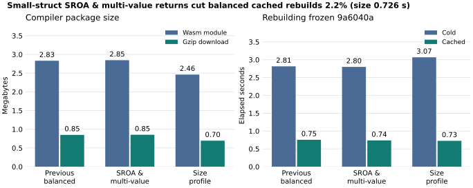
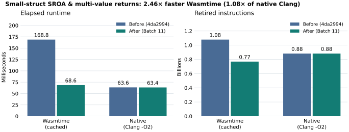

# Small-struct SROA & Wasm multi-value returns

Adding scalar replacement of aggregates (SROA) for non-escaping small fixed structs (1–4 scalar/slice/ref fields) and Wasm multi-value returns for internal functions returning small fixed structs in `selfhost/codegen.goose` at `-O2` (when `!m.nonlocal_returns && m.resolver < 0 && m.prefix_helper < 0`) eliminates activation stack frames, hidden destination pointers, and temporary memory copies across local struct variables, `for` element bindings, `match` variant binders, `.push(Record { ... })` / `arr[i] = Record { ... }` writes, and struct-returning helpers. On a small-struct & multi-value kernel (`sroa_kernel`, 7 alternating pairs on CPU 7 in cached Wasmtime), wall time dropped **−59.3% paired** (**168.83 ms → 68.59 ms**, **2.46× faster**, 7/7 rounds), retired instructions dropped **−28.7%** (**1.078 B → 0.768 B**, 7/7 rounds — **12.8% fewer instructions than native Clang `-O2` at 0.881 B**), and cycles dropped **−60.1%** (**697.5 M → 278.3 M**, 7/7 rounds), closing the Wasmtime-to-native gap from **2.65×** down to **1.08×** (**68.6 ms** vs **63.4 ms**). On the self-hosted compiler itself, cached Wasmtime rebuilds sped up on **7/7 rounds** on both frozen `9a6040a` (**0.752 s → 0.741 s**, **−1.4% paired**, −39.0 M instructions, `typecheck` **−4.1%**, `balanced.wasm` **0.737 s / −2.2%**, `size.wasm` **0.726 s / −3.8%**) and own source (**1.022 s → 1.006 s**, **−1.6% paired**, −55.2 M instructions, `lifetime` **−2.1%**, `typecheck` **−2.0%**, `backend` **−1.3%**), while emitted portable memory64 Wasm shrank **−0.25%** on frozen `9a6040a` (5,787,919 → **5,773,217 B**, +27 frame-free functions) and **−0.39%** on own source (4,717,519 → **4,699,024 B**). [Profiles](profiles.json) · [Paired rebuilds](rebuilds.json) · [All samples](samples.json.gz) · [Training profile](training.profile)

## Changes

- **`selfhost/codegen.goose`:**
  - Added `CG_NO_SROA` (`1024` on `Symbol.flags`), `sroa_count: i32` on `CgSlot`, `sroa_return: i32` on `CgFunction`, and `sroa_return`/`sroa_call_node`/`sroa_call_base` on `CgBody`.
  - Added `cg_sroa_struct` accepting plain fixed non-owner, non-root, non-relative structs with 1–4 non-pad scalar/slice/ref/fn fields (`cg_local_slot_type`), plus helpers for field indexing, narrow integer/`bool` normalization (`cg_sroa_field_store`), padding-aware materialization (`cg_sroa_has_padding`, `cg_sroa_store_to_addr`, `cg_sroa_materialize`), and `cg_emit_into_sroa`.
  - Extended `cg_prescan_node` to mark `CG_NO_SROA` on struct locals whose fields have their address taken (`&v.f`, `F_REFERENCE_CONTEXT`/`TY_REF` field uses) or whose `N_RECORD` initializer uses `N_SELF` or calls a non-intrinsic `F_EXTERN` host function (`cg_record_has_extern`), and disabled `sroa_return` on functions containing `N_SELF` or `N_RECORD` with an `extern` host call (preserving host-memory-visible record construction tested by `tests/test_zero_stores.py`).
  - Promoted non-escaping `N_VARIABLE` and `N_BINDING` small structs in `cg_prepare_function` into `1..4` contiguous Wasm locals (zero frame bytes), wiring SROA directly into `cg_expr_body` (`N_NAME`/`N_MEMBER`), `cg_assign` (whole-struct swap, compound/`++`/`--`/`.=` field updates, SROA RHS and small `N_RECORD` RHS direct memory stores), declarations (`cg_plain_declaration`, `cg_divergent_declaration`, `cg_region_multi_declaration`), `cg_for` element bindings, `cg_match` variant binders, `cg_emit_sequence`, and `.push(...)` (`cg_region_array_builtin` and `cg_array_builtin`).
  - Computed `m.regions_enabled`, `m.resolver`, and `m.prefix_helper` before function signature creation in `cg_collect` and lowered internal non-export/non-extern/non-closure/non-dispatch functions returning an eligible small struct to native Wasm multi-value signatures (`cg_make_signature`, `cg_prepare_function`, `cg_set_values`, `cg_call`, `cg_discard`, and direct member extraction `make_vec().z`).
- **`tests/test_wasm_sroa_multivalue.py`:**
  - Added end-to-end native C, `wasm32`, and `wasm64` tests verifying multi-value Wasm type/code sections (asserting `(result f64 f64 f64)`, `(result i64 i64)`, zero `global.set 0`, and zero memory spills directly on emitted Wasm binaries), self-referential swaps, narrow integer/`bool` normalization, padded structs, slice/ref struct fields, `.push(Record { ... })` with mutating field initializers, array-element swaps, escapes (`&v`, `&v.x`, closures, `F_VALUE_USED`), enum variants, and tuple destructuring.

## Generated program runtimes

Measured across 7 alternating rounds on CPU 7 (Ryzen 7 3800X) compiling at `-O2` with the Batch 10 (`4da2994`) and Batch 11 compilers (byte-identical stdout verified on every run).

| Workload (`-O2`, 7 pairs on CPU 7) | Target | Before (`4da2994`) | After (Batch 11) | Paired wall ratio | Paired instruction ratio | Paired cycle ratio |
| --- | --- | ---: | ---: | ---: | ---: | ---: |
| Small-struct & multi-value kernel (`sroa_kernel`, bundled) | Wasmtime cached | 168.83 ms (1.078 B instr) | **68.59 ms** (**0.768 B** instr) | **0.407×** (−59.3%, 7/7) | **0.713×** (−28.7%, 7/7) | **0.399×** (−60.1%, 7/7) |
| Small-struct & multi-value kernel (`sroa_kernel`) | Native Clang `-O2` | 63.60 ms (0.881 B instr) | 63.41 ms (0.881 B instr) | 0.996× | 1.000× | 0.995× |
| `examples/sorting.goose` | Wasmtime cached | 75.83 ms (1.211 B instr) | 75.81 ms (1.211 B instr) | 1.002× | 1.000× | 0.999× |
| `examples/sorting.goose` | Native Clang `-O2` | 53.37 ms (1.213 B instr) | 53.51 ms (1.213 B instr) | 1.004× | 1.000× | 1.000× |

Emitted `sroa_kernel` Wasm shrank **−12.7%** (`5,050 → 4,410 B`).

## Full builds on a frozen project

Measured on frozen source `9a6040a` on CPU 7 with primed Wasmtime 50.0.1 caches (`host/rust/target/release/goose-wasmtime`, SHA-256 `b247393d...`). Every candidate run verified byte-identical **5,773,217-byte** portable memory64 output (`09263a08...`, **−14,702 B / −0.25%** vs Batch 10 `5,787,919 B`, increasing frame-free functions from 385 to **412** and multi-value functions from 2 to **13**).

| Release | Raw Wasm | Gzip | Cold rebuild | Cached rebuild |
| --- | ---: | ---: | ---: | ---: |
| Previous balanced (`4da2994`, `912e9d46`) | 2.83 MB | 0.85 MB | 2.81 s | 0.754 s |
| SROA & multi-value, balanced (`0cd685e9`) | 2.85 MB | 0.85 MB | **2.80 s** (+0.1% paired) | **0.737 s** (**−2.2% paired**) |
| SROA & multi-value, size (`809dcccd`) | **2.46 MB** | **0.70 MB** | 3.07 s (+9.0% paired) | **0.726 s** (**−3.8% paired**) |

| Cached, 7 alternating pairs (frozen `9a6040a`) | Before median (`4da2994`) | After median | Paired wall | Paired typecheck | Paired lifetime | Paired backend | Paired instructions |
| --- | ---: | ---: | ---: | ---: | ---: | ---: | ---: |
| Wasmtime balanced | 0.752 s (5.701 B) | **0.741 s** (**5.662 B**) | **0.986×** (7/7) | **0.959×** (7/7) | **0.989×** (6/7) | **0.997×** | **0.993×** (7/7) |
| Native (Clang 1-TU) | 0.634 s (5.682 B) | **0.631 s** (5.698 B) | **0.993×** (7/7) | **0.990×** (7/7) | 1.004× | **0.986×** (7/7) | 1.003× |
| Wasmtime direct (`3.50 MB`) | 0.747 s (5.787 B) | **0.740 s** (**5.749 B**) | **0.991×** (7/7) | **0.979×** (7/7) | **0.985×** (7/7) | 1.003× | **0.994×** (7/7) |

## Own-source self-compilation

| Cached, 7 alternating pairs (`selfhost/main.goose`) | Before median (`4da2994`) | After median | Paired wall | Paired typecheck | Paired lifetime | Paired backend | Paired instructions |
| --- | ---: | ---: | ---: | ---: | ---: | ---: | ---: |
| Wasmtime balanced | 1.022 s (7.792 B) | **1.006 s** (**7.737 B**) | **0.984×** (7/7) | **0.980×** (7/7) | **0.979×** (7/7) | **0.987×** (7/7) | **0.993×** (7/7) |
| Native (Clang 1-TU) | 0.840 s (7.464 B) | **0.836 s** (7.476 B) | **0.993×** (7/7) | **0.985×** (7/7) | **0.999×** (5/7) | **0.991×** (7/7) | 1.002× |

Emitted own-source portable memory64 Wasm shrank from **4,717,519 B** (`595312d6...`) to **4,699,024 B** (`2ed38dc1...`, **−18,495 B / −0.39%**), byte-identical between native and Wasmtime.

## Qualification

- Upstream C++ Goose check: `build/native/goose check selfhost/main.goose --stdlib stdlib` exited **0** (`bce: elided 4137/13891 index`).
- C bootstrap (`scripts/bootstrap.py --verify`) reached a fixed point (`d7094037...`).
- Native and balanced 32-bit Wasm compilers rebuilt `direct.wasm` byte-for-byte (`b2ddd73f...`, 3,501,786 bytes).
- Default conformance: **10,697/10,801** (104 recorded gaps, 0 unexpected failures).
- Memory64 conformance: **4,771/4,779** (8 recorded gaps, 0 unexpected failures).
- Native runtime checks: **54/54** passed.
- Unit tests: **101/101** qualification unit tests passed plus all **10/10** tests in `tests/test_wasm_sroa_multivalue.py`, `tests/test_wasm_licm.py`, and `tests/test_bce_and_direct_index.py`.
- Measured with [measure_batch11.py](measure_batch11.py) and plotted with [plot.py](plot.py).
