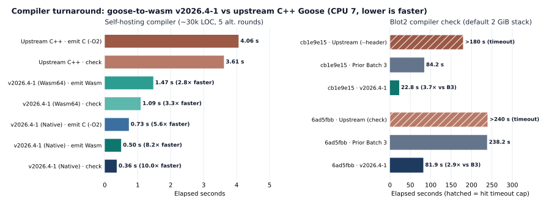
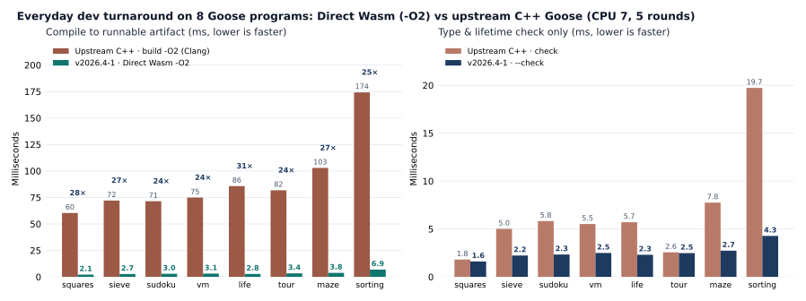
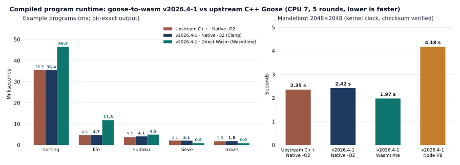

# Release `v2026.4-1` head-to-head benchmarks vs upstream C++ Goose (2026-11-24)

Pinned release measurements comparing **`goose-to-wasm v2026.4-1`** against plain upstream C++ Goose (`d5ae5bb`, right on top of `v2026.4`) on CPU 7 across compilation turnaround, everyday dev builds, compiled runtime speed, and large-scale real-world compiler checking.

## Pinned environment and artifacts

- **Host:** `Linux-7.3.5-2-cachyos-x86_64-with-glibc2.44` (CPU 7 pinned via `taskset -c 7` / `os.sched_setaffinity`)
- **Tool versions:** `clang version 23.1.5`, `node v26.5.0`, `wasmtime 50.0.1`
- **Qualified `v2026.4-1` release compiler:**
  - `build/qualify-v2026.4-1/bootstrap/bin/goose` (`goose-to-wasm v2026.4-1 (Goose v2026.4)`)
  - Fixed-point C SHA-256 (`next_generation == third_generation`): `dbfecfe0a3c0a6503e06cb74428e758b8b4e4046fac5873b7ec29a34f0db4c19`
  - Executable SHA-256: `139b06dbc1c952795cd99438cec14b0af19e30a1eaa59460988fdd773beaff76`
  - Portable memory64 Wasm compiler (`compiler-mem64.wasm`): `4,195,075 B` (SHA-256 `c39c19bd84e27938…`, bit-identical whether emitted natively or by itself in Wasmtime)
- **Plain upstream C++ Goose reference:**
  - `build/native/goose` (`d5ae5bb`, SHA-256 `2bb184c84bc540b3a64d2e8fea760e5992813f80a719c6645ed60f819748c367`), run with `GOOSE_CC=clang` and an isolated pre-warmed `GOOSE_HOME` runtime cache.
- **Qualification gate ([summary.json](../../../../build/qualify-v2026.4-1/summary.json), `282.6 s`):** plain upstream check exit 0; C bootstrap `--verify` fixed point (`111.9 s`); default conformance `10,697/10,801` (`104` recorded gaps, `0` unexpected); memory64 conformance `4,771/4,779` (`8` recorded gaps, `0` unexpected); native checks `54/54`; all 19 unit-test modules passed.
- **Raw data and scripts:** [measure.py](measure.py) · [plot.py](plot.py) · [results.json](results.json)

## 1. Large-project compiler turnaround (`selfhost/main.goose`, ~30k LOC, 5 alternating rounds, CPU 7)

| Mode | Median wall | 5-round timings (s) | Speedup vs upstream | Output |
|---|---:|---|---:|---|
| Upstream C++ Goose · `check` | `3.615 s` | `[3.559, 3.741, 3.615, 3.875, 3.611]` | `1.0×` | — |
| Upstream C++ Goose · emit C (`-O2`) | `4.058 s` | `[3.990, 4.141, 4.058, 4.491, 3.967]` | `1.0×` | `14,029,070 B` |
| `v2026.4-1` (Native) · `--check` | **`0.363 s`** | `[0.354, 0.409, 0.343, 0.431, 0.363]` | **10.0× vs check** | — |
| `v2026.4-1` (Native) · emit Wasm64 (`-O2`) | **`0.496 s`** | `[0.485, 0.589, 0.483, 0.702, 0.496]` | **8.2× vs emit C** | `4,195,075 B` (`c39c19bd…`) |
| `v2026.4-1` (Native) · emit C (`-O2`) | **`0.731 s`** | `[0.690, 0.731, 0.667, 0.946, 0.752]` | **5.6× vs emit C** | `21,912,631 B` (`e3d6eb4c…`) |
| `v2026.4-1` (Wasm64 in Wasmtime) · `--check` | **`1.090 s`** | `[0.981, 1.090, 1.364, 1.299, 1.088]` | **3.3× vs check** | — |
| `v2026.4-1` (Wasm64 in Wasmtime) · emit Wasm64 | **`1.472 s`** | `[1.472, 1.469, 1.811, 2.402, 1.358]` | **2.8× vs emit C** | `4,195,075 B` (`c39c19bd…`, identical) |

## 2. Everyday dev build & check turnaround (8 Goose examples, 5 alternating rounds, CPU 7)

| Program | Upstream `check` | `v2026.4-1` `--check` | Upstream `build -O2` (Clang) | `v2026.4-1` Direct Wasm `-O2` | Build speedup | `v2026.4-1` Wasm + Node cycle |
|---|---:|---:|---:|---:|---:|---:|
| `squares` | `1.8 ms` | **`1.6 ms`** | `60.4 ms` | **`2.1 ms`** | **28×** | `24.1 ms` |
| `sieve` | `5.0 ms` | **`2.2 ms`** | `72.1 ms` | **`2.7 ms`** | **27×** | `26.5 ms` |
| `sudoku` | `5.8 ms` | **`2.3 ms`** | `71.5 ms` | **`3.0 ms`** | **24×** | `30.8 ms` |
| `vm` | `5.5 ms` | **`2.5 ms`** | `74.9 ms` | **`3.1 ms`** | **24×** | `24.5 ms` |
| `life` | `5.7 ms` | **`2.3 ms`** | `85.8 ms` | **`2.8 ms`** | **31×** | `36.5 ms` |
| `tour` | `2.6 ms` | **`2.5 ms`** | `81.8 ms` | **`3.4 ms`** | **24×** | `24.6 ms` |
| `maze` | `7.8 ms` | **`2.7 ms`** | `102.9 ms` | **`3.8 ms`** | **27×** | `25.3 ms` |
| `sorting` | `19.7 ms` | **`4.3 ms`** | `174.2 ms` | **`6.9 ms`** | **25×** | `209.6 ms` |

Note: `v2026.4-1` Native `-O2` via `scripts/goose_wasm.py build` took `141–446 ms` (includes Python driver startup + Clang compile/link); upstream `goose run -O0` (in-process C/TinyCC) took `3.3–29.0 ms` on small examples and `222.1 ms` on `sorting`.

## 3. Compiled program runtime speed vs upstream C++ Goose (5 alternating rounds, CPU 7)

All outputs verified bit-exact against `examples/expected/*.out` and Mandelbrot checksum `1038538536` (`2048 1000 1`).

| Workload | Upstream C++ Native `-O2` | `v2026.4-1` Native `-O2` (Clang) | `v2026.4-1` Direct Wasm (Wasmtime 50.0.1) | `v2026.4-1` Direct Wasm (Node v26.5) |
|---|---:|---:|---:|---:|
| `sorting` | `35.48 ms` | **`35.38 ms`** (`1.00×`) | `46.50 ms` (`1.31×`) | `203.09 ms` |
| `life` | `4.60 ms` | **`4.70 ms`** (`1.02×`) | `11.78 ms` | `33.03 ms` |
| `sudoku` | `3.72 ms` | **`4.07 ms`** (`1.09×`) | `4.93 ms` | `26.83 ms` |
| `sieve` | `2.09 ms` | **`2.05 ms`** (`0.98×`) | `0.89 ms` *(in-process)* | `22.75 ms` |
| `maze` | `1.78 ms` | **`1.85 ms`** (`1.04×`) | `0.87 ms` *(in-process)* | `19.56 ms` |
| `mandelbrot` *(kernel clock)* | `2.355 s` | **`2.419 s`** (`1.03×`) | **`1.974 s`** (`0.84×`) | `4.176 s` |

## 4. Giant real-world compiler check — frozen Blot2 snapshots (default 2 GiB `--stack-reserve`, CPU 7)

| Snapshot | `v2026.4-1` wall / CPU / RSS | Prior Batch 3 (`6ba2365f…`) | Plain upstream C++ (`d5ae5bb`) | Diagnostics (`v2026.4-1`) |
|---|---:|---:|---:|---|
| `cb1e9e15` | **`22.79 s`** / `22.34 s` / **`3.34 GiB`** | `84.15 s` / `3.58 GiB` (**3.69× faster**) | `>180 s` timeout (`--header`), `>240 s` timeout (`check`) | 1 sound §5.2 (`check/check.goose:3422:86`) |
| `6ad5fbb` | **`81.87 s`** / `81.32 s` / **`5.94 GiB`** | `238.16 s` / `7.53 GiB` (**2.91× faster**) | `>240 s` timeout (`check`) | 1 sound §5.2 (`check/check.goose:3179:86`) |
