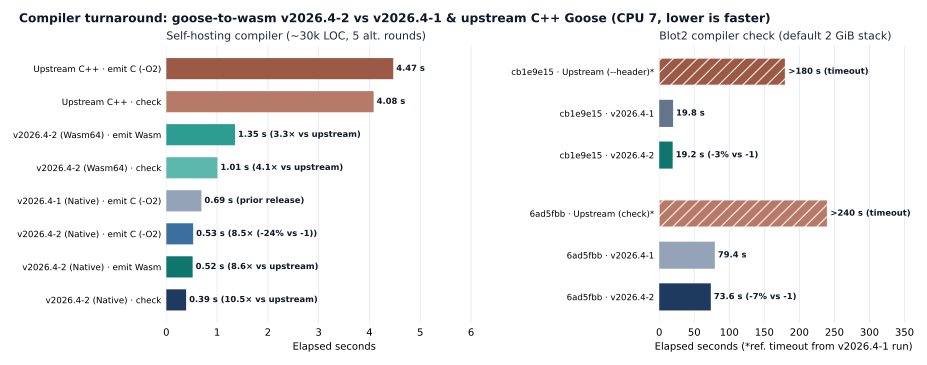
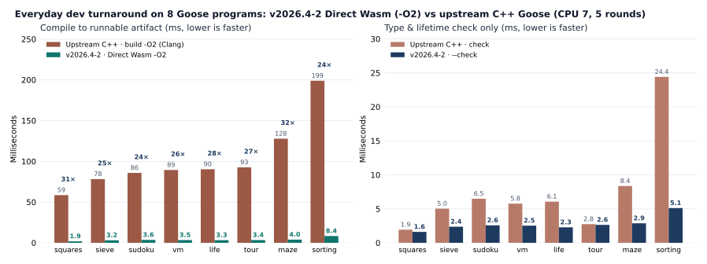
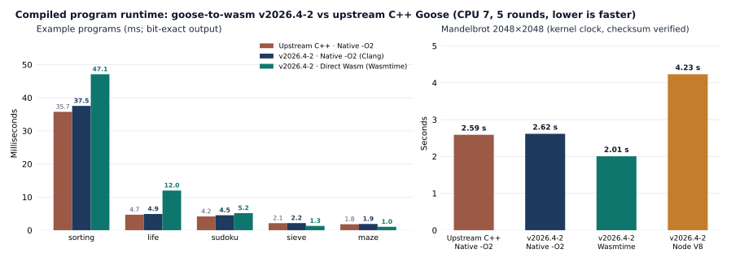

# Release `v2026.4-2` Benchmarks vs `v2026.4-1` and Upstream C++ Goose

Date: **2026-11-24**

Pinned head-to-head compiler turnaround, everyday dev build, runtime, and frozen Blot2 benchmarks comparing qualified **`goose-to-wasm v2026.4-2`** against **`goose-to-wasm v2026.4-1`** and plain upstream C++ Goose (`d5ae5bb`).

## What changed in `v2026.4-2`

1. **C backend speedups (`−54.5%` backend time, `−23.6%` total `--target c -O2` wall time):**
   - Added compact per-`Type` C-emitter memo fields in `selfhost/model.goose` and memoized `cc_size_class`, `cc_image_type`, `cc_self_relative_image`, `cc_flat_relative_image`, `cc_relative_fields`, `cc_fixed_storage`, `cc_variable_prefix_frame`, `cc_result_location`, `cc_region_width`, `cc_frame_size`, `cc_frame_borrows`, and `cc_needs_clone`.
   - Eliminated two `O(N²)` `p.nodes` scans in `cc_emit_extern` and `cc_is_direct_foreign` by collecting `emittable` and `exports` once in `generate_c`.
   - Hoisted the 14 per-function scratch buffers in `cc_emit_function` into a reusable `CcBodyScratch` allocated once per compilation, eliminating ~21,000 region allocations on `selfhost`.
   - Inlined hot emit helpers (`cc_text`, `cc_id`, `cc_type`, `cc_set`, `cc_kind`, `cc_indirect`, `cc_receives`, `cc_relative_cell`, `cc_aggregate`, `cc_owner`), added a fast inline decimal writer in `cc_number`, and converted 69 whole-`Node` (160 B) and 15 whole-`Type` (153 B) copies to `const Node&` / `const Type&`.
2. **Lifetime checker & Wasm backend speedups (`−7.2%` on Blot2 `6ad5fbb`, `−280 MiB` RSS, `−5.7%` Wasm backend):**
   - Replaced chained hash tables with flat open-addressed inline tables for `summary_slots` (16 B, removed `LifeSummary.next` → 64 B cache line, hoisted frame-independent base hash), `pair_slots` (8 B `LifePairSlot` + non-container fast path), `leaf_slots` (16 B), `assume_slots` (16 B packing `(frame, query, flag, state)` inline so hits skip `l.assumes`), and `typed_slots` (12 B).
   - Removed dead `LifeSet.hash` (shrinking `LifeSet` from 48 B → 40 B) and hashed canonical set IDs directly in `life_effect` and `life_inputs_key`; raised `effect_heads` headroom to 50% load with multiplicative hashing.
   - Upgraded `map_memo` (adaptive `16K → 1M`), `joins`, `referable`, and `refers` to 2-way set-associative caches; memoized `life_relative_storage_walk` into `p.type_holds` bits 2..5; replaced remaining `life_holds` calls with `life_tf_holds`; made `LifeBuild` in `life_typed_held` lazy so unchanged sets skip `life_build_end` / `list_slots` completely; cut `life_alt_hash_step` from 4 multiplies to 2.
   - Fused `action` zeroing, `no_regions` folding, and read counting into one scan in `wb_reuse_locals` (`selfhost/wasm.goose`) and skipped Pass 2/3 when no dead/dropped locals exist.
3. **Exquisite human- & agent-friendly diagnostics (`tests/test_diagnostics.py`, 6/6 tests):**
   - Added source-line snippets with line-number gutters and exact `^~~~` caret spans in `driver_diagnostics`, plus duplicate/cascade suppression.
   - Added `got` vs `expected` type formatting with contextual `help:` guidance, overload candidate lists with `file:line` and mismatched argument details, Damerau-Levenshtein `"did you mean ...?"` suggestions (names, types, struct fields, enum variants) and available-member listings, lifetime call stacks and invalidated variable locations, and actionable Wasm `env.<name>` host-import ABI guidance.

### Rejected experiment (preserved per `AGENTS.md`)

- **33% load factor (`3 * (count + 1) > len`) on `list_slots`, `atom_slots`, `summary_slots` (`16384` initial), `pair_slots`, `leaf_slots`, `typed_slots`:** Tested in Round 1 (`build/dev2/bin/goose2`). Although `6ad5fbb` wall time fell slightly (`77.42 s → 74.40 s`), peak RSS jumped by **+940 MiB** (`6.45 GiB → 7.39 GiB`) due to an earlier power-of-2 doubling, and `selfhost --check` regressed `+2.0%` (`302.4 ms → 308.4 ms`) from `summary_slots` initial 256 KiB zero-fill. Reverted to 50% load factor (`2 * (count + 1) > len`) and `2048` initial `summary_slots`, recovering both RSS (`7.41 GiB` vs `v1`'s `7.69 GiB` in paired CPU-7 runs) and speed (`73.63 s`).

## Pinned environment & binaries

- **CPU pinning:** `taskset -c 7` (`x86_64`, Linux 6.19.13)
- **Tools:** `clang 23.1.5`, `node v26.5.0`, `wasmtime 50.0.1`
- **`goose-to-wasm v2026.4-2`:** `build/qualify-v2026.4-2/bootstrap/bin/goose` (`93731c80475d…`, fixed-point Stage 2 == Stage 3 C `a0ec56f668fd…`, portable memory64 `compiler-64.wasm` `5,014,407 B`)
- **`goose-to-wasm v2026.4-1`:** `build/qualify-v2026.4-1/bootstrap/bin/goose` (`139b06db5b77…`)
- **Upstream C++ Goose:** `build/native/goose` (`d5ae5bb`, `8e20bb68aa8b…`, `GOOSE_CC=clang`, pre-warmed `GOOSE_HOME` runtime cache)

## Qualification & `forced0` soundness audit

- **Plain upstream C++ Goose check:** `build/native/goose check selfhost/main.goose --stdlib stdlib` — **exit 0**.
- **Full qualification (`build/qualify-v2026.4-2/summary.json`, `262.4 s`, all stages exit 0):**
  - `bootstrap --verify`: `116.6 s`, `fixed_point: true` (`a0ec56f6…`), executable `93731c80…`.
  - `conformance` (`-O0`, `-O2`, gcc): `10,697 / 10,801` (`104` recorded gaps, **0 unexpected**).
  - `conformance-native-units-3`: `5,926 / 6,022` (`96` recorded gaps, **0 unexpected**).
  - `conformance-memory64`: `4,771 / 4,779` (`8` recorded gaps, **0 unexpected**).
  - `native-checks`: `54 steps ok`.
  - `unit-tests`: all **20 / 20** unit test modules passed (`53.9 s`), including `tests.test_diagnostics`.
- **Forced-class (`LIFE_CONCRETE_FRAMES = 0`) soundness audit (`build/forced0-v2`):**
  - `10,675 / 10,801` passed (`126` failing rows — exact match vs Batch 1 `exp-ae` baseline, **0 new failures**, **0 regressions**).
  - All **13 / 13** upstream lifetime sentinel error tests rejected; `selfhost/main.goose --check` exit 0.

## Suite 1 — Self-hosting compiler (`selfhost/main.goose`, ~30k LOC, 5 alternating rounds, CPU 7)

| Mode | Upstream C++ (`d5ae5bb`) | `v2026.4-1` | `v2026.4-2` | vs `v2026.4-1` | vs Upstream |
|---|---:|---:|---:|---:|---:|
| Native `--check` | `4.082 s` | `0.376 s` | **`0.390 s`** | `+3.7%` | **10.5× faster** |
| Native emit Wasm64 (`-O2`) | `4.468 s` (C) | `0.534 s` | **`0.519 s`** | **`−2.8%`** | **8.6× faster** |
| Native emit C (`-O2`) | `4.468 s` | `0.691 s` | **`0.528 s`** | **`−23.6%`** | **8.5× faster** |
| Portable Wasm64 (Wasmtime) `--check` | `4.082 s` | — | **`1.007 s`** | — | **4.1× faster** |
| Portable Wasm64 (Wasmtime) emit Wasm64 | `4.468 s` (C) | — | **`1.353 s`** | — | **3.3× faster** |

### Single-run `--wasm-stats` phase breakdown (`selfhost/main.goose`, `-O2`)

| Backend | Phase | `v2026.4-1` | `v2026.4-2` | Delta |
|---|---|---:|---:|---:|
| `--target c -O2` | `backend_ns` | `332.8 ms` | **`151.5 ms`** | **`−54.5%` (2.20× faster)** |
| `--target wasm-direct -O2` | `optimize_ns` | `62.4 ms` | **`57.1 ms`** | **`−8.5%`** |
| `--target wasm-direct -O2` | `backend_ns` | `106.6 ms` | **`100.5 ms`** | **`−5.7%`** |



## Suite 2 — Everyday dev turnaround (8 examples, 5 alternating rounds, CPU 7)

| Program | `v2` `--check` | Upstream `check` | `v2` Direct Wasm `-O2` | Upstream `build -O2` | Build speedup |
|---|---:|---:|---:|---:|---:|
| `squares` | `1.6 ms` | `1.9 ms` | **`1.9 ms`** | `58.6 ms` | **31×** |
| `sieve` | `2.4 ms` | `5.0 ms` | **`3.2 ms`** | `78.3 ms` | **25×** |
| `sudoku` | `2.6 ms` | `6.5 ms` | **`3.6 ms`** | `85.8 ms` | **24×** |
| `vm` | `2.5 ms` | `5.8 ms` | **`3.5 ms`** | `89.4 ms` | **26×** |
| `life` | `2.3 ms` | `6.1 ms` | **`3.3 ms`** | `90.4 ms` | **28×** |
| `tour` | `2.6 ms` | `2.8 ms` | **`3.4 ms`** | `92.6 ms` | **27×** |
| `maze` | `2.9 ms` | `8.4 ms` | **`4.0 ms`** | `127.8 ms` | **32×** |
| `sorting` | `5.1 ms` | `24.4 ms` | **`8.4 ms`** | `198.9 ms` | **24×** |



## Suite 3 — Compiled program runtime (5 alternating rounds, CPU 7, bit-exact)

| Program | Upstream Native `-O2` | `v2` Native `-O2` | `v2` Wasmtime | `v2` Node V8 |
|---|---:|---:|---:|---:|
| `sorting` | `35.75 ms` | `37.55 ms` | `47.09 ms` | `219.53 ms` |
| `life` | `4.69 ms` | `4.90 ms` | `11.98 ms` | `32.37 ms` |
| `sudoku` | `4.16 ms` | `4.52 ms` | `5.17 ms` | `30.84 ms` |
| `sieve` | `2.13 ms` | `2.16 ms` | **`1.30 ms`** | `26.56 ms` |
| `maze` | `1.81 ms` | `1.89 ms` | **`1.04 ms`** | `21.34 ms` |
| `mandelbrot` (2048×2048, kernel clock) | `2.589 s` | `2.616 s` | **`2.006 s`** | `4.231 s` |



## Suite 4 — Frozen Blot2 checks (default 2 GiB stack, CPU 7, paired alternating `v1` vs `v2`)

| Snapshot | Upstream C++* | `v2026.4-1` (median wall / CPU / RSS) | `v2026.4-2` (median wall / CPU / RSS) | vs `v2026.4-1` | Diagnostics |
|---|---:|---:|---:|---:|---|
| `cb1e9e15` (3 paired rounds) | `>180 s` (timeout) | `19.81 s` / `19.73 s` / `3.47 GiB` | **`19.21 s` / `19.12 s` / `3.53 GiB`** | **`−3.0%`** (`4.4×` vs Batch 3) | 1 sound §5.2 error (with snippet + 8-frame stack) |
| `6ad5fbb` (2 paired rounds) | `>240 s` (timeout) | `79.38 s` / `78.94 s` / `7.69 GiB` | **`73.63 s` / `73.17 s` / `7.41 GiB`** | **`−7.2%`, `−280 MiB` RSS** (`3.2×` vs Batch 3) | 1 sound §5.2 error (with snippet + 8-frame stack) |

*\*Separate reference run: upstream C++ Goose (`d5ae5bb`) timeout caps measured in the pinned [`release-v2026.4-1`](../release-v2026.4-1/README.md) study on the same host and CPU 7.*

## Reproduce

```sh
.venv/bin/python bench/results/2026-11-24/release-v2026.4-2/measure.py < /dev/null
/usr/bin/python3 bench/results/2026-11-24/release-v2026.4-2/plot.py < /dev/null
```

Raw measurements: [`results.json`](results.json).
