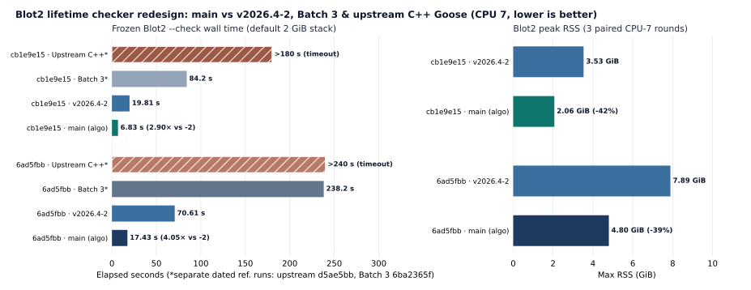

# Blot2 Class-Keyed Lifetime Checker Algorithmic Redesign (2026-11-25)

A 7-round, 100%-sound algorithmic redesign confined to `selfhost/checker_lifetimes.goose` cuts frozen Blot2 checking time by **2.90×** on `cb1e9e15` (`19.81 s → 6.83 s`, **−41.5% RSS** `3.53 → 2.06 GiB`) and **4.05×** on `6ad5fbb` (`70.61 s → 17.43 s`, **−39.2% RSS** `7.89 → 4.80 GiB`) relative to `v2026.4-2` in pinned CPU-7 alternating runs, while also speeding up own-source `selfhost/main.goose --check` by **1.15×** (`0.344 s → 0.298 s`) and `-O2` Wasm64 self-compilation by **1.11×** (`0.561 s → 0.504 s`) with **10,061/10,061** byte-identical C and WebAssembly outputs and identical `forced0` soundness conformance.



## Pinned environment and inputs

- **Host:** `Linux cachyos-x8664 7.3.5-2-cachyos #1 SMP PREEMPT_DYNAMIC Fri, 20 Nov 2026 07:37:39 +0000 x86_64`
- **CPU pinning:** `taskset -c 7` (`os.sched_setaffinity(0, {7})`, `os.wait4` wall / CPU / max RSS)
- **C compiler:** `clang version 23.1.5` (release bootstrap), `gcc` (conformance runner default)
- **Repository base commit:** `87c11409ddac37a8bc45e18b950552f25f7f1eab`
- **Baseline compiler (`v2026.4-2`):** `build/qualify-v2026.4-2/bootstrap/bin/goose`, executable SHA-256 `93731c80475d80fc3e1fe1a904368c254cae5d795b7ea038f713a2022a5f0efc`
- **Qualified candidate compiler (`blot2-algo`):** `build/qualify-blot2-algo/bootstrap/bin/goose`, built by `scripts/qualify.py --output-dir build/qualify-blot2-algo --baseline build/qualify-v2026.4-2/bootstrap/bin/goose --jobs 8`
  - Fixed-point Stage 2 == Stage 3 C SHA-256: `e150c7511c657b16db7626b35d1590c1ffcbc320696d6b428770872eb84083b6`
  - Executable SHA-256: `aae458fabec9ebd91fd04e0b0470e3fa7f57acf6724ad1c5f9390f6b0b7771ce`
- **Plain upstream C++ Goose reference check:** `build/native/goose check selfhost/main.goose --stdlib stdlib` (`d5ae5bb`): **exit 0**
- **Threshold policy:** `LIFE_CONCRETE_FRAMES = 4096` kept unchanged; `native/runtime/*` untouched.
- **Frozen Blot2 snapshots (read-only export from `../blot2` into `build/`, sibling untouched):**
  - `cb1e9e156d73c87c873f15888cd4fb6d2a399576` with Blot2's pinned stdlib (`build/blot-stdlib`)
  - `6ad5fbbd921d8c272667b5955085f479a99f5834` with repository `stdlib`

## What changed (`selfhost/checker_lifetimes.goose`)

Seven profile-driven rounds, all strictly within `selfhost/checker_lifetimes.goose`:

1. **Round 1 — Per-node/per-function hold reachability & non-cautious assumption lists:**
   - Added static `hold_flags` reachability (`FH_CONSTRUCT_READ`, `FH_BUILD_HOLD`, `FH_FORMAT_RAW`, `FH_SC2_SITE`) in `life_prepare_nodes` so functions outside any construction-hold subtree omit construct reads (`omit_construct_reads`) and skip unreachable grow/replace checks cleanly.
   - Restricted `LifeFrame.assumptions` linked lists to non-cautious assumptions only (unlinking flipped/cautious entries immediately in `life_class_check`), tracked `noncautious_ver` and per-root `chk_dep_roots`, added sorted `O(|A| + |B|)` `q4` aliasing in `life_class_answer_roots`, and bumped `stored_version` on `class_mask` mutations.
   - Cut Blot2 checking from `19.21 s / 73.63 s` → `8.78 s / 32.92 s` (`~2.2×`) and slashed peak RSS `3.53 → 2.02 GiB` / `7.41 → 4.68 GiB`.
2. **Round 2 — Activation-independent `chk` caching & replay fast paths:**
   - Added `checked_island_act == -2` for checks that saw no unsealed/back-edge dependencies, stopped bumping `noncautious_ver` on assumption unlinking, added singleton `ac == 1 && bc == 1` `q4` fast path, empty-summary/effect replay & empty-result `life_map_value` short-circuits, `in_own_island` replay skip via `parameter_version`, concrete clean-frame skip under `class_frames > 0 && island == 0 && lexical == 0`, and made `life_shrink_array` clean caching independent of `p.diagnostics.len`.
3. **Round 3 — `life_held_own` memoization, `life_body` O(N) build, and cold-path outlining:**
   - Added singleton fast path and `held_own_memo` (with O(1) `held_epoch` + per-root stamp verification) in `life_held_own`, reused `any_set` / `any_held` in `life_class_any_make`, and switched `life_typed_held`, `life_fold_slow`, and `life_clear_reads` to `l.scratch` + `life_list_set` (crushing `life_held_own`/`LifeBuild` from `7.60 s` to `< 0.2 s` on `6ad5fbb`).
   - Replaced `life_body` hash lookup with direct `l.node_body[start]` array indexing, O(N) 16-node checkpointing, reusable `body_work`/`body_reached` buffers, `!l.has_captures` fast skips, `local_holder_bits`/`local_holder_words` bitset iteration for `skip_globals` in `life_shrink_array`, and outlined cold rehash/error helpers to eliminate `GActivation` setup from hot paths.
4. **Round 4 — Canonical type-query closures & transitive `LifeBody` globals (`−11 s` on `6ad5fbb`):**
   - Computed `type_canon` and exact bit-identical `type_exact_canon` (keeping `TY_TUPLE` and non-standard kinds as identity and distinguishing `TY_REF` by `length_storage >= 0`) first in `life_prepare_nodes`, reusing `TF_L_HOLDS` across duplicates via O(1)-gen `life_holds_fast`.
   - Replaced repeated type-graph walks in `life_contains` (`4.34 s`), `life_refers` / `life_holder_points` / `life_referable` (`3.79 s`), and `life_gs_contains` (`0.92 s`) with lazy per-`type_exact_canon` sorted inline closures (`closure_*`, `holder_ref_*` with separate relative-ref vs plain-ref flags, `gs_*`) built once with O(1) generation marks (`contains_seen`, `outer_type_seen`).
   - Added lazy transitive globals (`body_trans_globals`) per `LifeBody` for `life_mark_future_globals`, `life_reads_global`, and `life_global_capture_span`.
5. **Round 5 — Transitive-global merge, L1 front caches, and `val_stores_only` skips:**
   - Made `life_body_compute_trans_globals` merge already-computed transitive/leaf global lists (`0.69 s → ~0.02 s`), enabled discovery back-edge replay skip inside `in_own_island`, added `val_stores_only` validation replay skipping, `LifeRoot.last_atom_set` in `life_single`, single-alt exact fast path in `life_map_set`, and 32 KiB direct-mapped front caches (`summary_l1`, `assume_l1`).
6. **Round 6 — Validation index sweeping, decoupled `cls_child_rev`, Pass-1 certification, and universal `chk_dep_roots`:**
   - Fixed `life_assume_close` to set `has_gs_assume` only when `q < 3 && index >= class_base`, recorded `chk_dep_stack` across `life_contents_plain`/`life_live_contents`/`life_overlay` (and bumped `stored_version` on `class_stored` updates), and carried argument-only `chk` hits across discovery → validation.
   - Removed redundant unmatched-entry barrier scans (`newest_match < 0` / `found < 0`) in `life_effect_indexed`, swept finished-frame entries in `life_index_reserve` (walking only the active `.parent` stack so `effect_heads` stays L1/L2-resident instead of growing to 16 MB), and skipped dead `l.summaries` pushes during class-mode validation (saving ~98 MB on `6ad5fbb`).
   - Decoupled per-island `own_rev` via `cls_child_rev` (guarded by `dep_callee_stamp_stack` call-site stamp checks) and added zero-overhead Pass-1 certification (`can_cert_p1`) for pure/scalar-local helper class frames.
7. **Round 7 — Sealed caller-island `chk` independence, incremental `min_ver` checks, and `val_stores_shallow`:**
   - Tracked `chk_island` in `life_class_check` so sealed (`open == 0`) assumptions on `l.chk_island` (already protected by `checked_island_stored == island_stored`) no longer force `chk_saw_unsealed = true`, eliminating `~67k` (`6ad5fbb`) / `~42k` (`cb1e9e15`) `act` cache misses.
   - Added monotonically increasing `LifeAssume.ver` and incremental `life_class_check(..., min_ver)` to verify only newly-prepended assumptions on `noncautious_ver` bumps, fixed `life_frame_is_clean` so concrete frames above clean SCC roots skip cleanly, added 1-step `val_stores_shallow` validation replay skipping (with `val_kill_epoch` tracking clears in `life_set_live_contents`/`life_set_live_refs`), and canonicalized `alt.target_type` via `type_exact_canon` in `life_classify_set`.

## Rejected experiments (preserved per `AGENTS.md`)

1. **Round 2 `E` — Pass-1 RW-tracking (`root_read_act` / `cell_read_act`):**
   - *Hypothesis:* Tracking read/write activations during Pass 1 would allow certifying frames on Pass 1 even when they wrote local cells.
   - *Measured outcome:* Regressed `6ad5fbb` Pass 1 by **`+3 s`** and increased total discovery passes from `8 → 10`.
   - *Diagnosis:* Tracking reads bypassed the O(1) `(flags & 2) != 0` guard in `life_note_places_read`, adding per-read work across every local/class root. Reverted (replaced in Round 6 by zero-overhead `body_own_rev == 0` Pass-1 certification).
2. **Round 2 `B` — 4,096-slot direct-mapped `q4_cache`:**
   - *Hypothesis:* Direct-mapped caching of `(island, set, other)` `q4` alias answers would speed up `life_class_answer_roots`.
   - *Measured outcome:* **74% miss rate** due to frequent `l.island` switching; no net win on `6ad5fbb`.
   - *Diagnosis:* Conflict misses outweighed hit savings once sorted O(|A|+|B|) merging and the singleton `ac == 1 && bc == 1` fast path were in place. Reverted `q4_cache` while keeping the singleton fast path.
3. **Round 3 — Enabling `life_offer_repeated` inside recursive islands (`allow_rec_offer`):**
   - *Hypothesis:* Allowing intra-activation dedup in `life_offer_repeated` inside recursive class islands would avoid redundant `life_effect_merge` calls.
   - *Measured outcome:* Regressed `6ad5fbb` by **`+0.67 s`** and `cb1e9e15` by **`+0.15 s`**.
   - *Diagnosis:* High-volume recursive island offers thrashed the 6.3 MB `l.offers` table (DRAM misses exceeded saved merges). Reverted in Round 4.
4. **Round 5 — Tightening `map_memo` cap (`1,048,576 → 65,536`) and `assume_slot` load factor (`3× → 2×`):**
   - *Hypothesis:* Shrinking `map_memo` from 16 MB to 1 MB and `assume_slots` by half would improve L3 residency.
   - *Measured outcome:* Neutralized Round 5's `trans_globals` (`−0.67 s`) and `val_stores_only` (`26,823` skips) gains (`goose-r5` measured `18.38–19.45 s` vs `goose-r4` `18.90 s` on `6ad5fbb`).
   - *Diagnosis:* `6ad5fbb` (`48,411` class frames, `224,200` call sigs) thrashed a 65K `map_memo` and hit longer linear-probe chains at 50% load on `assume_slots`. Restored `map_memo` cap to `524,288` and `assume_slot` to `3×` in Round 6. (A separate alternating CPU-7 ablation of `summary_l1`/`assume_l1` measured `17.21–17.75 s` kept vs `17.75–18.27 s` removed on `6ad5fbb`, so the L1 front caches were kept.)

## Qualification & `forced0` soundness audit

### Full qualification (`build/qualify-blot2-algo/summary.json`, `268.9 s`, all stages exit 0)

| Stage | Exit | Time | Summary |
|---|---:|---:|---|
| Plain upstream check (`build/native/goose`) | 0 | — | `selfhost/main.goose --stdlib stdlib` checks cleanly |
| `bootstrap` (`--verify`) | 0 | 125.8 s | Fixed point `e150c751…`, executable `aae458fa…` |
| `conformance` (`-O0`, `-O2`, gcc) | 0 | 90.2 s | `10,697 / 10,801` (`104` recorded gaps, **0 unexpected**) |
| `native-checks` (`native/tests/check.py`) | 0 | 11.2 s | `54 steps ok` |
| `conformance-memory64` | 0 | 143.0 s | `4,771 / 4,779` (`8` recorded gaps, **0 unexpected**) |
| `equivalence` (vs `v2026.4-2`) | 0 | 26.4 s | **`10,061` compared, `0` differing** (100% byte-identical C & Wasm) |
| `unit-tests` (20 modules) | 0 | 51.8 s | All passed |

### Forced-class (`LIFE_CONCRETE_FRAMES = 0`) soundness audit (`build/forced0-algo/`)

Built from a scratch copy of qualified `selfhost/` with `LIFE_CONCRETE_FRAMES = 0` via the qualified compiler (`aae458fa…`):

- `selfhost/main.goose --stdlib stdlib --check`: **exit 0**
- `tests/conformance.py --frontend-only --jobs 8`: **`10,675 / 10,801` passed (`126` failing rows — exact set match vs baseline, `0` newly failing, `0` newly passing / unexpected accepts)**

## Pinned CPU-7 alternating benchmarks (`v2026.4-2` vs qualified `blot2-algo`)

### Suite 1 — Own-source `selfhost/main.goose` (~30k LOC, 5 alternating rounds, CPU 7)

| Workload | `v2026.4-2` (`93731c80…`) median wall / CPU | **`blot2-algo` (`aae458fa…`) median wall / CPU** | Speedup (wall) | Output |
|---|---:|---:|---:|---|
| `--check` | `0.344 s` / `0.342 s` | **`0.298 s` / `0.296 s`** | **`1.15×` (`−13.2%`)** | — |
| `--target wasm-direct --wasm-memory64 -O2` | `0.561 s` / `0.554 s` | **`0.504 s` / `0.498 s`** | **`1.11×` (`−10.1%`)** | `5,147,372 B` (`04c01f43…`, byte-identical) |
| `--target c -O2` | `0.565 s` / `0.555 s` | `0.568 s` / `0.556 s` | `1.00×` | `24,229,189 B` (`0dd54739…`, byte-identical) |

*Separate reference run (`release-v2026.4-2`, CPU 7): plain upstream C++ Goose (`d5ae5bb`) checked `selfhost/main.goose` in `4.082 s` (`13.7×` slower than `0.298 s`) and emitted `-O2` C in `4.468 s`.*

### Suite 2 — Frozen Blot2 checks (default 2 GiB stack, 3 alternating paired rounds each, CPU 7)

| Snapshot | Compiler | Median wall | Median CPU | Median max RSS | vs `v2026.4-2` | Diagnostics |
|---|---|---:|---:|---:|---:|---|
| `cb1e9e15` | Upstream C++ (`d5ae5bb`)* | `>180 s` (timeout) | — | — | — | — |
| `cb1e9e15` | Batch 3 (`6ba2365f…`)* | `84.15 s` | `83.06 s` | `3.58 GiB` | — | 1 (`check/check.goose:3422:86`) |
| `cb1e9e15` | `v2026.4-2` (`93731c80…`) | `19.81 s` | `19.72 s` | `3.53 GiB` | `1.00×` | 1 (`check/check.goose:3422:86`) |
| **`cb1e9e15`** | **`blot2-algo` (`aae458fa…`)** | **`6.83 s`** | **`6.80 s`** | **`2.06 GiB`** | **`2.90×` wall/CPU (`−65.5%`), `−1.47 GiB` (`−41.5%`) RSS** | 1 (`check/check.goose:3422:86`) |
| `6ad5fbb` | Upstream C++ (`d5ae5bb`)* | `>240 s` (timeout) | — | — | — | — |
| `6ad5fbb` | Batch 3 (`6ba2365f…`)* | `238.16 s` | — | `7.53 GiB` | — | 1 (`check/check.goose:3179:86`) |
| `6ad5fbb` | `v2026.4-2` (`93731c80…`) | `70.61 s` | `70.31 s` | `7.89 GiB` | `1.00×` | 1 (`check/check.goose:3179:86`) |
| **`6ad5fbb`** | **`blot2-algo` (`aae458fa…`)** | **`17.43 s`** | **`17.26 s`** | **`4.80 GiB`** | **`4.05×` wall (`−75.3%`), `4.08×` CPU, `−3.09 GiB` (`−39.2%`) RSS** | 1 (`check/check.goose:3179:86`) |

*\*Separate dated reference runs from [`release-v2026.4-1`](../../2026-11-24/release-v2026.4-1/README.md) (upstream C++ `d5ae5bb` timeout caps) and [`blot2-lifetime-speed`](../../2026-11-24/blot2-lifetime-speed/README.md) (Batch 3 `6ba2365f…`).*

Raw paired wall timings (s):
- `cb1e9e15`: `v2026.4-2` `[19.81, 19.83, 19.18]`, `blot2-algo` `[6.98, 6.83, 6.62]`
- `6ad5fbb`: `v2026.4-2` `[74.43, 70.61, 70.42]`, `blot2-algo` `[17.43, 17.13, 17.45]`

## Reproduce

```sh
python3 bench/results/2026-11-25/blot2-lifetime-algo/measure.py < /dev/null
python3 bench/results/2026-11-25/blot2-lifetime-algo/plot.py < /dev/null
```

Raw data: [`results.json`](results.json).
