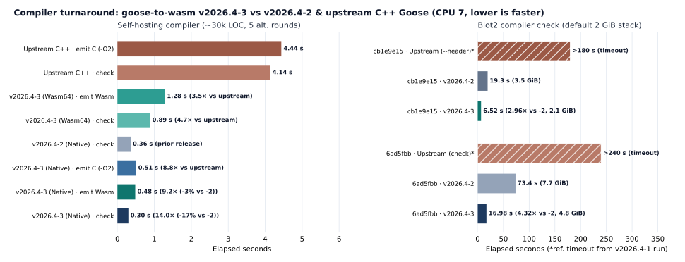
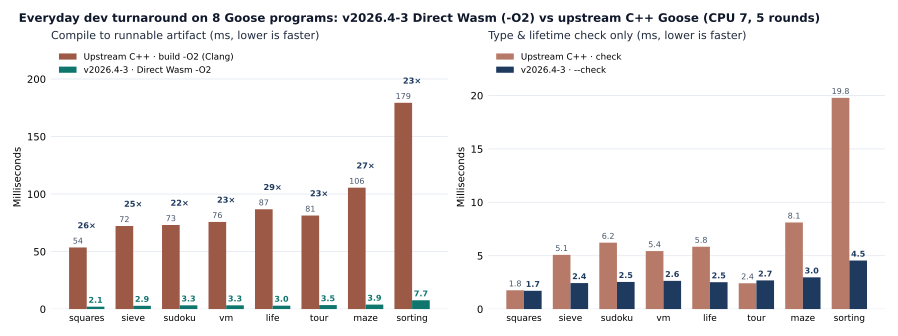
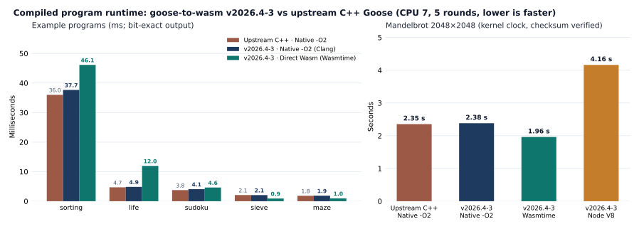
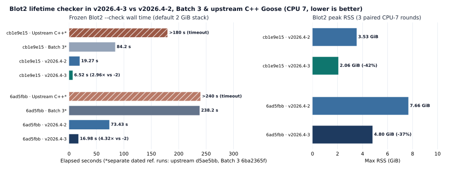

# Release `v2026.4-3` Benchmarks vs `v2026.4-2` and Upstream C++ Goose

Date: **2026-11-25**

Pinned head-to-head compiler turnaround, everyday dev build, runtime, and frozen Blot2 benchmarks comparing qualified **`goose-to-wasm v2026.4-3`** against **`goose-to-wasm v2026.4-2`** and plain upstream C++ Goose (`d5ae5bb`).

## What changed in `v2026.4-3`

Seven profile-driven rounds of 100%-sound algorithmic redesign inside `selfhost/checker_lifetimes.goose` (preserving exact `10,061/10,061` byte-identical C and Wasm output equivalence vs `v2026.4-2` and identical `forced0` conformance):

1. **Reachability pruning & non-cautious assumption lists:**
   - Added static per-node/per-function `hold_flags` reachability (`FH_CONSTRUCT_READ`, `FH_BUILD_HOLD`, `FH_FORMAT_RAW`, `FH_SC2_SITE`) in `life_prepare_nodes` so functions outside any construction-hold subtree omit construct reads (`omit_construct_reads`) and skip unreachable grow/replace checks cleanly.
   - Restricted `LifeFrame.assumptions` linked lists to non-cautious assumptions only (unlinking flipped/cautious entries immediately in `life_class_check`), tracked `noncautious_ver`, `LifeAssume.ver`, and per-root `chk_dep_roots`, and replaced nested `q4` loops with sorted `O(|A| + |B|)` merging plus a singleton `ac == 1 && bc == 1` fast path.
2. **Canonical type closures, O(N) `life_body`, and `life_held_own` memoization:**
   - Computed bit-exact structural `type_exact_canon` and `type_canon` up front in `life_prepare_nodes`, replacing repeated type-graph walks in `life_contains`, `life_refers` / `life_holder_points` / `life_referable`, and `life_gs_contains` with lazy per-canonical-type sorted inline closures (`closure_*`, `holder_ref_*`, `gs_*`) built once with O(1) generation stamps.
   - Added singleton + epoch-verified `held_own_memo` in `life_held_own`, replaced `life_body` hash lookup with direct `l.node_body[start]` array indexing + O(N) 16-node checkpointing + lazy merged transitive globals (`body_trans_globals`), added `local_holder_bits` bitset iteration, and outlined cold rehash/error helpers.
3. **Incremental validation, active-frame effect sweeping, and decoupled island certification:**
   - Decoupled per-island `own_rev` via `cls_child_rev` (guarded by `dep_callee_stamp_stack`), added zero-overhead Pass-1 certification (`can_cert_p1`), tracked `chk_island` so sealed caller-island assumptions reuse activation-independent `chk` entries, and added incremental `life_class_check(..., min_ver)` plus 1-step validation replay skips (`val_stores_only`, `val_stores_shallow`).
   - Removed unmatched-entry barrier scans in `life_effect_indexed`, swept finished-frame entries in `life_index_reserve` (walking only the active `.parent` stack so `effect_heads` stays L1/L2-resident), skipped dead `l.summaries` pushes during class-mode validation, and added 32 KiB direct-mapped `summary_l1`/`assume_l1` front caches.

Full round-by-round development log and all **4 preserved rejected experiments** (`root_read_act`/`cell_read_act`, 4,096-slot `q4_cache`, `allow_rec_offer`, and `map_memo` 65K / `assume_slot` 2× tightening) are documented in [`blot2-lifetime-algo/README.md`](../blot2-lifetime-algo/README.md).

## Pinned environment & binaries

- **Host:** `Linux-7.3.5-2-cachyos-x86_64-with-glibc2.44`
- **CPU pinning:** `taskset -c 7` (`os.sched_setaffinity(0, {7})`, `os.wait4` for Suite 4 CPU & max RSS)
- **Tools:** `clang version 23.1.5`, `node v26.5.0`, `wasmtime 50.0.1`
- **`goose-to-wasm v2026.4-3`:** `build/qualify-v2026.4-3/bootstrap/bin/goose` (`209831db656f…`, fixed-point Stage 2 == Stage 3 C `00ffd1ea7c47…`, portable memory64 `compiler-64.wasm` `5,147,372 B`)
- **`goose-to-wasm v2026.4-2`:** `build/qualify-v2026.4-2/bootstrap/bin/goose` (`93731c80475d…`)
- **Upstream C++ Goose:** `build/native/goose` (`d5ae5bb`, `2bb184c84bc5…`, `GOOSE_CC=clang`, pre-warmed `GOOSE_HOME` runtime cache)

## Qualification & `forced0` soundness audit

- **Plain upstream C++ Goose check:** `build/native/goose check selfhost/main.goose --stdlib stdlib` — **exit 0**.
- **Full qualification (`build/qualify-v2026.4-3/summary.json`, `269.2 s`, all stages exit 0):**
  - `bootstrap --verify`: `126.4 s`, `fixed_point: true` (`00ffd1ea…`), executable `209831db…`.
  - `conformance` (`-O0`, `-O2`, gcc): `10,697 / 10,801` (`104` recorded gaps, **0 unexpected**).
  - `native-checks`: `54 steps ok`.
  - `conformance-memory64`: `4,771 / 4,779` (`8` recorded gaps, **0 unexpected**).
  - `equivalence` (vs `v2026.4-2`): **`10,061` compared, `0` differing** (100% byte-identical C & Wasm).
  - `unit-tests`: all **20 / 20** unit test modules passed (`51.6 s`).
- **Forced-class (`LIFE_CONCRETE_FRAMES = 0`) soundness audit (`build/forced0-algo`, identical lifetime engine):**
  - `selfhost/main.goose --stdlib stdlib --check`: **exit 0**.
  - `tests/conformance.py --frontend-only --jobs 8`: **`10,675 / 10,801` passed (`126` failing rows — exact match vs baseline, `0` newly failing, `0` newly passing)**.

## Suite 1 — Self-hosting compiler (`selfhost/main.goose`, ~30k LOC, 5 alternating rounds, CPU 7)

| Mode | Upstream C++ (`d5ae5bb`) | `v2026.4-2` | `v2026.4-3` | vs `v2026.4-2` | vs Upstream |
|---|---:|---:|---:|---:|---:|
| Native `--check` | `4.139 s` | `0.358 s` | **`0.297 s`** | **`−17.0%`** | **14.0× faster** |
| Native emit Wasm64 (`-O2`) | `4.436 s` (C) | `0.497 s` | **`0.482 s`** | **`−3.0%`** | **9.2× faster** |
| Native emit C (`-O2`) | `4.436 s` | `0.594 s` | **`0.506 s`** | **`−14.8%`** | **8.8× faster** |
| Portable Wasm64 (Wasmtime) `--check` | `4.139 s` | — | **`0.886 s`** | — | **4.7× faster** |
| Portable Wasm64 (Wasmtime) emit Wasm64 | `4.436 s` (C) | — | **`1.284 s`** | — | **3.5× faster** |

*(Portable Wasm64 self-compilation produced the exact same `5,147,372 B` binary SHA-256 as the native binary.)*

### Single-run `--wasm-stats` phase breakdown (`selfhost/main.goose`, `-O2`)

| Backend | Phase | `v2026.4-2` | `v2026.4-3` | Delta |
|---|---|---:|---:|---:|
| `--target wasm-direct -O2` | `lifetime_ns` | `261.2 ms` | **`201.6 ms`** | **`−22.8%`** |
| `--target wasm-direct -O2` | `typecheck_ns` | `352.3 ms` | **`297.6 ms`** | **`−15.5%`** |
| `--target c -O2` | `lifetime_ns` | `247.5 ms` | **`194.5 ms`** | **`−21.4%`** |
| `--target c -O2` | `typecheck_ns` | `338.1 ms` | **`284.8 ms`** | **`−15.8%`** |



## Suite 2 — Everyday dev turnaround (8 examples, 5 alternating rounds, CPU 7)

| Program | `v3` `--check` | Upstream `check` | `v3` Direct Wasm `-O2` | Upstream `build -O2` | Build speedup |
|---|---:|---:|---:|---:|---:|
| `squares` | `1.7 ms` | `1.8 ms` | **`2.1 ms`** | `53.5 ms` | **26×** |
| `sieve` | `2.4 ms` | `5.1 ms` | **`2.9 ms`** | `72.2 ms` | **25×** |
| `sudoku` | `2.5 ms` | `6.2 ms` | **`3.3 ms`** | `73.1 ms` | **22×** |
| `vm` | `2.6 ms` | `5.4 ms` | **`3.3 ms`** | `75.8 ms` | **23×** |
| `life` | `2.5 ms` | `5.8 ms` | **`3.0 ms`** | `86.8 ms` | **29×** |
| `tour` | `2.7 ms` | `2.4 ms` | **`3.5 ms`** | `81.4 ms` | **23×** |
| `maze` | `3.0 ms` | `8.1 ms` | **`3.9 ms`** | `105.5 ms` | **27×** |
| `sorting` | `4.5 ms` | `19.8 ms` | **`7.7 ms`** | `179.3 ms` | **23×** |



## Suite 3 — Compiled program runtime (5 alternating rounds, CPU 7, bit-exact)

| Program | Upstream Native `-O2` | `v3` Native `-O2` | `v3` Wasmtime | `v3` Node V8 |
|---|---:|---:|---:|---:|
| `sorting` | `36.01 ms` | `37.67 ms` | `46.13 ms` | `207.46 ms` |
| `life` | `4.70 ms` | `4.85 ms` | `11.96 ms` | `36.57 ms` |
| `sudoku` | `3.75 ms` | `4.09 ms` | `4.64 ms` | `25.74 ms` |
| `sieve` | `2.09 ms` | **`2.08 ms`** | **`0.92 ms`** | `23.99 ms` |
| `maze` | `1.85 ms` | `1.88 ms` | **`0.97 ms`** | `20.82 ms` |
| `mandelbrot` (2048×2048, kernel clock) | `2.354 s` | `2.380 s` | **`1.961 s`** | `4.160 s` |



## Suite 4 — Frozen Blot2 checks (default 2 GiB stack, CPU 7, 3 paired alternating rounds `v2` vs `v3`)

| Snapshot | Upstream C++* | `v2026.4-2` (median wall / CPU / RSS) | `v2026.4-3` (median wall / CPU / RSS) | vs `v2026.4-2` | Diagnostics |
|---|---:|---:|---:|---:|---|
| `cb1e9e15` (3 paired rounds) | `>180 s` (timeout) | `19.27 s` / `19.18 s` / `3.53 GiB` | **`6.52 s` / `6.49 s` / `2.06 GiB`** | **`2.96×` faster (`−66.2%`), `−1.47 GiB` (`−41.5%`) RSS** | 1 sound §5.2 error (`check/check.goose:3422:86`) |
| `6ad5fbb` (3 paired rounds) | `>240 s` (timeout) | `73.43 s` / `73.11 s` / `7.66 GiB` | **`16.98 s` / `16.85 s` / `4.80 GiB`** | **`4.32×` faster (`−76.9%`), `−2.86 GiB` (`−37.4%`) RSS** | 1 sound §5.2 error (`check/check.goose:3179:86`) |

*\*Separate dated reference runs: upstream C++ Goose (`d5ae5bb`) timeout caps measured in the pinned [`release-v2026.4-1`](../../2026-11-24/release-v2026.4-1/README.md) study on the same host and CPU 7; Batch 3 (`6ba2365f…`) reference times (`84.15 s` / `238.16 s`) from [`blot2-lifetime-speed`](../../2026-11-24/blot2-lifetime-speed/README.md).*



## Reproduce

```sh
.venv/bin/python bench/results/2026-11-25/release-v2026.4-3/measure.py < /dev/null
python3 bench/results/2026-11-25/release-v2026.4-3/plot.py < /dev/null
```

Raw measurements: [`results.json`](results.json).
