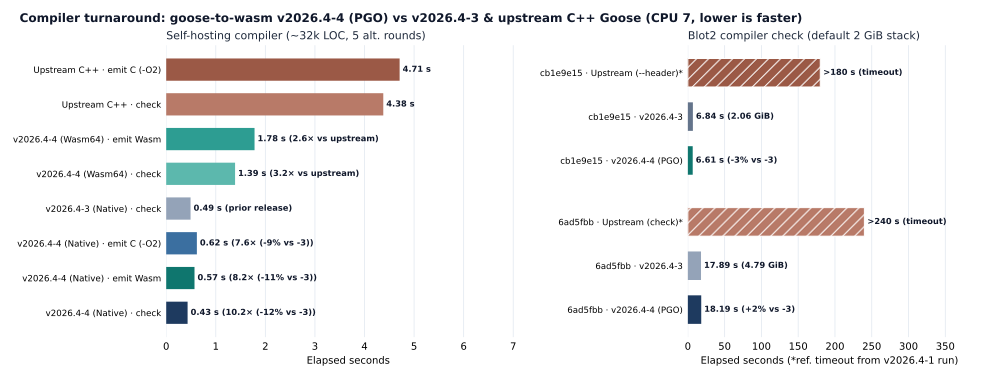
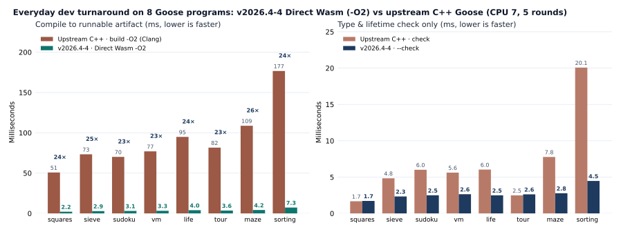
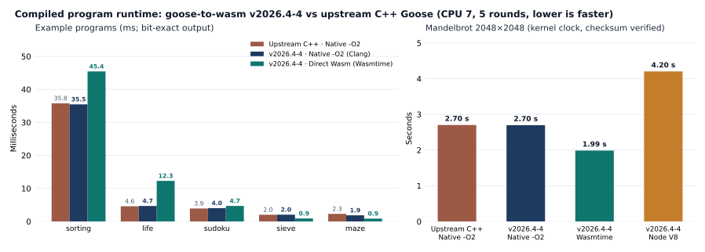
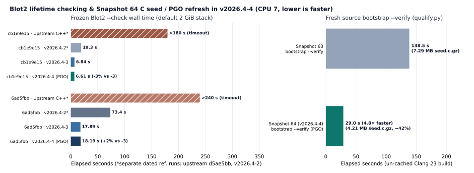

# Release `v2026.4-4` Benchmarks vs `v2026.4-3` and Upstream C++ Goose

Date: **2026-11-25**

Pinned head-to-head compiler turnaround, everyday dev build, runtime, frozen Blot2 check, and Direct Wasm64 `wtime` benchmarks comparing qualified **`goose-to-wasm v2026.4-4`** (Snapshot 64 + Clang 23 PGO) against **`goose-to-wasm v2026.4-3`** and plain upstream C++ Goose (`d5ae5bb`).

## What changed in `v2026.4-4`

1. **Direct Wasm `reusable[]` slice pools, flat `from_bytes`, and O(1) page-bucketed forwarding (`992`-byte scratch + 512-byte B+ max-augmented span tree):**
   - Lowered `alloc_slice`, `realloc_slice`, and `free_slice` on both memory32 and `--wasm-memory64`, matching upstream §5.4 placement, coalescing, regrowth, rebinding, and error semantics.
   - Added flat fixed-size `from_bytes<T[>..]>` verification, diverging `TY_REF` returns, and upgraded the forwarding resolver from an O(N) linked list to a lazily allocated O(1) 4 KiB page-bucketed table.
2. **Thin `#![forbid(unsafe_code)]` Rust `wtime` host wrapper ([`host/wtime`](../../../../host/wtime/README.md)) + `--library --reachable-program`:**
   - `--library --reachable-program` now skips unreachable non-generic bodies so library-style programs like Blot2 (`compiler-goose/src/main.goose`) compile directly to Wasm64 without a wrapper `fn main()`.
   - `goose-wtime` binds `goose.*`, pure-Rust math, `env.gs_os_*`, and all 56 `env.blot_*` imports on read-only sibling `../wtime` (`ad175d5`, `rustc 1.99.1`), compiling all **18/18** frozen Blot2 `benchmarks/idiomatic/*.blot` benchmarks into **18/18 byte-identical `.wasm` binaries** matching native `blotc-goose`. [Blot2 Wasm64 on `wtime` evidence](../blot2-wtime-wasm64/README.md)
3. **Diagnostics to solid standard + `--run` CLI fix:**
   - Added `--error-format=text|json`, `--color=auto|always|never` (respecting `NO_COLOR`/`CLICOLOR_FORCE`), generic/stdlib instantiation backtraces (`note: while instantiating ... called from file:line:col`), opening-delimiter location notes, prior-declaration notes, consolidated missing `match` variants and struct fields, immutable `let` reassignment hints, return type mismatch `help:`, and fixed `--run` without `-o` on relative native paths (`./out.c.bin`).
4. **Conformance & compatibility gap burn-down (`10,697 → 10,709 / 10,801`, `99.15%`; `104 → 92` open gaps):**
   - Fixed 12 recorded conformance gaps (and 2 memory64 gaps: `4,773 / 4,779`): §10.4 `2^48` native aggregate layout limit, qualified generic enum variant constructor shadowing (`H<G.B>.A`), standardized `"limited array capacity exceeded"`, and fill `[v; n]` overflow evaluation order on both native C and Direct Wasm.
5. **Direct Wasm64 codegen speedups (`selfhost/codegen.goose`):**
   - Added `m.safe_refs` field-offset folding on `--wasm-memory64` and non-bundled safe modules, inline small scalar clears (`1..12` B) and copies (`1..8` B) at `-O2`, and fast `const_idx`/`simple_idx` memory64 array indexing. [Isolated Wasm64 A/B & preserved rejected experiments](../wasm64-codegen/README.md)
6. **Snapshot 64 C seed & Clang 23 PGO profile refresh (`bootstrap/`):**
   - Refreshed the checked-in C seed from Snapshot 63 (`7.29 MB` `.c.gz`, ~39 MB C) to Snapshot 64 (`4.21 MB` `.c.gz`, **−42.2%**, `25.2 MB` fixed-point C) with a freshly trained Clang 23 PGO profile (`754 KB`).
   - Fresh un-cached `scripts/bootstrap.py --verify` dropped from **`138.5 s` → `29.0 s`** (**4.8× faster**) with `seed_matches_sources: true`, `fixed_point: true`, and `profile_used: true`. [Snapshot 64 record](../../../../selfhost/results/2026-11-25/snapshot-64/README.md)

## Pinned environment & binaries

- **Host:** `Linux-7.3.5-2-cachyos-x86_64-with-glibc2.44`
- **CPU pinning:** `taskset -c 7` (`os.sched_setaffinity(0, {7})`, `os.wait4` for Suite 4 CPU & max RSS)
- **Tools:** `clang version 23.1.5`, `node v26.5.0`, `wasmtime 50.0.1`, `rustc 1.99.1` (`host/wtime` on read-only `../wtime` `ad175d5`)
- **`goose-to-wasm v2026.4-4` (PGO):** `build/qualify-v2026.4-4/bootstrap/bin/goose` (`40409f9a212d…`, fixed-point seed `a27c51ec448a…`, `profile_used: true`, portable memory64 `compiler-64.wasm` `5,383,316 B`, bundled `4,320,788 B`)
- **`goose-to-wasm v2026.4-4` (no-PGO ref.):** `build/redeliver64/boot-from-63/goose` (`f981337450bc…`)
- **`goose-to-wasm v2026.4-3`:** `build/qualify-v2026.4-3/bootstrap/bin/goose` (`209831db656f…`)
- **Upstream C++ Goose:** `build/native/goose` (`d5ae5bb`, `2bb184c84bc5…`, `GOOSE_CC=clang`, pre-warmed `GOOSE_HOME` runtime cache)

## Qualification

- **Plain upstream C++ Goose check:** `build/native/goose check selfhost/main.goose --stdlib stdlib` — **exit 0**.
- **Full qualification (`build/qualify-v2026.4-4/summary.json`, `170.0 s`, all stages exit 0):**
  - `bootstrap --verify`: **`29.0 s`** (un-cached), `seed_matches_sources: true`, `fixed_point: true` (`a27c51ec…`), `profile_used: true`, executable `40409f9a…`.
  - `conformance` (`-O0`, `-O2`, gcc): **`10,709 / 10,801`** (`99.15%`, `92` recorded gaps, **0 unexpected**).
  - `native-checks`: `54 steps ok`.
  - `conformance-memory64`: **`4,773 / 4,779`** (`99.87%`, `6` recorded gaps, **0 unexpected**).
  - `unit-tests`: all **21 / 21** unit test modules passed (`52.2 s`), including `tests.test_diagnostics` and `tests.test_wtime_host`.

## Suite 1 — Self-hosting compiler (`selfhost/main.goose`, ~32k LOC, 5 alternating rounds, CPU 7)

*(Note: `selfhost/main.goose` grew by ~1.6k lines since `v2026.4-3` from Direct Wasm slice pools, flat `from_bytes`, and diagnostics, so both `v2026.4-3` and `v2026.4-4` are timed on the identical frozen `v2026.4-4` codebase below.)*

| Mode | Upstream C++ (`d5ae5bb`) | `v2026.4-3` | `v2026.4-4` (PGO) | vs `v2026.4-3` | vs Upstream |
|---|---:|---:|---:|---:|---:|
| Native `--check` | `4.379 s` | `0.491 s` | **`0.431 s`** (`0.480 s` no-PGO) | **`−12.2%`** | **10.2× faster** |
| Native emit Wasm64 (`-O2`) | `4.708 s` (C) | `0.642 s` | **`0.571 s`** | **`−11.1%`** | **8.2× faster** |
| Native emit C (`-O2`) | `4.708 s` | `0.681 s` | **`0.619 s`** | **`−9.1%`** | **7.6× faster** |
| Portable Wasm64 (Wasmtime, plain) `--check` | `4.379 s` | — | **`1.389 s`** | — | **3.2× faster** |
| Portable Wasm64 (Wasmtime, `--wasm-bundled-host`) `--check` | `4.379 s` | — | **`1.114 s`** | — | **3.9× faster** |
| Portable Wasm64 (Wasmtime, plain) emit Wasm64 | `4.708 s` (C) | — | **`1.782 s`** | — | **2.6× faster** |

*(Portable Wasm64 self-compilation produced the exact same `5,383,316 B` binary SHA-256 as the native binary.)*

### Single-run `--wasm-stats` phase breakdown (`selfhost/main.goose`, `-O2`)

| Backend | Phase | `v2026.4-3` | `v2026.4-4` (PGO) | Delta |
|---|---|---:|---:|---:|
| `--target wasm-direct -O2` | `lifetime_ns` | `339.2 ms` | **`304.0 ms`** | **`−10.4%`** |
| `--target wasm-direct -O2` | `typecheck_ns` | `432.4 ms` | **`388.9 ms`** | **`−10.1%`** |
| `--target wasm-direct -O2` | `optimize_ns` | `53.3 ms` | **`49.1 ms`** | **`−7.9%`** |
| `--target c -O2` | `lifetime_ns` | `337.3 ms` | **`297.5 ms`** | **`−11.8%`** |
| `--target c -O2` | `typecheck_ns` | `430.5 ms` | **`383.4 ms`** | **`−10.9%`** |



## Suite 2 — Everyday dev turnaround (8 examples, 5 alternating rounds, CPU 7)

| Program | `v4` `--check` | Upstream `check` | `v4` Direct Wasm `-O2` | Upstream `build -O2` | Build speedup |
|---|---:|---:|---:|---:|---:|
| `squares` | `1.7 ms` | `1.7 ms` | **`2.2 ms`** | `50.8 ms` | **24×** |
| `sieve` | `2.3 ms` | `4.8 ms` | **`2.9 ms`** | `73.3 ms` | **25×** |
| `sudoku` | `2.5 ms` | `6.0 ms` | **`3.1 ms`** | `70.1 ms` | **23×** |
| `vm` | `2.6 ms` | `5.6 ms` | **`3.3 ms`** | `77.0 ms` | **23×** |
| `life` | `2.5 ms` | `6.0 ms` | **`4.0 ms`** | `94.9 ms` | **24×** |
| `tour` | `2.6 ms` | `2.5 ms` | **`3.6 ms`** | `81.6 ms` | **23×** |
| `maze` | `2.8 ms` | `7.8 ms` | **`4.2 ms`** | `108.7 ms` | **26×** |
| `sorting` | `4.5 ms` | `20.1 ms` | **`7.3 ms`** | `176.7 ms` | **24×** |



## Suite 3 — Compiled program runtime (5 alternating rounds, CPU 7, bit-exact)

| Program | Upstream Native `-O2` | `v4` Native `-O2` | `v4` Wasmtime | `v4` Node V8 |
|---|---:|---:|---:|---:|
| `sorting` | `35.77 ms` | **`35.47 ms`** | `45.44 ms` | `201.14 ms` |
| `life` | `4.60 ms` | `4.69 ms` | `12.28 ms` | `31.28 ms` |
| `sudoku` | `3.93 ms` | `4.04 ms` | `4.69 ms` | `26.18 ms` |
| `sieve` | `2.03 ms` | `2.05 ms` | **`0.90 ms`** | `23.28 ms` |
| `maze` | `2.29 ms` | **`1.86 ms`** | **`0.86 ms`** | `19.29 ms` |
| `mandelbrot` (2048×2048, kernel clock) | `2.703 s` | **`2.698 s`** | **`1.986 s`** | `4.204 s` |



## Suite 4 — Frozen Blot2 checks (default 2 GiB stack, CPU 7, 3 paired alternating rounds `v3` vs `v4` PGO)

| Snapshot | Upstream C++* | `v2026.4-3` (median wall / CPU / RSS) | `v2026.4-4` PGO (median wall / CPU / RSS) | vs `v2026.4-3` | Diagnostics |
|---|---:|---:|---:|---:|---|
| `cb1e9e15` (3 paired rounds) | `>180 s` (timeout) | `6.84 s` / `6.82 s` / `2.06 GiB` | **`6.61 s` / `6.58 s` / `2.06 GiB`** | **`−3.4%`** | 1 sound §5.2 error (`check/check.goose:3422:86`) |
| `6ad5fbb` (3 paired rounds) | `>240 s` (timeout) | `17.89 s` / `17.75 s` / `4.79 GiB` | **`18.19 s` / `18.05 s` / `4.79 GiB`** | `+1.7%` (flat within noise) | 1 sound §5.2 error (`check/check.goose:3179:86`) |

*\*Separate dated reference runs: upstream C++ Goose (`d5ae5bb`) timeout caps from [`release-v2026.4-1`](../../2026-11-24/release-v2026.4-1/README.md); `v2026.4-2` reference times (`19.27 s` / `73.43 s`) from [`release-v2026.4-3`](../release-v2026.4-3/README.md).*



## Suite 5 — Direct Wasm64 Blot2 (`cb1e9e15`) on pure-Rust `wtime` (`host/wtime`, CPU 7)

- **Emit Blot2 Wasm64 (`--library --reachable-program --wasm-memory64 -O2`):** **`8.643 s`** (`44,277,085 B`, 3 exports: `memory`, `_start`, `blot_goose_main`; 85 imports: 10 `goose.*`, 19 math, 56 `env.blot_*`)
- **`goose-wtime` (`compact`, `fibonacci.blot`):** compile **`0.803 s`**, instantiate **`1.93 ms`**, run **`14.47 s`**, bit-exact SHA-256 `fd6bacef670e` matching native `blotc-goose` (**18/18** `benchmarks/idiomatic/*.blot` benchmarks verified bit-exact in [`blot2-wtime-wasm64`](../blot2-wtime-wasm64/README.md)).

## Reproduce

```sh
.venv/bin/python bench/results/2026-11-25/release-v2026.4-4/measure.py < /dev/null
python3 bench/results/2026-11-25/release-v2026.4-4/plot.py < /dev/null
```

Raw measurements: [`results.json`](results.json).
