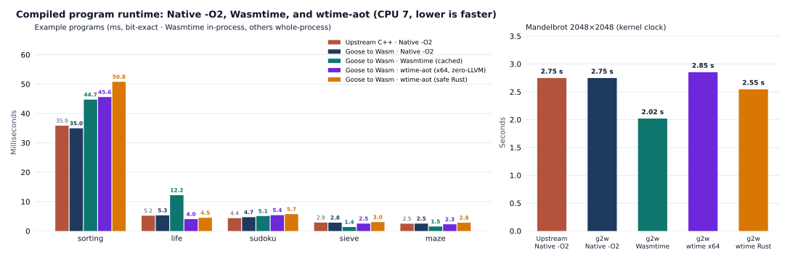

# Production Runtime Speed with `wtime-aot` (`x64` & safe Rust)

Date: **2026-11-25**

Pinned CPU-7 head-to-head runtime comparison across **5 engines** on the 6 README runtime workloads (`sorting`, `life`, `sudoku`, `sieve`, `maze`, `mandelbrot 2048×2048`), adding [`mewhhaha/wtime`](https://github.com/mewhhaha/wtime) `wtime-aot` (`--backend x64` and `--backend rust`) alongside Upstream C++ Goose, Goose to Wasm Native `-O2`, and Wasmtime.

## Pinned environment & tools

- **Host:** `Linux-7.3.5-2-cachyos-x86_64-with-glibc2.44`
- **CPU pinning:** CPU 7 (`os.sched_setaffinity(0, {7})`), **5 alternating rounds** per workload (reversed order on odd rounds), **bit-exact stdout / checksum verification** on every run
- **`goose-to-wasm`:** Snapshot 68 PGO (`build/bin/goosew`, `v2026.4-1`, Clang 23.1.5)
- **Upstream C++ Goose:** `build/native/goose` (`92125b6`, `GOOSE_CC=clang`, pre-warmed `GOOSE_HOME` runtime cache)
- **Wasmtime:** `wasmtime` Python bindings `50.0.1` (precompiled `.cwasm`, in-process `run_wasmtime.run_module`, matching [`../release-v2026.4-4/README.md`](../release-v2026.4-4/README.md))
- **`wtime-aot`:** read-only sibling `../wtime` `v0.1.5` (`718924112d1c…`), built with default flags (no `--target-cpu native`, matching default `clang -O2`):
  - `--backend x64`: pure-Rust (`#![forbid(unsafe_code)]`) x86-64 AOT compiler emitting zero-`libc` static Linux `ET_EXEC` binaries directly from `.wasm` (no LLVM/Clang)
  - `--backend rust`: safe-Rust (`#![forbid(unsafe_code)]`) AOT backend compiled through `rustc`/LLVM

## Results (median of 5 alternating rounds, CPU 7)



| Program | Upstream Native `-O2` | Goose to Wasm Native `-O2` | Direct Wasm · Wasmtime (cached)* | Direct Wasm · `wtime-aot x64` | Direct Wasm · `wtime-aot rust` | `wtime-aot x64` cold AOT build |
|---|---:|---:|---:|---:|---:|---:|
| `sorting` | `35.85 ms` | **`34.96 ms`** | `44.72 ms` | `45.60 ms` | `50.78 ms` | `16.4 ms` |
| `life` | `5.21 ms` | `5.33 ms` | `12.20 ms` | **`4.05 ms`** | `4.51 ms` | `9.3 ms` |
| `sudoku` | **`4.36 ms`** | `4.70 ms` | `5.09 ms` | `5.39 ms` | `5.73 ms` | `7.1 ms` |
| `sieve` | `2.88 ms` | `2.84 ms` | **`1.35 ms`** | `2.51 ms` | `3.03 ms` | `7.2 ms` |
| `maze` | `2.48 ms` | `2.52 ms` | **`1.53 ms`** | `2.29 ms` | `2.82 ms` | `9.4 ms` |
| `mandelbrot` (2048×2048, kernel clock) | `2.748 s` | `2.748 s` | **`2.019 s`** | `2.853 s` | `2.545 s` | `4.7 ms` |

*\*Wasmtime runs the 5 example programs in-process from a precompiled `.cwasm`, whereas Upstream Native, Goose to Wasm Native, and both `wtime-aot` binaries are timed whole-process (`fork`+`exec`). On `mandelbrot`, all 5 engines report the internal Goose `clock_ns()` kernel time (excluding process startup).*

### Key takeaways

- **`wtime-aot --backend x64`** turns Direct Wasm `-O2` modules into standalone static Linux x86-64 binaries with zero LLVM/Clang and zero `libc` in **`4.7–16.4 ms`**, beating native Clang `-O2` on whole-process **`life` (`4.05 ms` vs `5.21–5.33 ms`, `3.0×` faster than Wasmtime)**, **`sieve` (`2.51 ms` vs `2.84–2.88 ms`)**, and **`maze` (`2.29 ms` vs `2.48–2.52 ms`)**.
- **`wtime-aot --backend rust`** (`#![forbid(unsafe_code)]` guest codegen via LLVM) beats native Clang `-O2` on **`life` (`4.51 ms`)** and **`mandelbrot` (`2.545 s` vs `2.748 s`)**.
- All 5 engines produced **bit-exact** outputs (and exact Mandelbrot checksum `1038538536`).

## Reproduce

```sh
.venv/bin/python bench/results/2026-11-25/runtime-with-wtime/measure.py < /dev/null
python3 bench/results/2026-11-25/runtime-with-wtime/plot.py < /dev/null
```

Raw measurements: [`results.json`](results.json).
