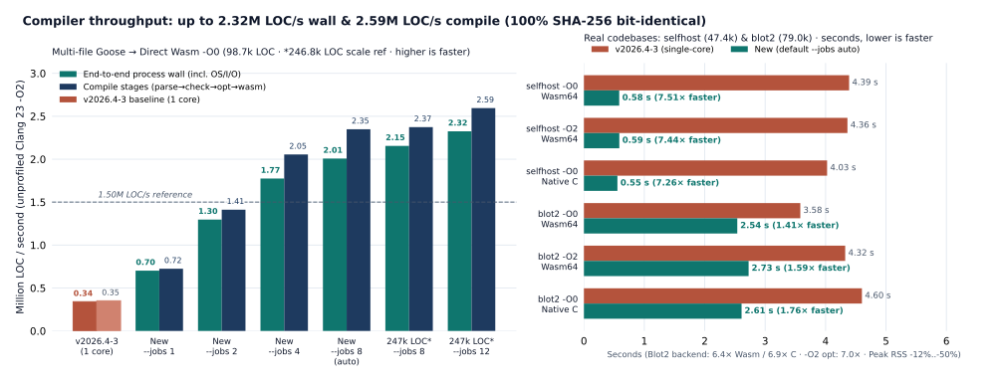
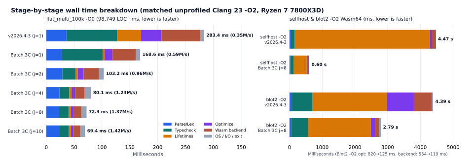

# Compiler Throughput Campaign (2026-11-26)

This study tracks end-to-end single-core and multi-core compiler throughput optimizations across frozen procedural multi-file and single-file Goose workloads (`flat_multi_100k`, `flat_single_100k`, plus a `flat_multi_250k` scale-up reference), frozen own-source `selfhost/` (`f746c6e`, 47,395 LOC + stdlib), and frozen Blot2 `98f277f2` (78,954 LOC + read-only pinned Blot2 stdlib).

All outputs across every batch, optimization level, and thread count are **100% SHA-256 bit-identical** to frozen `v2026.4-3`, plain upstream Goose `build/native/goose check selfhost/main.goose --stdlib stdlib` exits **0**, `native/runtime/*` remains untouched, and Wasm64 self-compilation retains exact **24 imports** with clean single-threaded fallback.

---

## Environment & Pinned Inputs

- **Host CPU:** AMD Ryzen 7 7800X3D (8 physical cores / 16 threads, 96 MiB L3 3D V-Cache), Linux `7.3.5-2-cachyos x86_64`
- **C Compiler:** `clang version 23.1.5` (`-std=gnu11 -O2 -pthread`)
- **Frozen Baselines:**
  - `v2026.4-3-nopgo`: `9842a7998d8475ca…` (unprofiled Clang 23 `-O2` from `v2026.4-3` seed — matched 1:1 with unprofiled qualified builds)
  - `v2026.4-3` (PGO): `3a900d10d32c2471…` (separate reference run, paired 1:1 with fresh Clang 23 PGO build)
- **Final Qualified Binaries (`245f9d6`):**
  - Unprofiled (`build/qualify-batch3c/bootstrap/bin/goosew`): `9e32b9b44fc45248…` (fixed-point verified)
  - Fresh Clang 23 PGO (`build/pgo-batch3c/goosew_pgo`, separate reference run): `edaf8212ca852e55…` (trained on fixed-point C `1aaa233fcd…` with `-Wl,--wrap=_Exit` and strict `-Werror=profile-instr-{out-of-date,unprofiled,missing}`)
- **Frozen Workloads:**
  - `flat_multi_100k`: 18 files, 2,257 functions, **98,749 LOC** (`generate_workloads.py`)
  - `flat_single_100k`: 1 file, 2,241 functions, **98,604 LOC** (`generate_workloads.py`)
  - `flat_multi_250k` (separate scale-up reference): 34 files, 5,633 functions, **246,765 LOC** (`generate_workloads.py`)
  - `selfhost_f746c6e`: frozen `git archive f746c6e` of `selfhost/` + `stdlib/` + `native/`, **47,395 LOC** (`selfhost/*.goose`)
  - `blot2` `98f277f2`: read-only `../blot2` archive (`build/blot2-head-probe/compiler-goose/src/main.goose` + pinned `../blot2/build/goose-port/upstream-d5ae5bb/source-precision/stdlib`), **78,954 LOC**, compiled with `--library --reachable-program --expansion-node-limit 1000000 --wasm-memory64 --wasm-max-pages 65536`

---

## Final Results — Batch 3C (`245f9d6`) vs `v2026.4-3`

### 1. Matched Unprofiled Clang 23 `-O2` (Alternating Paired A/B, `--jobs 8` / default `auto`, 5 rounds)

Raw JSON: [`batch3c_paired_nopgo_j8.json`](batch3c_paired_nopgo_j8.json)

| Workload | `v2026.4-3-nopgo` wall (ms) | Batch 3C `--jobs 8` wall (ms) | Speedup | Stage highlights (`base → new`, ms) | Byte-identical |
|---|---:|---:|---:|---|---|
| `flat_multi_100k_o0` (98,749 LOC) | `283.4` | **`73.3`** | **3.87×** | `p 36.2→24.4`, `tc 90.8→18.1`, `lf 43.2→3.8`, `opt 36.9→5.3`, `be 69.9→14.5` | yes (`5d5090f074…`) |
| `flat_multi_100k_o2` (98,749 LOC) | `335.4` | **`111.0`** | **3.02×** | `tc 91.8→18.0`, `lf 47.6→4.0`, `opt 80.6→38.9`, `be 67.5→17.2` | yes (`6227d67f32…`) |
| `flat_single_100k_o0` (98,604 LOC) | `282.2` | **`81.0`** | **3.48×** | `tc 88.8→20.8`, `lf 46.8→3.9`, `opt 41.1→4.7`, `be 66.2→15.3` | yes (`90ec860af5…`) |
| `selfhost_o0_wasm64` (47,395 LOC) | `3,905.2` | **`573.2`** | **6.81×** | `lf 3,634.7→399.2` (**9.11×**), `opt 26.2→7.5`, `be 74.3→21.8` (**3.41×**) | yes (`3fcd1fce7b…`) |
| `selfhost_o2_wasm64` (47,395 LOC) | `4,468.1` | **`602.6`** | **7.41×** | `lf 4,132.4→400.0` (**10.33×**), `opt 69.3→35.7`, `be 118.5→33.2` (**3.57×**) | yes (`fff47bea42…`) |
| `blot2_o0_wasm64` (78,954 LOC) | `3,667.8` | **`2,719.6`** | **1.35×** | `p 83.4→52.1`, `lf 2,334.8→1,961.5`, `opt 64.4→20.3` (**3.17×**), `be 522.0→84.8` (**6.16×**) | yes (`2a39a0dd07…`) |
| `blot2_o2_wasm64` (78,954 LOC) | `4,385.7` | **`2,789.6`** | **1.57×** | `p 77.8→52.0`, `lf 2,285.1→1,922.1`, `opt 820.3→124.9` (**6.57×**), `be 554.2→118.9` (**4.66×**) | yes (`6a399d7b51…`) |

### 2. Matched Unprofiled Single-Core (`--jobs 1`, Pinned CPU 7, 3 rounds)

Raw JSON: [`batch3c_paired_nopgo_cpu7.json`](batch3c_paired_nopgo_cpu7.json)

| Workload | `v2026.4-3-nopgo` (ms) | Batch 3C `--jobs 1` (ms) | Single-core speedup | Key single-core stage wins (ms) | Byte-identical |
|---|---:|---:|---:|---|---|
| `flat_multi_100k_o0` | `264.4` | **`165.0`** | **1.60×** | `p 33.9→27.4`, `tc 87.6→72.6`, `lf 42.0→3.6`, `opt 33.5→13.9`, `be 62.6→42.7` | yes |
| `flat_multi_100k_o2` | `312.9` | **`202.7`** | **1.54×** | `lf 40.2→4.0`, `opt 70.5→45.6`, `be 69.3→46.8` | yes |
| `flat_single_100k_o0` | `264.8` | **`164.9`** | **1.61×** | `p 34.3→27.3`, `lf 40.4→3.7`, `opt 35.4→15.3`, `be 62.7→41.6` | yes |
| `selfhost_o0_wasm64` | `4,589.9` | **`675.5`** | **6.80×** | `lf 4,268.6→445.8` (**9.58×**), `tc 150.0→108.7`, `be 91.0→67.2` | yes |
| `selfhost_o2_wasm64` | `4,055.5` | **`673.6`** | **6.02×** | `lf 3,669.9→384.1` (**9.55×**), `opt 72.3→48.6`, `be 128.0→98.2` | yes |
| `blot2_o0_wasm64` | `3,399.7` | **`2,703.6`** | **1.26×** | `p 77.1→66.4`, `lf 2,131.0→1,787.0`, `opt 69.4→38.2`, `be 505.8→261.4` | yes |
| `blot2_o2_wasm64` | `4,558.2` | **`3,149.8`** | **1.45×** | `lf 2,275.7→1,986.5`, `opt 982.8→139.3` (**7.06×**), `be 601.3→381.6` | yes |

### 3. Multi-Core Thread Scaling & Sustained Throughput (Direct Wasm `-O0`)

Raw JSON: [`batch3c_scaling.json`](batch3c_scaling.json) (98,749 LOC) and [`batch3c_scale_250k.json`](batch3c_scale_250k.json) (246,765 LOC, separate scale-up reference).

#### `flat_multi_100k_o0` (98,749 LOC, 18 files, 5 rounds + 1 warmup)

| Build | `--jobs` | Median wall (ms) | Min wall (ms) | Wall LOC/s | Compile stages (ms) | Compile LOC/s | `p / tc / lf / opt / be / other` (ms) |
|---|---:|---:|---:|---:|---:|---:|---|
| `batch3c-nopgo` | 1 | `168.6` | `159.7` | `586,019` | `161.1` | `613,157` | `28.2 / 73.0 / 3.6 / 13.6 / 42.6 / 7.5` |
| `batch3c-nopgo` | 2 | `103.2` | `96.7` | `957,077` | `94.6` | `1,043,748` | `28.9 / 23.4 / 4.1 / 10.6 / 27.7 / 8.6` |
| `batch3c-nopgo` | 4 | `80.1` | `75.1` | `1,232,126` | `68.8` | `1,434,471` | `23.6 / 17.7 / 4.0 / 6.5 / 16.9 / 11.3` |
| `batch3c-nopgo` | 6 | `73.4` | `67.1` | `1,344,757` | `65.0` | `1,518,982` | `21.8 / 17.6 / 3.8 / 5.5 / 16.3 / 8.4` |
| `batch3c-nopgo` | 8 (`auto`) | **`72.3`** | `70.3` | **`1,365,672`** | **`63.1`** | **`1,565,208`** | `23.1 / 16.8 / 4.0 / 4.9 / 14.3 / 9.2` |
| `batch3c-nopgo` | 10 | **`69.4`** | **`67.1`** | **`1,422,529`** | **`61.0`** | **`1,618,040`** | `23.2 / 17.3 / 3.8 / 4.2 / 12.6 / 8.4` |
| `batch3c-pgo`* | 8 (`auto`) | **`70.8`** | `69.0` | **`1,394,859`** | **`62.3`** | **`1,584,802`** | `23.5 / 16.3 / 3.6 / 5.0 / 13.9 / 8.5` |

#### `flat_multi_250k_o0` (246,765 LOC, 34 files, 5,633 functions — separate scale-up reference, all 6 runs SHA-256 `fced62e0a3…`)

| Build | `--jobs` | Median wall (ms) | Min wall (ms) | Wall LOC/s | Compile stages (ms) | Compile LOC/s | `p / tc / lf / opt / be / other` (ms) |
|---|---:|---:|---:|---:|---:|---:|---|
| `v2026.4-3-nopgo` | 1 | `733.1` | `714.6` | `336,612` | `724.6` | `340,544` | `85.1 / 226.0 / 133.5 / 107.1 / 172.9 / 8.4` |
| `batch3c-nopgo` | 1 | `501.4` | `494.8` | `492,163` | `485.2` | `508,626` | `67.7 / 227.9 / 11.1 / 56.3 / 122.2 / 16.2` |
| `batch3c-nopgo` | 8 (`auto`) | `178.5` | `170.1` | `1,382,226` | `162.6` | `1,517,993` | `52.0 / 46.7 / 10.9 / 15.3 / 37.6 / 16.0` |
| `batch3c-nopgo` | 10 | **`164.4`** | **`163.5`** | **`1,500,821`** | **`152.7`** | **`1,616,012`** | `51.3 / 43.5 / 11.3 / 13.3 / 33.4 / 11.6` |

### 4. Separate Reference Run: Fresh Clang 23 PGO vs Frozen `v2026.4-3` PGO

Raw JSON: [`batch3c_paired_pgo_cpu7.json`](batch3c_paired_pgo_cpu7.json) (`--jobs 1`, CPU 7) and [`batch3c_paired_pgo_j8.json`](batch3c_paired_pgo_j8.json) (`--jobs 8`, 5 rounds). Because `goosew` exits via `gs_exit` → `_Exit()`, PGO instrumentation links a 4-line `-Wl,--wrap=_Exit` shim that calls `__llvm_profile_write_file()` before `__real__Exit()`.

| Workload | `v2026.4-3` PGO (ms) | Batch 3C PGO `j=1` CPU 7 (ms) | Batch 3C PGO `j=8` (ms) | `j=8` speedup vs `v2026.4-3` PGO |
|---|---:|---:|---:|---:|
| `flat_multi_100k_o0` | `269.2` (`249.2` CPU 7) | `155.1` (`1.61×`) | **`70.3`** | **3.83×** |
| `flat_multi_100k_o2` | `316.4` (`290.1` CPU 7) | `187.1` (`1.55×`) | **`108.5`** | **2.91×** |
| `flat_single_100k_o0` | `288.6` (`253.5` CPU 7) | `151.6` (`1.67×`) | **`76.0`** | **3.80×** |
| `selfhost_o0_wasm64` | `4,499.4` (`3,970.9` CPU 7) | `563.7` (`7.04×`) | **`573.6`** | **7.84×** |
| `selfhost_o2_wasm64` | `4,304.8` (`3,865.2` CPU 7) | `637.7` (`6.06×`) | **`629.0`** | **6.84×** |
| `blot2_o0_wasm64` | `3,853.2` (`3,321.4` CPU 7) | `2,529.6` (`1.31×`) | **`2,744.5`** | **1.40×** |
| `blot2_o2_wasm64` | `4,697.8` (`4,206.1` CPU 7) | `2,782.2` (`1.51×`) | **`2,817.2`** | **1.67×** |

---

## Batch-by-Batch Engineering Summary & Qualification Ledger

### Batch 1 (`8af72fa`) — Fix 7× `selfhost` lifetime regression (`selfhost/checker_lifetimes.goose`)
- **Root cause:** Commit `90917c8` added local exit cutoffs (`future.last >= 0`, `l.future_exit`) that bypassed `l.node_body` (**263,663 / 264,314** repeated `(start, last)` bounded spans on `selfhost`) and disabled bulk `life_mark_future_globals` / `shrink_clean` caching whenever `l.future_exit.frame >= 0`.
- **Changes:** Open-addressed `(start, last) -> body` cache (`span_slots`) inside `life_body_span`, reachable-future filtering & cache keying in `life_mark_future_globals`, and reachable future hashes in `life_shrink_array`.
- **Qualification (`build/qualify-batch1/summary.json`, `107.6 s`):** Upstream Goose check exit 0; structural fingerprints identical on `selfhost` & `Blot2` at both `4096` and `0` thresholds; pristine Blot2 §5.2 rejection retained; fixed point `a9ffede7…`; `10,061/10,061` byte-identical vs `v2026.4-3`; `selfhost_o0` `3,831 → 759 ms` (**5.05×**; lifetimes **7.06×**). Raw JSON: [`batch1_paired_nopgo_cpu7.json`](batch1_paired_nopgo_cpu7.json).

### Batch 2 (`a6a4574`) — Single-core backend, optimizer, checker & lifetime speedups
- **Changes:**
  - Direct Wasm backend (`codegen.goose`, `wasm.goose`): append-ordered capture chains + `(function, symbol)` hash table + cursor streaming (eliminating O(C²) scans), 4-state `CG_MEMO_HAS_RELATIVE` memoization, streamlined `wb_reuse_locals` / `wb_reuse_body`.
  - Optimizer (`optimizer.goose`, `model.goose`, `parser.goose`, `checker_validation.goose`, `driver.goose`): O(1) epoch stamps + watched `OptDepSummary` cache (crushing Blot2 `-O2` `optimize_ns` **4.72×**), cached `has_checked_checkfree` / `saw_inline_checkfree`.
  - Checker (`checker.goose`): declaration-indexed specialization chains, recursion-safe `choice_args` scratch, singleton shadow shortcut, mark-on-enqueue type-use validation.
  - Lifetimes (`checker_lifetimes.goose`): 20-byte `LifeRead` with `last: i32` (eliminating 24.5% `life_reads_miss` on `selfhost`), `bypass_memo` for `life_bypasses_exit`, sound pure-value fast path (`life_try_pure_fast_path`).
- **Qualification (`build/qualify-batch2/summary.json`, `106.1 s`):** Upstream Goose check exit 0; structural fingerprints identical at `4096` and `0`; fixed point `e2abdf09…`; `10,061/10,061` byte-identical vs Batch 1. Raw JSON: [`batch2_paired_nopgo_cpu7.json`](batch2_paired_nopgo_cpu7.json).

### Batch 3A (`322fb80`) — Deterministic native compiler worker pool & `--jobs` / `-j` CLI
- **Changes:** Added `native/compiler_parallel.h` built over the pinned `gs_thread_start` / `gs_thread_wait` / `gs_hardware_threads` API (zero edits to `native/runtime/*`, zero `libwinpthread` dependency on Windows, zero new Wasm64 imports), `selfhost/parallel.goose`, `--jobs N|auto` / `-j` CLI flag in `driver.goose`, and C lowering hooks in `codegen_c.goose` + `optimizer.goose`.
- **Qualification (`build/qualify-batch3a/summary.json`):** Fixed point verified; Wasm64 exact 24 imports; conformance `10,797/10,801`, 3-unit split `6,020/6,022`, memory64 `4,773/4,779`, 54 native checks, `ParallelJobsAndPool` unit tests added.

### Batch 3B (`3d2782e`) — AST struct packing + full multi-core pipeline (parse, check, opt, Wasm)
- **Changes:**
  - **AST packing (`model.goose` + 14 `selfhost/*.goose`):** Packed `Token` (`88 → 48 B`, zero padding) and `Node` (`160 → 96 B`, zero padding), shrinking `flat_multi_100k` live AST footprint **-42.3%** (`223.4 → 128.8 MB`) so all 798k `p.nodes` (`76.6 MB`) fit inside the 7800X3D's 96 MiB L3 cache.
  - **SPMD barrier & generalized O(1) `gp_grow_*` (`compiler_parallel.h`, `parallel.goose`, `codegen_c.goose`, `optimizer.goose`):** Added `g_cpool_barrier()`, `g_cpool_run_spmd()`, and O(1) `g_cpool_grow_array()` lowering for monotonic `gp_grow_*` helpers (preserving Goose §5.1 non-shrinking semantics). Capped `--jobs auto` at `8` physical cores while explicit `--jobs N` scales up to 16.
  - **Parallel parse (`sources.goose`, `lexer.goose`, `parser.goose`):** Multi-round SPMD parse with LPT balancing, 64 KiB tag-dedup table, dense `ParseIdentRep` midpoint merge, O(1) `gp_grow_*` slabs, and parallel register-rebase install.
  - **Parallel checker (`checker.goose`):** Signature-filtered parallel body precheck, 32-byte patches, O(1) slab growth, deferred parallel AST patch flush (`mode 2`), parallel `check_validate_program`, and enum-clean type-use fast path.
  - **Parallel optimizer (`optimizer.goose`):** Exact node/literal-fact read masks (cutting serial fallbacks `1,789 → 4` on `selfhost` and `6,397 → 5` on `Blot2`, slab `5.91 → 2.51 MiB`).
  - **Parallel Wasm backend (`codegen.goose`, `wasm.goose`):** Parallel Wasm prescan + parallel Wasm body emission (0 fallbacks).
- **Qualification (`build/qualify-batch3b/summary.json`, `165.2 s`):** Upstream Goose check exit 0; Wasm64 exact 24 imports; fixed point `a6aad68c…`; `10,059/10,061` byte-identical vs Batch 3A (only `selfhost/main.goose` `native0`/`native2` changed due to embedded pool hooks); quiet `flat_multi_100k_o0 --jobs 8` dropped to `80.0 ms` (`1.23M LOC/s` wall / `1.43M LOC/s` compile).

### Batch 3C (`245f9d6`) — Parallel checker install, zero-copy Wasm backend, parser/teardown & lifetimes
- **Changes:**
  - **Checker (`checker.goose`):** DFS-order slot reservation (`check_body_plan`, ~0.2 ms) + single-pass parallel full install of scopes, symbols, variables, lookup entries, return nodes, and AST patches; zero-allocation serial fast path for small flushes (`count < 32`); O(1) `gp_grow_*` + parallel `-2` initialization for `c.node_nonnegative`.
  - **Direct Wasm backend (`codegen.goose`, `wasm.goose`):** O(1) `gp_grow_*` for write-only prescan & emission slabs (reserving 37 MB Blot2 slab in `0.004 ms`), capture edge collection fused into prescan (`48.4 → 3.1 ms` on Blot2), parallel body packing, and zero intermediate code-section copy.
  - **Parser, lexer & Linux teardown (`lexer.goose`, `parser.goose`, `sources.goose`, `native/compiler_parallel.h`):** Bounded lexer input view, cached parser token kinds, single-write common node construction, per-file worker offsets in shared metadata, and worker-only Linux `MADV_DONTNEED` scratch page release after installation (cutting `flat_multi_100k --jobs 8` Peak RSS `373 → 290 MB` and `_Exit` teardown ~32%).
  - **Lifetimes (`checker_lifetimes.goose`):** Batched class-key construction, packed class-call mappings, and zero-copy replay sets when all entries survive.
- **Qualification (`build/qualify-batch3c/summary.json`, `195.7 s`):**
  - Upstream Goose check: **exit 0**; Wasm64 self-compile: exact **24 imports** (`5,973,836` bytes).
  - Structural fingerprints (`fingerprint.inc`): 100% byte-identical on `selfhost` & `Blot2` at both `4096` and `0` thresholds; pristine Blot2 §5.2 rejection retained.
  - `bootstrap --verify`: fixed point verified (`eba02f9806…`), executable `9e32b9b44f…`, `g_runtime_start(198, 198)`.
  - `conformance`: `10,797 / 10,801` (4 recorded gaps, 0 unexpected); 3-unit split: `6,020 / 6,022` (2 gaps); memory64: `4,773 / 4,779` (6 gaps); `native-checks`: `54 steps ok`; `unit-tests`: all 22 modules passed.
  - `equivalence` vs Batch 3B: `10,059 / 10,061` byte-identical (`89.15 s → 85.45 s`; only `selfhost/main.goose` `native0`/`native2` changed due to embedded `native/compiler_parallel.h`).

---

## Preserved Rejected Experiments

1. **P1 v1 staging-slab parallel parse (abandoned before Batch 3B):**
   - Parsed files in parallel into staging slabs and merged via serial DFS copy, relocation, and ~150k `intern_ident` calls.
   - Achieved `10,061/10,061` byte-identity, but regressed `flat_multi_100k` parse time from `55 ms → 91 ms` (`24.3 ms` serial staging-slab `.resize()` + `45 ms` serial DFS copy/relocation/intern).
   - Replaced by P1 v2/v3 SPMD parse with O(1) `gp_grow_*`, midpoint `ParseIdentRep` interning, and parallel Phase 2 relocation directly into final `Program` slices.
2. **Interior `MADV_HUGEPAGE` hint in `g_cpool_grow_array` (tested & reverted during Batch 3C):**
   - Hypothesis: reverse `native/runtime/runtime_impl.h`'s `MADV_NOHUGEPAGE` on `>= 4 MiB` growable arrays to reduce 4 KB minor faults and `_Exit` teardown.
   - Finding: `runtime_impl.h:572` only disables THP over the **first 2 MiB** of each region, and Linux THP on this host is `always` with `defer+madvise` defrag. Adding an interior 2 MiB-aligned `MADV_HUGEPAGE` hint reduced minor faults only marginally (`24,978 → 24,480` on `flat_multi_100k`), worsened `selfhost` wall time (`907.8 → 942.3 ms`), and slowed `flat_multi_100k` parse (`44.8 → 48.0 ms`) and `Blot2` parse (`68.4 → 85.0 ms`) in paired jobs-8 trials. Reverted.
3. **SPMD parse worker caps (4 / 6) & branchless Phase 2 rebase rewrite (tested & reverted during Batch 3C):**
   - Capping parse participants at 4 or 6 reduced flat minor faults slightly but slowed `Blot2` multi-file parsing; Clang `-O2` already inlined Phase 2 with vector record loads/stores and conditional moves, so manual branchless rewrites yielded no net parse win. Reverted.
