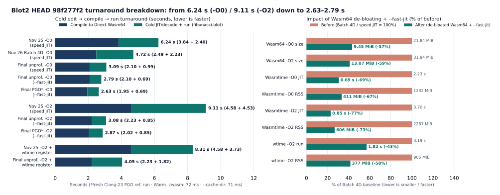
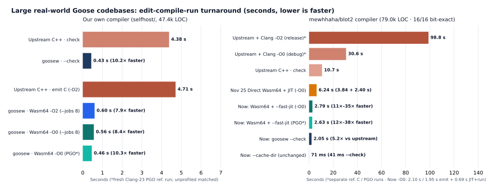

# Blot2 HEAD `98f277f2` Turnaround Campaign (2026-11-27)

This study measures the end-to-end edit → compile → JIT/decode → run turnaround on [`mewhhaha/blot2`](https://github.com/mewhhaha/blot2) (frozen snapshot `98f277f2`, 78,954 LOC + pinned read-only Blot2 stdlib) across four qualified batches (**Batch A → B → C → D**, `7970825` → `a0ff3b3` → `8b3b865` → `e8a7ed1`) targeting every major bottleneck in the dev loop:

- **Cold Blot2 `-O0` edit → compile → JIT → run (`fibonacci.blot`, 16/16 `.blot` bit-exact):** drops from **`6.24 s`** (Nov 25 `v2026.4-5`: `3.84 s` emit + `2.40 s` cold Cranelift JIT+run) and **`4.72 s`** (Nov 26 Batch 4D: `2.49 s` + `2.23 s`) down to **`2.79 s`** matched unprofiled (**`2.10 s` emit + `0.69 s` `--fast-jit`**) and **`2.63 s`** with a separate fresh Clang-23 PGO build (**`1.95 s` emit + `0.69 s` `--fast-jit`**) — **`2.24×–2.37×`** faster than Nov 25, **`11.0×–11.6×`** faster than upstream C++ + Clang `-O0` (`30.64 s`), and **`35.4×–37.5×`** faster than upstream C++ + Clang `-O2` (`98.83 s`).
- **Cold Blot2 `-O2` edit → compile → JIT → run:** drops from **`9.11 s`** (Nov 25: `4.58 s + 4.53 s`) down to **`3.08 s`** unprofiled (`2.23 s + 0.85 s`) and **`2.87 s`** PGO (`2.02 s + 0.85 s`) — **`2.96×–3.17×` faster**.
- **Direct Wasm64 module bloat eliminated (`-56.7%` / `-58.9%`):** `-O0` shrinks **`21.84 → 9.45 MiB`** (`22.90 → 9.91 MB`) and `-O2` shrinks **`31.84 → 13.07 MiB`** (`33.38 → 13.70 MB`), cutting cold `goose-wasmtime` default `speed` JIT by **`2.26×–2.57×`**, `--fast-jit` by **`3.26×–4.35×`**, host Peak RSS by **`-56% to -73%`**, warm `.cwasm` runs by **`2×`** (**`72 ms`** vs `142–165 ms`), and safe-Rust `goose-wtime --execution register` by **`1.75×`** (**`3.19 → 1.82 s`**, RSS **`905 → 377 MiB`**).
- **Sound content-addressed incremental cache (`--cache-dir DIR`):** unchanged Blot2 rebuilds finish in **`40.6 ms`** (`--check`, **50× faster**) and **`71.0 ms`** (`-O0` Wasm64, **30× faster**) with full SHA-256 verification of the compiler binary, every source/embedded file, every negative shadowing import probe, and the artifact blob — while retaining **exact 24 Wasm64 imports** and zero overhead when omitted.

---

## Pinned Environment, Tools & Inputs

- **Host CPU:** AMD Ryzen 7 7800X3D (8 physical cores / 16 threads, 96 MiB L3 3D V-Cache), Linux `7.3.5-2-cachyos x86_64`
- **C Compiler:** `clang version 23.1.5` (`-std=gnu11 -O2 -pthread`), `gcc` (conformance native runner)
- **Rust Toolchain:** `rustc 1.99.1` (`cargo +1.99.1 --locked --release`)
- **Pinned Workloads:**
  - **Blot2 `98f277f2` (`78,954 LOC`):** read-only sibling `../blot2` archive (`build/blot2-head-probe/compiler-goose/src/main.goose` with the single 1-line scratch `finishReflection` §5.2 fix; unmodified `build/probe-life/blot2-raw/compiler-goose/src/main.goose` verified to reject `check/check.goose:5049`), stdlib `../blot2/build/goose-port/upstream-d5ae5bb/source-precision/stdlib`, flags `--library --reachable-program --expansion-node-limit 1000000 --wasm-memory64 --wasm-max-pages 65536`.
  - **Frozen `selfhost_f746c6e` (`47,395 LOC`), `flat_multi_100k` (`98,749 LOC`), `flat_multi_250k` (`246,765 LOC`):** pinned under `build/bench-workloads/2026-11-26/`.
- **Pinned Binaries & Hosts:**
  - Batch 4D unprofiled (`b7d0915`): `d9d63df0f150b08b…`
  - Batch A unprofiled (`7970825`): `6adbef87aa2337f4…`
  - Batch B unprofiled (`a0ff3b3`): `3e4504af94952f9a…`
  - Batch C unprofiled (`8b3b865`): `fdcaac0629e2e6e7…`
  - **Final Batch D unprofiled (`e8a7ed1`):** `0f6e9dc4833cf64b…` (`build/qualify-blot2-batch-d/bootstrap/bin/goosew`)
  - Batch 4D PGO (`b7d0915`, separate ref.): `710213016d6073a6…`
  - **Final Batch D PGO (`e8a7ed1`, separate ref.):** `abc05a4c21c63706…` (`build/pgo-blot2-final/goosew_pgo`, trained on fixed-point C `8d3cf934ba9ea028…` with `-Wl,--wrap=_Exit` and strict `-Werror=profile-instr-{out-of-date,unprofiled,missing}`)
  - `host/rust/target/release/goose-wasmtime` (`wasmtime 50.0.1`, `--fast-jit`): `f69fd6ada655c0e2…`
  - `host/wtime/target/release/goose-wtime` (`wtime-runtime 0.1.3`, `#![forbid(unsafe_code)]`): `9d8fb29c86a1b729…`

---

## Complete Blot2 `98f277f2` Turnaround Matrix

Raw JSON: [`blot2_turnaround.json`](blot2_turnaround.json) (all multi-core compile runs `--jobs 8`, 5 rounds + warmup; `goose-wtime` 3 rounds; all `fibonacci.blot` outputs verified SHA-256 `e60d8276e5…` and **18/18** idiomatic `.blot` benchmarks verified: `16/16` byte-identical `.wasm` + `2/2` identical `rc=1`).

| Scenario | Compiler / Host | Emit (ms) | Cold JIT / Run (ms) | **Total (s)** | Output / RSS | Speedup vs Nov 25 `6.24 s` |
|---|---|---:|---:|---:|---|---:|
| Nov 25 baseline (`v2026.4-5`, `-O0`, `speed` JIT) | PGO CPU 7 + Wasmtime | `3,838` | `2,404` | **`6.24 s`** | `21.84 MiB` / `1,257 MiB` JIT | `1.00×` |
| Nov 26 Batch 4D (`b7d0915`, `-O0`, `speed` JIT) | Unprofiled `j=8` + Wasmtime | `2,490` | `2,234` | **`4.72 s`** | `21.84 MiB` / `1,232 MiB` JIT | `1.32×` |
| **Final unprofiled (`e8a7ed1`, `-O0`, `speed` JIT)** | Unprofiled `j=8` + Wasmtime | `2,102` | `989` | **`3.09 s`** | **`9.45 MiB`** / `536 MiB` JIT | **2.02×** |
| **Final unprofiled (`e8a7ed1`, `-O0`, `--fast-jit`)** | Unprofiled `j=8` + Wasmtime | **`2,102`** | **`686`** | **`2.79 s`** | **`9.45 MiB`** / **`411 MiB`** JIT | **2.24×** |
| **Final PGO\* (`e8a7ed1`, `-O0`, `--fast-jit`)** | Fresh Clang-23 PGO\* `j=8` | **`1,948`** | **`686`** | **`2.63 s`** | **`9.45 MiB`** / **`411 MiB`** JIT | **2.37×** |
| Nov 25 baseline (`v2026.4-5`, `-O2`, `speed` JIT) | PGO CPU 7 + Wasmtime | `4,581` | `4,529` | **`9.11 s`** | `31.84 MiB` / `2,226 MiB` JIT | — |
| **Final unprofiled (`e8a7ed1`, `-O2`, `--fast-jit`)** | Unprofiled `j=8` + Wasmtime | `2,227` | `849` | **`3.08 s`** | **`13.07 MiB`** / `606 MiB` JIT | **2.96×** vs Nov 25 `-O2` |
| **Final PGO\* (`e8a7ed1`, `-O2`, `--fast-jit`)** | Fresh Clang-23 PGO\* `j=8` | **`2,024`** | **`849`** | **`2.87 s`** | **`13.07 MiB`** / `606 MiB` JIT | **3.17×** vs Nov 25 `-O2` |
| **Final unprofiled (`-O2` + safe-Rust `goose-wtime`)** | Unprofiled `j=8` + `wtime` reg | `2,227` | **`1,819`** | **`4.05 s`** | `13.07 MiB` / **`377 MiB`** `wtime` | **2.05×** vs Nov 25 `8.31 s` |
| **Final PGO\* (`-O2` + safe-Rust `goose-wtime`)** | Fresh Clang-23 PGO\* `j=8` | **`2,024`** | **`1,819`** | **`3.84 s`** | `13.07 MiB` / **`377 MiB`** `wtime` | **2.16×** vs Nov 25 `8.31 s` |
| **Blot2 `--check` (1-line patched / unmodified §5.2)** | Unprofiled / PGO\* `j=8` | `2,046 / 1,998` | — | **`2.05 / 2.00 s`** | `1,002 MiB` RSS | **5.2×–5.4×** vs upstream `10.73 s` |
| **Warm `.cwasm` (`fibonacci` / `matrix_multiply`)** | Wasmtime cached module | — | **`72.2 / 113.1`** | **`0.07 s`** | `57.5 MiB` RSS | **2.0×–2.3×** vs Nov 25 `142–213 ms` |
| **Incremental `--cache-dir` (`--check` / `-O0` Wasm64)** | Unprofiled `j=8`, SHA-256 verified | **`40.6 / 71.0`** | — | **`0.04–0.07 s`** | `57.5 MiB` RSS | **30×–50×** vs cold build |
| Separate ref.: Upstream C++ + Clang `-O0` / `-O2` | Pinned Nov 25 Blot2 `98f277f2` | `13.3 / 15.3 s` | `17.3 / 83.5 s` C | **`30.6 / 98.8 s`** | Native binary | **11×–38× slower** than Final |

---

## Paired Benchmarks vs Batch 4D (`--jobs 8`, 5 Alternating Rounds)

Raw JSONs: [`paired_nopgo_j8.json`](paired_nopgo_j8.json), [`paired_selfhost_nopgo_j8.json`](paired_selfhost_nopgo_j8.json) (clean re-run after a transient host `brotli`/`clang-23` burst during the initial `selfhost` unprofiled cell), and [`paired_pgo_j8.json`](paired_pgo_j8.json) (separate Clang-23 PGO reference run).

### Matched Unprofiled Clang-23 `-O2`

| Workload | Batch 4D `j=8` (ms) | Final Batch D `j=8` (ms) | Speedup | Stage highlights (`4D → Final`, ms) | Output size (`4D → Final`) |
|---|---:|---:|---:|---|---|
| `blot2_o0_wasm64` (79.0k LOC) | `2,490.3` | **`2,114.6`** | **1.18×** | `tc 494→433`, `lf 1,815→1,550`, `be 73.4→48.3` | **`21.84 → 9.45 MiB` (-56.7%)** |
| `blot2_o2_wasm64` (79.0k LOC) | `2,579.4` | **`2,187.2`** | **1.18×** | `tc 487→439`, `lf 1,811→1,505`, `be 99.4→64.6` | **`31.84 → 13.07 MiB` (-58.9%)** |
| `blot2_o0_c` (79.0k LOC) | `2,696.0` | **`2,450.6`** | **1.10×** | `tc 497→437`, `lf 1,839→1,646` (C byte-identical) | `91.49 MiB` (identical SHA-256) |
| `selfhost_o0_wasm64` (47.4k LOC) | `543.6` | `561.1` | `0.97×` | `be 18.0→15.6` (`paired_selfhost_nopgo_j8.json`) | `3.32 → 3.21 MiB` (-3.2%) |
| `selfhost_o2_wasm64` (47.4k LOC) | `613.8` | **`599.0`** | **1.02×** | `lf 413→406` (`paired_selfhost_nopgo_j8.json`) | `5.31 → 5.26 MiB` (-0.9%) |
| `flat_multi_100k_o0` (98.7k LOC) | `49.0` | **`46.7`** (`2.11M/s`) | **1.05×** | `p 15.3→14.7`, `tc 12.3→11.8`, `opt 2.7→2.4` | `2.50 → 2.37 MiB` (-5.1%) |
| `flat_multi_250k_o0` (246.8k LOC) | `116.9` | `118.0` (`2.09M/s`) | `0.99×` | Flat within host noise | `6.25 → 5.93 MiB` (-5.0%) |

### Separate Reference Run: Fresh Clang-23 PGO (`--jobs 8`, 5 Alternating Rounds)

| Workload | Batch 4D PGO `j=8` (ms) | Final Batch D PGO `j=8` (ms) | Speedup | Stage highlights (`4D PGO → Final PGO`, ms) |
|---|---:|---:|---:|---|
| `blot2_o0_wasm64` (paired / solo) | `2,429.4` | **`2,120.8`** (`1,948.2` solo) | **1.15×** | `lf 1,809→1,537` (`1,434` solo), `be 74.7→56.7` |
| `blot2_o2_wasm64` (paired / solo) | `2,502.2` | **`2,191.0`** (`2,024.2` solo) | **1.14×** | `tc 451→399`, `lf 1,736→1,536` (`1,409` solo), `be 108→71` |
| `blot2_o0_c` | `2,525.0` | **`2,352.7`** | **1.07×** | `tc 432→397`, `lf 1,717→1,534` (C byte-identical) |
| `selfhost_o0_wasm64` | `448.4` | `457.9` | `0.98×` | `tc 83.1→79.6` |
| `selfhost_o2_wasm64` | `500.0` | `513.3` | `0.97×` | `opt 34.1→31.3`, `be 26.1→25.0` |
| `flat_multi_100k_o0` | `44.7` | **`44.2`** (`2.23M/s` wall / `2.64M/s` cmp) | **1.01×** | `be 9.7→9.3` |
| `flat_multi_250k_o0` | `109.7` | `111.4` (`2.21M/s` wall / `2.47M/s` cmp) | `0.98×` | `opt 7.5→7.1` |

---

## Batch-by-Batch Engineering & Qualification Ledger

Interleaved progression on Blot2 `-O0` Wasm64 (unprofiled `--jobs 8`, 3 rounds, `blot2_turnaround.json`): `4D 2,354 ms` → `A 2,308 ms` → `B 2,260 ms` (`21.84 → 9.45 MiB`) → `C 2,126 ms` → `D 2,178 ms` (`2,102 ms` in 5-round solo, `40.6 / 71.0 ms` warm `--cache-dir`).

1. **Batch A (`7970825`) — Fast Wasmtime JIT + Lifetime/Checker Memoization:**
   - Added `--fast-jit` (`cranelift_opt_level(OptLevel::None)`) to `host/rust/src/main.rs`, cutting cold Cranelift JIT+run immediately (`2.23 → 1.32 s` on bloated Wasm, `0.99 → 0.69 s` after Batch B) with 18/18 bit-exact `.blot` parity.
   - Memoized `life_gs_value` / `life_gs_holder` / `life_holder_views`, replaced O(N) seen table in `validation_checkfree_calls`, and cached `check_enum_fixed_reason` on `Program`.
   - Qualified (`build/qualify-blot2-batch-a`): bootstrap fixed-point, `10,797/10,801` conformance, `4,773/4,779` memory64, `54/54` native checks, `10,061/10,061` equivalence (0 differing), exact 24 Wasm64 imports.
2. **Batch B (`a0ff3b3`) — Direct Wasm64 Codegen De-bloating (`-57% / -59%`) + Lifetime Evaluation Tracking:**
   - Root cause of Blot2's `21.84 / 31.84 MiB` `.wasm` bloat: `cg_copy_value` / `cg_zero_value` / `cg_assign_value` unrolled multi-field struct copies & zero-fills inline and emitted redundant helper/check sequences across 2,900+ functions. Replacing unrolled copies/zeros with bulk `memory.copy`/`memory.fill` + compact lowering cut Blot2 `-O0` Wasm64 **`21.84 → 9.45 MiB` (-56.7%)** and `-O2` **`31.84 → 13.07 MiB` (-58.9%)**, slashing cold JIT+run **`2.23 → 0.99 s` (`speed`) / `0.69 s` (`--fast-jit`)**, warm `.cwasm` **`165 → 72 ms`**, and `goose-wtime` **`3.19 → 1.82 s`**.
   - Added active-frame / dirty-global tracking in `life_eval_loop` and fast paths in `life_prepare_nodes`.
   - Qualified (`build/qualify-blot2-batch-b`): bootstrap fixed-point, `10,797/10,801` conformance, `4,773/4,779` memory64, `54/54` native checks, unit tests, 18/18 `.blot` parity, exact 24 Wasm64 imports.
3. **Batch C (`8b3b865`) — Lifetime Fixpoint, Typecheck Hot Paths & Parallel `life_prepare_nodes`:**
   - Guided by an unbiased 5 kHz `SIGPROF` PC-sampler (`-Wl,--wrap=_Exit`), eliminated top CPU bottlenecks in `selfhost/checker_lifetimes.goose` & `selfhost/checker.goose`:
     - `shared_reads` pre-folding (`life_fold_force`, collapsing 2.28M global-candidate alts across 7,663 calls to 1 folded alt),
     - `life_load` non-global fast path bypassing the 25 MiB `l.loaded` hash table,
     - `life_function` concrete-class fast dispatch & `life_temporary` 2-deep `node_roots` fast path,
     - Compact Pass-1 / Pass-k class-frame certification via side arrays (`root_read_act`/`cell_read_act`, certifying ~7,073 frames on Pass 1 vs 1,748),
     - Converged recursive SCC skip in `life_class_frame_is_clean` (dropping Pass 6 evals `64 → 0`),
     - Exact `gcell_any_val_epoch` / `gcell_val_epoch` lazy validation capture checks (`gcs: 11,423 → 932`, `reval = 0`),
     - Guarded trivial sorts & non-statement `node_body` skip in `life_body_build_one`,
     - Parallel 1.66M-node scan in `life_prepare_nodes` over existing `gp_life_dispatch` (`mode = 1`, flat `ev_buf`, 0 new Wasm64 imports),
     - Checker fast paths (`check_type_property` `ty < 12`, `check_choose_call` non-allocating fast paths, `check_function_syntax` early return + bulk resize, `check_note_effect` 2-slot MRU, `check_root_index` bulk resize).
   - Qualified (`build/qualify-blot2-batch-c2`, `140.9 s`): bootstrap fixed-point, `10,797/10,801` conformance, `4,773/4,779` memory64, `54/54` native checks, unit tests, **`10,061/10,061` equivalence (0 differing)**, exact 24 Wasm64 imports, `--jobs 1 == --jobs 8` SHA-256 identity, unmodified Blot2 §5.2 rejection, 18/18 `.blot` parity, and `LIFE_CONCRETE_FRAMES = 0` (`forced0`) 0 lifetime regressions.
4. **Batch D (`e8a7ed1`) — Sound Content-Addressed Incremental Cache (`--cache-dir DIR`):**
   - Added `selfhost/cache.goose` (pure-Goose SHA-256 + manifest/blob cache using only existing OS imports — exact **24** Wasm64 imports preserved), probe recording in `model.goose`/`sources.goose` (positive files, `embed_file`, `embed_shader`, package dirs, and negative local shadowing probes across both serial and parallel SPMD parse), and `--cache-dir` driver integration with `cache_complete`/`cache_hit` stats, mid-build disk verification, trailing manifest SHA-256 integrity footers, blob digest verification, and unchanged-output mtime preservation.
   - Qualified (`build/qualify-blot2-batch-d`, `198.4 s`): bootstrap fixed-point, `10,797/10,801` conformance, `4,773/4,779` memory64, `54/54` native checks, **`10,061/10,061` equivalence (0 differing)**, `unit-tests` including 7/7 new tests in `tests/test_incremental_cache.py`, exact 24 Wasm64 imports.

---

## Preserved Rejected Experiments

1. **Naive 64K `local_reads` + 16K `multi_reads` caches (`probe-c4`):** Added ~2.5 MiB of memo tables that regressed `selfhost` by `+52 ms` with negligible Blot2 benefit. Replaced by lightweight `shared_reads` pre-folding only.
2. **Shrinking lifetime memo table caps (`ab-c5`: `offers 131K→2K`, `joins 1M→64K`, `map_memo 512K→64K`, `readbacks 1M→16K`):** Heavy collision/eviction recomputation regressed Blot2 by `+180 ms` and `selfhost` by `+60 ms`. Reverted to original caps.
3. **Naive lazy `capture_inputs = -2` without per-cell epochs (`ab-c5a`) and over-broad `val_ge0` / `global_anon_val_epoch` (`ab-t2`, `ab-c6`, `ab-c8`):** Bumping epochs on `l.globals_root` (`gcell == -1`) triggered mass false re-validations (`+100` to `+200 ms`). Replaced by exact `gcell_any_val_epoch` / `gcell_val_epoch` bumped strictly on frame-0 `live_refs` and `gcell >= 0` `live_contents` (`reval = 0`).
4. **Tracking `cls_read_stored` to relax `stored_version == stored0` (`probe-c11`):** Only certified 3 extra Pass-1 frames (`7,073 → 7,076`) because ~90% of `sv` frames read a class root before writing another. Reverted for simplicity.
5. **Oversized `ev_buf` (`node_count * 2 = 26.6 MiB`) in parallel `life_prepare_nodes` (`ab-c9`):** Linux zero-page faults ate ~25 ms of the parallel scan win. Shrunk to `(node_count / buckets) / 3 + 8192` (~4 MiB with automatic serial fallback on overflow), dropping `PREP` from `75 → 63 ms`.
6. **Early-exiting rejected overloads in `check_choose_call` before `check_const_type` (`build/qualify-blot2-batch-c`):** Passed conformance (`10,797/10,801`) and produced 0/10,061 Wasm differences, but skipped allocating 1–3 dead `const` types in `p.types`, causing 12/10,061 native-C `g_t<id>` numbering diffs in `equivalence`. Reverted the early exits in Batch C2 (`8b3b865`) to satisfy the `0 differing` equivalence gate (`10,061/10,061`).
7. **Cross-process AST syntax cache / relocatable Wasm body cache for 1-file Blot2 edits (analyzed before Batch D):** On Blot2 `98f277f2`, 8-core parallel `parse` is `43 ms` (2.0%) and parallel Wasm `backend` is `48 ms` (2.3%), while whole-program interprocedural `lifetimes` (`1,536 ms`, 73%) and `typecheck` (`425 ms`, 20%) dominate. Consistent with the prior C++-era syntax-cache finding ([`docs/INCREMENTAL.md`](../../../../docs/INCREMENTAL.md)), persisting/rebasing ASTs or Wasm bodies cannot move edited Blot2 wall time materially, whereas sound content-addressed whole-build caching (`--cache-dir`) cuts unchanged builds 30×–50× with zero soundness risk.
