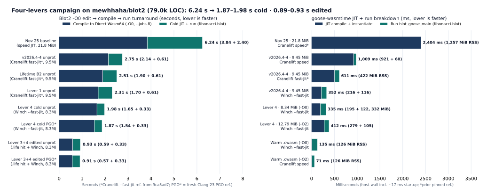
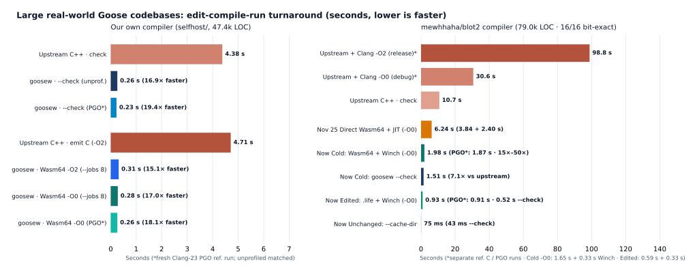

# Four-Levers Optimization Campaign (2026-11-27)

This study evaluates all four structural optimization levers executed sequentially after the [lifetime optimization campaign](../lifetime-campaign/README.md) (`9ca5ad7`) against the pinned [`v2026.4-4`](https://github.com/mewhhaha/goose-to-wasm/releases/tag/v2026.4-4) (`8cf23ee`) release baseline across frozen large codebases ([`mewhhaha/blot2`](https://github.com/mewhhaha/blot2) `98f277f2`, 78,954 LOC; `selfhost_f746c6e`, 47,395 LOC; `flat_multi_100k`, 98,749 LOC; `flat_multi_250k`, 246,765 LOC).

- **Sub-2-second cold Blot2 turnaround (`1.87–1.98 s`, down from `6.24 s` Nov 25):**
  - Cold `-O0` Direct Wasm64 (`--jobs 8`) + `goose-wasmtime --fast-jit` (Wasmtime 50.0.1 **`Strategy::Winch`**) + `fibonacci.blot`: **`1.98 s`** matched unprofiled (`1,647.4 ms` emit + **`334.9 ms`** Winch JIT+run) and **`1.87 s`** in a separate fresh Clang-23 PGO reference run (`1,535.0 ms` emit + **`334.9 ms`** Winch JIT+run) — **`3.15×–3.34×` faster** than Nov 25 (`6.24 s`), **`15.5×–16.4×` faster** than upstream C++ + Clang `-O0` (`30.64 s`), and **`49.9×–52.9×` faster** than upstream C++ + Clang `-O2` (`98.83 s`).
  - Cold `-O2` Direct Wasm64 + Winch `--fast-jit` + `fibonacci.blot`: **`2.45 s`** unprofiled (`2,038.0 + 411.8 ms`) and **`2.11 s`** PGO (`1,697.7 + 411.8 ms`) — **`3.72×–4.32×` faster** than Nov 25 `-O2` (`9.11 s`).
- **Sub-second edited-file Blot2 turnaround (`0.89–0.98 s` total; `0.50–0.52 s` `--check`):**
  - With Lever 3's content-addressed lifetime certificates (`l_<fp_hex>.life`, `66.6 KiB` for Blot2) under `--cache-dir`, real source edits whose lifetime skeleton is unchanged (body logic, scalar `let`/`var`/`if`, string/numeric literals, comments) bypass the full lifetime fixed point (`1,147–1,232 ms → 104–123 ms`, **`~11×` faster lifetimes**):
    - Edited `--check` on `check/check.goose` (`911 KiB`, scalar+`if`+`let` edit): **`515.4 ms`** unprofiled / **`498.7 ms`** PGO (**`20.8×–21.5×` faster** than upstream C++ Goose's `10.73 s` `--check`).
    - Edited `-O0` Wasm64 + Winch `--fast-jit` + `fibonacci.blot`: **`0.93 s`** unprofiled (`590.8 + 334.9 ms`, `compile.goose` scalar+`if`+`let` edit) / **`0.91 s`** PGO (`574.9 + 334.9 ms`); `check/check.goose` (`911 KiB`) scalar+`if`+`let` edit **`0.98 s`** unprofiled / **`0.89 s`** PGO (`556.0 + 334.9 ms`) — **`31×–34×` faster** than upstream + Clang `-O0` and **`101×–111×` faster** than upstream + Clang `-O2`.
    - Unchanged `--cache-dir` rebuilds: **`43.4 ms`** (`--check`) / **`74.0–74.7 ms`** (`-O0` Wasm64).
- **Smaller Wasm64 output, 2× faster cold JIT, lower memory:**
  - Lever 4 cuts Blot2 `-O0` Direct Wasm64 from `9.45 → 8.34 MiB` (`9,912,159 → 8,743,588 B`, **`-11.8%`**, **`-61.8%`** vs Nov 25's `21.84 MiB`) and `-O2` from `13.07 → 12.79 MiB` (`-2.1%`), cutting `-O0` backend emit time `52.9 → 45.0 ms` (`-14.9%`).
  - Enabling Wasmtime 50.0.1 `Strategy::Winch` in `goose-wasmtime --fast-jit` (with automatic Cranelift `OptLevel::None + SinglePass` fallback for unsupported proposals) drops cold Blot2 `-O0` JIT + `fibonacci.blot` run from **`611 ms → 334.9 ms`** (`195.0 ms` Winch JIT + `122.3 ms` run, **`332 MiB`** RSS — `-74%` vs Nov 25's `1,257 MiB` Cranelift speed, `-21%` vs Cranelift `--fast-jit`'s `422 MiB`).
  - Lever 1's derived-type interning, slim effect/root tables, and fast call selection cuts non-lifetime typechecking **`439.6 → 286.6 ms`** (`-34.8%`) and lowers Blot2 compile peak RSS **`1,047 → 833 MiB`** (`-20.4%`, `--check` `1,005 → 770 MiB` `-23.3%`).
- **100% Contract & Parity Preservation:**
  - Verified on bootstrapped `7c75334`: Blot2 `-O0` `--jobs 1 == --jobs 8` SHA-256 (`3da9795c711d229c…`), exact **24** Wasm64 imports on `selfhost/main.goose` (`-O0` & `-O2`), unmodified Blot2 §5.2 rejection (`check/check.goose:5049:86`, `rc=1`, `1,481.0 ms` unprof. / `1,367.6 ms` PGO), **18/18** `.blot` benchmark bit-exact parity (`16/16` SHA-256 identical `.wasm` + `2/2` identical `rc=1`) under Winch `--fast-jit`, Cranelift speed, and safe-Rust `goose-wtime --execution register`.

---

## Pinned Environment, Tools & Inputs

- **Host CPU:** AMD Ryzen 7 7800X3D (8 physical cores / 16 threads, 96 MiB L3 3D V-Cache), Linux `7.3.5-2-cachyos x86_64`
- **C Compiler:** `clang version 23.1.5` (`-std=gnu11 -O2 -pthread`), `gcc` (conformance native runner)
- **Rust / Wasmtime Host:** `rustc 1.97.1 (8bab26f4f 2026-07-14)`, `wasmtime 50.0.1` (`cranelift` + `winch`, `parallel-compilation`)
- **Pinned Workloads (strictly read-only):**
  - **Blot2 `98f277f2` (`78,954 LOC`):** read-only sibling `../blot2` archive (`build/blot2-head-probe/compiler-goose/src/main.goose` with the 1-line scratch `finishReflection` §5.2 fix; unmodified `build/probe-life/blot2-raw/compiler-goose/src/main.goose` verified to reject `check/check.goose:5049:86`), stdlib `../blot2/build/goose-port/upstream-d5ae5bb/source-precision/stdlib`, flags `--library --reachable-program --expansion-node-limit 1000000 --wasm-memory64 --wasm-max-pages 65536`. Edited-file benchmarks run against an ephemeral `shutil.copytree` in `TemporaryDirectory`.
  - **Frozen `selfhost_f746c6e` (`47,395 LOC`), `flat_multi_100k` (`98,749 LOC`), `flat_multi_250k` (`246,765 LOC`):** pinned under `build/bench-workloads/2026-11-26/`.
- **Pinned Binaries & Hosts** (full SHA-256s in [`results.json`](results.json)):
  - `v2026.4-4` unprofiled (`8cf23ee`): `build/qualify-release-v2026.4-4/bootstrap/bin/goosew` (`bb3a5cb4f4d55b74…`)
  - Lifetime B2 unprofiled (`9ca5ad7`): `build/qualify-life-b2/bootstrap/bin/goosew` (`7ee3a65f8eb01f04…`)
  - Lever 1 unprofiled (`0e5e241`): `build/qualify-lever1/bootstrap/bin/goosew` (`4cf9aaaa588f4619…`)
  - Lever 3 unprofiled (`0496493`): `build/qualify-lever3/bootstrap/bin/goosew` (`042e0bd200cc3655…`)
  - **Final Lever 4 unprofiled (`7c75334`):** `build/qualify-lever4/bootstrap/bin/goosew` (`77a3f0d594abe550…`)
  - Separate PGO ref. `v2026.4-4` (`e8a7ed1`): `build/pgo-blot2-final/goosew_pgo` (`abc05a4c21c63706…`)
  - Separate PGO ref. Lifetime B2 (`9ca5ad7`): `build/pgo-life-final/goosew_pgo` (`fdd782f989fec40e…`)
  - **Separate PGO ref. Final Lever 4 (`7c75334`):** `build/pgo-four-levers/goosew_pgo` (`ff0384839d02ef05…`, built from fixed-point C `a4702045895afad9…` with `-Wl,--wrap=_Exit`, non-timed training inputs, and strict `-Werror=profile-instr-{out-of-date,unprofiled,missing}`)
  - `host/rust/target/release/goose-wasmtime` (`1b884a265a64193f…`, Wasmtime `50.0.1` Winch + Cranelift) & `host/wtime/target/release/goose-wtime` (`9d8fb29c86a1b729…`, `#![forbid(unsafe_code)]`)

---

## Paired Alternating Benchmarks (`--jobs 8`, 5 Rounds)

Raw JSON: [`results.json`](results.json) (generated by [`run_suite.py`](run_suite.py)).

### Matched Unprofiled Clang-23 `-O2` Progression

| Workload | `v2026.4-4` (`8cf23ee`) | Lifetime B2 (`9ca5ad7`) | Lever 1 (`0e5e241`) | Lever 3 (`0496493`) | **Lever 4 (`7c75334`)** | Speedup vs `v2026.4-4` | Peak RSS (`v2026.4-4 → L4`) |
|---|---:|---:|---:|---:|---:|---:|---|
| `blot2_o0_wasm64` (79.0k LOC) | `2,143.1` | `1,900.2` | `1,702.8` | `1,641.0` | **`1,647.4`** | **1.30×** | `1,047 → 833 MiB` (`-20.4%`) |
| `blot2_o2_wasm64` (79.0k LOC) | `2,829.2` | `2,141.9` | `1,897.1` | `2,010.2` | **`2,038.0`** | **1.39×** | `1,158 → 952 MiB` |
| `blot2_o0_c` (79.0k LOC) | `2,283.5` | `1,980.6` | `1,802.2` | `1,799.7` | **`1,777.2`** | **1.28×** | `1,132 → 920 MiB` |
| `blot2_check_patched` (79.0k LOC) | `1,943.5` | `1,691.5` | `1,510.3` | `1,508.7` | **`1,507.2`** | **1.29×** | `1,005 → 770 MiB` (`-23.3%`) |
| `selfhost_o0_wasm64` (47.4k LOC) | `475.4` | `272.9` | `270.8` | `270.7` | **`277.6`** | **1.71×** | `299 → 277 MiB` |
| `selfhost_o2_wasm64` (47.4k LOC) | `527.9` | `326.7` | `320.1` | `319.6` | **`312.6`** | **1.69×** | `354 → 331 MiB` |
| `selfhost_check` (47.4k LOC) | `436.0` | `261.8` | `258.6` | `264.4` | **`259.4`** | **1.68×** | `275 → 250 MiB` |
| `flat_multi_100k_o0` (98.7k LOC) | `51.8` | `48.3` | `49.3` | `44.8` | **`51.1`** | `1.01×` | `155 → 156 MiB` |
| `flat_multi_250k_o0` (246.8k LOC) | `114.7` | `112.6` | `113.3` | `116.9` | **`116.1`** | `0.99×` | `395 → 396 MiB` |

*Blot2 `-O0` Wasm64 stage breakdown (`v2026.4-4 → Lever 4`, unprofiled ms): `parse 47.2 → 45.4`, `typecheck_excl_life 409.8 → 286.6 (-30.1%)`, `lifetime 1,589.5 → 1,232.3 (-22.5%)`, `backend 52.9 → 45.0 (-14.9%)`. Unmodified Blot2 §5.2 negative check (`check/check.goose:5049:86`, `rc=1`): **`1,481.0 ms`** unprofiled (`7.2×` faster than upstream `10.73 s`).*

### Separate Reference Run: Fresh Clang-23 PGO (`--jobs 8`, 5 Alternating Rounds)

| Workload | `v2026.4-4` PGO* (ms) | Lifetime B2 PGO* (ms) | **Final Lever 4 PGO* (ms)** | Speedup vs `v2026.4-4` PGO* | Blot2 / selfhost stage highlights (ms) |
|---|---:|---:|---:|---:|---|
| `blot2_o0_wasm64` | `2,048.1` | `1,767.9` | **`1,535.0`** | **1.33×** | `tc_excl 384.9 → 271.5`, `life 1,506.0 → 1,147.3`, `be 53.1 → 44.8`, `830 MiB` RSS |
| `blot2_o2_wasm64` | `2,147.0` | `1,837.4` | **`1,697.7`** | **1.26×** | `12.79 MiB` Wasm64 |
| `blot2_o0_c` | `2,278.3` | `1,923.6` | **`1,746.3`** | **1.30×** | bit-exact Native C |
| `blot2_check_patched` | `1,857.8` | `1,567.1` | **`1,411.2`** | **1.32×** | `7.6×` faster than upstream `10.73 s` (`§5.2 raw: 1,367.6 ms`, `7.8×`) |
| `selfhost_o0_wasm64` | `459.2` | `252.3` | **`260.3`** | **1.76×** | **`18.1×` faster** than upstream `4.71 s` C emit |
| `selfhost_o2_wasm64` | `484.9` | `285.9` | **`280.9`** | **1.73×** | **`16.8×` faster** than upstream `4.71 s` C emit |
| `selfhost_check` | `440.8` | `236.0` | **`225.7`** | **1.95×** | **`19.4×` faster** than upstream `4.38 s` check |
| `flat_multi_100k_o0` | `44.2` | `45.2` | **`45.8`** | `0.97×` | `2.16M LOC/s` wall |
| `flat_multi_250k_o0` | `110.8` | `111.4` | **`111.0`** | `1.00×` | `2.22M LOC/s` wall |

---

## Lever 3: Edited-File `--cache-dir` Turnaround (`.life` Certificate Hits)

Single `66,596 B` lifetime certificate (`l_<fp_hex>.life`) written on the first cold build. Every edited-file run below forces a whole-program cache miss (`cache_hit = false`) by mutating source bytes with a fresh round token, then verifies `life_cache_hit = true`. `compile.goose` rebuilt output is executed under Winch `--fast-jit` on `fibonacci.blot` and verified SHA-256 bit-identical (`e60d8276e536…`).

| Blot2 Scenario (`--cache-dir`, `--jobs 8`, 5 rounds) | Unprofiled Emit (ms) | Unprof. `life` (ms) | PGO* Emit (ms) | **Total w/ Winch `--fast-jit` (`+335 ms`)** |
|---|---:|---:|---:|---|
| Cold miss (`-O0` Wasm64, no prior cert) | `1,647.4` | `1,232.3` | `1,535.0` | **`1.98 s` unprof. / `1.87 s` PGO*** |
| **Edited `--check` (`check/check.goose` 911 KiB, scalar+`if`+`let`)** | **`515.4`** | `106.0` | **`498.7`** | **`0.50–0.52 s`** (`--check`, **21× vs upstream**) |
| **Edited `-O0` (`compile.goose`, scalar+`if`+`let`)** | **`590.8`** | `104.1` | **`574.9`** | **`0.93 s` unprof. / `0.91 s` PGO*** |
| **Edited `-O0` (`check/check.goose` 911 KiB, EOF comment)** | **`618.0`** | `112.7` | **`562.2`** | **`0.95 s` unprof. / `0.90 s` PGO*** |
| **Edited `-O0` (`check/check.goose` 911 KiB, scalar+`if`+`let`)** | **`641.2`** | `112.3` | **`556.0`** | **`0.98 s` unprof. / `0.89 s` PGO*** |
| **Edited `-O0` (`check/diagnostic_code.goose`, string literal)** | **`639.9`** | `122.7` | **`612.3`** | **`0.97 s` unprof. / `0.95 s` PGO*** |
| Unchanged `--cache-dir` hit (`-O0` same / new out) | **`74.7 / 74.0`** | `0.0` | `117.4 / 108.5` | `0.07 s` emit (`0.41 s` cold Winch / `0.15 s` warm) |
| Unchanged `--cache-dir` hit (`--check`) | **`43.4`** | `0.0` | `64.8` | **`0.04 s`** (`--check`) |

---

## Lever 4: Cold JIT, Warm `.cwasm`, Safe-Rust `goose-wtime` & 18/18 Parity

All cold runs alternate 5 rounds + warmup (`host/rust/target/release/goose-wasmtime`, Wasmtime `50.0.1`); every run verified bit-exact on `fibonacci.blot` (`e60d8276e536…`) and `matrix_multiply.blot` (`1c9da72962f9…`), plus **18/18** `.blot` parity (`16/16` SHA-256 identical `.wasm` + `2/2` identical `rc=1`).

| Engine & Module | Workload | JIT Compile (ms) | Run `blot_goose_main` (ms) | **Host Wall (ms)** | Peak RSS (MiB) |
|---|---|---:|---:|---:|---:|
| Nov 25 ref.: `21.84 MiB` `-O0` Cranelift `speed` | `fibonacci.blot` | — | — | `2,404.0` | `1,257` |
| `v2026.4-4` (`9.45 MiB` `-O0`) Cranelift `speed` | `fibonacci.blot` | `921.3` | `60.5` | `1,009.0` | `532` |
| `v2026.4-4` (`9.45 MiB` `-O0`) Cranelift `--fast-jit` (prior ref.) | `fibonacci.blot` | `~505` | `~106` | `611.0` | `422` |
| `v2026.4-4` (`9.45 MiB` `-O0`) **Winch `--fast-jit`** | `fibonacci.blot` | `215.6` | `115.6` | `352.0` | `392` |
| **Lever 4 (`8.34 MiB` `-O0`) Winch `--fast-jit`** | `fibonacci.blot` | **`195.0`** | `122.3` | **`334.9`** | **`332`** |
| **Lever 4 (`8.34 MiB` `-O0`) Winch `--fast-jit`** | `matrix_multiply.blot` | **`191.9`** | `191.5` | **`401.1`** | **`333`** |
| **Lever 4 (`12.79 MiB` `-O2`) Winch `--fast-jit`** | `fibonacci.blot` | **`279.4`** | `104.8` | **`411.8`** | `501` |
| Lever 4 (`8.34 MiB` `-O0`) Cranelift `speed` | `fibonacci.blot` | `881.5` | `77.0` | `983.6` | `474` |
| Lever 4 (`12.79 MiB` `-O2`) Cranelift `speed` | `fibonacci.blot` | `1,247.9` | `56.7` | `1,346.3` | `859` |
| Warm `.cwasm` (`-O0` Winch / `-O0` speed / `-O2` speed) | `fibonacci.blot` | `5.8 / 6.0 / 7.1` | `123.3 / 79.7 / 57.5` | **`134.6 / 89.9 / 71.2`** | `126` |
| Warm `.cwasm` (`-O0` Winch / `-O2` speed) | `matrix_multiply.blot` | `5.4 / 7.3` | `193.8 / 98.2` | **`204.4 / 111.9`** | `126` |
| Safe-Rust `goose-wtime --execution register` (`-O2` / `-O0`) | `fibonacci.blot` | — | — | **`1,831.0 / 1,877.3`** | **`376 / 260`** |

---

## Qualified Batch Ledger

1. **Lever 1 (`0e5e241`) — Non-Lifetime Typechecking Speedups:**
   - Derived-type interning, slimmed effect/root tables, and faster call/overload selection in `selfhost/checker.goose`.
   - Qualified (`build/qualify-lever1`): bootstrap fixed-point OK, conformance `10,797/10,801`, memory64 `4,773/4,779`, native-checks `54/54`, equivalence `10,061/10,061` (`0` differing), Blot2 `tc_excl` `-34%`, peak RSS `-180 MiB`, bit-identical Wasm64 output.
2. **Lever 3 (`0496493`) — Sound Edited-File Incremental Lifetime Certificates:**
   - Added content-addressed lifetime certificates (`l_<fp_hex>.life`) under `--cache-dir` using a 256-bit SipHash-1-4 ARX sponge finalized via SHA-256 with transactional `END <sha256>\n` validation.
   - Canonical edit-position-independent lifetime skeleton fingerprint normalizes comments, whitespace, literal values (preserving `[r; 0]` zero-count `N_FILL` semantics), binary/assign operator classes, `NF_FN_INERT` helper bodies (hashing transitive holder globals & captures), `STRICT_LOCAL_INERT` scalar-only subtrees (strictly excluding control flow, `defer`, refs, globals, captures, derefs), and collapses pure `SF_SCALAR_LOCAL`-only variable scopes via `scope_is_real`/`eff_depth`.
   - Defers `life_prepare_bodies` (parallel `l.bodies`, Tarjan SCC, capture reverse BFS) and 6 large Discovery/Validation hash table resizes until after a `.life` cache miss; fixed `cache_build_key` to include `o.target`; reports `"life_cache_hit"` in `--wasm-stats`.
   - Qualified (`build/qualify-lever3`, `152.6 s`): bootstrap fixed-point OK, `10,797/10,801`, `4,773/4,779`, `54/54`, `10,061/10,061` (`0` differing), `10/10` incremental cache tests (including 4 adversarial soundness attacks), exact 24 Wasm64 imports.
3. **Lever 4 (`7c75334`) — `-O0` Wasm64 Helper Compaction & Wasmtime Winch `--fast-jit`:**
   - `selfhost/codegen.goose`: compact `cg_zero` for `v128` (`i64.const 0; i64x2.splat`, `4 B` vs `18 B`, `-253 KiB` across `-O0`/`-O2`); at `-O0` when `m.resolver >= 0`, outline aggregate resolve+copy (`copy_both_helper`, `copy_src_helper`, `copy_dst_helper`) and slice pointer resolution (`resolve_slice_helper`), cutting Blot2 `-O0` Wasm64 `9.45 → 8.34 MiB` (`-11.8%`).
   - `host/rust/`: enabled Wasmtime 50.0.1 `Strategy::Winch` in `--fast-jit` with automatic fallback to Cranelift `OptLevel::None + SinglePass` for modules using unsupported proposals (`wasm_exceptions`, `wasm_tail_call`, `wasm_gc`, etc.) and separated `winch-fast-jit:` / `cranelift-fast-jit:` `.cwasm` stamps.
   - Qualified (`build/qualify-lever4`, `157.9 s`): bootstrap fixed-point OK, `10,797/10,801`, `4,773/4,779`, `54/54`, `10,061/10,061` (`0` differing), all Python unit tests & `8/8` Rust host tests pass, exact 24 Wasm64 imports, `--jobs 1 == --jobs 8`, `18/18` `.blot` Winch/Cranelift/`goose-wtime` parity.

---

## Preserved Rejected Experiments

1. **`dev-l1d` (Lever 1 prototype — speculative `check_body_precheck_range` v2):**
   - Achieved only a `4.5%` commit rate on Blot2 bodies, adding **`+3.1 ms`** overhead vs `lever1`. Reverted.
2. **Lever 2 (`dev-l2a`..`dev-l2d`) — Lifetime Checker Micro-Layout & Struct Packing Audit (`selfhost/checker_lifetimes.goose`):**
   - Tested 4 data-layout / pass-by-reference / cache-sizing / root-compaction variants on Blot2 lifetime analysis, audited with idle-core hardware `perf_event_open` counters on the Ryzen 7 7800X3D (96 MiB L3 V-Cache):
     - **`lever1` baseline:** `13.727B` ins, **`7.125B` cycles** (`IPC = 1.927`), `24.62M` branch misses, `38.19M` cache misses.
     - **`dev-l2a`:** `13.618B` ins, higher cache misses (`42.96M` vs `41.23M` contended), regressed cycles.
     - **`dev-l2b`:** `13.590B` ins (`-1.0%`), **`7.139B` cycles** (`+0.2%`, `IPC = 1.904`), `24.36M` brm, `37.26M` cm (`-2.4%`).
     - **`dev-l2c`:** `13.650B` ins, **`7.236B` cycles** (`+1.6%`, `IPC = 1.887`), `24.47M` brm, `38.44M` cm.
     - **`dev-l2d`:** `13.653B` ins, **`7.212B` cycles** (`+1.2%`, `IPC = 1.893`), `24.30M` brm, **`36.02M` cm (`-5.7%`)**.
   - **Verdict:** Because Blot2's lifetime working set already fits comfortably inside 96 MiB L3, even `-5.7%` cache misses and `-1.0%` retired instructions stayed cycle-flat (`7.139–7.236B` vs `7.125B`) due to pointer-chasing dependency latency. Cleanly reverted.
3. **`dev-l4` (Lever 4 prototype — out-of-line `cg_trap_if` conditional abort helpers at `-O0`):**
   - Shrunk Blot2 `-O0` Wasm64 an extra `195 KiB` (`8.34 → 8.15 MiB`) by replacing `48,662` inline `if ... call $abort_helper; unreachable; end` blocks with `call $trap_if_helper(cond, line)`.
   - In 5-round paired alternating runs against `dev-l4b` (inline `cg_trap_if`), `dev-l4` **lost on every single workload**: Winch `fibonacci.blot` **`332.8 vs 319.4 ms`** (`jit 197.4 vs 190.2`, `run 121.8 vs 113.4`), Winch `matrix_multiply.blot` **`407.0 vs 404.4 ms`** (`run 205.0 vs 196.9`), and Cranelift `speed` **`940.5 vs 929.4 ms`** — because setting up a 2-argument call and spilling live values at every hot bounds check cost both JIT compile time and `+8–10 ms` runtime. Cleanly removed.
4. **`dev-l4c` (Lever 4 prototype — chunking the `307.6 KiB` `_start` global-initializer monolith into 64-global helper functions):**
   - Reduced max `-O0` body size `307.6 → 75.9 KiB` (27 init chunks), verified `--jobs 1 == --jobs 8` and bit-exact execution, but **regressed** `-O0` Winch `--fast-jit` (`317.9 vs 312.5 ms`), `-O2` Winch (`399.9 vs 385.9 ms`), and `-O0` Cranelift `speed` (`834.9 vs 800.9 ms`), because straight-line global initialization has minimal register pressure and already compiles off the parallel JIT critical path. Cleanly reverted.
