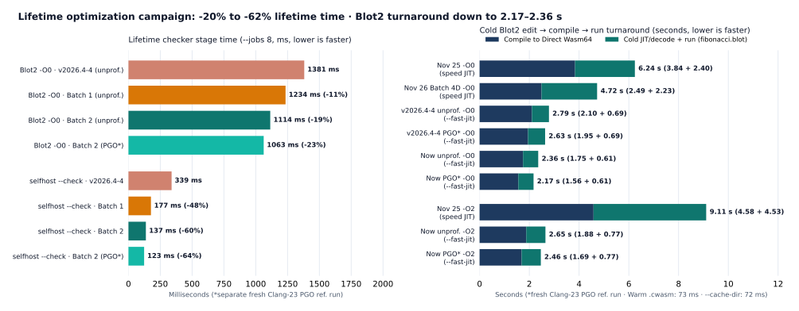
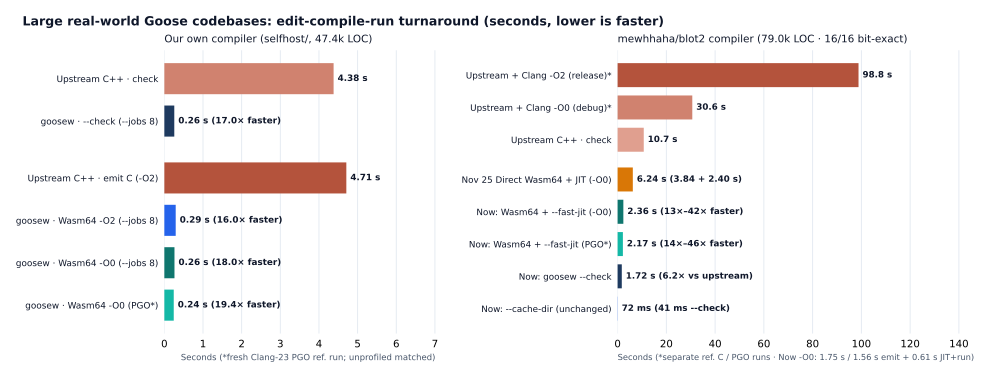

# Lifetime Checker Optimization Campaign (2026-11-27)

This study measures the two qualified lifetime-analysis batches (**Batch 1** `b75c334` and **Batch 2** `9ca5ad7`) plus the exhaustively evaluated and cleanly rejected **Batch 3** (parallel bottom-up condensation-DAG Validation, `v1`–`v6b`) against the pinned [`v2026.4-4`](https://github.com/mewhhaha/goose-to-wasm/releases/tag/v2026.4-4) (`8cf23ee`) release baseline across frozen large codebases ([`mewhhaha/blot2`](https://github.com/mewhhaha/blot2) `98f277f2`, 78,954 LOC; `selfhost_f746c6e`, 47,395 LOC; `flat_multi_100k`, 98,749 LOC; `flat_multi_250k`, 246,765 LOC).

- **`selfhost/` (47.4k LOC) — 1.66×–1.80× faster total, 2.41×–2.64× faster lifetime stage:**
  - `-O0` Direct Wasm64 (`--jobs 8`): **`434.1 → 262.1 ms`** matched unprofiled (**`1.66×`**, `lifetime_ns` **`307.8 → 127.8 ms`**, **`-58.5%`**) and **`439.0 → 243.3 ms`** in a separate fresh Clang-23 PGO reference run (**`1.80×`**, `lifetime_ns` **`311.7 → 117.9 ms`**, **`-62.2%`**) — **`18.0×–19.4×` faster** than upstream C++ Goose's `4.71 s` C emit.
  - `-O2` Direct Wasm64 (`--jobs 8`): **`471.8 → 293.9 ms`** unprofiled (**`1.60×`**) and **`486.4 → 278.0 ms`** PGO (**`1.75×`**).
  - `--check` (`--jobs 8`): **`446.1 → 257.4 ms`** unprofiled interleaved (**`1.73×`**, `281.6 ms` solo) and **`232.7 ms`** PGO — **`17.0×–18.8×` faster** than upstream C++ Goose's `4.38 s`.
- **`mewhhaha/blot2` `98f277f2` (79.0k LOC) — 1.15×–1.18× faster compile, 2.17–2.36 s cold turnaround:**
  - `-O0` Direct Wasm64 (`--jobs 8`): **`1,998.7 → 1,744.0 ms`** matched unprofiled (**`1.15×`**, `lifetime_ns` **`1,476.8 → 1,180.0 ms`**, **`-297 ms`**; `1,651.5 ms` interleaved) and **`1,844.9 → 1,559.3 ms`** fresh Clang-23 PGO (**`1.18×`**, **`-286 ms`**, `lifetime_ns` **`1,354.5 → 1,066.5 ms`**).
  - `-O2` Direct Wasm64 (`--jobs 8`): **`2,108.5 → 1,875.9 ms`** unprofiled (**`1.12×`**) and **`1,981.1 → 1,690.5 ms`** PGO (**`1.17×`**, **`-291 ms`**).
  - `-O0` Native C emit (`--jobs 8`): **`2,203.2 → 1,942.3 ms`** unprofiled (**`1.13×`**) and **`2,116.2 → 1,806.7 ms`** PGO (**`1.17×`**, **`-310 ms`**).
  - `--check` (`--jobs 8`): **`1,861.2 → 1,608.1 ms`** unprofiled interleaved (`1,718.6 ms` solo; **`1,652.9 ms`** PGO; unmodified §5.2 `check.goose:5049:86` **`1,646.2 ms`** unprofiled / **`1,537.1 ms`** PGO — **`6.5×–7.0×` faster** than upstream C++ Goose's `10.73 s`).
  - **Cold Blot2 `-O0` edit → compile → `--fast-jit` → run (`fibonacci.blot`):** drops to **`2.36 s`** matched unprofiled (`1.75 s` emit + `0.61 s` `--fast-jit`) and **`2.17 s`** PGO (`1.56 s` emit + `0.61 s` `--fast-jit`) — **`2.65×–2.88×` faster** than Nov 25's `6.24 s`, **`13.0×–14.1×` faster** than upstream C++ + Clang `-O0` (`30.64 s`), and **`41.9×–45.6×` faster** than upstream C++ + Clang `-O2` (`98.83 s`). At `-O2`, cold turnaround is **`2.65 s`** unprofiled / **`2.46 s`** PGO (down from `9.11 s`, **`3.44×–3.70×` faster**).
- **100% Bit-Exact & Contract Preservation:**
  - All 7 paired workloads produce **100% SHA-256 bit-identical** outputs (`same=True`) between `v2026.4-4` and Batch 2 (`9ca5ad7`), including Blot2 `-O0` Wasm64 `9.45 MiB` (`c291188bbb1ab45d430d111e97a1a7e546e16e8b935e7558a90f18a04c3509f5`, `--jobs 1 == --jobs 8`), exact **24** Wasm64 imports on `selfhost/main.goose`, unmodified Blot2 §5.2 rejection (`check/check.goose:5049:86`, `rc=1`), and **18/18** `.blot` benchmark parity (`16/16` byte-identical `.wasm` + `2/2` identical `rc=1`).

---

## Pinned Environment, Tools & Inputs

- **Host CPU:** AMD Ryzen 7 7800X3D (8 physical cores / 16 threads, 96 MiB L3 3D V-Cache), Linux `7.3.5-2-cachyos x86_64`
- **C Compiler:** `clang version 23.1.5` (`-std=gnu11 -O2 -pthread`), `gcc` (conformance native runner)
- **Pinned Workloads (strictly read-only):**
  - **Blot2 `98f277f2` (`78,954 LOC`):** read-only sibling `../blot2` archive (`build/blot2-head-probe/compiler-goose/src/main.goose` with the 1-line scratch `finishReflection` §5.2 fix; unmodified `build/probe-life/blot2-raw/compiler-goose/src/main.goose` verified to reject `check/check.goose:5049:86`), stdlib `../blot2/build/goose-port/upstream-d5ae5bb/source-precision/stdlib`, flags `--library --reachable-program --expansion-node-limit 1000000 --wasm-memory64 --wasm-max-pages 65536`.
  - **Frozen `selfhost_f746c6e` (`47,395 LOC`), `flat_multi_100k` (`98,749 LOC`), `flat_multi_250k` (`246,765 LOC`):** pinned under `build/bench-workloads/2026-11-26/`.
- **Pinned Binaries & Hosts:**
  - Baseline `v2026.4-4` unprofiled (`8cf23ee`): `build/qualify-release-v2026.4-4/bootstrap/bin/goosew` (`sha256` in [`paired_nopgo_j8.json`](paired_nopgo_j8.json))
  - Batch 1 unprofiled (`b75c334`): `build/qualify-life-b1/bootstrap/bin/goosew` (`sha256` in [`lifetime_turnaround.json`](lifetime_turnaround.json))
  - **Final Batch 2 unprofiled (`9ca5ad7`):** `build/qualify-life-b2/bootstrap/bin/goosew` (`sha256` in [`paired_nopgo_j8.json`](paired_nopgo_j8.json))
  - Baseline `v2026.4-4` PGO (`e8a7ed1`, separate ref.): `build/pgo-blot2-final/goosew_pgo` (`abc05a4c21c63706…`)
  - **Final Batch 2 PGO (`9ca5ad7`, separate ref.):** `build/pgo-life-final/goosew_pgo` (`fdd782f989fec40e…`, trained on fixed-point C `1944ab1e40c406ba…` with `-Wl,--wrap=_Exit` non-timed training inputs and strict `-Werror=profile-instr-{out-of-date,unprofiled,missing}`)
  - `host/rust/target/release/goose-wasmtime` (`wasmtime 50.0.1`, `--fast-jit`) & `host/wtime/target/release/goose-wtime` (`wtime-runtime 0.1.3`, `#![forbid(unsafe_code)]`)

---

## Paired Benchmarks vs `v2026.4-4` (`--jobs 8`, 5 Alternating Rounds)

Raw JSONs: [`paired_nopgo_j8.json`](paired_nopgo_j8.json) (matched unprofiled Clang-23 `-O2`) and [`paired_pgo_j8.json`](paired_pgo_j8.json) (separate fresh Clang-23 PGO reference run). Every workload verified `byte_identical = true`.

### Matched Unprofiled Clang-23 `-O2`

| Workload | `v2026.4-4` `j=8` (ms) | Batch 2 `9ca5ad7` `j=8` (ms) | Speedup | Lifetime stage (`v2026.4-4 → B2`, ms) | Byte-identical |
|---|---:|---:|---:|---|:-:|
| `blot2_o0_wasm64` (79.0k LOC) | `1,998.7` | **`1,744.0`** | **1.15×** | **`1,476.8 → 1,180.0`** (`-296.8 ms`, `1.25×`) | yes (`9.45 MiB`) |
| `blot2_o2_wasm64` (79.0k LOC) | `2,108.5` | **`1,875.9`** | **1.12×** | **`1,460.5 → 1,168.3`** (`-292.2 ms`, `1.25×`) | yes (`13.07 MiB`) |
| `blot2_o0_c` (79.0k LOC) | `2,203.2` | **`1,942.3`** | **1.13×** | **`1,439.2 → 1,151.7`** (`-287.5 ms`, `1.25×`) | yes (`91.49 MiB`) |
| `selfhost_o0_wasm64` (47.4k LOC) | `434.1` | **`262.1`** | **1.66×** | **`307.8 → 127.8`** (`-180.0 ms`, **`2.41×`**) | yes (`3.21 MiB`) |
| `selfhost_o2_wasm64` (47.4k LOC) | `471.8` | **`293.9`** | **1.60×** | **`309.2 → 124.5`** (`-184.7 ms`, **`2.48×`**) | yes (`5.26 MiB`) |
| `flat_multi_100k_o0` (98.7k LOC) | `40.1` | `42.1` (`2.35M/s`) | `0.95×` | `0.6 → 0.5` (pure-value fast path) | yes (`2.37 MiB`) |
| `flat_multi_250k_o0` (246.8k LOC) | `104.0` | `103.8` (`2.38M/s`) | `1.00×` | `3.8 → 3.8` (pure-value fast path) | yes (`5.93 MiB`) |

### Separate Reference Run: Fresh Clang-23 PGO (`--jobs 8`, 5 Alternating Rounds)

| Workload | `v2026.4-4` PGO `j=8` (ms) | Batch 2 PGO `j=8` (ms) | Speedup | Lifetime stage (`v2026.4-4 → B2 PGO`, ms) | Byte-identical |
|---|---:|---:|---:|---|:-:|
| `blot2_o0_wasm64` (79.0k LOC) | `1,844.9` | **`1,559.3`** | **1.18×** | **`1,354.5 → 1,066.5`** (`-288.0 ms`, `1.27×`) | yes |
| `blot2_o2_wasm64` (79.0k LOC) | `1,981.1` | **`1,690.5`** | **1.17×** | **`1,374.5 → 1,086.2`** (`-288.3 ms`, `1.27×`) | yes |
| `blot2_o0_c` (79.0k LOC) | `2,116.2` | **`1,806.7`** | **1.17×** | **`1,378.2 → 1,056.9`** (`-321.3 ms`, `1.30×`) | yes |
| `selfhost_o0_wasm64` (47.4k LOC) | `439.0` | **`243.3`** | **1.80×** | **`311.7 → 117.9`** (`-193.8 ms`, **`2.64×`**) | yes |
| `selfhost_o2_wasm64` (47.4k LOC) | `486.4` | **`278.0`** | **1.75×** | **`324.8 → 117.0`** (`-207.8 ms`, **`2.78×`**) | yes |
| `flat_multi_100k_o0` (98.7k LOC) | `41.2` | `42.5` (`2.32M/s`) | `0.97×` | `0.4 → 0.5` | yes |
| `flat_multi_250k_o0` (246.8k LOC) | `103.2` | `105.0` (`2.35M/s`) | `0.98×` | `3.9 → 3.9` | yes |

---

## Interleaved Unprofiled Progression & Complete Blot2 Turnaround Matrix

Raw JSON: [`lifetime_turnaround.json`](lifetime_turnaround.json) (5 interleaved rounds for progression; 5 rounds + warmup for solo emit & JIT runs; 3 rounds for unmodified `--check` and `goose-wtime`; **18/18** `.blot` parity verified).

### Unprofiled 1-Unit Progression (`--jobs 8`, 5 Interleaved Rounds)

| Workload | `v2026.4-4` (`8cf23ee`) | Batch 1 (`b75c334`) | Batch 2 (`9ca5ad7`) | Total Gain |
|---|---:|---:|---:|---:|
| `blot2_o0_wasm64` wall / lifetime (ms) | `1,889.3` / `1,381.3` | `1,778.0` / `1,234.3` | **`1,651.5`** / **`1,114.1`** | **`-237.8 ms` (`1.14×`)** / **`-267.2 ms`** |
| `blot2_check_patched` wall / lifetime (ms) | `1,861.2` / `1,399.7` | `1,728.7` / `1,232.5` | **`1,608.1`** / **`1,110.1`** | **`-253.1 ms` (`1.16×`)** / **`-289.6 ms`** |
| `selfhost_check` wall / lifetime (ms) | `446.1` / `339.0` | `293.3` / `176.8` | **`257.4`** / **`136.9`** | **`-188.7 ms` (`1.73×`)** / **`-202.1 ms` (`2.48×`)** |

### Complete Blot2 `98f277f2` Turnaround Matrix

| Scenario | Emit (ms) | Cold JIT / Run (ms) | **Total (s)** | Output / RSS | Speedup vs Nov 25 `6.24 s` |
|---|---:|---:|---:|---|---:|
| Nov 25 baseline (`v2026.4-5`, `-O0`, `speed` JIT) | `3,838` | `2,404` | `6.24 s` | `21.84 MiB` / `1,257 MiB` JIT | `1.00×` |
| `v2026.4-4` (`e8a7ed1`, `-O0`, `--fast-jit`, unprof. / PGO\*) | `2,102 / 1,948` | `686` | `2.79 / 2.63 s` | `9.45 MiB` / `411 MiB` JIT | `2.24× / 2.37×` |
| **Now unprofiled (`9ca5ad7`, `-O0`, `--fast-jit`)** | **`1,746`** | **`611`** | **`2.36 s`** | **`9.45 MiB`** / `422 MiB` JIT | **2.65×** |
| **Now PGO\* (`9ca5ad7`, `-O0`, `--fast-jit`)** | **`1,558`** | **`611`** | **`2.17 s`** | **`9.45 MiB`** / `422 MiB` JIT | **2.88×** |
| **Now unprofiled (`9ca5ad7`, `-O2`, `--fast-jit`)** | **`1,876`** | **`772`** | **`2.65 s`** | **`13.07 MiB`** / `651 MiB` JIT | **3.44×** vs Nov 25 `-O2` `9.11 s` |
| **Now PGO\* (`9ca5ad7`, `-O2`, `--fast-jit`)** | **`1,691`** (paired) | **`772`** | **`2.46 s`** | **`13.07 MiB`** / `651 MiB` JIT | **3.70×** vs Nov 25 `-O2` `9.11 s` |
| **Now unprof. / PGO\* (`-O2` + safe-Rust `goose-wtime`)** | `1,876 / 1,691` | `1,828` | **`3.70 / 3.52 s`** | `13.07 MiB` / **`377 MiB`** `wtime` | **2.25×–2.36×** vs Nov 25 `8.31 s` |
| **Blot2 `--check` (patched / unmodified §5.2)** | `1,719 / 1,646` (unprof.) · **`1,653 / 1,537`** (PGO\*) | — | **`1.54–1.72 s`** | `988–990 MiB` RSS | **6.2×–7.0×** vs upstream `10.73 s` |
| **Warm `.cwasm` (`fibonacci` `-O2` / `-O0` `--fast-jit`)** | — | **`72.8 / 117.0`** | **`0.07–0.12 s`** | `46–49 MiB` RSS | — |
| **Incremental `--cache-dir` (`--check` / `-O0` Wasm64)** | **`41.0 / 71.6`** | — | **`0.04–0.07 s`** | `57 MiB` RSS | **24×–42×** vs cold build |
| Separate ref.: Upstream C++ + Clang `-O0` / `-O2` | `13.3 / 15.3 s` | `17.3 / 83.5 s` C | **`30.6 / 98.8 s`** | Native binary | **13×–46× slower** than Now |

---

## Qualified Batch Ledger

1. **Batch 1 (`b75c334`) — Concrete-Frame Budget, Future-Global Shrink Fast Path, Validation Sig Reuse & Parallel Body Prep:**
   - Lowered `LIFE_CONCRETE_FRAMES` from `4096 → 256` (switching `selfhost/` and mid-sized programs onto class-keyed summaries much earlier; `64` was rejected after failing 2 conformance rows), added the `future_global_syms` fast path in `life_shrink_array`, reused Discovery `call_sigs` across the Discovery→Validation boundary (with exact `val_base_live_stamp` checking), parallelized `life_prepare_nodes` body scans (`mode = 2` on existing `gp_life_dispatch`), and replaced O(N²) dedup in `life_body_compute_trans_globals` with O(1) generation marks.
   - Qualified (`build/qualify-life-b1`): bootstrap fixed-point, `10,797/10,801` conformance, `4,773/4,779` memory64, `54/54` native checks, `158/158` unit tests, `7/7` incremental cache tests, **`17,435/17,435` equivalence (`0` differing)**, exact 24 Wasm64 imports.
2. **Batch 2 (`9ca5ad7`) — Dense Holder-Global Bitsets, Tarjan SCC `body_glob_bits`, Clean-Check Precision & Hot-Table Multipliers:**
   - Replaced per-global linear scans in `life_shrink_array` with dense 64-bit holder-global bitsets (`holder_glob_idx`/`body_glob_bits` computed bottom-up over body Tarjan SCCs + `future_global_cells` cache + `cap_owner_reach` skip + stride-4 checkpoints).
   - Tightened Discovery clean checks (`stored_version` precision, type-filtered `globals_root` clean checks via `dep_groot_tys`/`dep_groot_refs`, `map_memo` `fresh` survival).
   - Added hot-path multipliers: `life_effect` own-island fast path, `noncautious_ver` precision, 1-cacheline `list2_l1`, `life_join_slow` `1+1` fast path, `atom_l1`, and `typed_held_memo` (all narrowing hash casts guarded with `& 0x7fffffff` for checked Wasm64 `-O0` casts).
   - Qualified (`build/qualify-life-b2`): bootstrap fixed-point, `10,797/10,801` conformance, `4,773/4,779` memory64, `54/54` native checks, `158/158` unit tests, `7/7` incremental cache tests, **`17,435/17,435` equivalence (`0` differing)**, exact 24 Wasm64 imports, `--jobs 1 == --jobs 8 == c291188bbb...`.

---

## Preserved Rejected Experiments

1. **`LIFE_CONCRETE_FRAMES = 64` (Batch 1 prototype):** Failed 2 pinned conformance cases where deep concrete specialization is required before class generalization; raised to **`256`** (`0` unexpected failures, `17,435/17,435` equivalence).
2. **Naive in-place SCC fixed-point loop bumping `l.pass += 1` (`D3`):** Invalidated global clean stamps across unrelated frames, regressing Blot2 lifetime analysis **`1,286 → 1,705 ms` (+419 ms)**.
3. **Batch 2A `v0_noscc` (`life_overlay` non-holder `globals_root` filter + `LifeExit.read_act`):** Flat/slightly slower (`1,333 → 1,340 ms` Blot2; `231 → 234 ms` `selfhost`). Reverted.
4. **Batch 2A in-place DFS SCC loops in `life_class_eval` (`v1_p2scc`, `v2_p1scc`, `v3_p2scc_settle`):** All three regressed (`1,333 → 1,418–1,467 ms` Blot2; `231 → 249–261 ms` `selfhost`) due to redundant inner re-evaluations before outer callers converged. Reverted.
5. **Batch 2 `v2` (Early Pass-1 out-of-context `rep_sig` settle):** Regressed **`+355 ms`** on Blot2 (`1,862.6 → 2,217.5 ms`) and **`+127 ms`** on `selfhost` (`463.6 → 590.8 ms`) due to `inact = 505` inactive-caller hits (`open = -1` pollution). Reverted.
6. **Batch 2 `v4_late_settle` (Late-only Pass-3 out-of-context `rep_sig` settle):** Regressed **`+81 ms`** on Blot2 (`P4+P5 = 150 ms` → `SETTLE r=0..2 + P7 = 231 ms`, `rev = +10,981` spurious revisions); break-even on `selfhost` (`22.7` vs `22.9 ms`). Reverted.
7. **Batch 3 (`b3_v1`..`b3_v6b`) — Zero-Copy Parallel Bottom-Up Condensation-DAG Validation (`gp_life_dispatch` `mode = 3`):**
   - Built, race-audited (all 87 `l0` arrays audited, 5 concurrent races fixed), verified (`--jobs 1 == --jobs 8 == c291188bbb...`, exact 24 Wasm64 imports), and iterated through **6 versions** to determine whether parallelizing Validation (`287 ms` Blot2 / `118 ms` `selfhost` in Batch 2) could deliver a clean net win:
     - **`b3_v1`:** Regressed **`+232–696 ms`** (`warm = 141 ms` eagerly walking 439K types; `dirty_groots = 158` bailed `1,043` SCCs and invalidated `2,520` committed frames via `gepoch 238 → 354`).
     - **`b3_v2`:** Speculative settled globals (`validated_global_epoch = -2`) + island-private `conc_members` + read-only `life_class_check` achieved **`91.6%`** parallel SCC coverage (`10,101 / 11,030`), yet regressed **`+29.4 ms`** (`+1.8%`) on Blot2 `--check` (`1,651.2 → 1,680.6 ms`), **`+52.2 ms`** (`+3.1%`) on Blot2 `-O0`, and **`+27.4 ms`** (`+7.3%`) on `selfhost --check` due to `~1.9 GB` per-wave cold cache allocations across 46 waves and `785` dependency-blocked (`depblk`) SCCs.
     - **`b3_v3`:** L2-sized compacted worker caches (`~160 KB` lazy tables), `< 8` serial wave fast path, and between-wave recovery achieved zero `--jobs 1` regression and **`-22.8 ms`** (`-6.1%`) on `selfhost --check` (`375.5 → 352.7 ms`), but was flat **`-6.9 ms`** (`-0.4%`) on Blot2 `--check` (`1,609.2 → 1,602.3 ms`) and **`+18.7 ms`** (`+1.1%`) on Blot2 `-O0` (`val_tot = 268 ms` vs Batch 2's `287 ms`), because `88` frames with Validation-only assumption misses (`why[29]`) blocked `721` downstream SCCs (`tail = 158 ms`, `94 ms` `life_replay`) and static round-robin bucketing had `~2×` straggler imbalance (`crit_work = 58 ms` vs `sum_work/8 = 30 ms`).
     - **`b3_v4`:** Disproved conservative `life_cautious` fallback on Validation-only assumption misses: `19` valid `selfhost` functions (`life_build_add_alt`, `opt_collect_parallel`, etc.) and `70` Blot2 functions (`encodeTypeId`, etc.) specifically need non-cautious `false` shrink/alias answers, triggering false-positive diagnostics.
     - **`b3_v5`:** Representative Discovery `call_sig` loading in `life_val_run_scc_serial` + LPT weight-balanced bucketing + worker-private `w_val_skip` (`256`-slot L1 replay skip cache) + deduplicated warm-up: won **`-28.8 ms`** (`-1.7%`) on Blot2 `--check` (`1,694.4 → 1,665.7 ms`) and **`-13.7 ms`** (`-3.7%`) on `selfhost --check` (`371.9 → 358.2 ms`), but remained **`+25.9 ms`** (`+1.5%`) on Blot2 `-O0`.
     - **`b3_v6b`:** Fixed `if !l.val_bail` in `life_error` + assumption-unwind on bail, pushing coverage to **`96.7%` on `selfhost` (`2,917 / 3,018`, `depblk = 4`)** and **`95.8%` on Blot2 (`11,406 / 11,900`, `depblk = 301`)** — exposing the **structural speedup ceiling**:
       - `selfhost`: `val_tot = 94 ms` vs Batch 2's `118 ms` (`-24 ms`), hard-capped by the single giant mutually-recursive type-checker SCC (`small = 45 ms` with zero parallelism) + `22 ms` wave barriers + `15 ms` `tail`.
       - Blot2: `val_tot = 262 ms` vs Batch 2's `287 ms` (`-25 ms`, `~1.5%` of total compile time), hard-capped by `25 ms` orchestration (`warm+build+resz+comm`) + `67 ms` across 29 wave barriers + `51 ms` serial recovery (`404` higher-wave assumption/typed-root/global-kill bails) + `115 ms` serial `tail` (top-level mutually-recursive `checkExpr`/`checkEngine` SCC + concrete frames), while also exposing an assumption-list unwind hang on negative `blot2-raw`.
   - **Verdict:** Cleanly rejected and reverted to qualified Batch 2 (`9ca5ad7`) rather than carrying `+850` lines of concurrent Validation machinery for a `~1.5%` ceiling.
