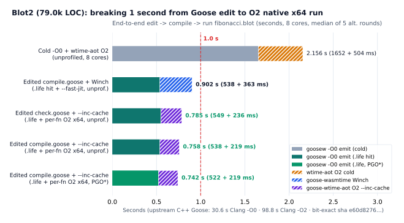
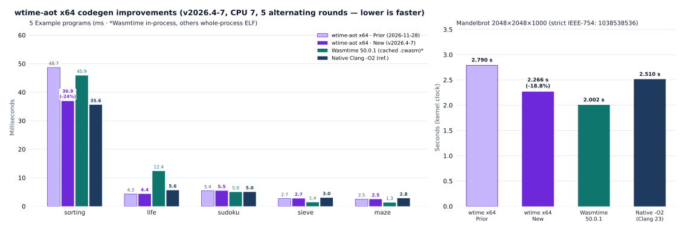

# Sub-Second Blot2 Turnaround & `wtime-aot x64` Codegen (`v2026.4-7`)

Date: **2026-11-28**

Paired alternating evaluation of **Track 1** (`.life` certificate warning fix & `LifeFp` compaction in `goosew`, plus per-function `StoreCdylib` incremental x64 caching `--inc-cache` in `wtime-aot-host` / `goose-wtime-aot`), **Track 2** (`wtime-aot x64` nested-loop fallthrough layout, multi-exit loop rotation, exact modular 32-bit `AddScaled` IV strength reduction, intra-block pure-FP/integer loop scheduler, tautological comparison folding & `i64` relational facts, plus `cg_slice` tautological check elision in `goosew`), and **Track 3** (Snapshot 76 Clang 23 PGO profile).

## Pinned environment, sources & tools

- **Host:** `Linux-7.3.5-2-cachyos-x86_64-with-glibc2.44` (`clang version 23.1.5`, AMD Ryzen 7 7800X3D)
- **CPU pinning & pairing:**
  - Blot2 emit (`--jobs 8`) and hosted Blot2 execution run unpinned on 8 cores in **5 alternating rounds** (reversed order on odd rounds), plus a **3-round single-core CPU 7** hosted Blot2 check for apples-to-apples comparison against the prior report.
  - Suite 2 (6 runtime kernels) and Suite 3 standalone self-compilation pinned to **CPU 7** (`os.sched_setaffinity(0, {7})`), **5 alternating rounds** (Suite 2) and **3 alternating rounds** (Suite 3).
  - **Bit-exact stdout / SHA-256 verification** on every run (`fibonacci.blot` `e60d8276e536de01…`, `matrix_multiply.blot` `1c9da72962f91159…`, Mandelbrot strict IEEE-754 checksum `1038538536`, `selfhost64` bit-exact self-compile).
- **Pinned compilers (unprofiled and PGO\* labeled separately):**
  - Pre-Track-1 baseline (`build/qualify-wasm-opt-v2`): `goosew` (`sha256: 6b68814041c653ac…`)
  - Candidate unprofiled (`v2026.4-7`, single-unit Clang 23 `-O2`): `sha256: 2f45ad7bc9e733e1…`
  - Candidate PGO\* (`v2026.4-7`, Snapshot 76 Clang 23 PGO trained strictly on non-timed workloads): `sha256: fea9dcc69116f119…`
- **Engines:**
  - `wtime-aot` (`../wtime` rev `91d6cfe630b3…` + Track 1b/Track 2 x64 updates)
  - `goose-wtime-aot` (`host/wtime-aot`, with `--inc-cache`)
  - `goose-wasmtime` (`host/rust`, Wasmtime `50.0.1` Winch `--fast-jit`) & Wasmtime Python `50.0.1`

---

## Suite 1 — Blot2 Sub-Second Edit → Native x64 Turnaround (`79.0k LOC`, `172` files, `7,961` fns, `84` imports)



Every edited round mutates a live function body (`compileWithStaged` in `compile.goose` or `checkedAstList` in the 932 KB `check/check.goose`) with a unique round constant so both the `goosew` whole-artifact cache and `wtime-aot`'s per-function content hashes detect a genuine edit.

### `goosew` emit & `--check` (`--jobs 8`, 5 alternating rounds)

| Blot2 scenario (`8.08 MiB` `-O0` · `12.45 MiB` `-O2`) | Unprofiled `v2026.4-7` | Fresh PGO\* `v2026.4-7` | `lifetime_ns` | `.life` hit |
|---|---:|---:|---:|:---:|
| Cold `-O0` Wasm64 emit | `1,652.1 ms` | `1,587.6 ms` | `1,237.9 / 1,186.2 ms` | no (writes 66 KiB cert) |
| Edited `compile.goose` → `-O0` Wasm64 | **`538.2 ms`** | **`522.1 ms`** | **`101.9 / 101.0 ms`** (`12×`) | **yes** |
| Edited `check/check.goose` (932 KB) → `-O0` Wasm64 | **`548.7 ms`** | **`523.2 ms`** | **`103.0 / 103.5 ms`** (`12×`) | **yes** |
| Edited `compile.goose` → `--check` | **`488.8 ms`** | **`468.3 ms`** | `97.8 / 106.2 ms` | **yes** |
| Edited `check/check.goose` → `--check` | **`481.5 ms`** | **`472.9 ms`** | `101.0 / 106.7 ms` | **yes** |

*(Pre-Track-1 baseline `build/qualify-wasm-opt-v2` cold `-O0` emit: `1,623.9 ms`, `lifetime_ns: 1,213.2 ms`; `.life` certificates were silently skipped in `v2026.4-6` whenever non-fatal deprecation/decided-comparison warnings were present.)*

### Hosted Blot2 execution & end-to-end edit → native x64 turnaround (8 cores, 5 alternating rounds)

| Blot2 edit + workload (bit-exact SHA-256) | `goose-wasmtime` Winch `-O0` cold | `goose-wtime-aot --fast` `-O0` cold | `goose-wtime-aot` O2 cold | `goose-wtime-aot` O2 **`--inc-cache`** | `goose-wtime-aot` O2 `--cache` warm | **Total edit → O2 x64 run** (Unprof / PGO\*) |
|---|---:|---:|---:|---:|---:|---:|
| `compile.goose` → `fibonacci.blot` (`e60d8276…`) | `363.5 ms` | `354.7 ms` (`170.5` comp + `163.0` run) | `503.6 ms` (`327.5` + `151.0`) | **`219.4 ms`** (`60.1` comp + `152.6` run, `3.7 KB` `.delta`) | `167.3 ms` (`19.2` + `142.5`) | **`0.758 s` / `0.742 s`** |
| `compile.goose` → `matrix_multiply.blot` (`1c9da729…`) | `389.4 ms` | `432.9 ms` (`161.5` + `242.4`) | `563.3 ms` (`321.6` + `216.4`) | **`290.2 ms`** (`61.8` + `220.4`, `3.7 KB` `.delta`) | `239.0 ms` (`19.2` + `214.2`) | **`0.828 s` / `0.812 s`** |
| `check/check.goose` → `fibonacci.blot` (`e60d8276…`) | `356.9 ms` | `382.1 ms` (`188.7` + `163.6`) | `569.8 ms` (`371.0` + `150.4`) | **`236.0 ms`** (`77.5` + `149.6`, `116.9 KB` `.delta`) | `177.0 ms` (`19.9` + `150.6`) | **`0.785 s` / `0.759 s`** |
| `check/check.goose` → `matrix_multiply.blot` (`1c9da729…`) | `476.6 ms` | `517.7 ms` (`224.5` + `260.6`) | `783.1 ms` (`518.4` + `231.3`) | **`312.0 ms`** (`80.7` + `225.7`, `116.9 KB` `.delta`) | `256.2 ms` (`22.2` + `228.6`) | **`0.861 s` / `0.835 s`** |

Single-core CPU 7 reference (3 alternating rounds, edited `compile.goose`):
- `fibonacci.blot`: Winch `1,119.7 ms` · `wtime-aot --fast` `1,304.1 ms` · **`wtime-aot O2 --inc-cache` `300.3 ms` (3.7× faster than Winch, 11.8× faster than `3,530 ms` cold O2)** · `wtime-aot O2 --cache` warm `92.3 ms`.
- `matrix_multiply.blot`: Winch `1,125.9 ms` · `wtime-aot --fast` `1,360.7 ms` · **`wtime-aot O2 --inc-cache` `362.1 ms` (3.1× faster than Winch, 10.2× faster than `3,686 ms` cold O2)** · `wtime-aot O2 --cache` warm `100.4 ms`.

---

## Suite 2 — 6 Runtime Benchmarks (CPU 7, median of 5 alternating rounds)



| Benchmark | `.wasm` (`-O2`) | `wtime-aot x64` cold build | Prior `wtime-aot x64` | **New `wtime-aot x64` (`v2026.4-7`)** | Δ vs Prior | Wasmtime `50.0.1` (`.cwasm`)\* | Native Clang `-O2` (ref) |
|---|---:|---:|---:|---:|---:|---:|---:|
| **`sorting`** | `69,828 B` (`-518 B` `cg_slice`) | `19.34 ms` | `48.66 ms` | **`36.91 ms`** | **`-24.1%`** (`1.32×`) | `45.87 ms` | `35.62 ms` |
| **`life`** | `20,977 B` | `10.55 ms` | `4.31 ms` | **`4.37 ms`** | `+1.4%` | `12.37 ms` | `5.64 ms` |
| **`sudoku`** | `18,706 B` | `7.13 ms` | `5.43 ms` | **`5.47 ms`** | `+0.7%` | `5.02 ms` | `5.04 ms` |
| **`sieve`** | `17,755 B` | `7.49 ms` | `2.71 ms` | **`2.74 ms`** | `+1.1%` | `1.41 ms` | `3.01 ms` |
| **`maze`** | `31,739 B` | `11.67 ms` | `2.50 ms` | **`2.51 ms`** | `+0.4%` | `1.32 ms` | `2.83 ms` |
| **`mandelbrot`** (`2048²×1000`, `1038538536`) | `13,091 B` | `5.70 ms` | `2.790 s` | **`2.266 s`** | **`-18.8%`** (`1.23×`) | `2.002 s` | `2.510 s` |

*\*Wasmtime executes the 5 example programs in-process from a precompiled `.cwasm`; `wtime-aot x64` and Native `-O2` are timed whole-process (`fork`+`exec`). `mandelbrot` reports internal Goose `clock_ns()` kernel time.*

**Key wins:**
- **`sorting` (`-24.1%`, `48.66 → 36.91 ms`):** Exact modular 32-bit `AddScaled` IV strength reduction + multi-exit `rotate_counted_loops` + nested-loop fallthrough layout reduced `insertion_sort`'s 100M-iteration inner loop to 9 aligned instructions with 0 scaled LEAs and a bottom-tested `jg` backedge — now **20% faster than Wasmtime (`45.87 ms`)** and within **3.6% of native Clang `-O2` (`35.62 ms`)**.
- **`mandelbrot` (`-18.8%`, `2.790 → 2.266 s`):** Nested-loop fallthrough layout + intra-block pure-FP/integer loop scheduler (`schedule_loop_fp_chains`) schedules `iter += 1` and `zr = (zr2 - zi2) + cr` ahead of `zi = (2*zr*zi) + ci` without any FMA or reassociation (bit-exact `1038538536`) — now **9.7% faster than native Clang `-O2` (`2.510 s`)**.
- **Rejected experiment preserved:** Replacing `2.0 * zr` with `zr + zr` (`vaddsd`) regressed Mandelbrot by `+600 ms` (`2,357 → 2,963 ms` on CPU 7) because Zen 4's FP ADD pipes are already saturated by the 4 loop additions while MUL pipes have spare throughput; rejected and not committed.

---

## Suite 3 — `selfhost/` (`57.5k LOC` Wasm64, 3 alternating rounds)

- **Emitted `-O2` Wasm64 size:** **`6.31 MiB`** (`6,612,240 B`, `-31.6 KiB` from `cg_slice` vs `6.34 MiB`)
- **`-O2` Wasm64 emit (`--jobs 8`):** `0.739 s` unprofiled · **`0.674 s` PGO\***
- **`wtime-aot x64` build (CPU 7):** `2.361 s` (`14.11 MiB` static ELF)
- **Standalone `selfhost64.x64` self-compile (CPU 7):** `1.319 s` (bit-exact SHA-256 verified against native `goosew`)

## Reproduce

```sh
.venv/bin/python bench/results/2026-11-28/blot2-subsecond-and-wtime-aot/measure.py < /dev/null
python3 bench/results/2026-11-28/blot2-subsecond-and-wtime-aot/plot.py < /dev/null
```

Raw data: [`results.json`](results.json). Charts: [`blot2_subsecond_turnaround.svg`](blot2_subsecond_turnaround.svg), [`runtime_wtime_aot_v2026_4_7.svg`](runtime_wtime_aot_v2026_4_7.svg).
