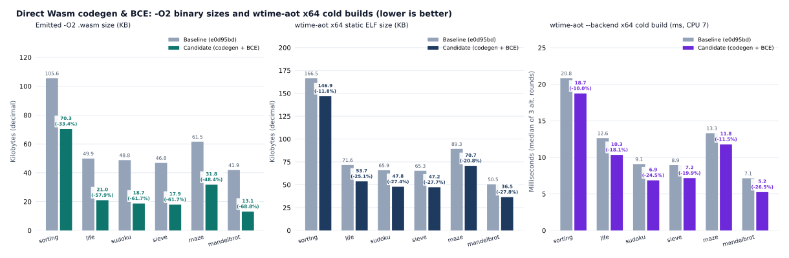
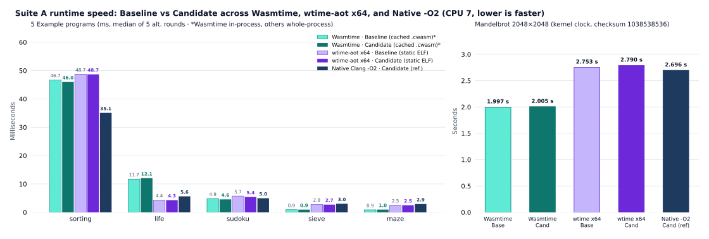
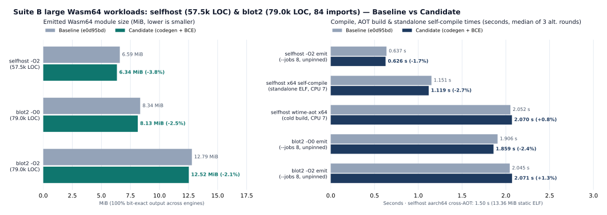
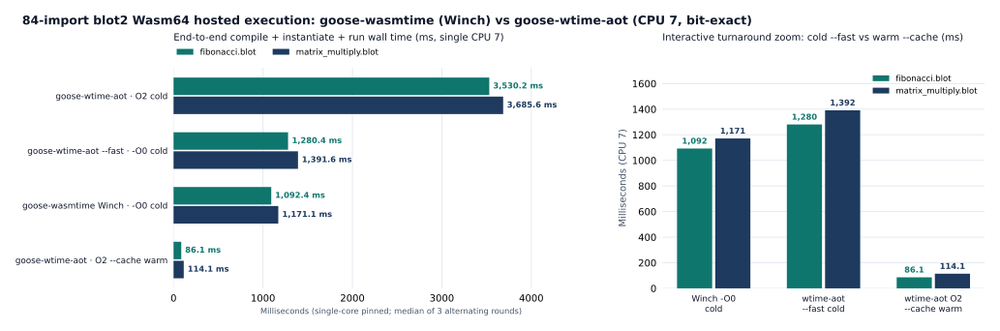

# `wtime-aot` Integration & Direct Wasm Codegen / BCE Optimizations

Date: **2026-11-28**

Paired alternating evaluation of the **Direct Wasm codegen, local-reuse peephole, and bounds-check elimination (BCE)** batch against the immediately preceding qualified commit `e0d95bd` (which wired `wtime-aot` standalone `x64`/`aarch64` targets, `goose-wtime-aot` for 84-import Blot2, and `--runner` selection into `goosew`).

## Pinned environment, sources & tools

- **Host:** `Linux-7.3.5-2-cachyos-x86_64-with-glibc2.44` (`clang version 23.1.5`)
- **CPU pinning:**
  - Runtime, `wtime-aot` builds, and hosted Blot2 runs pinned to **CPU 7** (`os.sched_setaffinity(0, {7})`)
  - Multi-core compiler emission (`--jobs 8`) run unpinned on 8 cores, alternating baseline vs candidate
  - **5 alternating rounds** per workload in Suite A (reversed order on odd rounds), **3 alternating rounds** in Suite B; **bit-exact stdout / SHA-256 verification** on every run
- **Baseline compiler (`e0d95bd`):** `build/qualify-wtime-cli-v2/bootstrap/bin/goosew` (`sha256: ebd41d9f8f28d2bd3914a29a8890683a4bafb20224f53f8fbe163b16a9cf1770`)
- **Candidate compiler (qualified `build/qualify-wasm-opt-v2`):** `build/qualify-wasm-opt-v2/bootstrap/bin/goosew` (`sha256: 6b68814041c653ac2edbb25e33f55b3cb363eaad79ee3cfbbc61f8c232cd128b`)
- **Engines:**
  - Wasmtime Python bindings `50.0.1` (precompiled `.cwasm`, in-process `run_wasmtime.run_module`) & `goose-wasmtime` (`sha256: e0825f4c991a...`)
  - `wtime-aot` (`../wtime` rev `91d6cfe630b3...` + Wasm64/Goose host-import extensions, `sha256: 928fa24170ed...`)
  - `goose-wtime-aot` (`host/wtime-aot`, `sha256: d15c11a42d53...`)

## Changes measured in this batch

1. **Constant fixed scalar array static data copy (`selfhost/codegen.goose`):** Fixed scalar arrays of length `>= 4` (`bool`, plain `i8`–`i64`/`u8`–`u64`, `f32`/`f64`, e.g. `stdlib/std.goose`'s `POW10`, `POW10_U64`, `POW5`, and 648-entry `EISEL_LEMIRE`) emit into a deduplicated static data segment copied via one `memory.copy` instead of thousands of per-element stores and stack frames in `_start`.
2. **Constant-divisor `/` & `%` + redundant 32/64-bit shift masking (`selfhost/codegen.goose`, `selfhost/optimizer.goose`):** Drops Wasm-redundant `& 31` / `& 63` shift masks, eliminates division-by-zero / `INT_MIN / -1` trap guards for positive constant divisors, uses `shr_u`/`and`/`div_u`/`rem_u` when unsigned or optimizer-proven nonnegative (`F_BOUNDS_PROVEN`), uses `x & (2^k - 1)` for all signed Euclidean `%` by powers of two, and branchless `select` for signed non-power-of-two Euclidean `%`.
3. **Direct `br_if` on `if`/`guard` loop exits (`selfhost/codegen.goose`):** Lowers `if cond { break/continue; }` and `guard cond else { break/continue; }` with clean exit targets directly to `br_if` (eliminating nested `block` + `br` in `mandelbrot` and `sudoku`).
4. **Publication mark & local-reuse peephole (`selfhost/codegen.goose`, `selfhost/wasm.goose`):** Records `global.get 11` in `cg_mark_publications`, hoists it out of `cg_loop` and gates it on `regions >= 0`, and deletes post-slot-reuse self-copies (`local.get X; local.set X`) and redundant self-tees (`local.get X; local.tee X`).
5. **Fast `A_FIXED` indexing & stronger BCE (`selfhost/codegen.goose`, `selfhost/optimizer.goose`):** Direct unchecked `A_FIXED` bounds compare without `cg_pack_view`; constant-guard propagation from `x % C`, `x / C`, bounded `+`/`*`, fixed-array accesses (`b.cells[i]` → `i < 81`), 1-arg inlined `F_EARLY` blocks (`box_of(i)`), bounded positive-step `while` induction (`while i * i <= N` with pre-loop bound + `while j <= N { j += i; }` in `sieve`), and `le_only` length aliases (`let mid = xs.len / 2;` surviving immutable-slice calls in `merge_sort`).

## Suite A — 6 Runtime Benchmarks (CPU 7, median of 5 alternating rounds)

### Binary size & `wtime-aot --backend x64` cold AOT build



| Program | `.wasm` Base → Cand | `.wasm` Δ | `x64` ELF Base → Cand | `wtime-aot x64` Cold Build | Build Δ |
|---|---:|---:|---:|---:|---:|
| `sorting` | `105,557 → 70,346 B` | **`-33.4%`** | `166.5 → 146.9 KB` | `20.83 → 18.74 ms` | **`-10.0%`** |
| `life` | `49,877 → 20,977 B` | **`-57.9%`** | `71.6 → 53.7 KB` | `12.63 → 10.34 ms` | **`-18.1%`** |
| `sudoku` | `48,781 → 18,706 B` | **`-61.7%`** | `65.9 → 47.8 KB` | `9.09 → 6.86 ms` | **`-24.5%`** |
| `sieve` | `46,843 → 17,926 B` | **`-61.7%`** | `65.3 → 47.2 KB` | `8.94 → 7.16 ms` | **`-19.9%`** |
| `maze` | `61,526 → 31,757 B` | **`-48.4%`** | `89.3 → 70.7 KB` | `13.31 → 11.78 ms` | **`-11.5%`** |
| `mandelbrot` | `41,894 → 13,091 B` | **`-68.8%`** | `50.5 → 36.5 KB` | `7.14 → 5.25 ms` | **`-26.5%`** |

### Runtime speed (all bit-exact; Mandelbrot checksum `1038538536`)



| Program | Wasmtime Base → Cand (cached)* | `wtime-aot x64` Base → Cand | Candidate Native `-O2` (ref) |
|---|---:|---:|---:|
| `sorting` | `46.69 → 45.97 ms` (`-1.5%`) | `48.68 → 48.66 ms` (`-0.1%`) | `35.08 ms` |
| `life` | `11.73 → 12.06 ms` (`+2.8%`) | **`4.36 → 4.31 ms`** (`-1.1%`) | `5.63 ms` |
| `sudoku` | **`4.86 → 4.57 ms`** (**`-6.0%`**) | **`5.73 → 5.43 ms`** (**`-5.2%`**) | `4.97 ms` |
| `sieve` | `0.91 → 0.94 ms` | **`2.80 → 2.71 ms`** (**`-3.2%`**) | `3.03 ms` |
| `maze` | `0.86 → 0.95 ms` | **`2.53 → 2.50 ms`** (`-1.1%`) | `2.93 ms` |
| `mandelbrot` (2048×2048, kernel) | `1.997 → 2.005 s` (min `1.992 → 1.990 s`) | `2.753 → 2.790 s` (min `2.731 → 2.701 s`) | `2.696 s` |

*\*Wasmtime executes the 5 example programs in-process from a precompiled `.cwasm`; `wtime-aot x64` and Native `-O2` are timed whole-process (`fork`+`exec`). `mandelbrot` reports internal Goose `clock_ns()` kernel time.*

## Suite B — Large Real-World Wasm64 Workloads (3 alternating rounds)



### `selfhost/` (57.5k LOC Wasm64, `--wasm-max-pages 262144`)

| Metric | Baseline (`e0d95bd`) | Candidate | Delta |
|---|---:|---:|---:|
| `-O2` emit (`--jobs 8`, unpinned) | `0.637 s` | **`0.626 s`** | `-1.7%` |
| `.wasm` size (`-O2`, memory64) | `6.59 MiB` (`6,905,752 B`) | **`6.34 MiB`** (`6,643,837 B`) | **`-3.8%`** |
| `wtime-aot --backend x64` build (CPU 7) | `2.052 s` (`14.21 MiB` ELF) | `2.070 s` (`14.13 MiB` ELF) | `+0.8%` |
| Standalone `x64` ELF self-compile (CPU 7) | `1.151 s` | **`1.119 s`** (bit-exact `537d2907bf99…`) | **`-2.7%`** |
| `wtime-aot --backend aarch64` cross-build (CPU 7) | — | **`1.498 s`** (`13.36 MiB` static AArch64 ELF) | — |

### `blot2` (79.0k LOC Wasm64, 84 C/host imports)

| Metric | Baseline (`e0d95bd`) | Candidate | Delta |
|---|---:|---:|---:|
| `-O0` emit (`--jobs 8`, unpinned) | `1.906 s` | **`1.859 s`** | **`-2.4%`** |
| `-O0` `.wasm` size | `8.34 MiB` (`8,743,794 B`) | **`8.13 MiB`** (`8,525,852 B`) | **`-2.5%`** |
| `-O2` `.wasm` size | `12.79 MiB` (`13,407,143 B`) | **`12.52 MiB`** (`13,128,338 B`) | **`-2.1%`** |

Pinned single-core (CPU 7) hosted execution of candidate `blot2` on `goose-wtime-aot` vs `goose-wasmtime --fast-jit` (Winch), bit-exact SHA-256 verified across every engine:



| Blot2 benchmark | Output SHA-256 | Winch `-O0` cold (CPU 7) | `goose-wtime-aot --fast` `-O0` cold (CPU 7) | `goose-wtime-aot` O2 cold (CPU 7) | `goose-wtime-aot` O2 `--cache` warm (CPU 7) |
|---|---|---:|---:|---:|---:|
| `fibonacci.blot` | `e60d8276e536…` | `1,092.4 ms` | `1,280.4 ms` | `3,530.2 ms` | **`86.1 ms`** |
| `matrix_multiply.blot` | `1c9da72962f9…` | `1,171.1 ms` | `1,391.6 ms` | `3,685.6 ms` | **`114.1 ms`** |

*(Note: pinning `goose-wtime-aot` and `goose-wasmtime` to a single core serializes parallel module compilation; unpinned on 8 cores in the separate Batch 1 smoke check, `goose-wtime-aot --fast` cold ran in `533 ms` vs `418 ms` Winch and `--cache` warm in `47.6 ms`.)*

## Qualification

- `build/qualify-wasm-opt-v2/summary.json`: **PASSED in `85.9 s`**
  - `bootstrap`: fixed point verified
  - `conformance`: `10,790 / 10,801` (`0` unexpected)
  - `native-checks`: `54 / 54` ok
  - `conformance-memory64`: `4,771 / 4,779` (`0` unexpected)
  - `unit-tests`: `174 / 174` passed (including 4 new tests in `WasmCodegenAndBceTests`)

## Reproduce

```sh
.venv/bin/python bench/results/2026-11-28/wtime-aot-and-codegen/measure.py < /dev/null
python3 bench/results/2026-11-28/wtime-aot-and-codegen/plot.py < /dev/null
```

Raw measurements: [`results.json`](results.json).
