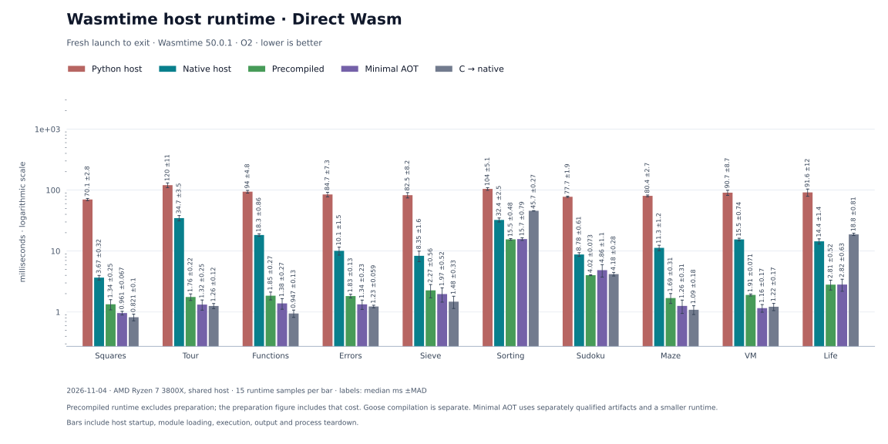
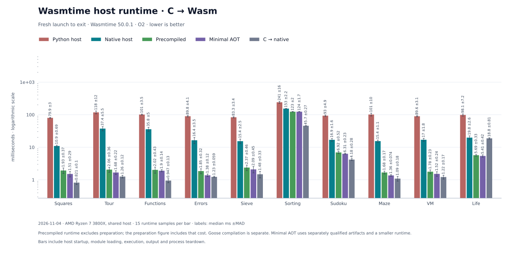
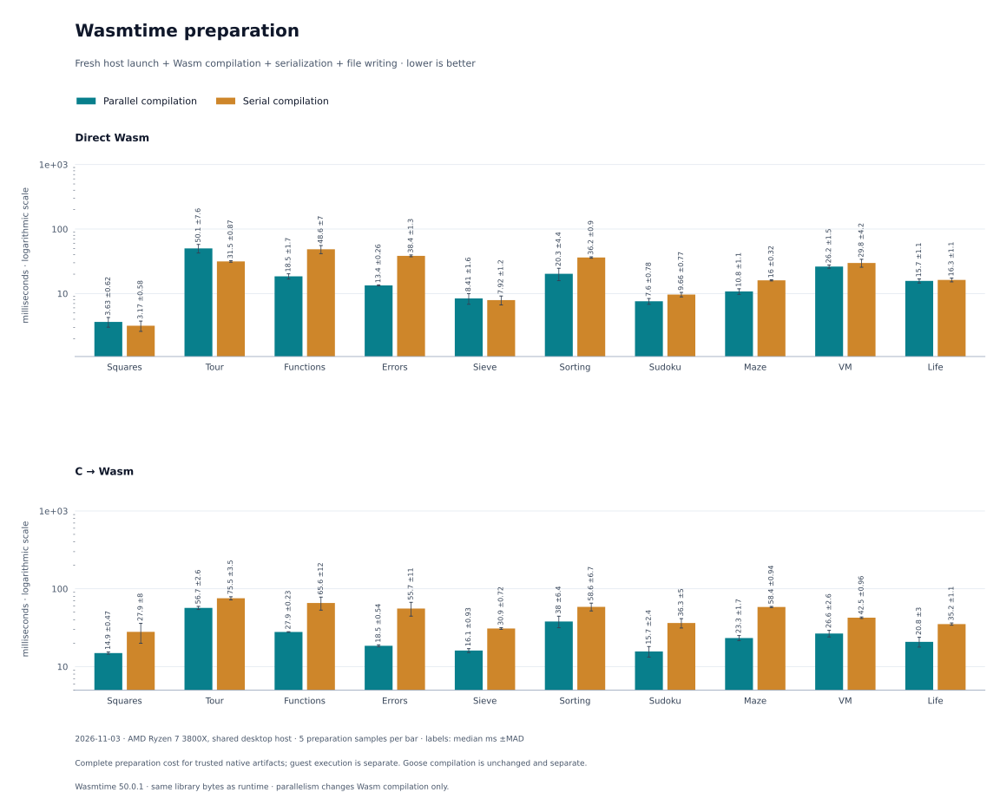
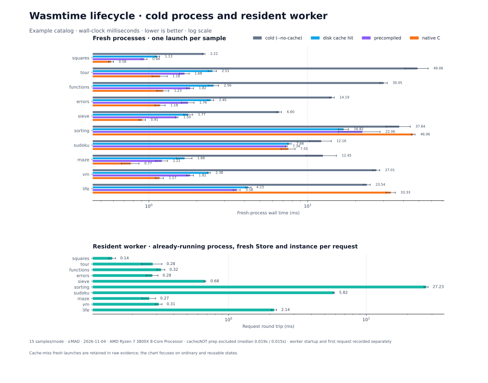

# Wasmtime host comparison

The native C++ host uses the official static Wasmtime 50.0.1 SDK; Python uses its own bindings. The full host supports compilation, caching, precompiled modules and a resident worker. An optional minimal host loads trusted precompiled modules only. Host, callbacks and I/O differ, so timing differences are not Python startup alone. Direct Wasm uses memory32; C-to-Wasm uses memory64.







The November 4 run used a shared AMD Ryzen 7 3800X and compiler `8c09c1a6bcc782de5b86dda621a91ae234acba8fbe108d146582113eb6a110b6`. The broad cohort has one warmup and 15 fresh-process samples per cell, with checked output. Five separate preparations per artifact and configuration measure preparation, which is excluded from AOT execution. Median milliseconds for direct Wasm:

| Example | Cold | Full AOT | Minimal AOT | Native C |
| --- | ---: | ---: | ---: | ---: |
| Functions | 18.321 | 1.853 | 1.384 | 0.947 |
| Sorting | 32.385 | 15.542 | 15.727 | 45.734 |
| Sudoku | 8.783 | 4.020 | 4.861 | 4.183 |
| Life | 14.437 | 2.813 | 2.821 | 18.770 |

The full host is 22,029,544 bytes; the minimal host is 1,412,248 bytes. The minimal profile supports numeric and linear-memory Wasm, including SIMD, tail calls, memory64, bulk memory and multivalue. It excludes GC, reference and function reference types, exceptions, components, concurrency and JIT. Default-profile AOT artifacts cannot be loaded by the minimal host.

A separate 61-round matched Functions comparison measured 1.002 ms for the previous full host, 0.772 ms minimal and 0.666 ms native C. The median paired minimal/full ratio was 0.764 (23.6% lower); minimal/native was 1.158 (15.8% higher). These results and the broader cohort above are separate measurements.

The historical Functions precompiled median of 1.691 ms used Python's timed wait, which introduced an approximately 1 ms polling artifact on this system. The corrected harness uses pidfd; the difference from that historical value includes this method correction. Only matched before/after runs using the corrected harness establish runtime improvement. Lifecycle measurements already used a blocking wait.

[Results, raw samples, preparation and qualification](results/2026-11-04/minimal-aot/README.md) · [Earlier cohort](results/2026-11-04/leaf-and-loads/README.md)

## Runtime lifecycle



The lifecycle cohort uses the full host and measures uncached compilation, an empty SDK cache, a populated SDK cache and precompiled artifacts in fresh processes; a resident session is measured separately. The host charts above also show minimal AOT. The resident session excludes process startup but creates fresh guest state, store and instance on every request. The empty-cache launch includes cache population; precompiled execution excludes artifact preparation.

## Reproduce

Install the [toolchain and optional native host](../docs/GUIDE.md#optional-native-wasmtime-host), including the oracle SDK, then run:

```sh
python bench/examples.py --output-dir build/example-benchmarks
python bench/wasmtime_host.py --example-report build/example-benchmarks/report.json --aot-host build/bin/goose-wasmtime-aot
python bench/wasmtime_host_charts.py build/wasmtime-host/bench/report.json --output-dir bench/charts
python bench/runtime_lifecycle.py --example-report build/example-benchmarks/report.json --output-dir build/runtime-lifecycle
python bench/runtime_lifecycle_charts.py build/runtime-lifecycle/report.json --output build/runtime-lifecycle.svg
```

Chart rendering requires Matplotlib. The lifecycle chart command requires a fresh output path and will not overwrite an existing file. The host benchmark's default output path can be changed with `--output-dir`; use its generated report path for chart rendering. See the [dated evidence](results/2026-11-04/minimal-aot/README.md) for retained raw data and qualification.

To regenerate the qualification baseline and replay from a fresh checkout:

```sh
python bench/qualify_compiler.py --jobs 6 --output-dir build/differential-sharded
python bench/qualify_wasmtime_host.py --baseline-dir build/differential-sharded --output-dir build/wasmtime-host-qualification
python bench/qualify_wasmtime_host.py --baseline-dir build/differential-sharded --aot-host build/bin/goose-wasmtime-aot --backends direct --output-dir build/minimal-host-qualification
python tests/test_native_wasmtime.py
python tests/test_aot_wasmtime.py
```
